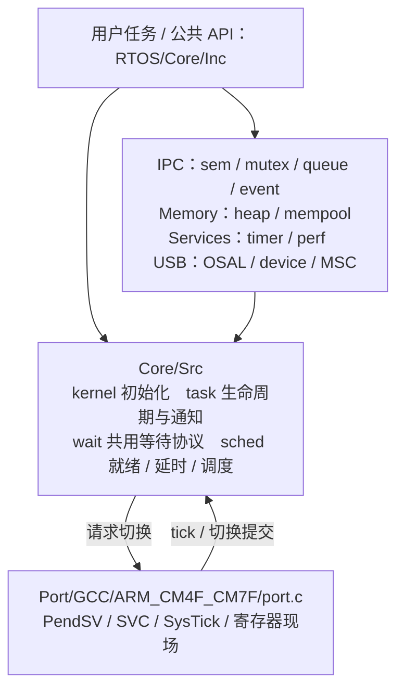

# RTOS — 面向通用 Cortex-M 的自研嵌入式实时内核

一个从零设计、配有[设计文档](docs/rtos_design.md)的可移植抢占式 RTOS：`RTOS/Core/` 提供内核机制，`RTOS/IPC/`、`Memory/`、`Services/` 和 `USB/` 按职责组织功能，`RTOS/Port/` 提供处理器移植层；应用侧附带 USB 设备栈（CDC 虚拟串口 + MSC U 盘 + HID 三合一复合设备）、端侧 AI 推理（int8 量化 CNN 说话人识别）与 HardFault 诊断示例，并配有 FreeRTOS V10.4.6 的[对照分析](docs/freertos_design.md)。

**当前验证平台**：STM32F446RET6（Cortex-M4F @ 168MHz，STM32CubeIDE + GCC）。内核代码不含任何 ST 头文件引用；换一颗 Cortex-M3/M4/M7 芯片只需替换移植层与目标 SDK 工程，见[移植指南](#移植到其他芯片)。

当前功能与边界以[设计手册](docs/rtos_design.md)、[公共API契约](docs/ai/README.md)及源码为准。
[文档导航](docs/README.md)按用途区分现行手册、参考资料和每日日志；历史修复与测试结论统一放在
`docs/logs/YYYY-MM-DD.md`。旧测试工程、构建副本和大批历史结果已清理，保留权威夹具及复测工具，
见[HIL入口](hil/README.md)。历史实测不等于本轮重新验证，物理USB传输仍须单独验证。



> 当前架构、寄存器现场、API 契约及工程集成见 [设计手册](docs/rtos_design.md)，配有状态、等待归属和执行时序图；修复、优化及历史验证结论按日期查阅[文档导航](docs/README.md)。

---

## 内核特性

### 调度

- **32 级抢占式优先级调度**：就绪表用位图 + `__builtin_ctz`（RBIT、CLZ 两条指令）定位最高就绪优先级，O(1) 选择；
- **同优先级时间片轮转**：tick 驱动，可配置关闭；
- **1kHz tick**（可配），`delay` / `delay_until`（周期任务防漂移）两种延时语义；
- **延时管理**：当前使用一条按唤醒 tick 排序的双向链，表头缓存表尾；摘除 O(1)，追加命中快路径时 O(1)，中间插入 O(n)。tick 比较采用带符号差值，有限等待范围见[当前边界](#当前边界与已知限制)；
- **决策/执行分离**：调度决策收口在 `rtos_sched.c`，切换执行统一由 PendSV 完成——决策在临界区内、切换在临界区外，天然合并多次切换请求。
- **挂起与切换保护**：调度挂起支持嵌套，挂起期间冻结内核 tick 并拒绝新阻塞；PendSV 提交切换前重新检查候选任务的状态。
- **临界区事务保护**：默认 BASEPRI 配置下，BASEPRI 屏蔽 syscall 域中断，PRIMASK 仅在进出事务中保护共享元数据；调用者更强的 BASEPRI 及原 PRIMASK 状态得到保留。出口 ISB 同步解屏蔽与后续执行，避免阻塞结果被提前读取。NMI/HardFault 不得调用临界区原语或操作内核对象；详见[设计手册第 4.5 节](docs/rtos_design.md#45-临界区-进出与屏障)。

### IPC（五种机制，语义各有分工）

| 机制 | 文件 | 语义要点 |
|---|---|---|
| 信号量 | `rtos_sem.c` | 二值/计数；存在等待者时计数为零，give 优先把令牌交给等待者，避免重复计数 |
| 互斥锁 | `rtos_mutex.c` | 有界求解锁依赖图，传播并撤销继承；递归溢出返回错误，删除持锁任务时移交；ISR 禁用，循环死锁仍需应用避免 |
| 消息队列 | `rtos_queue.c` | 环形缓冲 + 拷贝传递；ISR 投递非阻塞 |
| 事件组 | `rtos_event.c` | ANY/ALL 等待 + CLEAR_ON_EXIT + 满足位回传（信箱模式） |
| 任务通知 | `rtos_task.c` | 通知值内嵌 TCB，无需独立 IPC 对象或对象等待链；有限超时仍使用内核延时链 |

信号量使用等待者优先级位图，队列、互斥锁及事件组使用有序等待链。位图定位优先级不代表整条等待链操作为 O(1)：信号量尾插、寻找候选和清理共享优先级位仍可能扫描链表。

### 内存

- **静态资源与动态任务共存**：`rtos_task_create_static` 使用调用方提供的 TCB 和栈，`rtos_task_create` 从通用堆分配 TCB 和栈；IPC 对象及队列存储由调用方提供，USB OSAL 使用固定对象池；
- 双档固定块 USB 堆（小块 64B / 大块 512B）：分配 O(1)，释放为检测重复归还而做有界扫描，最坏 O(n)；通用堆使用 first-fit 和相邻高地址块合并。

### 可观测性（调试即功能）

- **性能监视器**（`rtos_perf.c`，DWT 周期级精度）：CPU 占用率、每任务运行时间、切换频率、调度延迟、栈高水位（0xA5 染料法）；
- **栈溢出双检测**：栈底 magic 字 + 边界检查两档；
- **HardFault 诊断与九类故障示例**：保留 BusFault、INVSTATE、UNDEFINSTR、DIVBYZERO、非对齐、栈边界及 ISR 故障示例；当前 `task_uart` 中的命令派发被注释，需启用 `ft_dispatch` 后按菜单触发，见 [hardfault_debug.md](docs/hardfault_debug.md)。

## USB 子系统

基于 **CherryUSB 裁剪版**（仅保留 CDC/MSC/HID 设备栈 + DWC2 端口，共 6 个 `.c`），通过 [rtos_usb_osal.c](RTOS/USB/rtos_usb_osal.c) 的 26 函数 OSAL 契约对接自研内核：

- **三合一复合设备**：单 USB 口同时枚举出虚拟串口（CDC ACM）+ 32KB RAM 盘 U 盘（MSC）+ 自定义 HID（64B IN/OUT 报告）；
- **静态对象池 OSAL**：信号量/互斥锁/队列/线程/定时器全部池化，无堆分配；
- **DWC2 自定义 FIFO**：适配 F446 OTG_FS 的 320 字 FIFO 与 6 端点限制（三类功能共需 4 个 IN 端点，靠同端点号不同方向复用解决）；
- MSC 后端三个回调（`get_cap/sector_read/sector_write`）即存储介质抽象——当前是 RAM 盘，换 SPI Flash / SD 卡只改这三个函数。

完整移植步骤（OSAL 契约、胶水层、换芯片 IP 的 DCD 契约）见 [rtos_design.md 第十三章](docs/rtos_design.md)。

## 端侧 AI：int8 量化说话人识别

一条从训练到 MCU 推理的完整 TinyML 流水线，演示"RTOS 事件驱动 + 端侧推理"的组合：

下图描述应用预留的数据路径。当前 `main.c` 中音频攒帧与事件置位代码被注释，默认固件的 `algo_task` 等待事件，不会仅因串口收到 2048 字节就自动运行推理。

```
训练侧(PC)                                部署侧(MCU)
voice_classifier.pth ──cnn2c.py──▶  ai_param.c/h   int8 权重数组(约130K参数)
  (PyTorch, 1D-CNN)     --quant int8  ai_app.c/h    量化推理运行时
                                    conv.c/h      Conv1d/BN/ReLU/MaxPool/Linear 算子
                                        │
USART2 音频字节流 ─▶ uart2_rx_queue ─▶ task_uart 攒满 2048 字节
                                        │ rtos_event_set(位0x01)
                                        ▼
                              algo_task 被事件唤醒
                              ai_forward_u8(audio_buf, logits, &class_id)
                              → "无人声 / 其他人 / 注册说话人1 / 注册说话人2"
                              → 打印类别与推理耗时(tick)
```

- **模型**：1D-CNN 说话人分类器（3 个 Conv+BN+ReLU+MaxPool 块 → FC 4032→32→4），4 类输出；
- **[cnn2c.py](AI/model/cnn2c.py)**：通用的 PyTorch→C 转换脚本——递归遍历模型按实际层生成代码，不固定网络结构；`--quant int8` 生成**动态量化**版本（激活 scale 每帧在线计算，无需校准数据集）；
- **推理接口**：`ai_forward()`（float 输入）/ `ai_forward_u8()`（uint8 输入，省一次转换），返回 logits 与 argmax 类别；
- `algo_task`、USB 和诊断任务由 RTOS 调度；启用音频输入路径后可进行业务验证。各任务共享地址空间，当前内核不提供 MPU 内存隔离。

## 移植到其他芯片

内核与硬件的全部耦合收敛在两处：

1. **`RTOS/Port/` 移植层**（当前提供 GCC/ARM_CM4F_CM7F，已在 F446 Cortex-M4F 上验证）：负责 PendSV/SVC 上下文切换、BASEPRI 或 PRIMASK 临界区和 tick。预定义宏用于选择部分处理器特性，不替代新目标的完整适配和验证；M0/M0+ 需要对应端口，不能仅修改屏蔽宏就视为移植完成；
2. **`rtos_config.h`**：配置 tick 频率、性能注册表容量、BASEPRI 阈值及功能裁剪。目标 MCU 的中断优先级位数、FPU 和缓存契约仍需结合 SDK 核对；本轮实板验证平台为 F446RE。

内核不提供启动文件/链接脚本/时钟配置——这些属于目标 SDK（如 CubeMX 工程）的职责，集成时需加入 `RTOS/Core/Src/`、所用功能目录与对应 `Port/` 源码，并配置公共和私有头文件搜索路径；手工源码清单的迁移要求见[源码导览](RTOS/README.md#工程迁移与兼容)。USB 子系统换其他 USB IP（fsdev/chipidea 等）的完整移植步骤见 [rtos_design.md 第十三章](docs/rtos_design.md)。

## 演示工程（STM32F446RET6 验证平台）

| 项 | 值 |
|---|---|
| MCU | STM32F446RET6（Cortex-M4F @ 168MHz，LQFP64） |
| 控制台 | USART2 @ PA2(TX)/PA3(RX)，115200-8N1 |
| USB | OTG_FS @ PA11(DM)/PA12(DP) |
| IDE | STM32CubeIDE 1.13+（GCC arm-none-eabi） |

默认日常固件创建以下任务；测试变体通过 `FIRMWARE_*` 宏选择，默认关闭自测、性能和压力任务：

| 任务 | 演示内容 |
|---|---|
| `task0` / `task1` | 每 1000 / 500 tick 打印运行信息 |
| `task_uart` | 接收 USART2 队列字节；命令派发及音频攒帧当前被注释 |
| `algo_task` | 等待音频事件后推理；默认没有音频事件生产者 |
| `task_usb_cdc` | 虚拟串口回显 |
| `task_usb_msc` | U 盘扇区读写统计 |
| `task_usb_hid` | 每秒 64B HID 输入报告，输出报告回显 |
| `ft1`~`ft8` | 阻塞等待故障触发通知；第九类由 USART2 ISR 执行，需先启用命令派发 |

## 快速开始

1. **导入**：STM32CubeIDE → File → Import → Existing Projects，选择本仓库根目录（工程名 `f446_rtos`）；
2. **编译烧录**：Build → 下载 `Debug/f446_rtos.elf`（CherryUSB 头文件路径已在 `.cproject` 配好）；
3. **观察与验证**：
   - USART2（115200-8N1）应输出系统初始化菜单及 `task0` / `task1` 周期信息；
   - 若需要故障或音频演示，先在 `task_uart` 启用对应输入处理，再单独验证；故障触发后需复位；
   - USB 配置预期提供 **CDC + 32KB RAM 盘 + HID**。需连接目标 OTG_FS 数据接口，并实际检查枚举、控制请求和传输；ST-LINK 虚拟串口日志不能替代这些验证。

## 目录结构

```
.
├── Core/                     # 演示应用层（CubeMX 生成 + 手写演示）
│   ├── Src/main.c           # 任务编排/USB/AI推理/HardFault测试/命令菜单
│   ├── Src/usb_otg.c        # OTG_FS 时钟 GPIO NVIC(HAL 层 glue)
│   └── Src/stm32f4xx_it.c   # 中断向量(HardFault 诊断入口/USB ISR 挂接)
├── RTOS/
│   ├── README.md             # 源码导览、阅读顺序与构建迁移说明
│   ├── Core/
│   │   ├── Inc/              # 兼容既有公共 API、类型和配置头
│   │   ├── Private/          # rtos_internal.h：内核模块间协议
│   │   └── Src/rtos_{kernel,sched,task,wait}.c
│   ├── IPC/                  # sem / mutex / queue / event
│   ├── Memory/               # heap / mempool；公共 rtos_mem.h 名称保留
│   ├── Services/             # timer / perf
│   ├── USB/                  # OSAL / 复合设备 CDC+HID / MSC 后端
│   ├── Port/GCC/ARM_CM4F_CM7F/ # port.c：PendSV/SVC/屏蔽与上下文
│   └── lib/third/CherryUSB/   # 裁剪版 CDC/MSC/HID/DWC2 设备栈
├── AI/                      # ★ 端侧 AI 流水线
│   ├── model/cnn2c.py       # PyTorch→C 转换工具(支持 int8 动态量化)
│   ├── model/voice_classifier.pth  # 训练好的说话人分类模型
│   └── output/int8/         # 生成的 C 推理代码(param/app/算子库, 已编入固件)
├── docs/                    # 现行手册、AI契约、参考资料与logs每日日志
├── hil/                     # 权威测试夹具、复测工具与最新AI编译证据
├── Drivers/                 # ST HAL + CMSIS(Apache-2.0, 仅演示工程用)
└── .cproject / .project     # CubeIDE 工程配置
```

> `Core/` 与 `Drivers/` 属于 F446 演示工程。移植需要加入内核及端口源码、配置启动与中断，并核对时钟、栈、FPU 和内存布局后执行验证。

## 配置裁剪

全部开关集中在 [`RTOS/Core/Inc/rtos_config.h`](RTOS/Core/Inc/rtos_config.h)，常用项：

| 宏 | 默认 | 说明 |
|---|---|---|
| `RTOS_CONFIG_TICK_RATE_HZ` | 1000 | tick 频率 |
| `RTOS_CONFIG_MAX_PRIORITIES` | 32 | 优先级数（决定就绪表 RAM） |
| `RTOS_CONFIG_MAX_TASKS` | 16 | 用于派生性能注册表容量，不是内核静态任务池或创建数量上限 |
| `RTOS_CONFIG_PERF_TASK_REGISTRY_SIZE` | 18 | 默认 `MAX_TASKS + 2`；超过容量的任务仍可创建，但注册表观测不完整 |
| `RTOS_CONFIG_USE_TIMERS` | 1 | 控制定时器自动初始化；关闭不自动移除定时器实现 |
| `RTOS_CONFIG_USE_PERF_MONITOR` | 1 | 性能监视器（DWT 周期级） |
| `RTOS_CONFIG_CHECK_FOR_STACK_OVERFLOW` | 2 | 栈溢出检测（0/1/2 三档） |
| `RTOS_CONFIG_USE_USB` | 1 | USB 子系统总开关 |
| `RTOS_CONFIG_USB_USE_MSC` / `_USE_HID` | 1 / 1 | 复合设备裁剪（全关 = 仅 CDC） |
| `RTOS_CONFIG_USE_BASEPRI` | 1 | 1 使用 BASEPRI 临界区，0 使用 PRIMASK；两种配置均在 F446 上验证，不能据此推断已有 M0/M0+ 端口 |

## 文档

从[文档导航](docs/README.md)选择阅读路径，常用入口如下：

| 入口 | 用途 |
|---|---|
| [设计手册](docs/rtos_design.md) | 当前架构、不变式、IPC、端口、USB、资源预算和边界 |
| [AI项目入口](AGENTS.md) / [API契约与检索](docs/ai/README.md) | 精确原型、调用上下文、生命周期、示例与调试指南 |
| [源码导览](RTOS/README.md) | 目录职责、阅读顺序和手工构建集成 |
| [故障诊断](docs/hardfault_debug.md) | 异常寄存器、栈帧与现有故障示例 |
| [HIL说明](hil/README.md) | 当前夹具、编译/采集入口及验证限制 |
| [测试方法与教训](docs/rtos_testing_report.md) / [历史性能参考](docs/rtos_performance_report.md) | 旧测量的适用范围、失效结论和测试器教训 |
| [FreeRTOS设计参考](docs/freertos_design.md) / [编译原理](docs/compilation_pipeline.md) | 专题学习资料 |
| [每日日志](docs/README.md#daily-logs) | 按日期汇总修复、结果、失败和清理记录 |

## 当前边界与已知限制

- **有限等待范围仍为 `1..0x7FFFFFFF` tick**（1kHz 下最大约 24.8 天）：当前调度器只有一个 `delay_head`，维护一条双向延时链；未实现 current / overflow 双延时链。`rtos_sched_block()` 将更大的等待值设为永久等待，`0xFFFFFFFF` 是 `RTOS_WAIT_FOREVER`。软件定时器拒绝超过有限范围的周期，USB 毫秒转换饱和到该上界；`delay_until` 调用方也应遵守有限周期范围，详见[设计手册的延时与定时器章节](docs/rtos_design.md)；
- **tick 回绕与有限范围是两个问题**：当前采用有符号差值比较来处理限定范围内的跨回绕等待；不能据此声称支持任意 32 位有限延时；
- **延时链中间插入为 O(n)**，表尾快路径需新唤醒点不早于当前表尾，周期任务并非必然命中；
- **继承不提供死锁检测**：当前会沿锁依赖传递及撤销捐赠；循环锁依赖仍须采用统一加锁顺序或有限超时，图重算成本随锁和等待者数量增长；
- **通用堆释放时仅尝试合并紧邻的高地址空闲块**，不会向低地址查找或循环合并整段连续空闲块，长期分配仍需关注碎片。

完整债务清单与 FreeRTOS 逐项对照见 [freertos_design.md 第十二章](docs/freertos_design.md)。

## 第三方组件

| 组件 | 目录 | 许可 |
|---|---|---|
| CherryUSB（裁剪版） | `RTOS/lib/third/CherryUSB` | Apache-2.0 |
| STM32 HAL / CMSIS | `Drivers/` | Apache-2.0 |

自研内核与应用代码的许可由仓库作者声明（待补充 LICENSE 文件）。
