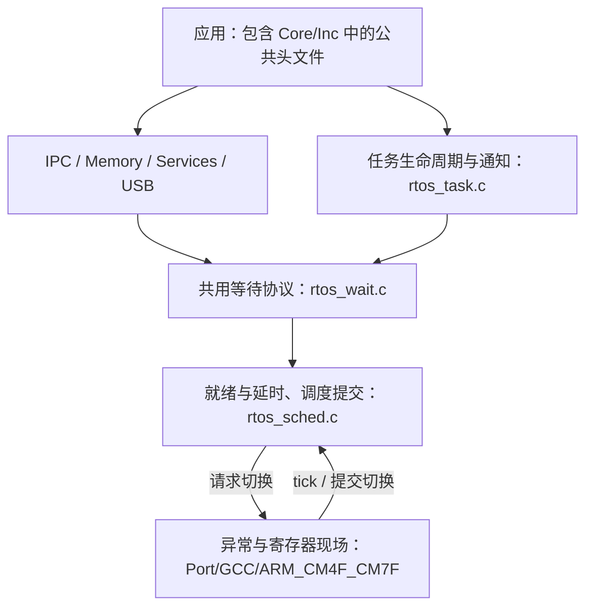

# RTOS 源码导览

自研实现按共享状态的归属组织，公共头文件统一保留在 `Core/Inc/`。源码目录分别对应内核机制、IPC 对象、内存、后台服务、USB 适配和处理器端口；第三方 CherryUSB 保留独立边界。

```text
RTOS/
├── Core/
│   ├── Inc/                       # 公共 API、公共类型、配置和端口接口
│   ├── Private/rtos_internal.h     # 模块间私有协议，不是应用 API
│   └── Src/
│       ├── rtos_kernel.c          # 初始化编排、启动入口、版本和默认弱钩子
│       ├── rtos_sched.c           # 就绪/延时结构、tick、调度决策和切换提交
│       ├── rtos_task.c            # TCB 生命周期、通知、挂起/恢复和延期回收
│       └── rtos_wait.c            # 共用等待链、阻塞登记、唤醒和优先级重挂
├── IPC/
│   ├── rtos_sem.c                 # 信号量计数与令牌授予
│   ├── rtos_mutex.c               # 互斥所有权、递归与传递优先级继承
│   ├── rtos_queue.c               # 环形队列、阻塞发送/接收与单次拷贝交接
│   └── rtos_event.c               # 事件位条件、ANY/ALL 和消费式清位
├── Memory/
│   ├── rtos_heap.c                # first-fit 通用堆及相邻块合并
│   └── rtos_mempool.c             # 固定块池；公共头文件仍为 rtos_mem.h
├── Services/
│   ├── rtos_timer.c               # 软件定时器命令队列和服务任务
│   └── rtos_perf.c                # DWT 记账、观察注册表和统计查询
├── USB/
│   ├── rtos_usb_osal.c            # RTOS 句柄封装、对象池、USB 堆与 usb_osal_*
│   ├── rtos_usb_device.c          # 复合设备描述符、CDC/HID、F446 FIFO 策略
│   └── rtos_usb_msc.c             # MSC RAM 盘后端与扇区统计
├── Port/GCC/ARM_CM4F_CM7F/port.c   # Cortex-M4F/M7F 上下文和异常处理
└── lib/third/CherryUSB/           # 裁剪后的第三方设备栈及 DWC2 驱动
```

## 模块为什么这样划分

`rtos_kernel.c` 负责把系统建立起来，`rtos_sched.c` 负责运行中的时间和调度，`rtos_task.c` 持有任务地址登记链及延迟释放链。任务通知直接操作 TCB，并依赖任务身份校验，因此继续放在任务模块。`rtos_wait.c` 提取原本散在任务模块中的共用等待机制，供 IPC、超时清理和优先级继承使用。

信号量、互斥锁、队列和事件组共享等待协议，但分别管理令牌、所有权、消息和位条件，继续保留四个实现文件。合并这些对象会扩大单文件职责，不能消除它们的语义差异。通用堆和固定块池同属内存管理，但分配算法、元数据与时延不同，因此只归入共同目录，不合成一个分配器。

就绪环与延时链共同复用 TCB 链接字段，到期处理直接把任务送回就绪集合，仍由调度器统一维护；本次不为减少文件行数增加新的热路径接口。USB 的两层 OSAL 封装合并到一个文件；CDC/HID 共享设备会话、描述符和回调状态，保持在设备文件中；MSC 存储后端单列，便于替换为实际介质。



箭头说明主要协作，不表示严格无环的依赖图。对象模块也会读写 TCB；任务删除需协调互斥锁和堆；初始化入口调用服务模块。内部协作声明集中在 `Core/Private/rtos_internal.h`，共享状态和保护规则见[设计手册](../docs/rtos_design.md)。

## 建议阅读顺序

1. 从 [rtos.h](Core/Inc/rtos.h)、[rtos_types.h](Core/Inc/rtos_types.h) 与 [rtos_task.h](Core/Inc/rtos_task.h) 建立 API、TCB 和等待节点模型。
2. 读 [rtos_kernel.c](Core/Src/rtos_kernel.c) 的初始化顺序，再读 [rtos_sched.c](Core/Src/rtos_sched.c) 的 `rtos_sched_start/schedule/commit_context_switch`。
3. 对照 [port.c](Port/GCC/ARM_CM4F_CM7F/port.c) 与 [rtos_port.h](Core/Inc/rtos_port.h)，区分调度候选、临界区解除和实际异常切换。
4. 沿 [rtos_sem.c](IPC/rtos_sem.c) 的一次 `take/give` 跟进 [rtos_wait.c](Core/Src/rtos_wait.c)，再追踪 tick 超时及 task 的挂起、删除、改优先级路径。
5. 按业务继续读互斥继承、队列交接、事件位、定时器及内存；USB 从 OSAL、设备会话到 MSC 后端依次阅读。

## 工程迁移与兼容

公共函数名、公共头文件名及 `Core/Inc/` 路径保持兼容，包括固定池仍使用 `#include "rtos_mem.h"`。本次仅改变源码归属，不借目录整理调整对象布局、TCB/汇编协议或临界区算法。

自行维护编译清单的工程必须同步源码新路径，并移除旧条目，避免缺失或重复链接。`Core/Src/rtos_mem.c` 对应新 `Memory/rtos_mempool.c`；原 USB 两个文件对应新 `USB/` 三文件；旧 `Port/GCC/ARM_CM7/port.c` 对应 `Port/GCC/ARM_CM4F_CM7F/port.c`。不能只收集 `Core/Src/` 就认为已经包含全部 RTOS 功能。

内核及需要私有协议的测试编译需增加 `Core/Private/` 头文件搜索路径；应用继续以公共头文件为入口。`rtos_internal.h` 不是兼容 API，依赖它的外部测试或私有扩展需调整 include 搜索路径。不要为解决编译错误把内部声明复制到应用头文件。

F446 演示工程的启动文件、链接脚本、HAL/CMSIS 和中断配置仍位于仓库顶层 `Core/` 与 `Drivers/`。处理器端口目录名表示实现适用范围，不能据此推断所有 M7 型号、FPU/缓存配置均已完成硬件验证。USB 设备文件中的 FIFO 划分属于 F446 DWC2 集成策略，移植时需重新核对。

历史 HIL 证据保留测试时的旧路径和源码身份；它们说明当时的验证范围。本次目录重组后的编译和板上回归应以新一轮日志为准，不能把历史 PASS 自动当作新布局已验证。测试入口见 [HIL 说明](../hil/README.md)。

本轮文件映射、编译结果、测试迁移纠正与清理记录见[2026-10-27 源码重组记录](../docs/rtos_source_reorganization_20261027.md)。
