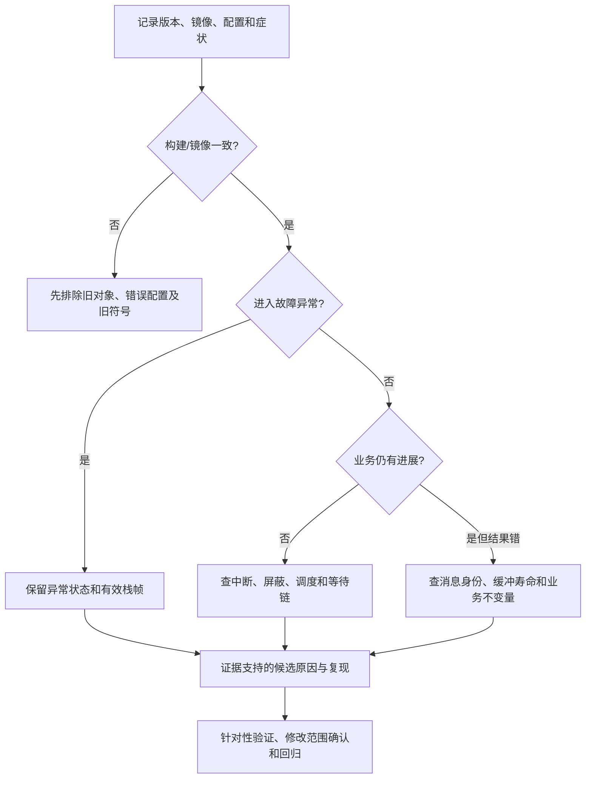

# AI 调试指南

适用基线`87bfbe4a6efc50f9b828128c713a1b5af2900ef8`，F446、Cortex-M4F、单核。
本页给出可人工执行的诊断过程，不是新增采集器、固件诊断服务或自动修复功能。
下列GDB命令是说明，未作为本轮使用示例的编译/运行对象；本轮实际验证范围查
[每日记录](../logs/2026-10-28.md)及[编译工具](../../hil/ai_docs/README.md)。

## 1. 先确认分析对象

开始排障先填写以下信息，再依据[API索引](api_index.json)查相关契约：

| 项目 | 必须记录的内容 |
|---|---|
| 源码与配置 | 当前提交、未提交改动、相关宏实际取值、生成头/构建参数；不要只记录RTOS_VERSION_STRING |
| 镜像 | 实际编译ELF及其身份、链接脚本/map、目标芯片、主频、tick频率；装载的符号必须匹配被测镜像 |
| 工具 | 编译器、调试服务器和Python/PowerShell版本、实际命令、退出码及完整输出 |
| 硬件 | 探针/串口、板卡供电、外设及接线、主机连接；ST-LINK串口不等于MCU USB数据链路 |
| 症状 | 预期行为、实际行为、首次出现位置、复现输入/频率、是否修改过IRQ优先级或屏蔽寄存器 |
| 采样 | 运行/停机、断点位置、当前异常、采样时间、是否清过状态/复位、外设是否继续运行 |

先保留现场再复位。读出或清除具有副作用的外设寄存器之前，查该芯片参考手册。
停核不一定停止DMA、定时器和看门狗，断点采样可能改变故障时序；多次运行中读取也不
天然形成同一瞬间的快照。无法证明关联时，将字段标为未知，而不是填零或拼成根因。

## 2. 最小决策流程



输出应区分“已观察事实”“候选解释”“已复现根因”“尚缺证据”。命中某种症状不代表
对应的历史BUG必然复现；修复应说明哪条不变量被破坏、触发条件及反例验证。

## 3. 构建成功但运行不是预期版本

1. 检查实际编译命令和所有参与链接的对象，不根据脚本名字猜配置。
2. 本基线`build_fw.ps1 -Clean`调用make清理；Windows缺少兼容rm时，make可忽略失败。
   比对对象重编译数量和日志，必要时仅在核实的Debug绝对路径内原生删除生成对象。
   不清理源文件、原始证据、其他本地资料或未核实的目录。
3. 同一make目标更换宏不一定触发重编译。变体stamp主要处理已实现的变体流程，不能
   据此证明手工改过的所有配置已生效；旧的第三方/BSP对象也可能残留。
4. 核对烧写校验、实际ELF与串口结束标记。缺少结束行时报告采集不完整，不能将最后
   一个PASS当作整套通过。
5. `restore_project.ps1 -Rebuild`恢复规范规则并重建，不能单凭这个开关证明全量清理。

编译/链接脚本与使用方法见[HIL入口](../../hil/README.md)。该历史说明包含当时环境，
例如本地Git换行设置应通过`git config --show-origin --get core.autocrlf`查实际值，不能
照旧文字假定true。源码换行改变会影响身份，不应为匹配新文件而重写历史清单。

## 4. 程序仍运行，但中断或业务没有进展

按以下证据链检查，不以“没有HardFault”作为正确性结论：

1. **外设是否产生事件**：时钟、触发源、外设中断使能和实际输入是否满足预期。
2. **IRQ是否具备执行条件**：向量映射、NVIC使能/挂起/活动、优先级、PRIGROUP，
   以及当前PRIMASK/BASEPRI/FAULTMASK和正在执行的异常。
3. **处理函数是否执行**：使用可关联的既有计数/序号或明确的断点证据，不把pending
   位直接当作ISR已完成；多个事件可能在一个pending位中合并。
4. **RTOS是否推进**：`sched_state`、tick变化、`suspend_depth`、就绪集合及current/next。
5. **交接是否成功**：消息/通知/信号量返回结果、队列是否满、消费者是否就绪、对应
   数据序号是否完整。业务预期频率和期限必须由业务提供，内核不能自行推断。

可用GDB先列出实际支持的寄存器，再读取本版本已有全局对象：

```gdb
info all-registers
p/x rtos_port_crit_nest
p/x rtos_port_saved_mask
p rtos_kernel.sched_state
p/x rtos_kernel.tick_count
p rtos_kernel.suspend_depth
p/x rtos_kernel.ready_bitmap
p rtos_kernel.current_tcb
p rtos_kernel.next_tcb
x/wx 0xe000ed04
```

最后一条读取F446的SCB ICSR。BASEPRI/PRIMASK/CONTROL/PSP/MSP/xPSR等寄存器的名字和
可用性取决于调试服务器；不支持时报告缺失，不自动执行目标函数或注入代码代替。
这些表达式只读已有对象；不要在GDB中调用`rtos_perf_get_system()`、IPC或分配函数来
“顺便查状态”，目标函数会改变窗口/状态，甚至在停机上下文阻塞。

**屏蔽值不是单独的故障判据。** 本端口允许调用者先设置更严格的屏蔽，最外层临界区
退出后恢复它。`rtos_port_crit_nest==0 && BASEPRI!=0`可能属于合法调用者状态；
反之nest非零时发现屏蔽也可能正处于合法事务。必须关联采样指令、调用者约束、
当前异常及后续中断进展，排除短暂发布窗口，再用精确交错或真实IRQ回归验证。

本基线调度挂起时`rtos_sched_tick()`不推进普通tick处理；不能看到tick停滞就直接
断定SysTick硬件失效。`current_tcb`是内核已发布指针，PendSV提交后到异常返回前CPU
仍在Handler，不能由这个指针单独证明目标任务已执行。

## 5. 任务阻塞、优先级异常和消息错误

| 观察现象 | 优先核对 | 不能直接推断 |
|---|---|---|
| 高优先级任务未运行 | 有效priority/base_priority、ready位图、挂起深度、屏蔽和PendSV是否挂起 | 低优先级任务运行即调度器坏了 |
| mutex等待很久 | 所有者是否活跃、递归次数、持有锁链及传递继承关系 | 有等待环就一定会永久死锁，或所有timeout都能立即解环 |
| queue返回TIMEOUT | 是NO_WAIT满/空还是实际等待超时；每次send/recv结果和序号 | 数据已丢失、或等待一定经过了给定时长 |
| event_wait返回非目标位 | 按掩码检查条件，核对消费式清位、超时快照和取消语义 | 返回值是rtos_status_t，或非零一定成功 |
| 通知丢计数 | VALUE覆盖、BIT合并、INCREMENT计数、等待输出及消费规则 | 每次notify必对应一次独立业务处理 |
| timer删除后仍有活动 | 命令是否仅接纳、服务任务是否消费、回调是否结束 | delete返回OK就是存储可释放 |
| heap/mempool偶现异常 | 实际边界、对齐、尺寸、配对分配器、旧指针及同址复用 | magic或重复释放检查能撤销所有悬空指针 |

观察TCB/等待节点前先检查地址、对齐、对象寿命和访问范围。不得在损坏链上无界遍历。
同优先级ready结构本来就是环；等待链的预期结构与它不同。设置访问预算并保存访问
地址集合，达到预算或不可信地址时停止，报告未完成而不是继续解引用。

应用不能直接修链表、清`blocked_on`或改嵌套计数来“让系统跑起来”；这会破坏唤醒、
超时和优先级继承之间的共同协议。相关逐项规则见[IPC契约](contracts_ipc_memory.md)
和[任务/调度契约](contracts_kernel.md)。

## 6. HardFault和异常返回

先保存PC/LR/xPSR、异常入口的EXC_RETURN、MSP/PSP、SCB CFSR/HFSR/SHCSR、BFAR/MMFAR
及有效位；确认可读范围后再读取帧。针对当前ELF用addr2line/反汇编映射PC/LR，记录
优化级；不能用其他构建的地址反查结果解释现场。

F446寄存器定义见[本机CMSIS](../../Drivers/CMSIS/Include/core_cm4.h)。架构解释参照
[Arm Cortex-M4指南](https://documentation-service.arm.com/static/5f2ac76d60a93e65927bbdc5)
的故障处理及异常章节，寄存器细节参照
[ST PM0214](https://www.st.com/resource/en/programming_manual/pm0214-stm32-cortexm4-mcus-and-mpus-programming-manual-stmicroelectronics.pdf)。

- 故障处理器未使能时可升级为HardFault；不能据此假定CFSR必不记录原始原因。
- BFAR/MMFAR只有对应有效位成立时才作为有效故障地址使用。状态可能来自更早事件，
  保留第一份现场，不先清标志。
- 非精确总线错误的堆栈PC不一定是实际出错写指令。栈入栈/出栈错误也可能使保存帧
  不完整；不能未经检查就按固定八个字解引用。
- 区分硬件异常帧、FPU扩展及本端口软件保存区。TCB保存的top_of_stack不是总能当作
  当前运行任务的实时PSP；按EXC_RETURN及实际端口布局分析。
- 故障处理中的再次故障仍可能导致lockup；软件嵌套标记不能保证阻止这种架构行为。

当前`Core/Src/stm32f4xx_it.c`故障报告保留旧栈用量显示算法，不能把显示的`Used`直接
当作正确用量。向下增长栈的瞬时使用量需要按有效SP与`base + stack_size*4`的关系计算，
先检查边界；历史高水位、TCB缓存SP和现场实时SP分别表示不同量。

异常适配应核对启动向量与最终反汇编。port中的naked入口依赖EXC_RETURN和栈布局，
不能随意通过普通C函数调用包装。当前BSP中SVC/PendSV的C定义含asm分支，具体是否
产生前后序指令应以该优化级的目标码确认；这是移植核对点，不是本轮已复现运行缺陷。

[原故障手册](../hardfault_debug.md)含历史示例与设计解释，使用前核对当前实现及本节
校正，不能把示例整段覆盖到已集成工程。本轮不修改异常处理代码。

## 7. USB、性能与时间判断

USB的`is_connected`当前反映已配置状态，不证明主机打开CDC端口。read/write返回0
可能有多个原因，检查实际长度、初始化顺序、IRQ映射、端点忙和物理连接，不能唯一
解释成超时。只有实际枚举及收发证据才构成物理互操作验证，寄存器/OSAL测试另列。
F446的FIFO/缓存策略不证明M7 D-cache或其他控制器已适配，参照[USB契约](contracts_services_usb.md)。

默认`PERF_HOTPATH_STATS=0`，完整热点运行时间/延迟指标不可按开启时解释。
此时`get_system`给出CPU=0、idle=10000（100.00%）的占位组合，不能据此认定系统实际全空闲。
`get_system`会推进统计窗口，不能频繁调用后仍用旧窗口解释CPU%。DWT计数器会回绕，
长间隔和统计字段溢出可能影响结果；最大观测值不是WCET。
本实现的perf TCB查询没有通用活跃身份验证，删除后旧指针不能因为“只是查询”就使用。

约24.8天是当前推荐单条有限等待的上限，约49.7天是1kHz的32位tick回绕周期，均不
表示系统到时自动结束运行。tick、DWT周期、毫秒换算及计数器字段分别核对。

## 8. 复现与交付清单

先提出能区分候选原因的最小实验，再选择已有HIL夹具。涉及端口时至少核对屏蔽保存、
阻塞返回、合法及非法IRQ优先级；涉及IPC时核对超时、删除、挂起、重建、竞争和输出。
加入能被验收器检出的指定负例，避免以“日志有很多PASS”替代覆盖判断。

每次交付报告：版本/配置/目标、触发条件、证据、期望/实际、修改范围、验证命令、
正常与负向结果、未验证范围及日常固件是否恢复。只编译、部分链接、宿主模拟、
寄存器观察和真实HIL分别列明；缺探针/串口、工具启动失败和缺结束行不计成功。

本阶段仅核对源码与编译文档示例。没有新增运行时故障记录器、等待解释API、采集服务
或模型推理代码，也不把文档中的检查流程称为已执行的硬件测试。
