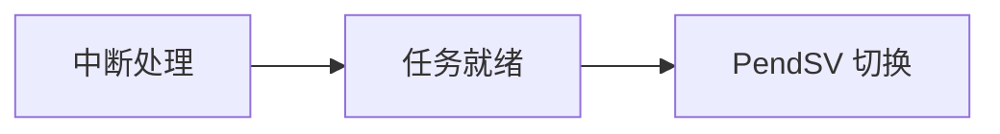

# 文档插图的来源与维护

本目录保存当前设计手册引用的 PNG。每张可重新生成的图，其唯一来源是相应 Markdown 文档内的 Mermaid 代码块；PNG 是提供给不支持 Mermaid 的查看器使用的渲染结果。另有明确标记的原生 Mermaid 图，直接由 Markdown 查看器显示。修改架构图时先修改源码块；涉及 PNG 时再渲染并检查图片，不直接修改 PNG。

## 图文配对与稳定命名

需要导出 PNG 的 Mermaid 代码块前必须紧邻一个独立的 Markdown 图片链接，中间可留空行，也可加入一行 `<details><summary>图形源码（mermaid）</summary>`。例如：

````markdown


<details><summary>图形源码（mermaid）</summary>



</details>
````

图片名称取自明确的 `images/<文件名>.png` 链接，与代码块的出现顺序无关。已有 `rtos_design_02.png` 等仍被引用的历史名称继续保留；新增图建议按主题命名，例如 `rtos_design_irq_wakeup.png`。编号不连续也合法，插入图时不需要重编号。

只在支持 Mermaid 的查看器中直接显示的图，在代码围栏前添加独立标记 `<!-- diagram:inline -->`。脚本检查其图源非空、围栏闭合，不为它生成 PNG；未加该标记的 Mermaid 块仍须遵守图文配对规则。该标记用于明确文档展示方式，不能用来跳过需要维护的现有 PNG。

脚本要求配对图片直接位于 `docs/images/`，拒绝跨目录链接、重复输出名称、缺失配对、空图源和未闭合的 Mermaid 代码块。同一次调用的不同文档也不能使用同一输出名，避免覆盖其他图。

## 校验与离线渲染

脚本从自身所在目录定位文档，工作目录可任意选择。只校验图文配对时不需要 Node.js 或浏览器，也不会修改文档、图片或创建临时文件：

```powershell
& .\docs\gen_diagrams.ps1 -Docs rtos_design -ValidateOnly
```

渲染使用已经安装的 Node.js、Mermaid CLI 和本地浏览器。显式提供 CLI 入口与 Puppeteer 配置路径，脚本不会通过 `npx` 下载依赖。下面使用示意工具目录；请替换为本机实际安装位置：

```powershell
$renderArgs = @{
    Docs = @('rtos_design')
    NodePath = 'C:\Program Files\nodejs\node.exe'
    MermaidCliPath = 'C:\tools\mermaid-cli\src\cli.js'
    PuppeteerConfig = 'C:\tools\mermaid-cli\puppeteer.json'
}
& .\docs\gen_diagrams.ps1 @renderArgs

# 只更新所列图片；仍先校验全部图源的配对关系。
& .\docs\gen_diagrams.ps1 @renderArgs -OnlyImages rtos_design_irq_wakeup.png
```

Puppeteer JSON 配置必须通过 `executablePath` 指向已经存在的浏览器，例如：

```json
{
  "executablePath": "C:\\Program Files\\Google\\Chrome\\Application\\chrome.exe"
}
```

请按本机环境配置浏览器参数；脚本将配置原样传给 Mermaid CLI。历史渲染记录使用 CLI **10.9.1**；旧机器的临时浏览器配置及图源工作目录已清理。调用者应在自己的临时或工具目录创建配置，并显式提供 `-PuppeteerConfig`，不能假定工程中存在可复用的机器配置。

脚本先在独立临时目录渲染，确认 Node.js 返回成功且产物具有 PNG 文件头后，才替换对应图片。解析或渲染失败会以非零退出状态报告，并保留该图的旧文件。`-FixLinks` 仅保留为兼容参数：它执行同样的配对校验，不再改写链接或自动编号；链接变更应由作者在文档中明确完成。

## 发布前复核

渲染成功只说明图源可以生成图片。发布前还应打开 PNG，检查文字是否完整、箭头方向和图例是否准确，并与本文引用的当前源码核对。历史报告沿用的文件名不代表当前架构版本；某张历史图没有配对 Mermaid 图源时，脚本不会重新生成或覆盖它。

典型维护顺序为：修改图源与配套正文 → `-ValidateOnly` → 仅渲染受影响图片 → 打开图片复核 → 检查 Git 差异。图片链接和 Mermaid 图源应随同一文档变更一起提交，保持读者看到的图片与图源一致。

2026-10-28已删除无正文引用的01/12/13号旧图、不再匹配现行完整端口流程的10号历史图，以及数据与历史表格不一致的性能图；旧测量值和失效口径见[性能参考](../rtos_performance_report.md)。当前不保留base64嵌图副本或专用分发转换脚本。
