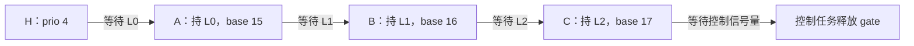
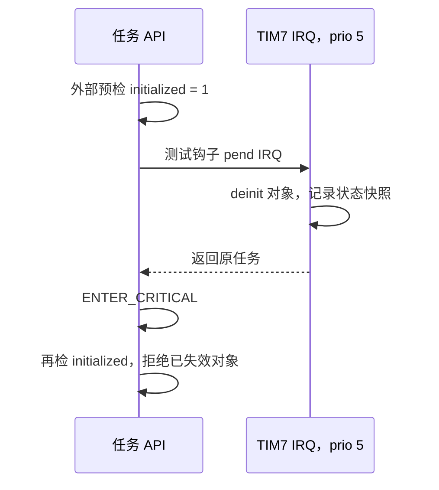

# RTOS 对抗时序与复杂依赖回归记录（2026-10-26）

本文记录 2026-10-25 夜间至 2026-10-26 的新增实板测试与修复。已完成故障复现、三类修复、60 个新配置镜像、74 个端口回归镜像、完整功能回归及 900 秒业务压力测试；最终独立校验为 PASS，日常固件已恢复。测试依据是本工程源码、板上 USART2 输出和烧录/采集记录。这里的 PASS/FAIL 是断言数量，不是独立测试用例数量，也不能解释为已经证明不存在其他缺陷。

## 1. 目标与证据要求

此前 BASEPRI 问题说明，仅验证常规返回值、单对象竞争或长时间不崩溃，可能漏掉很短的抢占窗口和复杂依赖关系。本轮增加两种可重复构造的条件：任务间的多级锁依赖，以及合法 ISR 在对象预检和临界区之间执行 deinit。另以队列、信号量、事件、通知和互斥锁组合场景检查结果与资源守恒。

测试平台为 NUCLEO-F446RE / STM32F446，保留原接口，串口使用 COM3、115200 baud。测试固件通过 ST-LINK 烧录，UART 采集必须收到对应 `DONE` 终止标记；超时、无终止标记或存在 FAIL 均不能判为通过。原始证据位于 [hil/adversarial_20261025](../hil/adversarial_20261025/)，日期目录沿用测试开始时间。

采用的判据包括：真实阻塞状态、有效优先级、所有权身份、消息哨兵、成功次数、存储计数、对象等待链与超时链清理，以及返回后的 BASEPRI、PRIMASK 和临界区嵌套深度。各固件输出中的检查项目应与源码共同阅读；不能只统计“未崩溃”或“串口仍有输出”。

## 2. 已取得的实板结果

| 测试 | 修复前 PASS / FAIL | 修复后 PASS / FAIL | 规模与结论 |
|---|---:|---:|---|
| AM：多级互斥锁依赖 | 801 / 109 | 每镜像 910 / 0，12 镜像通过 | 15 个场景，依赖深度 2、3、6；复现并修复传递继承及撤销传播缺陷 |
| OF：对象生命周期抢占窗口 | 8 / 72 | 每镜像 80 / 0，12 镜像通过 | 8 轮 × 10 个场景；复现并修复预检后 deinit 的状态竞争 |
| AW：多任务与 ISR 混合等待 | 1600 / 0 | 每镜像 1600 / 0，12 镜像通过 | 8 轮，73 个阶段，120 次 syscall IRQ 请求；最终修复版本已复跑 |
| AMB：递归边界、所有权移交与有限环 | 84 / 3 | 每镜像 87 / 0，12 镜像通过 | 复现递归计数回绕和环上的传递继承问题 |
| AR：满注册表与删除多锁持有者 | — | 每镜像 259 / 0，12 镜像通过 | 真实构造 8 个当前 owner 加 1 个已脱离 owner，以及两把锁的连续所有权移交 |

对应日志：

- AM：[基线](../hil/adversarial_20261025/baseline/log_mutex_chain_baseline.txt)、[修复后 O2](../hil/adversarial_20261025/evidence/log_mutex_graph_o2.txt)。
- OF：[基线](../hil/adversarial_20261025/baseline/log_object_lifetime_baseline.txt)、[修复后 O2](../hil/adversarial_20261025/evidence/log_lifetime_fixed_o2.txt)。
- AW：[基线](../hil/adversarial_20261025/baseline/log_wait_mix_baseline.txt)、[最终 O2 示例](../hil/adversarial_20261025/evidence/matrix_final/log_aw_basepri_a1_O2.txt)。
- AMB：[基线](../hil/adversarial_20261025/baseline/log_mutex_boundary_baseline.txt)、[修复后 O2](../hil/adversarial_20261025/evidence/log_mutex_boundary_fixed_o2.txt)。
- 完整修复矩阵：[48 镜像索引](../hil/adversarial_20261025/evidence/matrix_final/matrix_results.json)；AR：[12 镜像索引](../hil/adversarial_20261025/evidence/registry/registry_results.json)、[O2 示例](../hil/adversarial_20261025/evidence/registry/log_registry_basepri_a1_O2.txt)。

每个套件均覆盖 BASEPRI/PRIMASK × 断言开/关 × O0/O2/O3 的 12 种组合。前四个套件共 **48 个镜像、32,124 项检查通过**；AR 另有 **12 个镜像、3,108 项检查通过**。新增复杂场景合计 **60 个实板镜像、35,232 项检查通过**，全部收到各自正常终止标记。这是已执行配置矩阵的结果，不代表全部可能配置或所有输入空间。

每组测试另有 `run_*.json`、`flash_*.txt` 和构建记录，用于将串口结果与当次固件关联。JSON 中的 ELF 摘要用于追溯被烧录文件身份，不是正确性判据，也不是安全认证结果。

基线不是将整个工程退回早期版本：保留上一轮 BASEPRI 修复，仅对目标模块保留故障版本。AM 和 AMB 对应 [rtos_mutex.c.before](../hil/adversarial_20261025/baseline/rtos_mutex.c.before)；OF 对应同目录四个 `*.hooked_before_lifetime_fix` 快照，已包含 PI 修复和专用注入入口，但没有临界区内初始化复检。历史固件和串口日志保留原样，不以当前源码摘要覆盖旧身份。最终配置矩阵另为每个镜像保存完整源码清单并验证构建前后未变。

## 3. 缺陷一：多级优先级继承与撤销没有完整传播

### 3.1 复现方法与旧行为

[adversarial_mutex.c](../hil/fw/Src/adversarial_mutex.c) 仅通过公开 API 建立锁依赖，不直接改写 TCB 优先级或等待节点。任务 `owner[i]` 持有 `mutex[i]` 后等待 `mutex[i+1]`；最深层持有者阻塞于控制信号量。控制任务确认每级任务真正处于对应锁的等待状态，再创建优先级 4 的高优先级等待者。持有者基础优先级为 15～20，数值越小优先级越高。



正确结果要求 H 的捐赠沿整条持有者依赖传播。H 超时、挂起、删除或改变基础优先级后，所有仍受其影响的持有者也必须更新；资源最终释放后，各任务恢复各自基础优先级，锁无残留持有者。

深度 2、3、6 分别执行正常授予、超时、挂起/恢复、删除、等待者优先级调整，共 15 个场景。基线的具体失败包括 `high_inheritance actual=15 expected=4 depth=2`，以及深层持有者的 `initial_chain`、`timeout_withdrawal`、`suspend_withdrawal`、`delete_withdrawal` 和 `changed_waiter` 不符合预期。总计 109 个断言失败，说明原先只处理直接关系的重算不足以维护完整依赖。

### 3.2 修改方案

[rtos_mutex.c](../RTOS/Core/Src/rtos_mutex.c) 增加有界的全图优先级重算。图节点为注册互斥锁的不同持有者，并可附加刚释放最后一把锁的旧持有者；边表示某个等待任务向该锁持有者捐赠优先级。

每次重算都从各节点的 `base_priority` 初始化临时结果，遍历注册锁的全部等待者并进行松弛，最多执行节点数轮，稳定后提前结束。先在临时数组中求解，再更新任务有效优先级、就绪链和对象等待链，避免边求解边发布临时下降值。放锁、任务删除移交所有权时，先完成旧所有权撤销和新所有权登记，再根据最终依赖重算。

从基础优先级重算是必要条件：若直接使用旧有效优先级，循环依赖中的两个任务可能相互保留已经撤销的外部捐赠。该算法处理继承值传播和撤销；它不会使循环等待自动获得进展，业务仍须规定锁顺序或有限超时。

修复后相同 15 个场景为 **910 PASS / 0 FAIL**，并收到 `AM|DONE|status=0`。这项结果覆盖上述依赖深度和动作，不构成任意任务图的形式化证明。

## 4. 缺陷二：对象预检与临界区之间存在 deinit 竞争

### 4.1 可重复的真实 ISR 时序

[adversarial_lifetime.c](../hil/fw/Src/adversarial_lifetime.c) 使用专用编译开关，在 thread API 已读到 `is_initialized=1`、但尚未首次进入内核临界区的位置调用测试钩子。钩子只触发一次真实 TIM7 NVIC 中断，优先级为 5；IRQ 执行该对象的合法 deinit 并记录销毁后状态。对象始终使用静态存储，测试不释放内存。



测试记录 `IPSR=71`、NVIC priority=5、IRQ 入口 BASEPRI=0、PRIMASK=0，并要求 hook、IRQ 和窗口内执行计数均符合单次注入约束。没有将普通函数调用或伪造 ISR 标志当作中断验证。

每轮覆盖 sem give/take、queue send/recv、event set/clear/ready-wait、mutex take/give，以及不满足条件的有限 2 tick event wait。正确结果为状态型 API 返回 `RTOS_ERR_PARAM`、event API 返回 0；对象计数/位/索引/所有权保持 deinit 快照，queue 接收输出哨兵不变，不能新增死对象等待。

旧代码仅在临界区外检查 initialized，基线出现销毁后仍增加/扣减 sem count、修改 queue count 和数据、改写接收输出、设置/清除 event bits，以及给已销毁 mutex 登记 owner 等行为。不满足条件的 event wait 还实际阻塞到 2 tick 超时；仅看最后等待链为空会漏掉这一错误，因此判据同时要求立即拒绝。80 个场景中 72 个失败；其余 8 个为 mutex give，原有 owner 检查恰好拒绝了已清除 owner 的对象，不能据此推断其他入口安全。

### 4.2 修改与责任边界

sem、queue、event 和 mutex 相应入口保留临界区外快速预检，同时在首次进入临界区后、读改对象业务状态或登记等待之前再次验证 initialized。修复后 **80 PASS / 0 FAIL**，对象快照和接收哨兵均保持，空 event 场景立即返回，并收到 `OF|DONE|status=0`。

此修复只同步对象状态，不能解决已释放地址的访问。应用必须保证对象、queue storage 和在途 item 缓冲仍然有效；在调用者或 ISR 仍可能访问期间，不允许释放或重用这些存储。测试钩子用于确定性覆盖窄窗口，不代表生产固件保留注入行为。

## 5. 缺陷三与补充边界：递归计数回绕、移交与有限循环依赖

[adversarial_mutex_boundary.c](../hil/fw/Src/adversarial_mutex_boundary.c) 的递归边界通过测试夹具将已持有锁的计数置为 `UINT32_MAX`，模拟此前已经完成这么多次递归获取，然后只执行下一次真实 `rtos_mutex_take`。这是明确标记的白盒边界注入，不是实板逐次执行了 2³² 次调用。夹具收尾恢复计数只用于安全清理，不作为内核修复。

基线下一次 take 返回成功且计数变为 0；修复在增加计数前检查上界，返回 `RTOS_ERR_OVERFLOW`，保留 `UINT32_MAX` 和原 owner。测试另以公开 API 删除持锁任务，确认锁已预移交给最高优先级等待者、新持有者仍继承剩余等待者优先级，以及最终获取顺序、真实所有权和基础优先级恢复正确。

有限循环场景中，两任务各持一锁并等待另一锁，再由外部高优先级任务等待其中一把锁。验证外部捐赠在环内传播、外部超时后撤销到应有值，最终由真实有限超时打破循环并释放锁。该场景没有把“继承正确”解释为“内核解决死锁”。基线 **84 PASS / 3 FAIL**，失败为递归返回值、递归计数和一个环内继承检查；修复后 **87 PASS / 0 FAIL**，收到 `AMB|DONE|status=0`。

## 6. AW 综合等待场景覆盖

[adversarial_wait.c](../hil/fw/Src/adversarial_wait.c) 使用控制任务与不同优先级 worker，由合法 priority 5 TIM7 ISR 执行非阻塞 IPC；另有 priority 0 TIM2 硬件定时背景负载。TIM2 ISR 不调用 RTOS API。该组合同时覆盖 syscall 域中断和可抢占内核临界区的更高优先级硬件中断。

| 阶段 | 业务与主要判据 |
|---|---|
| 空队列接收竞争 | 两个不同优先级接收者等待容量 1 队列；IRQ 分别发送唯一消息，检查唤醒顺序、内容和无重复交付 |
| 满队列发送竞争 | 两个发送者阻塞，IRQ 逐次接收；检查原消息及两个发送者消息顺序，一次空位只授予一个发送者 |
| 信号量单次 give | 三个等待者竞争；只允许一个成功，其余有限超时；晚到 give 恰好存为一个 token，无幽灵令牌 |
| Event ANY/ALL + CLEAR | 高优先级 ANY 立即消费匹配位，低优先级 ALL 必须等后续条件凑齐；按本 RTOS 的逐优先级即时清位契约判断 |
| 通知增量与独立等待 | 同次 IRQ 多次 increment 累加并只消费一次；任务等 event 时收到 notify VALUE，不能错唤醒 event，稍后应保留该值 |
| 对象删除 | IRQ deinit 有接收等待者的队列；等待者返回 `ERR_DELETED`，输出缓冲哨兵不变 |
| 超时后迟到消息 | 接收超时后才发送；旧目标缓冲不能被改写，消息留在队列且只能被读取一次 |
| 持锁者阻塞与超时撤销 | 低优先级持锁者同时等其他信号量；高优先级等待者使其继承，超时后恢复，最后确认所有权与等待链清理 |

基线及最终矩阵的每个镜像均为 8 轮合计 **1600 PASS / 0 FAIL**，73 个阶段、120 次 syscall IRQ 请求。最终矩阵的 12 种配置全部通过。计数包含各阶段不变量检查，不能与 AM 的 15 个场景或 OF 的 80 个场景直接相加为独立用例数。AW 的实际等待使用有限预算，控制等待另有 tick/DWT 上界；若内核完全无法返回，仍由主机采集超时判失败。

AW 每阶段可删除并重建 worker，未单独证明同一 TCB 连续经历 sem→event→queue 的全部重用组合。AM 部分正常授权/取消场景有永久业务等待，依靠控制任务释放、取消和有界观察；不能将全部测试描述为“每一个 wait 均为有限超时”。

## 7. AR：满注册表边界与删除多锁持有者

[adversarial_registry.c](../hil/fw/Src/adversarial_registry.c) 在默认 `MAX_MUTEXES=8` 下执行两个场景。worker 只通过公开 API 改变任务与锁状态，控制任务在保护下观察内部不变量；没有通过改写 TCB 或锁字段合成依赖。场景中的等待均设置有限预算，观察与收尾也有界。

`saturated_handoff` 先让 8 个不同任务各持一把已注册锁，第 9 个高优先级任务等待锁 0。旧 owner 释放后，锁预移交给第 9 个任务，其余 7 个 owner 仍持各自锁。这时全图重算同时需要 **8 个当前持有者加 1 个已不持锁的旧持有者**，实际使用 `M+1` 暂存容量边界。`AR|GRAPH|phase=m_plus_one` 记录 `registered=8`、`distinct_current_owners=8`、`old_owns=0`，旧任务从继承值恢复为 base 15，新 owner 为 worker 8、有效优先级 4。日志中的 `detached_owner=0` 是旧 worker 的编号，不是空指针。

`deleted_multi_owner` 让一个任务同时持有锁 0、1，每把锁各有两个不同优先级等待者，再通过真实 `rtos_task_delete` 删除该 owner。两锁先分别移交给 worker 1、2。随后将二者基础优先级降低到 20、21，要求它们仍分别继承剩余等待者的 6、7；再逐条释放，验证另一条链保持原继承，最后所有锁和等待链为空。O2 示例的五条 `AR|HANDOFF` 是：

| 阶段 | 锁 | 实际 owner | 剩余等待者 | 实际/预期有效优先级 |
|---|---:|---:|---:|---:|
| deleted | 0 | worker 1 | 1 | 6 / 6 |
| deleted | 1 | worker 2 | 1 | 7 / 7 |
| released | 0 | worker 3 | 0 | 6 / 6 |
| other_chain_retained | 1 | worker 2 | 1 | 7 / 7 |
| released | 1 | worker 4 | 0 | 7 / 7 |

每镜像 **259 PASS / 0 FAIL、2 个场景**，12 个配置镜像全部通过。断言还检查 API 返回、获取时真实 owner、完成令牌、基础优先级恢复和清理。图容量测试不只是确认“未越界/未崩溃”，删除场景也不只是确认“某个等待者醒来”。

## 8. 既有回归与业务压力结果

端口窄窗口测试已完成 **74 个实板镜像**：mask matrix 12、blocking 12、nesting 6、guard 44，索引中的全部运行通过；证据保存在 [evidence/port](../hil/adversarial_20261025/evidence/port/)。这次使用最终内核重新执行，不能用上一轮的通过结果替代本轮证据。

[功能回归索引](../hil/adversarial_20261025/evidence/regression/regressions_functional.json) 中的 5 项均已完成：audit、selftest、boundary、lowlevel 和无测试钩子的 benchmark。selftest 输出 `432 PASS / 0 FAIL` 加 10 条信息记录；boundary 为 `103 / 0`；lowlevel 的 LC 为 `24 / 0`、PC 为 `22 / 0`。benchmark 数值只描述当次配置与负载，不作为最坏时延保证。

[业务压力索引](../hil/adversarial_20261025/evidence/regression/regressions_production.json) 中，队列容量 1、8、32 的三组正常业务负载均运行 30 秒，分别为 **165 PASS / 0 FAIL、worker_errors=0**。负向对照通过主动破坏消息校验验证故障检测有效：正式重跑实际报告 `checksum_errors=1`、`worker_errors=1` 与 3 条预期 FAIL，执行器据预定义负向契约将其验收为通过。这些 FAIL 是夹具故意注入后的检测结果，不能将负向对照写成“无错误正常负载”。

负向对照的第一次采集没有被冒充为正式最终结果：采集后，一个未编入该 production 镜像的 AR 夹具声明发生变化，使“全部输入源码清单”的严格身份检查不一致；内核与 production 源码未改变。原 ELF、日志、源码清单和原因继续保留在 [superseded_negative](../hil/adversarial_20261025/evidence/regression/superseded_negative/)，[原因记录](../hil/adversarial_20261025/evidence/regression/superseded_negative/superseded_reason.json) 标明不接受原采集作为最终证据。源码冻结后正式重跑成功；没有跳过或放宽摘要比较来接受旧记录。这属于证据身份失效，不是已经复现的内核失败。

900 秒业务 soak 于本轮 00:31 后启动，现已完成并取得完整日志及 `DONE`；最终消息守恒、资源清理和恢复记录见第 12 节。

## 9. 成本与未覆盖边界

全图重算在内核临界区内执行，成本随注册锁、不同持有者、等待者及松弛轮数增长；还包含应用新优先级时的就绪/等待链重挂。BASEPRI 模式下，syscall 域 ISR 会被延后，更高优先级硬件 ISR 仍可运行。正确性修复不能被宣传为常数时间优化。

本轮 `MAX_MUTEXES=8` 时，`mutex_refresh_priority_graph` 的编译器静态栈帧为下表。`m0/m1` 分别表示 `RTOS_CONFIG_USE_BASEPRI=0/1`，`a0/a1` 表示断言关闭/开启；证据为 [evidence/compile 中的逐配置 .su](../hil/adversarial_20261025/evidence/compile/)。

| 配置 | O0 | O2 | O3 |
|---|---:|---:|---:|
| m0_a0：PRIMASK、断言关闭 | 112 B | 128 B | 160 B |
| m0_a1：PRIMASK、断言开启 | 112 B | 128 B | 136 B |
| m1_a0：BASEPRI、断言关闭 | 112 B | 128 B | 160 B |
| m1_a1：BASEPRI、断言开启 | 112 B | 128 B | 136 B |

这些数值不含完整调用链、异常上下文和 ISR 嵌套，也不是运行时总栈峰值或所有任务栈的安全上界。图暂存数组使用栈，不新增动态堆分配；增大 `RTOS_CONFIG_MAX_MUTEXES` 后需重新检查栈和临界区时延。

有限的实板回归不能检测或排除所有缺陷。当前证据不覆盖任意图规模、任意中断相位、长时最坏响应时间、所有配置组合、真实 USB 主机数据交换、DMA/缓存一致性或实际产品业务的端到端恢复协议。对象存储释放协议与业务事务一致性仍由应用设计。

## 10. 编译检查与目录清理

[compile_checks.ps1](../hil/adversarial_20261025/compile_checks.ps1) 已对 8 个内核/移植源码执行 BASEPRI/PRIMASK × 断言开/关 × O0/O2/O3，共 96 次独立编译，另有一次 Cortex-M7 port 编译检查。合计 **97 次通过、0 个警告**，结果见 [compile_results.json](../hil/adversarial_20261025/evidence/compile/compile_results.json)。这项结果只证明所列翻译单元在相应编译选项下通过，不能代替链接、F446 上板运行，更不能推断 H743 硬件已经验证。

完整测试固件构建另有 `main.c` 中既有的 25 条未使用演示声明警告，不能声称整个工程零警告。矩阵执行器只允许该文件的 `-Wunused-function` / `-Wunused-variable` 既有诊断；新增夹具以 `-Wextra -Werror` 编译，其它诊断拒绝验收。首次执行器预检查曾错误要求整个工程零警告，在烧录前停止，记录保留于 `evidence/matrix/`；修正后的正式矩阵使用新目录 `evidence/matrix_final/`，不覆盖原记录。

已按明确清单清理 **277 个中间文件、13,668,514 B**，范围是选定的临时编译目标和生成/工具测试产物。删除完成后再次核对清单中的全部路径，记录目标残留为 0、无 tracked 文件删除、无保护文件丢失；历史 ELF、回滚资料和保留日志继续保存。详见带逐文件摘要及验证结果的 [cleanup_manifest.json](../hil/adversarial_20261025/cleanup_manifest.json)。清单已完成，不把文件删除当作内核功能验证。

## 11. 后续复现入口

在工程根目录运行以下命令，会重新构建并烧录测试固件，占用 ST-LINK 和 COM3。`repro_all` 的 adversarial 分组默认执行前四套 48 个镜像以及 AR 12 个镜像，共 60 个；每次输出到新的证据目录。

```powershell
powershell -NoProfile -ExecutionPolicy Bypass -File hil/repro_all.ps1 -Only adversarial
```

只复跑满注册表与删除多锁持有者的 12 配置矩阵，可显式指定 259 项判据和一个尚不存在的输出目录：

```powershell
powershell -NoProfile -ExecutionPolicy Bypass -File hil/adversarial_20261025/run_matrix.ps1 -RegistryOnly -ExpectedRegistryChecks 259 -OutDir hil/logs/registry_review_new
```

重跑不得覆盖已完成的历史证据。新运行结束后还需恢复默认工程、确认日常固件，并使用独立证据校验器核对原始日志、ELF 和输入源码身份；运行器的 passed 字段不是独立校验的替代。

## 12. 最终长测、恢复与独立验收

900 秒长测采用 seed=3735928559、队列容量 8、16 个优先级 5～20 的业务 worker，以及三层 IRQ。正常、高压和恢复各持续 300 秒。成功接纳并消费 **1,973,927 条消息**，消息逐项身份与完整性检查通过；最终 **165 PASS / 0 FAIL / worker_errors=0**，收到 `STRESS|DONE|status=0`。

实际覆盖到 4 个队列接收等待者、4 个发送等待者、2 个信号量等待者、2 个资源许可等待者、3 个事件等待者和 4 个锁等待者。高压阶段记录 284,761 次满队列背压，恢复阶段继续取得进展；这类显式拒绝不算消息已接纳。高优先级 IRQ 共进入 16,684,964 次，其中三层嵌套 20,206 次，错误为 0，寄存器/IRQ 状态恢复成功。线程安全点屏蔽检查 6,658,682 次、泄漏 0。堆可用量和最大可分配块均从 28,496 B 恢复为 28,496 B。

| 项目 | 最终结果 | 证据 |
|---|---|---|
| 900 秒业务 soak | 165 / 0，消息守恒、正常关停和资源清理通过 | [原始日志](../hil/adversarial_20261025/evidence/soak/log_final_production_soak900.txt)、[运行身份](../hil/adversarial_20261025/evidence/soak/run_final_production_soak900.json) |
| 默认工程与板上固件恢复 | `main.c` 未改、RTOS 修复保留；8 对构建模板恢复，测试宏/钩子移除；正常启动并运行 task 0 | [恢复状态](../hil/adversarial_20261025/evidence/daily/restore_status.json)、[启动日志](../hil/adversarial_20261025/evidence/daily/log_final_daily.txt) |
| 最后中间产物清理 | 再删除 200 个、1,008,343 B；两轮合计 **477 个、14,676,857 B**，未删除 tracked 文件 | [最终清单](../hil/adversarial_20261025/cleanup_final_manifest.json) |
| 独立严格证据校验 | **PASS，errors=[]，pending=[]**；直接复核原始日志、ELF、源身份和清理目标 | [校验摘要](../hil/adversarial_20261025/verification_summary.json)、[最终输入清单](../hil/adversarial_20261025/sources_final.json) |

最后清理包括 193 个可再生编译文件、2 个代理检查对象和 5 份已有完全相同归档的重复构建日志。96 份栈记录仍保留于 evidence/compile。第一轮清单的历史 `planned_bytes=0` 是计划统计遗留值，实际删除字节数采用逐条 `entries.bytes` 求和，并与完成汇总核对。7 份 tracked 全局构建日志恢复原版本，本批对应的新日志均已归档，不覆盖历史证据。

收尾阶段还修正了两项 PowerShell 容器兼容问题：恢复脚本原先将 JSON 数组当成一个管道对象，导致前置计数拒绝、尚未烧录；改为先解码后枚举。历史执行器将单镜像 soak 索引保存为对象，独立校验器改为在内存中规范为单元素数组，仍要求唯一正确 tag 和全部原始验收条件。原始索引/日志未改；校验器调整前的 source manifest 与唯一脚本身份变更记录保留在 [兼容记录](../hil/adversarial_20261025/oracle_index_compat.json)。AR 首次严格编译还捕获了测试观察函数缺少声明，补入专用测试头文件后才首次上板；这些是测试流水线问题，没有计为内核测试通过。

复核命令为 `python -B hil/adversarial_20261025/verify_evidence.py`，仅读取本地证据，不打开串口或重新烧录。验证仍依赖本机保留的 ELF 和源码；缺失输入不能算通过。本轮结论限定为所列配置、场景和时长内未发现失败，新增回归用例已保留在正常测试入口中。
