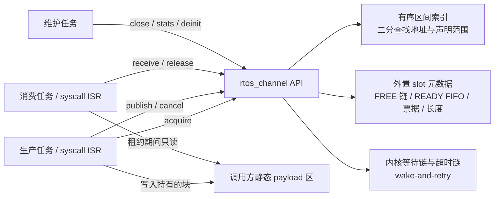
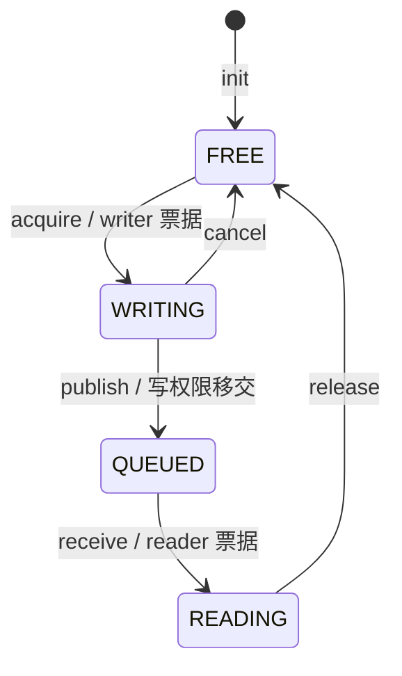
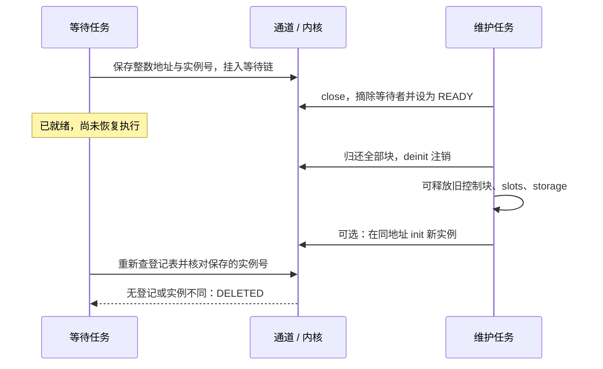

# 静态借用消息通道设计

本文说明当前 [rtos_channel.h](../RTOS/Core/Inc/rtos_channel.h) 与 [rtos_channel.c](../RTOS/IPC/rtos_channel.c) 的设计、调用契约和资源成本。核心为纯 C 共享内存协议，不启动 DMA、不访问芯片寄存器；内核调度和移植层背景见 [RTOS 架构设计](rtos_design.md)。本轮算法与验证见[共享内存优化报告](rtos_channel_shared_20261027.md)。

## 1. 解决的问题与工程定位

采样帧、通信报文和日志块常经过“生产者填充缓冲 → 排队 → 消费者处理 → 归还”这条路径。按值队列会复制消息；内存池加指针队列可以避免大块复制，但应用需要自行维护缓冲归属、错误清理、关闭顺序，以及对象重建后的旧指针问题。

本模块把固定块池、消息 FIFO 和单所有者租约组合成一个静态对象。数据始终留在调用方提供的存储中；API 只变更槽位索引、票据和固定尺寸的描述符。一个块在生产者、通道和消费者之间转移，不支持同时广播给多个读者。

这不是零拷贝或借用机制的行业首创。成熟系统已经提供相关基础设施：

| 成熟方案 | 官方已提供的机制 | 本模块的取舍 |
| --- | --- | --- |
| CMSIS-RTOS2 / RTX 教程 | 将固定块内存池与传递指针的消息队列组合成零拷贝 mailbox | 在本 RTOS 内提供统一的所有权状态、票据校验、关闭和资源账本。见 [官方教程](https://arm-software.github.io/CMSIS_5/RTOS2/html/rtos2_tutorial.html)的 Memory Pool / Zero Copy Mailbox 章节 |
| Zephyr memory slab 与 FIFO | 固定块分配和归还；FIFO 可在任务与 ISR 间传递对象，ISR 不得阻塞 | 使用外置槽位元数据和固定总容量；无需在 payload 内保留链指针。见 [Memory Slabs](https://docs.zephyrproject.org/latest/kernel/memory_management/slabs.html)、[FIFOs](https://docs.zephyrproject.org/latest/kernel/services/data_passing/fifos.html) |
| Zephyr net_buf | 引用计数缓冲、明确的所有权转移及转移后旧持有者停止使用 | 当前选择单所有者四态协议，不实现引用计数、分片链或多订阅者。见 [Network Buffers：Ownership](https://docs.zephyrproject.org/latest/services/net_buf/index.html#ownership) |

这里的工程价值是减少重复的驱动与业务清理协议，使错误能够以 STALE、BUSY、CLOSED 等状态返回，并用统一账本观察背压。它需要额外元数据和校验成本；小消息、无需持有缓冲的场景仍可直接使用普通 queue。是否改善吞吐和时延，要按真实消息大小、竞争规模及目标平台测量。

## 2. 模块组成与启用



公开接口在 `RTOS/Core/Inc/rtos_channel.h`，实现集中在 `RTOS/IPC/rtos_channel.c`。它复用内核临界区、阻塞登记和唤醒机制，不给 TCB 增加通道专用字段，也不修改 PendSV 现场格式。登记表独立于可关闭的 perf 观察表。

在 `rtos_config.h` 中启用，或为所有相关编译单元一致设置构建宏：

```c
#define RTOS_CONFIG_USE_CHANNEL (1)
#define RTOS_CONFIG_CHANNEL_MAX_CHANNELS (8U)
#define RTOS_CONFIG_CHANNEL_MAX_BLOCKS (256U)
```

业务源文件显式包含 `rtos_channel.h`，构建需包含 `RTOS/IPC/rtos_channel.c`。默认 `USE_CHANNEL=0`；此时九个公共 API 返回 `RTOS_ERR_DISABLED`，不改写输入对象和输出视图，实现文件不引入通道登记表。应用自己声明的静态缓冲仍占 RAM。不同编译单元不能使用彼此矛盾的配置。

## 3. 四态所有权与 FIFO



| 状态 | 所有者与允许访问 | 退出方式 |
| --- | --- | --- |
| FREE | 通道可分配；应用不得访问旧指针 | acquire |
| WRITING | 当前 writer 可在 `capacity` 内由 CPU 直接填写共享缓冲 | publish 或 cancel |
| QUEUED | 通道持有；生产者已失去访问权限 | receive |
| READING | 当前 reader 在 `length` 内只读；未 release 前块不会重新分配 | release |

始终保持资源守恒：

```text
capacity = free + writing + queued + reading
```

FREE 使用槽位索引单链表，READY 使用带尾指针的槽位 FIFO；一个 slot 只属于其中一个状态。成功 publish 的先后顺序决定 FIFO 顺序，不是 acquire 顺序。例如 A 先借块、B 后借块，B 先 publish，消费者就先收到 B。不同消费者的实际完成顺序仍由调度和处理耗时决定。

队列名额与块数同为 N。一个合法 WRITING 块本身尚未在 READY 中，因此在打开的通道中 publish 不会再因“指针队列已满”而等待。长度可以为零，也可以等于实际 `block_size`；超长提交返回 PARAM，并保留 writer 供修正或取消。

`reader.sequence` 取成功发布累计计数，正常从 1 开始，用于跟踪发布顺序；累计计数饱和时不回绕。它不是所有权凭证，也不是跨通道或跨重建实例的全局消息编号。业务需要跨重启的唯一 ID 时应自行定义。

## 4. 票据、实例号与生命周期安全

### 4.1 票据验证

每份视图包含 `channel_address`、`incarnation`、`slot`、`generation` 及数据地址。publish/cancel/release 在临界区内先查活跃登记表，再检查实例、槽位范围、阶段、代际和从已验证槽位计算出的真实数据地址。外来 data 指针只用于比较，不决定归还哪个块。

当前登记实现是有序区间索引：每个活跃通道占控制块、完整声明 payload 和完整声明 slots 三段，
各段记录 `begin/end/owner`，正长度、不相交，按 begin 排序。热路径不再读取其他控制块来重建范围。
先二分匹配控制段的精确起点，再验证实例；数据段或 slots 段的起点不能冒充控制块。

外部视图的重叠检查二分查找第一段 `end > view.begin`，只需判该段是否满足
`begin < view.end`。不相交区间按 begin 排序也必然按 end 排序，因此能够拒绝
“起点在空隙、尾部跨进已占区间”和跨越多段的视图，且允许半开区间恰好相邻。
初始化先验证全部范围和容量，再插入三段；注销按 owner 稳定压缩删除三段，不把可移动索引号
存进票据或阻塞调用。对象重建安全仍依赖实例号，不能只凭缓存地址判断存活。

`next_ticket` 从 0 开始。每次 acquire 预留两个号码：writer 使用奇数 `old + 1`，receive 将该槽 generation 加一，使用预留的偶数 reader 票据；计数推进到 `old + 2`。取消允许跳过未使用的 reader 号码。由此，未经修改的旧 producer 票据不能归还后续 READING 块。

当不能安全预留下一对号码时，acquire 返回 OVERFLOW，不改变槽位或输出。已有租约仍可完成发布、接收和归还。64 位实例号由全局单调分配器发放；同地址重建会获得新实例号，耗尽时 init 拒绝新实例，不以回绕“恢复可用”。实例号覆盖本次系统启动期间，不是跨重启持久化标识。票据用于检测陈旧能力，不是密码学认证；应用不得伪造、改写票据或通过裸内存篡改实现字段。

### 4.2 已唤醒调用与同地址重建

只从等待链摘除任务，还不能保证阻塞函数已经返回。较高优先级维护任务可能在它恢复运行前完成 close、deinit，甚至在相同地址初始化新通道。



等待重试不沿旧 channel 指针直接读取字段。成功视图填充和状态提交均在临界区内完成；退出后不再读取该通道元数据。deinit 的成功条件是已关闭、所有块 FREE、两个等待链为空；它只注销登记，不代替调用方释放存储。已被摘链但尚未返回的旧调用可以安全得到 DELETED，无需为它继续保留旧通道存储。

## 5. API 与失败语义

下表中的 syscall ISR 指允许调用内核对象 API 的中断优先级域。本 F446 默认阈值为编码值 `0x50`，逻辑优先级为 5–15；移植后应按 NVIC 优先级位数和配置重新确认。

| API | 作用 | 任务 / 启动上下文 | syscall ISR |
| --- | --- | --- | --- |
| `rtos_channel_init(channel, config)` | 校验并登记静态存储 | 允许 | 禁止 |
| `rtos_channel_acquire(channel, writer, timeout)` | 借出可写块 | 允许；资源不足可等待 | 仅 NO_WAIT |
| `rtos_channel_publish(channel, writer, length, tag)` | 将写租约移交到 FIFO | 允许；不阻塞 | 允许 |
| `rtos_channel_cancel(channel, writer)` | 归还 WRITING | 允许；不阻塞 | 允许 |
| `rtos_channel_receive(channel, reader, timeout)` | 按发布 FIFO 借出只读块 | 允许；资源不足可等待 | 仅 NO_WAIT |
| `rtos_channel_release(channel, reader)` | 归还 READING | 允许；不阻塞 | 允许 |
| `rtos_channel_close(channel)` | 关闭新流量并广播关闭状态 | 允许 | 禁止 |
| `rtos_channel_deinit(channel)` | 注销已关闭且完全归还的对象 | 允许 | 禁止 |
| `rtos_channel_get_stats(channel, stats)` | 获取一致快照及等待者数量 | 允许 | 禁止 |

启动时可以完成静态创建和已有资源上的非阻塞操作；需要真正阻塞时必须有正在运行的调度器和当前任务。高于 syscall 域的 ISR、NMI 和 HardFault 不得使用这些对象 API。启用模块后，非法 ISR 路径明确返回 ISR，不依赖断言开关。

成功 publish/cancel 会清零传入 writer，成功 release 会清零传入 reader。失败保持视图及原有租约状态，STALE/CLOSED/等待等诊断计数可以相应变化。一个函数返回错误，并不意味着调用方已经失去持有的块，必须根据操作阶段处理。

| 状态 | 调用方应如何解释 |
| --- | --- |
| TIMEOUT | NO_WAIT 没有资源，或有限等待预算耗尽；未获得租约 |
| CLOSED | acquire/publish 被关闭拒绝，或 receive 已无消息可排空；失败的 publish 仍持有 writer |
| STALE | 票据不属于当前实例/槽位/阶段，代际或数据地址不匹配；不能靠修改票据重试 |
| BUSY | deinit 条件不满足，不能释放存储；应查账本并完成安全清理 |
| DELETED | 地址未登记，或阻塞期间旧实例已被注销/替换 |
| SCHED | 当前确需阻塞，但调度器、外层临界区或 BASEPRI/PRIMASK 状态不允许 |
| PARAM | 尺寸、对齐、重叠、长度、timeout 等输入错误；调用方仍须提供有效可访问的 C 对象 |
| ALREADY | 重复 init 已登记对象，或重复 close |
| NO_MEM | init 的活跃登记表已满，不表示从堆申请内存失败 |
| OVERFLOW | init 实例号或 acquire 票据预留耗尽；不能通过回绕消除 |

每个 acquire/receive 输出对象必须独立于所有活跃通道的控制区、声明 slots 区和声明 payload 区；校验包含声明范围内当前未用的尾部。init 同时拒绝新通道三类区域之间及与其他活跃通道区域之间的重叠，检查乘法、地址加法溢出和对齐。范围校验不能判断任意地址是否映射、是否可写，实际对象长度和访问权限仍由调用方保证。

## 6. 等待、截止点与广播选择

`timeout` 接受 NO_WAIT、`1..0x7FFFFFFF` tick 或 WAIT_FOREVER。这里限制的是单次有限等待预算，不是系统只能运行这么长；tick 可以持续回绕。时间基准是内核逻辑 tick，调度器挂起或 tick 长时间受屏蔽造成的时钟行为应按内核时间模型解释，不能当作墙上时钟保证。

一次调用只建立一个起始时刻。被广播唤醒后若资源被其他执行者抢先取走，则按剩余预算重新入链，不重新获得完整 timeout。只要已经真正等待过，正常唤醒重试在授予资源前检查 `now - started >= timeout`；到期后即使已有资源也返回 TIMEOUT，资源留给后续调用。首次进入时已有资源则可以立即成功。

例如预算为 5 tick，任务在第 1 tick 被唤醒，但直到第 6 tick 才获得 CPU：它返回 TIMEOUT，不领取此时可用的块。这个规则约束授予窗口，不能保证 CPU 饥饿的任务在第 5 tick 准时执行返回。CLOSED、DELETED 等生命周期结果按相应优先路径返回，而不是被统一转换成 TIMEOUT。有限等待仍遵守本内核 32 位 tick 和有限比较窗口的假设，不承诺能分辨任务被饿死整轮 tick 回绕后的所有墙上时间。

publish 广播唤醒读等待链，cancel/release 广播唤醒写等待链；没有等待者时广播为空操作。选择 wake-all 是为了避免“只唤醒 A，A 已 READY 但还没取得资源就被删除/挂起，B 仍永久阻塞”吞掉唯一唤醒机会。醒来只取得竞争资格，尚未获得缓冲租约。

这个选择增加了竞争下的重新入链和调度成本。消息 FIFO 不等同于等待任务的严格公平服务；较低优先级任务可能长期抢不到资源。硬实时业务需要结合任务优先级、池容量、等待者上限及生产/消费速率做可调度性分析。

确需阻塞前，模块检查进入自身临界区之前的 BASEPRI/PRIMASK、进入后的嵌套深度及调度器状态，条件不满足返回 SCHED，且不挂等待链。已有资源的非阻塞路径仍可在外层临界区内完成。应用不得在手工设置其他不支持的 CPU 屏蔽状态、非特权执行环境或错误配对的临界区中使用阻塞 API。

## 7. 关闭、排空与停机顺序

close 是状态改变，不是强制销毁。它禁止新 acquire 和 publish，唤醒尚在等待链中的调用者；已经发布的数据仍可 receive，空且已关闭才返回 CLOSED。WRITING 可以 cancel，READING 可以 release。

推荐的业务停机协议是：先停止新的采集/请求来源并协调执行者停止提交；close；由明确的消费者或维护任务处理/丢弃所有 QUEUED 消息并 release；让在途生产者和 DMA 在确认不再访问缓冲后 cancel；让消费者完成访问后 release；核对账本；最后 deinit。成功 deinit 后才能复用或释放控制块、元数据与 payload。运行中的 DMA 不会因为 close 自动停下。

删除持有 WRITING/READING 租约的任务不会自动归还块，因为票据可以合法交给其他任务或 DMA 完成 ISR。仅凭任务死亡无法判断硬件和其他执行者是否仍在访问。管理者只能在停止全部访问之后，用协调保留的有效票据归还；票据确实丢失时该容量会保持占用，deinit 返回 BUSY。`writing/reading` 可以揭示未归还占用，但模块不自动定位任务归属，也不承诺自动恢复丢失票据。

## 8. 最小完整集成示例

以下代码演示全部九个 API。初始化由控制任务调用一次；produce 由单一生产任务调用，consume 由单一消费任务调用；stop 必须在二者停止访问后由控制任务执行。多个生产者或消费者应各自保存独立视图，不能并发共用这里的两个示例视图。

示例把视图保存在静态上下文，异常清理失败时不会因函数栈退出而把唯一能力丢掉。stop 采用“明确丢弃尚未处理的已发布消息”策略；有持久化要求的业务应改成处理完毕再归还。

```c
#include "rtos_channel.h"

#include <stdint.h>
#include <string.h>

#define SAMPLE_BLOCK_BYTES (256U)
#define SAMPLE_BLOCK_COUNT (4U)
#define SAMPLE_WAIT_TICKS (10U)

typedef struct sample_channel {
    rtos_channel_t channel;
    rtos_channel_slot_t slots[SAMPLE_BLOCK_COUNT];
    _Alignas(RTOS_CHANNEL_ALIGNMENT)
        uint8_t storage[SAMPLE_BLOCK_COUNT * SAMPLE_BLOCK_BYTES];
    rtos_channel_writer_t writer;
    rtos_channel_reader_t reader;
} sample_channel_t;

static sample_channel_t s_sample;

rtos_status_t sample_channel_init(void)
{
    const rtos_channel_config_t config = {
        .storage = s_sample.storage,
        .storage_size = sizeof(s_sample.storage),
        .slots = s_sample.slots,
        .slots_size = sizeof(s_sample.slots),
        .block_size = SAMPLE_BLOCK_BYTES,
        .block_count = SAMPLE_BLOCK_COUNT,
    };

    return rtos_channel_init(&s_sample.channel, &config);
}

rtos_status_t sample_channel_produce(uint8_t value, uint32_t tag)
{
    if (s_sample.writer.data != NULL) {
        return RTOS_ERR_BUSY; /* 先处理上次未归还的能力。 */
    }

    rtos_status_t status = rtos_channel_acquire(&s_sample.channel,
        &s_sample.writer, SAMPLE_WAIT_TICKS);
    if (status != RTOS_OK) {
        return status;
    }

    memset(s_sample.writer.data, value, SAMPLE_BLOCK_BYTES);
    status = rtos_channel_publish(&s_sample.channel, &s_sample.writer,
        SAMPLE_BLOCK_BYTES, tag);
    if (status != RTOS_OK) {
        rtos_status_t cleanup = rtos_channel_cancel(&s_sample.channel, &s_sample.writer);
        if (cleanup != RTOS_OK) {
            return cleanup; /* 保留静态 writer，交由故障处理定位。 */
        }
    }
    return status;
}

rtos_status_t sample_channel_consume(uint32_t *sum)
{
    if (sum == NULL) {
        return RTOS_ERR_PARAM;
    }
    if (s_sample.reader.data != NULL) {
        return RTOS_ERR_BUSY;
    }

    rtos_status_t status = rtos_channel_receive(&s_sample.channel,
        &s_sample.reader, SAMPLE_WAIT_TICKS);
    if (status != RTOS_OK) {
        return status;
    }

    const uint8_t *bytes = s_sample.reader.data;
    uint32_t result = 0U;
    for (uint32_t index = 0U; index < s_sample.reader.length; index++) {
        result += bytes[index];
    }
    *sum = result;
    return rtos_channel_release(&s_sample.channel, &s_sample.reader);
}

rtos_status_t sample_channel_stop(void)
{
    rtos_status_t status = rtos_channel_close(&s_sample.channel);
    if ((status != RTOS_OK) && (status != RTOS_ERR_ALREADY)) {
        return status;
    }
    if (s_sample.writer.data != NULL) {
        status = rtos_channel_cancel(&s_sample.channel, &s_sample.writer);
        if (status != RTOS_OK) {
            return status;
        }
    }
    if (s_sample.reader.data != NULL) {
        status = rtos_channel_release(&s_sample.channel, &s_sample.reader);
        if (status != RTOS_OK) {
            return status;
        }
    }
    for (;;) {
        status = rtos_channel_receive(&s_sample.channel, &s_sample.reader, RTOS_NO_WAIT);
        if (status == RTOS_ERR_CLOSED) {
            break;
        }
        if (status != RTOS_OK) {
            return status;
        }
        /* 此处执行本示例明确选择的丢弃策略。 */
        status = rtos_channel_release(&s_sample.channel, &s_sample.reader);
        if (status != RTOS_OK) {
            return status;
        }
    }

    rtos_channel_stats_t stats;
    status = rtos_channel_get_stats(&s_sample.channel, &stats);
    if (status != RTOS_OK) {
        return status;
    }
    if (stats.free != stats.capacity) {
        return RTOS_ERR_BUSY;
    }
    return rtos_channel_deinit(&s_sample.channel);
}
```

ISR 应使用独立、生命周期明确的视图，并将 acquire/receive 的 timeout 设为 NO_WAIT。不要照搬上述有限等待包装函数到 ISR。业务需要对 acquire 失败选择背压、丢帧、降采样或故障升级策略，模块不会替应用作出这些决定。

## 9. 共享缓冲安全与移植边界

### 9.1 描述符与裸指针

不能把尚持有租约的 writer/reader 再作为下一次 acquire/receive 输出，否则新能力会覆写旧能力，旧块仍处于 WRITING/READING，形成可观察的容量占用。输出参数允许是未初始化的有效对象，实现不能先把它当成旧票据读取来可靠判断“是否已有能力”；调用方必须自己管理视图生命周期。复制视图也不会创建第二份租约，转交时必须确保旧持有者停止使用，且只能有一次成功终结操作。

API 可以拒绝未经修改的过期票据、重复归还和跨通道能力，但 C 裸指针没有自动撤销功能。publish 后继续写旧 data，或 release 后继续读写旧 data，仍可能破坏另一个合法持有者的数据。`const void *` 约束消费者的正常 C 用法，不提供 MPU 隔离。模块不做 payload CRC、擦除、越界检测或恶意代码隔离；跨信任域的业务应另行设计保护与清零策略。

### 9.2 CPU 共享缓冲交接与错误清理

生产任务 acquire 后直接在 `writer.data` 中生成或编码数据，再 publish。消费者 receive 后
直接处理同一地址，再 release。整个路径不搬运 payload，也不需要 DMA。上文完整 C 示例展示
这一流程：publish 失败时保留 writer，由原持有者 cancel；处理失败时也须 release 已持有的 reader。
不应把应用刚构造的数据先放进私有大数组、再 memcpy 到共享块，否则会重新引入可避免的复制。

关闭顺序是停止发起新业务 → close → 已持有 writer 发布被拒绝后 cancel → 消费者 drain/release
→ 确认账本全 FREE → deinit → 允许释放存储或重建。RTOS 管理槽位归属、验证失败和清理提交，
应用仍负责调用对应的结束操作；不能在另一个上下文仍使用缓冲时强制回收。

### 9.3 移植边界

通道自身只使用标准 C 类型、整数地址、静态数组、元数据清零及内核等待协议。
需要由 RTOS port 提供临界区、上下文判定、ISR 优先级及屏蔽状态接口；CPU/中断控制器变化时
应适配这些端口接口，而不向通道中加入芯片驱动。原生 64 位测试使用端口替身，
Cortex-M4F 运行验证使用真实端口；它们不等于已在所有 ISA 上完成移植。

当前设计针对单核、可按 `uintptr_t` 比较的平坦地址空间。单核任务共享同一 CPU 缓存体系，
不需要为了该通道启动 DMA 或加入 DMA cache 维护。若将来引入 SMP、非一致缓存或外部总线
访问者，需要另行定义同步与适配协议；当前实现不声称支持这些场景。旧 DMA 夹具只保留为历史
外设集成试验，本轮功能、性能验收均不选择它。

## 10. 统计、容量规划与成本

### 10.1 账本如何解释

`get_stats` 在临界区内复制快照，并扫描两个等待链计算 `waiting_writers/readers`。已被唤醒、尚未实际恢复的 READY 调用不再计入等待链人数；账本不是活跃函数调用计数。

| 统计 | 含义与用途 |
| --- | --- |
| `free/writing/queued/reading` | 当前四态资源数量，用于区分生产持有、排队积压与消费持有 |
| `queued_peak/in_use_peak` | 峰值排队和峰值非 FREE 数量，用于容量估算 |
| `acquired/published/received/released/cancelled` | 各成功状态转移次数；64 位饱和计数 |
| `acquire_misses/receive_misses` | NO_WAIT 缺资源返回 TIMEOUT 的次数，适合 ISR try 路径观测 |
| `acquire_waits/receive_waits` | 实际挂入等待链的次数；同一次调用重试可多次增加 |
| `acquire_timeouts/receive_timeouts` | 有限等待实际到期次数，不把 NO_WAIT 资源不足计入 |
| `stale_rejections/closed_rejections` | 错误能力和关闭拒绝次数；不是去重后的故障事件数 |

累计计数均饱和而不回绕，因此饱和之后不能再用累计差值精确还原历史。当前四态数量是资源守恒的直接判据。`closed_rejections` 只统计返回 CLOSED 的拒绝，重复 close 的 ALREADY 不计入。

容量规划应覆盖同时 WRITING、QUEUED 和 READING 的峰值总和，并计入生产处理、消费者抖动和停机窗口。仅按平均队列深度选块数可能忽略长期持有的 reader。固定块没有运行时堆碎片，但块内剩余空间和 stride 对齐仍有代价。

### 10.2 RAM 与代码大小

设 C 为 `CHANNEL_MAX_CHANNELS`，N 为块数，B 为 `block_size`，则应用至少提供：

```text
payload  = N * align8(B)
slots    = N * sizeof(rtos_channel_slot_t)
control  = sizeof(rtos_channel_t)
views    = 同时存在的 writer / reader 描述符存储
```

另有模块全局有序索引、32 位区间数量及 64 位实例分配器。当前 STM32F446 的 32 位 ABI 下，
每段的两个 uintptr_t 和一个 owner 指针占 12 字节，默认 C=8 时最多 24 段占 288 字节；
另有计数 4 字节、实例分配器 8 字节，独立对象的 BSS 节尺寸合计 300 字节。
最终链接可能增加对齐填充，不能把独立 section 求和直接当作整机 RAM 增量。

当前 ARM GCC 11.3、Cortex-M4F、`-O2`、function/data sections、启用通道且默认 C=8 的
独立模块结果为 text 5560、data 0、BSS 300 字节；同选项旧扫描版本为 5608/0/104。
这是以额外索引 RAM 换热路径查询成本，模块关闭时三项均为零。最终 Flash 增量仍应查 map，
其他 ABI、配置或编译器需重新核对尺寸，也不能由代码大小推断吞吐表现。

### 10.3 时间复杂度与中断屏蔽

设 W 为相关等待链中的任务数，C 为登记上限，A 为活跃通道数（A≤C），N 为通道块数。
查询成本写为 log(A+1) 以包含空索引情况，最多查询 3A 个区间；共用内核等待/调度成本另计。

| 操作 | 当前实现的主要成本 |
| --- | --- |
| init | O(A + N)：三段二分重叠校验、三次有序插入及元数据清零；不清零 payload |
| 无等待者的 acquire/receive/publish/cancel/release | O(log(A+1))：控制段身份及视图区间各一次二分；槽位操作 O(1)，无 payload 复制 |
| 需要阻塞的 acquire/receive | 另有内核有序等待链插入成本 O(W)；唤醒后可重复竞争和入链 |
| 有等待者的 publish/cancel/release | 另有 broadcast O(W) 及内核就绪/超时链处理 |
| close | O(log(A+1) + W)：查找登记并唤醒两条等待链 |
| get_stats | O(log(A+1) + W)：校验输出及扫描等待人数 |
| deinit | O(A+1)：查身份和状态，按 owner 稳定压缩删除三段；不遍历 payload |

默认 C=8 时，最多 24 段的单次二分最多执行 5 次比较；这不是完整 API 的固定周期保证。
元数据提交和唤醒位于内核临界区，broadcast 会延后 syscall 域 ISR。初始化的 slot 数量、
等待者规模和高优先级非 RTOS 中断负载都影响观测时长。单通道、无等待者的吞吐结果不能当作
所有配置的最坏中断响应时间。

## 11. 集成验证入口

当前宿主入口见 [host/README.md](../hil/channel_shared_20261027/host/README.md)，含独立线性区间
oracle、注销重排和保护页生命周期。它链接真实生产 C；脚本调度替身不等于 Cortex-M 抢占验证。
本轮复用 [channel_checks.c](../hil/fw/Src/channel_checks.c)、[channel_stress.c](../hil/fw/Src/channel_stress.c)、
[channel_profile.c](../hil/fw/Src/channel_profile.c) 和 [channel_bench.c](../hil/fw/Src/channel_bench.c)，
只测 CPU 共享内存与真实中断，不选择 DMA 夹具。历史批次保留原实现与原始结果。

工程验收需要同时检查资源守恒、错误路径视图保持、票据失效、实际消息内容、等待预算、关闭清理和目标平台时序。执行结果及其配置范围应记录在单独的测试报告；本设计说明不以“未崩溃”推导不存在未知缺陷。

## 12. 后续路线：尚未实现

- **业务进度与截止期契约**：围绕完成事务而非仅任务仍在调度，记录失约原因及有限故障快照。
- **等待关系解释**：把等待对象、持有资源与超时来源形成可查询的依赖关系，帮助定位永久等待及业务级资源环。
- **显式时效策略**：由业务定义消息过期、丢弃与清理协议；不能因“过期”就回收仍被 CPU 或 DMA 持有的块。
- **更强隔离及平台适配**：探索 MPU 支持的租约访问约束及其他 CPU 端口；需要独立设计、平台验证和资源预算。

这些方向不属于当前 API，也不应通过未验证的强制回收或省略校验来换取表面性能。
