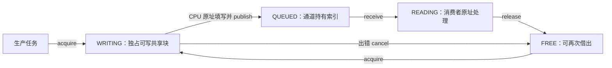

# 共享内存通道：纯 CPU 算法优化与移植边界

本轮保留静态共享缓冲区和九个 API，从算法上优化通道的身份与内存范围校验。
**数据由 CPU 在同一块内存上直接生成和处理，不启动 DMA，不引入 HAL、芯片寄存器或专用驱动依赖。**
上一轮 DMA 只是 F446 的独立外设集成夹具，原通道核心和吞吐基准也没有借助 DMA 搬运数据。
本轮不选择该夹具，历史文件和证据保留。

## 1. 数据如何共享，责任如何划分



RTOS 维护 FREE 链、发布 FIFO、四态数量、票据和等待协议，不复制 payload。
生产任务应直接在 `writer.data` 中编码、计算或生成数据；消费者直接读取 `reader.data`。
若先生成私有大数组再 memcpy 到共享块，业务仍会承担那次复制成本。

| 情况 | 协议 |
| --- | --- |
| 生产者填写失败或 publish 失败 | 写票据仍由原持有者负责，cancel 后归还；错误不暗中丢失所有权 |
| 消费者处理失败 | release 已取得的 reader；业务可另行记录失败结果 |
| 关闭 | 停止新业务、close、取消未提交 writer、排空并归还 reader、全 FREE 后 deinit |
| 等待者已 READY，旧对象随后注销或同址重建 | 阻塞重试凭保存的整数地址和实例号重新查找，旧实例返回 DELETED |
| 旧借用票据、重复归还、跨通道能力 | 按实例、槽位、代次、阶段和数据地址拒绝 |

关闭不强制回收其他上下文仍持有的块。RTOS 可以管理合法 API 内的归属和清理提交，
应用仍须调用对应结束操作。票据不撤销裸 C 指针；管理 API 的原始 channel 指针也不是带实例号的
跨生命周期句柄。对象管理者须协调停止旧调用，不能把“旧借用票据被拒绝”推广为任意旧指针都安全。
没有 MPU/访问隔离时，不能阻止应用绕开 API 继续写旧地址。完整示例见[通道设计](rtos_channel_design.md)。

## 2. 算法改动

原版本每次交接先线性查找登记表，再扫描登记上限；遇到活跃对象便读取其控制块，
重建控制、payload、slots 三类区域并逐一判断重叠。FREE/READY 槽位链本来已经为 O(1)，
本轮优化重复身份和区域检查，没有改动票据、槽位状态机、超时或调度协议。

当前用一个有序区间数组保存所有活跃对象的三段完整声明范围：

```text
begin 升序、不相交的半开区间：
[begin, end, owner] [begin, end, owner] ...，共 3 × A 段
```

- 对象查找：按 begin 二分，只接受 `begin == channel_address == owner_address` 的控制段。
  数据/slots 的起点不能冒充控制块，未登记地址不会被解引用。
- 视图校验：二分找第一段 `end > view.begin`，只需判断其 `begin < view.end`。
  这同时覆盖起点在空隙但尾部跨界、包围多段和声明尾部重叠；恰好相邻允许。
- 初始化：全部参数、三段互斥、容量和实例号检查通过后才提交三次插入。
- 注销：按 owner 稳定压缩删除三段并清理尾部，不保存易失效的区间下标。
- 重建：仍由不回绕的实例号识别新旧对象；索引命中不替代实例校验。

证明要点是：正长度、不相交的区间按 begin 排序后，end 也严格递增。
第一个 end 超过查询起点的区间如果还没有进入查询终点，后续区间更不可能相交。
插入前检查和按 owner 稳定过滤共同维持这个不变量。

| 路径 | 原算法 | 当前算法 |
| --- | --- | --- |
| 热路径身份/区域检查 | O(C)，C 为配置登记上限 | O(log(A+1))，A 为活跃通道数 |
| FREE/READY 槽位操作 | O(1) | O(1) |
| init | O(C+N) | O(A+N)，保留有序插入成本 |
| deinit | O(C) | O(A+1)，保留压缩成本 |
| 等待者唤醒 | 广播，O(W) 及内核成本 | 保持原协议 |

默认最多 8 个活跃通道、24 个区间，单次二分最多 5 次比较。
这是查询次数的上界，不是整个 API 的周期上界，也不是 WCET。

## 3. 移植性与资源代价

通道 C/公共头没有直接 DMA、HAL、SDK、寄存器或内嵌汇编依赖；只清零固定尺寸元数据，
不调用 payload memcpy。实际仍依赖 RTOS port 提供临界区、上下文和屏蔽状态接口，
并依赖内核 tick/等待协议。硬件相关的 ARM PRIMASK/BASEPRI/IPSR/NVIC 操作留在现有端口层。
这不是“任何 CPU 无需适配”的保证。

当前契约是单核、共享可访问内存和可用 uintptr_t 比较的平坦地址空间；SMP、非一致缓存或
跨信任域隔离需要独立设计。原生 64 位宿主验证使用端口替身，M4F 使用真实端口；M7 仅做
代码生成，仍使用 F446 设备头，不能据此声称其他 MCU/BSP 或缓存配置已经上板验证。

默认配置、ARM GCC 11.3、O2、function/data sections 的独立对象尺寸：

| 指标 | 原版本 | 当前版本 |
| --- | ---: | ---: |
| text | 5,608 B | 5,560 B |
| data | 0 B | 0 B |
| BSS section 合计 | 104 B | 300 B |

增加的 196 B 为索引空间；这是明确的时间/空间交换。最终链接还包含对齐：同夹具 O2 benchmark
的 text 从 44,420 降至 44,376 B，BSS 从 91,816 增至 92,016 B，实际增加 200 B。
默认关闭时模块 text/data/BSS 均为零；应用自备缓冲仍按原声明占用 RAM。

## 4. 实板性能：提升有限，完整保留对照

F446 / 168 MHz / GCC 11.3 / O2 / BASEPRI / 断言开启。两阶段复用相同的 benchmark/profile
夹具、消息数量及编译配置，夹具不改写。基线重新烧录上一轮已验证的归档 ELF，并关联原始
build/source 身份及本轮保存的原 C/头快照；它是 **replayed_verified_image**，不是本轮重新编译。
优化版本为当前源码完整新编译。两者都重新采集了真实串口和 ST-LINK 下载验证记录。

下表为容量 1 的三次 `cycles/messages` 中位数，已四舍五入。IPC 不包含 payload 填充/校验，
e2e 包含同样的 CPU 填充与校验；两者均包含循环、校验返回值及正常中断开销。

| 场景 | 原通道周期/条 | 当前通道周期/条 | 耗时减少 |
| --- | ---: | ---: | ---: |
| 16 B，纯 IPC | 3,986 | 3,884 | 2.56% |
| 256 B，纯 IPC | 3,986 | 3,884 | 2.56% |
| 16 KiB，纯 IPC | 3,986 | 3,884 | 2.55% |
| 16 B，e2e | 4,663 | 4,528 | 2.88% |
| 256 B，e2e | 12,119 | 11,984 | 1.12% |
| 16 KiB，e2e | 512,858 | 512,745 | 0.022% |

单通道改进幅度小，不能将复杂度改进宣传成业务吞吐大幅提升。硬件性能采样只有一个活跃
通道；8 通道的索引/生命周期正确性由宿主专项验证，不声称已测多通道最坏硬件时延。

同时记录了复制队列和内存池＋指针队列。16 B/容量1/IPC 下，copy 为 567.34→567.22 周期，
pool 为 866.31→854.45 周期；代码布局与中断相位也会影响对照路径。
通道相对 copy 的归一化比值改善约 2.54%，相对 pool 改善约 1.21%；不能把全部绝对变化归因于算法。
当前通道该格仍约为 pool 路径耗时的 4.55 倍，小消息仍适合普通队列或按业务选择池＋指针方案。
90 个性能单元中有 3 个 copy 对照格轻微变慢（最大约 0.078%），全部保留，没有筛掉退步项。

IRQ profile 用软件置 pending 的真实 TIM7 p5 异常观察临界区，timer 关闭，包含 hook 成本：
acquire 756→736、publish 774→759、receive 884→856、release 891→860 周期；
4 等待者 publish 1,114→1,099、release 1,231→1,200。每点 8 次，是观测值而非 WCET。
完整数据见[性能比较](../hil/channel_shared_20261027/evidence/comparison/comparison.json)
及对应 CSV，保留容量 1/3/16 和所有尺寸、路径、工作模式。

## 5. 健壮性验证与恢复状态

| 项目 | 本轮结果 |
| --- | --- |
| 宿主基线 | 原实现 6 个进程通过，源码身份稳定 |
| 宿主优化后 | 8 个进程通过；O0/O3 各 30 万随机模型操作，新增区间专项各 1,807,890 项检查 |
| 区间专项 | 8 owner / 24 段、相邻/跨界/声明尾、失败回滚、1,000 次随机注销重排、同址重建及保护页旧控制块 |
| 严格编译 | 429＋1 两批通过：408 M4、17 M7 代码生成、4 公共头、1 文档 C 示例；输入稳定 |
| 新算法板测 | 29 镜像：功能12、混合任务/IRQ压力12、profile2、benchmark2、单包损坏对照1 |
| 原内核集成 | 13 镜像通过：任务、IPC、互斥继承、生命周期、FPU、两种临界区及16任务业务压力 |
| 默认关闭与日常 | 2 镜像通过；日常可装载内容与扩展前相同，恢复模板后再比较仍相同 |
| 对照与验收器 | 基线重放2镜像；另27项验收器控制/篡改测试通过，没有选择DMA测试 |

合计 **46 次真实烧录/捕获，44 个新编译镜像＋2 个归档基线重放**。
最终关联复核见[final_summary.json](../hil/channel_shared_20261027/evidence/final_summary.json)。
宿主没有 ASan/UBSan、真实抢占或耗时证明；原有硬件夹具不等于覆盖所有应用。
这些检查约束已测试范围，不证明未知缺陷不存在。

未修改 `main.c` 或 TCB/端口汇编，通道仍默认关闭；日常固件和构建模板已恢复，串口确认任务0/1运行。
没有新增功能服务任务或运行时堆分配。正式源码、原始日志及必要本地 ELF 保留，临时对象、复制夹具
和重复 scratch 日志清理；历史证据不改写。本轮尚未提交或推送 Git。

复跑命令与证据边界见[本批 HIL 说明](../hil/channel_shared_20261027/README.md)。
