# 自研 RTOS 架构与实现设计手册

> **核对平台**：STM32F446RE，单核 Cortex-M4F（ARMv7E-M），GCC `arm-none-eabi`。默认 168 MHz、1 kHz tick；其他处理器、时钟和配置需要独立适配与验证。
> **文档基准**：2026-10-13 本工程 `RTOS/` 当前代码，包含源码审计修复、两轮性能优化及综合压力测试后的保留实现。变更与验证总览见 [发布汇总](rtos_release_20261013.md)，缺陷复现见 [审计报告](rtos_audit_20261012.md)，综合负载结果见 [生产压力测试报告](rtos_production_stress_20261013.md)。本文解释当前机制；不同阶段的性能数字保留在带日期报告中。4.2 中明确标注的历史图只用于追溯，不能当作当前端口流程。
> **文档目标**：说明内核的职责划分、共享状态、不变式、上下文切换协议和对象生命周期，使工程师能够沿调用链阅读源码、评估资源及审查修改。
> **代码位置**：内核 `RTOS/Core/`、移植层 `RTOS/Port/GCC/ARM_CM7/port.c`
> **配套文档**：[2026-10-12 底层优化报告](rtos_lowlevel_optimization_20261012.md)（当前实现与实板对照）、[第一轮性能优化报告](rtos_optimization_20261012.md)（历史阶段）、[rtos_performance_report.md](rtos_performance_report.md)（历史微基准 + 系统级场景 + 与 FreeRTOS 的实测对比）、[rtos_testing_report.md](rtos_testing_report.md)（功能回归/边界测试/HIL 复现审计）、[hardfault_debug.md](hardfault_debug.md)（故障诊断）、[compilation_pipeline.md](compilation_pipeline.md)（编译原理）、[freertos_design.md](freertos_design.md)（FreeRTOS 设计分析与排障，与本文互为镜像参照）

---

## 阅读方法与实现边界

这份手册描述当前实现，不把配置注释、历史实验或其他 RTOS 的机制自动视为本内核已实现的功能。API 声明在 `RTOS/Core/Inc/`，行为以对应 `.c` 文件为准；结构摘要和伪代码用于解释协议，不是可以替代头文件的 ABI 定义。

| 阅读目标 | 建议路径 | 需要回答的问题 |
|---|---|---|
| 建立架构模型 | 第 1、2 章，再读 3.3、3.5 | 谁拥有共享状态？任务为什么会出现在两条链上？ |
| 理解一次任务切换 | 3.3 → 3.6 → 4.1–4.5 | 调度决策与 CPU 执行位置为什么可以暂时不同？ |
| 集成任务与 IPC | 第 5–10 章，再读第 16 章 | 哪种同步语义适合业务？调用期间谁持有对象和缓冲？ |
| 修改内核或移植 | 第 2、4、14、15 章，再读第 16 章 | 改动破坏哪些不变式？需要补哪些触发条件和上下文验证？ |

**基本约定**：优先级数值越小越高；任务栈容量以 32 位字计；内核超时以 tick 计，USB 外部接口以毫秒计。任务运行于 Thread 模式、使用 PSP；异常处理运行于 Handler 模式、使用 MSP。当前未提供任务间 MPU 内存隔离、SMP 或 tickless idle。

**时间边界**：在 1 kHz 下，约 24.8 天是一次有限等待的上限，约 49.7 天是 32 位 tick 回绕周期；二者都不是系统的固定运行期限。等待范围与回绕算法见 3.4，统计计数器的另一组边界见第 12 章。

**复杂度记号**：`N` 为已登记任务数，`W` 为某对象等待者数，`M` 为已登记互斥锁数，`T` 为活跃软件定时器数，`B` 为一次消息的字节数。O(1) 只表示不随该规模增长，不代表固定周期数；完整 API 还可能包含参数验证、地址登记扫描、复制、继承重算和调度。资源与时延估算应使用对应配置和完整调用路径。

图中箭头表示调用、状态迁移或数据流，以图注为准。PNG 是便于阅读的渲染结果，折叠的 Mermaid 代码是可维护图源。寄存器布局以当前端口和架构手册为准，性能数值应回到独立测量报告核对。

---

## 目录

- [第一章 架构总览与设计哲学](#第一章-架构总览与设计哲学)
- [第二章 核心数据结构详解](#第二章-核心数据结构详解)
- [第三章 调度器: 从就绪表到上下文切换的完整链路](#第三章-调度器-从就绪表到上下文切换的完整链路)
- [第四章 移植层: PendSV, SVC 与临界区的指令级流程](#第四章-移植层-pendsv-svc-与临界区的指令级流程)
- [第五章 任务管理: 每个 API 的逐步执行流程](#第五章-任务管理-每个-api-的逐步执行流程)
- [第六章 信号量: take/give 的完整路径](#第六章-信号量-takegive-的完整路径)
- [第七章 互斥锁: 优先级继承的每一步](#第七章-互斥锁-优先级继承的每一步)
- [第八章 消息队列: 四条路径与单次拷贝直传](#第八章-消息队列-四条路径与单次拷贝直传)
- [第九章 事件标志组](#第九章-事件标志组)
- [第十章 软件定时器](#第十章-软件定时器)
- [第十一章 内存管理](#第十一章-内存管理)
- [第十二章 性能监视器](#第十二章-性能监视器)
- [第十三章 USB 子系统](#第十三章-usb-子系统)
- [第十四章 复杂度与开销总表](#第十四章-复杂度与开销总表)
- [第十五章 已知限制与设计债务](#第十五章-已知限制与设计债务)
- [第十六章 工程集成、资源预算与验证](#第十六章-工程集成资源预算与验证)

---

# 第一章 架构总览与设计哲学

## 1.1 分层结构

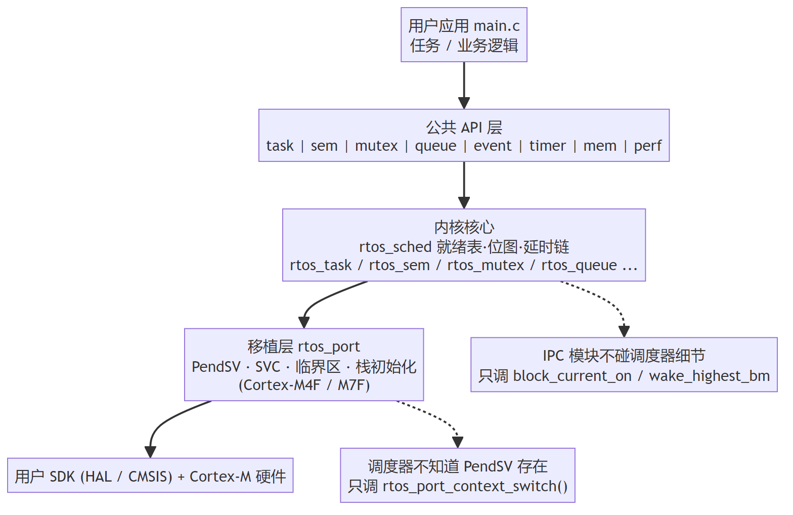

<details><summary>图形源码（mermaid）</summary>

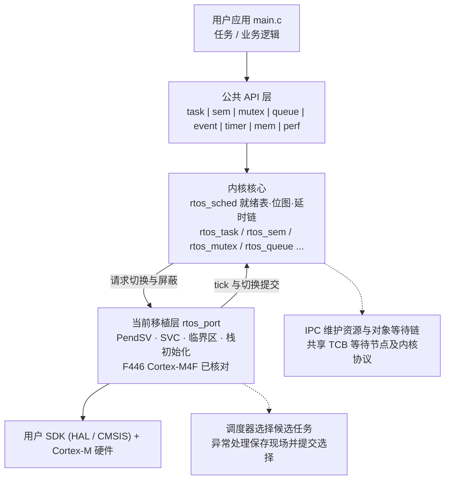

</details>

图中分层表达职责，不是严格无环的函数调用图。IPC 模块通过 `rtos_internal.h` 复用等待、超时和唤醒协议，同时会读取当前 TCB；信号量自行登记位图等待节点。调度器通过端口请求 PendSV，端口异常处理再调用 tick 和切换提交函数。初始化时调度器还会借助任务模块建立 idle。理解这些受约束的双向协作，比假定所有依赖都只能向下更接近实际代码。

| 组件 | 主要职责与状态归属 | 协作边界 |
|---|---|---|
| `rtos_sched.c` | 就绪位图、每优先级就绪环、延时链、current/next 和调度状态 | 选任务、处理时间到期、请求和提交切换 |
| `rtos_task.c` | TCB 构造、地址登记、任务生命周期、通知及公共等待原语 | 对象模块共享等待节点协议；删除时协调互斥锁和回收 |
| sem/mutex/queue/event | 各对象的资源状态与等待链 | 在同一保护协议内登记结果、摘链并使任务就绪 |
| `rtos_timer.c` | 命令队列、服务任务、活跃定时器链及创建代次 | 借助 queue/任务服务；用户回调在临界区外执行 |
| `rtos_port.h` / `port.c` | 原屏蔽值、临界区嵌套、PSP 栈帧和异常返回 | 由硬件异常承接 CPU 上下文切换；不能只更新 TCB 指针 |
| 应用及目标 SDK | 业务对象、静态存储、任务入口、时钟与外设 | 负责缓冲寿命、错误处理、中断优先级及目标资源配置 |

建立运行系统的次序是：板级时钟/内存/中断准备 → `rtos_init()` 初始化 perf、堆、调度器与 idle，并按配置初始化 timer → 应用建立 IPC、缓冲和任务 → `rtos_start()` 进入首任务。perf 在 idle 创建前初始化，避免清表时丢失刚登记的 idle；基础服务使用静态存储，应用任务则可混用静态和动态路径。初始化返回状态必须由应用检查，当前接口不提供跨全部模块的事务式失败回滚。

沿源码阅读时，可从 [rtos_sched.c](../RTOS/Core/Src/rtos_sched.c) 的 `rtos_init/rtos_sched_start` 开始，然后跟进 [rtos_task.c](../RTOS/Core/Src/rtos_task.c) 的创建与阻塞协议，最后用 [port.c](../RTOS/Port/GCC/ARM_CM7/port.c) 核对任务现场实际何时接管 CPU。

> **当前实现说明**：以下机制已按源码校订：
> ① 等待链有**两套并存约定**（信号量 FIFO 位图链 / 队列、事件组、互斥锁有序链）。位图选优先级是 O(1)，但信号量多等待者定位与清位仍需扫描，整体最坏 O(n)，见 1.3 不变式 III、2.3、6.3；
> ② 延时链由"单向 + 摘除 O(n)"改为**双向 + 表尾缓存**（插入 O(1) 快路径、摘除 O(1)），见 3.4；
> ③ PendSV 由"双层 C 调用 + `isb`"改为**汇编直存 + 单层 `bl`**，见 4.2；
> ④ 临界区由"out-of-line 函数 + exit 侧 `isb`"改为**头文件内联**，见 4.5；
> ⑤ 已知限制 L1/L2/L4 已修复，见第十五章；
> ⑥ 第十六章给出 API 上下文、存储寿命、资源预算与验证入口；历史性能记录见独立报告。

## 1.2 五条贯穿全内核的设计原则

| 原则 | 体现 | 违反的代价（为什么必须坚持） |
|------|------|------|
| **1. 基础服务不依赖运行时分配** | idle、定时器服务及命令队列使用静态存储；业务任务可选堆或调用方存储 | 基础回收路径若依赖可耗尽的堆，会使内存不足难以恢复 |
| **2. 保护窗口与工作分离** | 共享状态操作使用 BASEPRI 或 PRIMASK 临界区；栈初始化和用户回调尽量放在外部 | 扫描、复制和嵌套重算仍会增加保护时间，必须按完整路径评估 |
| **3. 优先缩短热路径** | 选任务（`ctz` 位图）、就绪表和内存池分配是 O(1)；信号量单等待者唤醒是 O(1)，多等待者仍最坏 O(n) | 线性扫描与任务数、等待者数一起增加，必须结合业务负载测量 |
| **4. 侵入式复用** | TCB 内嵌 wait_node 与链表指针，wait_node 字段多路复用 | 若用外部分配的节点，每次阻塞都要 malloc → 引入失败路径与碎片 |
| **5. 统一清理** | 任务离开等待状态的三条路径（唤醒/超时/中止）共用内核清理代码 | 任何一条路径漏删链表节点 → 悬空指针 → use-after-free |

## 1.3 任务状态机与迁移触发点

状态图包含可运行资格与生命周期状态。`INITIALIZING` 已占用 TCB 地址，但尚未进入就绪集合，公开修改接口不接受该任务；`READY` 表示具备运行资格。`RUNNING/current` 在受保护的交接阶段先发布，随后才恢复寄存器与 PSP；完成交接的稳定态中二者与 CPU 执行位置一致。首任务由 SVC 启动，日常切换由 PendSV 提交，不能把“选中或发布任务”直接等同于任务已开始执行指令。构造和发布过程见 5.1。

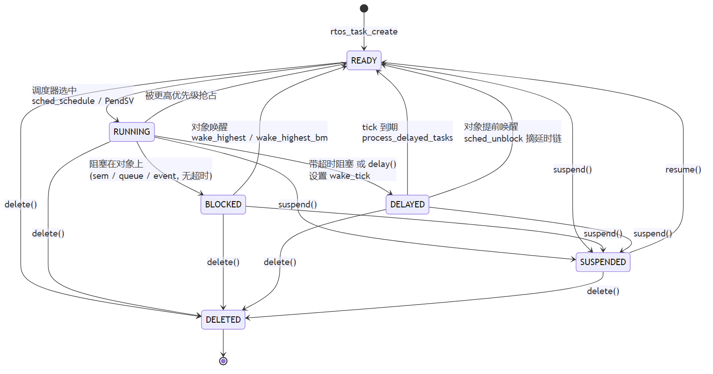

<details><summary>图形源码（mermaid）</summary>

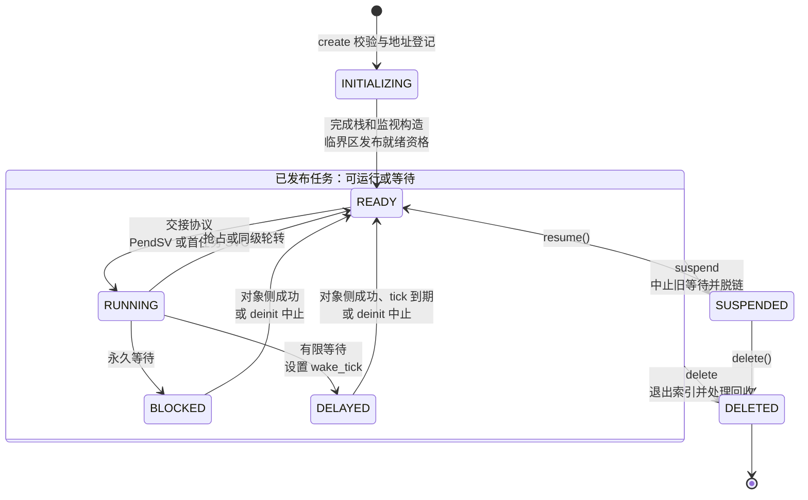

</details>

图中“已发布任务”是为合并公共 suspend/delete 箭头设置的分组，不是额外的任务状态枚举；具体状态仍为框内四类。永久纯 delay 没有对象侧授予者，需外部中止/管理操作才能结束。

**三条硬性不变式**（贯穿全文，每处代码都依赖它们）：

1. **不变式 I**：已完成切换、没有待执行同级轮转的稳定状态中，RUNNING TCB 是其优先级就绪链表的 head。轮转先移动 head 并登记 next_tcb，PendSV 执行前 current 仍是旧任务；阻塞后切出前也会暂时出现 current 指向 DELAYED/BLOCKED。因此不能只凭 current 指针推断任务处于 RUNNING；yield、取消候选和提交切换分别维护这一窗口；
2. **不变式 II**：任一时刻，一个 TCB 至多属于一条调度链表（就绪链表或延时链表）+ 至多一条对象等待链表；
3. **不变式 III（两套并存约定）**：对象等待链表有两种维护纪律，**同一个对象内不可混用**——
   - **(A) 位图索引链**：当前仅信号量采用。链表是**尾插的 FIFO 链**，链首**不一定**是最高优先级；`uint32_t` 位图 + `__builtin_ctz` 先选最高优先级，再从整条 FIFO 链首定位第一个匹配者（`rtos_internal_wake_highest_bm`）。入链 O(n)，单等待者唤醒 O(1)，多等待者定位和摘链后清位均最坏 O(n)。位图没有独立的每优先级链首，不能据此宣称整体唤醒 O(1)。
   - **(B) 有序链**：队列（发送链与接收链）、事件组、互斥锁。按任务优先级升序插入，**链首 = 最高优先级等待者**。`rtos_internal_wake_highest` 取链首是 O(1)，插入 O(n)；事件组 set 需逐个判定条件，仍是 O(n)。
   - 两种链的单资源候选选择规则相同：最高优先级优先，同优先级内 FIFO；事件组仍需另按位条件逐个判断，见第九章。
   - 任务有效优先级变化时，由 `rtos_internal_requeue_wait_lists()`（5.8）**按链的类别分别处理**：位图链摘出、同步旧/新位，再尾插；有序链摘出后按新优先级重插。有效优先级不变时不重挂，以保留 FIFO。

> **为什么保留两套**：信号量 FIFO 位图链与有序链具有相同的优先级唤醒、同级 FIFO 语义，但付出成本的位置不同。当前队列通过有序等待链直接取最高优先级发送者或接收者；互斥锁还要移交所有权并重算继承，事件组还要检查位条件。两套约定由 `queue_bitmap` 是否为 NULL 区分，不能混用。实际性能收益见带日期报告，不能由位图操作的常数复杂度推导整个 API 的时延。

---

# 第二章 核心数据结构详解

## 2.1 内核全局状态 rtos_kernel_t (rtos_sched.c 定义唯一实例)

```c
typedef struct rtos_kernel
{
    volatile rtos_sched_state_t sched_state;   /* NOT_STARTED/RUNNING/SUSPENDED/STOPPED */
    volatile rtos_tick_t        tick_count;    /* 全局时基, SysTick 每 ms +1 */

    volatile uint32_t           ready_bitmap;  /* ★就绪位图 */
    rtos_tcb_t                 *ready_heads[RTOS_CONFIG_MAX_PRIORITIES];
    rtos_tcb_t                 *delay_head;    /* 单条双向延时链，按半平面时序排序 */

    rtos_tcb_t                 *current_tcb;   /* 正在运行 */
    rtos_tcb_t                 *next_tcb;      /* 调度决策结果, PendSV 消费 */
    rtos_tcb_t                 *idle_tcb;

    volatile uint32_t           switch_count;  /* 切换请求/调度决策计数，非提交次数 */
    volatile uint32_t           critical_nesting; /* (保留字段; 实际计数在移植层
                                                   *  rtos_port_crit_nest, 见 4.5) */
    uint32_t                   suspend_depth; /* 成对的调度器挂起嵌套深度 */
    /* …统计与性能字段(第十二章, 受 RTOS_CONFIG_USE_PERF_MONITOR 条件编译)… */
} rtos_kernel_t;
```

> **易错点**：`critical_nesting` 是**历史遗留的保留字段**，内核实际使用的是移植层的全局
> `rtos_port_crit_nest`（`rtos_port.h` 内联函数直接读写它，避免跨 TU 函数调用）。
> 不要读 `rtos_kernel.critical_nesting` 来判断临界区状态 —— 它恒为 0。
> 查询入口是 `rtos_port_get_critical_nesting()`。

**`ready_bitmap` 与 `ready_heads[]` 的配合规则**（一切调度操作的基础）：

| 操作 | 链表动作 | 位图动作 |
|------|---------|---------|
| 任务入就绪表（优先级 p） | push_tail 到 ready_heads[p] 环 | `bitmap \|= 1<<p` |
| 该优先级最后一个任务离开 | ready_heads[p] = NULL | `bitmap &= ~(1<<p)` |
| 同优先级仍有其他任务 | 摘除 tcb；仅删除 head 时后移 head | 位不变 |

## 2.2 TCB: 字段分组与三个易错点

```c
struct rtos_tcb
{
    rtos_stack_t      *top_of_stack;    /* 偏移0: PendSV 汇编直接 STR, 不算偏移 */
    rtos_stack_t      *stack_base;      /* 栈最低地址(向下生长的边界) */
    uint32_t           stack_size;      /* ★单位是字(4字节), 不是字节 */

    rtos_prio_t        priority;        /* 有效优先级(可能被继承临时提升) */
    rtos_prio_t        base_priority;   /* 用户设定的原始优先级 */
    rtos_task_state_t  state;
    rtos_bool_t        is_static;

    struct rtos_tcb   *next_ready, *prev_ready; /* 双向环(就绪) / 双向链(延时) */
    struct rtos_tcb   *next_all;         /* 全任务地址登记链，独立于调度/等待链 */

    rtos_wait_node_t   wait_node;       /* 内嵌等待节点, 见 2.3 */
    rtos_tick_t        wake_tick;       /* 延时链排序键 */
    void              *blocked_on;      /* 所等对象; notify 等待时 =(void*)tcb 自指标记 */
    rtos_status_t      wait_result;     /* OK/TIMEOUT/DELETED, 醒来后由本任务读 */

    volatile uint32_t  notify_value;    /* 任务通知值 */
    volatile uint8_t   notify_state;    /* IDLE/PENDING/RECEIVED */

    char               name[ RTOS_CONFIG_MAX_TASK_NAME_LEN ];
    uint32_t           task_id, switch_count;
    uint32_t           stack_magic;     /* 0xDEADBEEF, 溢出哨兵(只读 TCB 内这份) */
    /* …perf 字段… */
};
```

**指针复用约束**：就绪态时 `next_ready`/`prev_ready` 构成双向环；延时态时构成终止于 NULL 的双向链，其中表头 `prev_ready` 可缓存表尾，见 3.4。两种用途由链归属互斥保证。任务离开延时链后必须清除旧链接，再按就绪环规则插入，不能把缓存表尾当作普通前驱。

**易错点 2**：`stack_size` 单位是字。所有边界计算都要 `× sizeof(rtos_stack_t)`。

**易错点 3**：`stack_magic` 的栈内副本（`*stack_buf` 处）会被性能监视器的水印填充（0xA5A5A5A5）覆盖——溢出检测**只能**读 TCB 内的这份。

## 2.3 等待节点: 对象模块共用的字段多路复用表

下面按用途归纳字段，不对应实际结构成员顺序或完整 ABI；`on_timeout` 在真实定义中的位置应直接查看头文件。

```c
typedef struct rtos_wait_node
{
    rtos_tcb_t   *tcb;          /* 常规: 指向等待者 */
    rtos_tick_t   wake_tick;    /* 常规: 未用 | 事件组: 存等待模式 */
    rtos_bool_t   timed_out;    /* 超时唤醒标记 */
    void         *wait_obj;     /* 所等对象指针: mutex_waiter_left 匹配互斥锁用 */
    struct rtos_wait_node *next, *prev;   /* 对象等待链表(双向) */
    void         *transfer_buf; /* 队列: 发送/接收缓冲 | 事件组: set 回传的位值 */
    uint32_t      transfer_size;/* 队列: 消息字节数 | 事件组: 等待位掩码 */
    uint8_t       to_front;     /* [队列] 阻塞发送的插队意图(代办入队时按此选写入位置) */
    struct rtos_wait_node **list_head; /* ★所在链表头地址, 超时/中止清理的钥匙 */
    void (*on_timeout)(struct rtos_wait_node *node); /* 摘对象链前捕获超时结果 */
    volatile uint32_t *queue_bitmap;   /* ★非 NULL = 本链为"位图索引链"(见下) */
    rtos_prio_t   queued_priority;     /* ★入链时的优先级(优先级变化后同步位图用) */
} rtos_wait_node_t;
```

| 字段 | 信号量 | 互斥锁 | 队列 | 事件组 |
|------|-------------|--------|------|--------|
| transfer_buf | 不用 | 不用 | 发送方=发送缓冲 / 接收方=接收缓冲 | set 写入"满足时的位值" |
| transfer_size | 不用 | 不用 | = item_size | = 等待位掩码 |
| wake_tick | 不用 | 不用 | 不用 | = 等待模式(ANY/ALL\|CLEAR) |
| to_front | 不用 | 不用 | 阻塞发送的插队意图 | 不用 |
| list_head | &sem->wait_head | &mutex->wait_head | &queue->send/recv_wait_head | &event->wait_head |
| **queue_bitmap** | **&sem->wait_bitmap** | NULL(有序链) | NULL(有序链) | NULL(有序链) |
| **queued_priority** | 入链时优先级 | 入链时优先级 | 入链时优先级 | 入链时优先级 |

**`list_head` 为什么存"链表头指针的地址"而不是链表头指针**：超时清理由 TCB 找到所属对象链头地址，再经 `rtos_internal_wait_remove_sync_bitmap()` 精确摘链并维护位图；字段也标识是否仍挂在对象链上。notify 等待不挂对象链，置 NULL 自动跳过。`on_timeout` 只由内核用于捕获结果，不是可随意执行用户业务回调的入口。

**`queue_bitmap` / `queued_priority` 是"链纪律"的运行时标记**（这是理解唤醒路径的钥匙）：

| queue_bitmap | 含义 | 入链方式 | 唤醒方式 |
|---|---|---|---|
| **非 NULL** | 位图索引链（当前仅信号量） | `rtos_internal_wait_append`（尾插 → O(n)，同优先级 FIFO） | `rtos_internal_wake_highest_bm`：单等待者 O(1)；多等待者从整链定位并扫描清位，最坏 O(n) |
| **NULL** | 按优先级有序链 | `rtos_internal_wait_insert_by_prio`（有序插入 → O(n)） | `rtos_internal_wake_highest`（取链首）→ **O(1)** |

> **两套约定的成本对比（注意：两者入链都是 O(n)，差别在唤醒侧）**：
> 有序链把成本花在**入链**（为唤醒时的 O(1) 取链首做排序准备）；
> 位图链尾插仍要找尾，唤醒侧用 `ctz` 选优先级后还需找节点、确认该位是否仍有等待者。减少优先级比较、处理单等待者快路径可以改善实测成本，但不改变多等待者路径最坏 O(n)。历史对照见[性能报告](rtos_performance_report.md)，不能代替当前实现复杂度分析。

`queued_priority` 记录**入链当时**的优先级：任务优先级被修改（用户 `set_priority` 或内核优先级继承提升/恢复）时，必须据此把旧位清掉、置新位，否则位图会残留一个"已无人等待"的优先级，导致后续唤醒空扫描甚至选错牺牲者。同步逻辑在 `rtos_internal_requeue_wait_lists()`（5.8）。

## 2.4 状态归属、登记结构与评审不变式

TCB 是几个独立索引的交汇点，而不是只有“当前任务指针”一条访问入口。就绪/延时结构决定调度资格，对象等待链决定资源授予，存活登记链用于地址校验，perf 表用于有限容量的观察。删除、挂起和改优先级必须协调相关索引，不能只改 `state`。

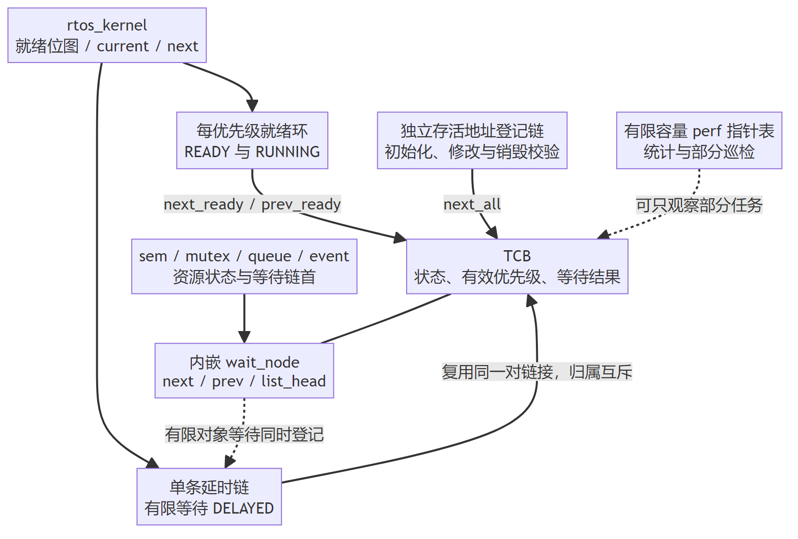

<details><summary>图形源码（mermaid）</summary>

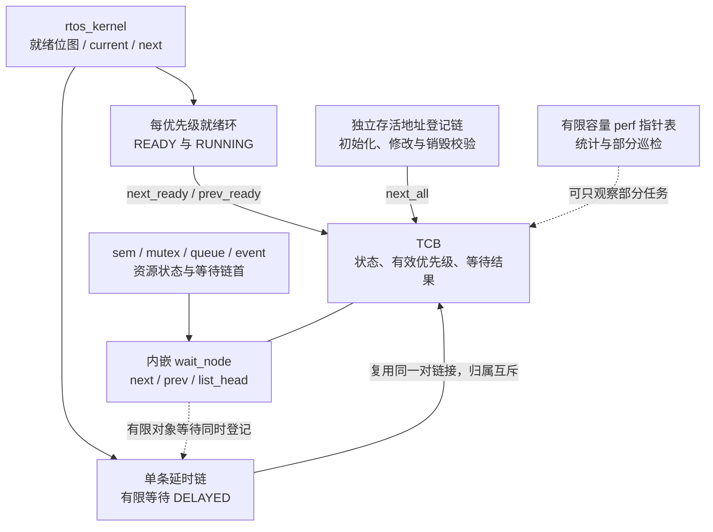

</details>

下表描述完成受保护操作后的稳定归属；在“阻塞决策已作出、PendSV 尚未切出”等窗口，`current_tcb` 仍可指向已离开就绪环的任务，见 3.3。

| 状态或操作 | 就绪/延时归属 | 等待节点约束 | 评审时应核对的联动 |
|---|---|---|---|
| READY / 稳定 RUNNING | 一个就绪环；对应 bitmap 位置位 | 没有未完成对象等待 | 环链接对称；最后节点离开时清位 |
| 纯有限 delay | 延时链；不在就绪环 | `blocked_on == NULL` | wake_tick 比较及表头尾缓存一致 |
| 有限对象等待 | 延时链；不在就绪环 | 一个对象链；notify 仅用自指标记 | 成功、超时或中止后同时清理两个索引 |
| 永久对象等待 | 不在就绪/延时结构 | 一个对象链；notify 例外同上 | 对象唤醒、deinit 或任务中止仍可找到它 |
| SUSPENDED | 不在就绪/延时结构 | 中止旧等待并脱链 | resume 恢复资格，不恢复旧资源等待 |
| 改有效优先级 | 更新对应就绪位置或保留延时位置 | 重排有序链，或同步位图与 FIFO 链 | 使用入链时 queued_priority 清理旧位 |
| 删除 | 退出调度与等待索引及存活登记 | 旧句柄不再供业务访问 | 锁移交、perf 注销、自删延迟回收和外部缓冲寿命 |

共享状态的安全性依赖完整协议：保护域覆盖所有修改方、节点只登记一次、结果先写好再发布就绪、离开等待时清理全部归属。`volatile` 可约束某些编译器访问，不能代替临界区、对象寿命或上述跨字段不变式。ISR 保护域见 4.6，业务销毁协议见 16.3/16.5。


---

# 第三章 调度器: 从就绪表到上下文切换的完整链路

## 3.1 find_highest_priority: 两条指令选出下一个任务

```c
static inline rtos_prio_t find_highest_priority( uint32_t bitmap )
{
    if( bitmap == 0U ) return MAX_PRIORITIES;
    return (rtos_prio_t)__builtin_ctz( bitmap );
}
```

因为优先级 0（最高）对应位图最低位，"最高优先级就绪任务 = 最低置位 bit"。当前 Cortex-M4 GCC 目标的非零位图选择可编译为 `RBIT + CLZ`；完整调用还包含零判断、取链首和访存，不能把两条指令的数量直接写成完整调度周期数。**代码注释警告不要写成 `31-clz`**——那是取最高置位 bit，方向相反（bitmap=0x3 时 ctz=0 正确选优先级 0，31-clz=1 会选优先级 1）。

## 3.2 ready_list 三操作: push_tail / remove / rotate

**push_tail（任务变为就绪）**：

```
空链:  tcb->next_ready = tcb->prev_ready = tcb; heads[p] = tcb;  (自环)
非空:  tail = head->prev_ready;
       tcb->next = head; tcb->prev = tail;
       tail->next = tcb; head->prev = tcb;      (插入 head 前 = 队尾)
       bitmap |= 1<<p;
```

**remove（任务失去就绪资格）**：

```
仅剩自己: heads[p] = NULL; bitmap &= ~(1<<p);
否则:     prev->next = next; next->prev = prev;
          若自己是 head: heads[p] = next_ready;   (维持不变式 I)
```

**rotate（时间片轮转）**：`heads[p] = heads[p]->next_ready` —— 只动头指针，O(1)。当前任务从"队头"变"队尾"，链上的下一个任务成为新队头（时间片轮到的下一个）。

## 3.3 rtos_sched_schedule(): 调度决策 (不执行切换)

```
前置: 调用方必须已进入临界区
1. sched_state != RUNNING → return
2. top = find_highest_priority(ready_bitmap)
3. top 无效 → return (idle 恒在, 理论不可达)
4. next = ready_heads[top]
5. next == current_tcb:
     next_tcb = NULL                    ← 取消早前已经失效的切换候选
     next 为 READY → state = RUNNING    ← 当前任务曾阻塞，但切出前又被唤醒
     return
6. next != current_tcb:
     抢占配置: next_tcb = next; switch_count++; 请求 PendSV
     非抢占配置: 仅 current 的 state != RUNNING 时执行上述提交
   rtos_port_context_switch()          ← 只"挂起" PendSV, 见 4.5
```

**关键理解：schedule() 返回后任务还在跑**。PendSV 优先级最低且被临界区屏蔽，此刻只是登记了"需要切换"。真正的切换发生在调用链层层退出、最外层临界区 `EXIT_CRITICAL` 恢复进入前的屏蔽状态并允许 PendSV 执行之后。

**本轮未保留的候选**：曾将提交/取消切换候选的逻辑抽为 `schedule_ready_task(next)`，让 `unblock` 在已知最高就绪优先级时直接复用 `ready_heads[p]`，减少一次状态检查与位图选择。候选保留了上述取消、READY→RUNNING、非抢占配置和 PendSV 请求语义，但常规微基准实测吞吐退步，因此已回退；当前 `unblock` 仍调用完整的 `rtos_sched_schedule()`。对照数据和最终保留范围见 [本轮性能优化报告](rtos_optimization_20261012.md)。

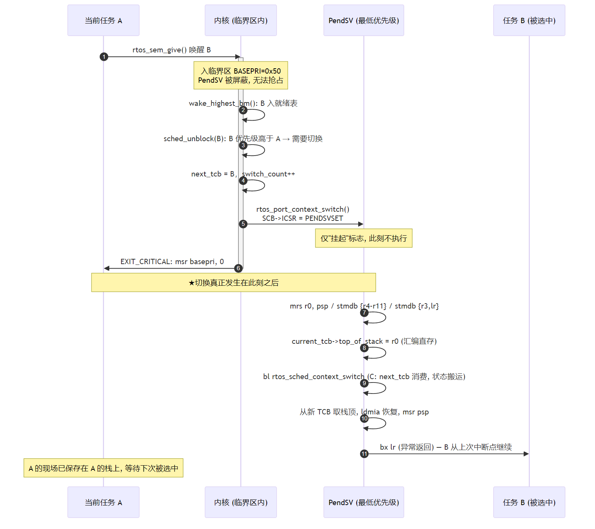

<details><summary>图形源码（mermaid）</summary>

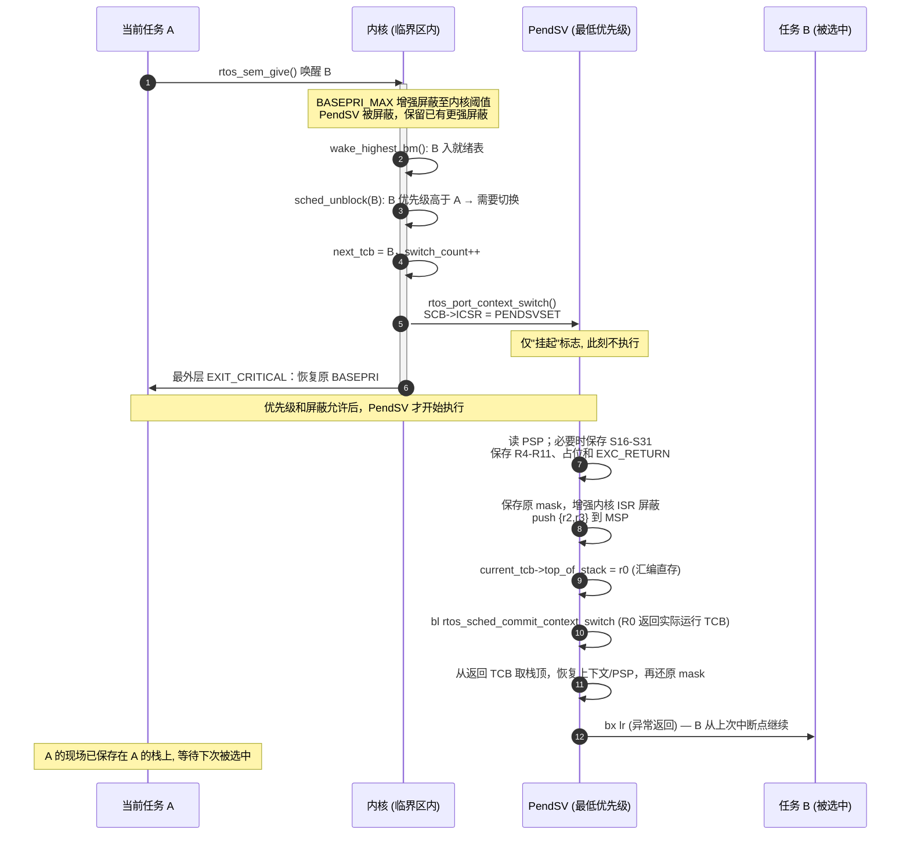

</details>

**这个"决策-执行分离"设计的三个好处**：
1. 临界区内可以多次调用 schedule()（如 tick 里唤醒多个任务），多次 pend 自然合并为一次切换；
2. 同一函数在任务上下文（yield）和 ISR 上下文（sem_give 唤醒）都能用——ISR 里挂 PendSV 是安全的标准手法；
3. schedule() 本身不安装任务栈或 PSP，可在合法任务/ISR 调用链内复用；调用方仍须持内核临界区，并满足调度与生命周期约束。

**决策失效时必须重算**：合法 RTOS ISR（本配置优先级数值 ≥5）可在 PendSV 执行前唤醒刚阻塞的当前任务。若它重新成为最高就绪任务，`schedule` 清除过期 `next_tcb`，并恢复它的 RUNNING 状态。删除、挂起和优先级变化同样重算候选。优先级 0~4 的 ISR 不允许调用 RTOS API，不能用它们解释合法内核竞态。

## 3.4 rtos_sched_block(): 任务退出运行, 进入等待

任何阻塞 API（delay/sem_take/mutex_take/queue/event/notify_wait）最终都走到这里：

```
sched_block(tcb, ticks):
1. state == READY/RUNNING → ready_list_remove(tcb)     ← 先摘出就绪表
2. ticks == RTOS_WAIT_FOREVER 或 ticks > 0x7FFFFFFF:
      wake_tick = 0xFFFFFFFF (哨兵); state = BLOCKED
      (不入延时链 —— 不会因 tick 超时唤醒；IPC 可被对象唤醒，纯 delay 需外部中止)
3. 否则:
      wake_tick = tick_count + ticks
      state = RTOS_TASK_DELAYED
      delay_list_insert(tcb)                            ← 表尾快路径 O(1)，乱序插入 O(n)
```

### 延时链表: 按"睡到几点"排序的**双向**链 (含表尾缓存)

延时链没有独立的链表对象，而是由一个链头和 TCB 内的复用指针构成：

```c
rtos_kernel.delay_head;   /* 唯一链表头 */
tcb->wake_tick;           /* 睡到第几个 tick 醒(绝对时刻) */
tcb->next_ready;          /* 延时链上的后继(此态下语义为 next) */
tcb->prev_ready;          /* 延时链上的前驱 —— 但要见下方的"表头借用"约定 */
```

**核心技巧：表头节点的 `prev_ready` 被借用来缓存表尾。**

链表有两个方向的指针（`next_ready` 指向更晚醒的、普通节点 `prev_ready` 指向更早醒的，表尾 `next_ready == NULL`），长度至少为 2 时**表头节点的 `prev_ready` 借用为表尾缓存**；只有一个节点时，next/prev 均为 NULL。这里的“双向”描述指针方向，不表示有两条延时链：

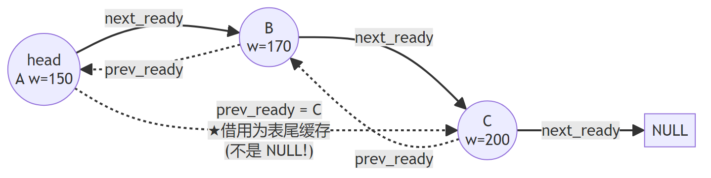

<details><summary>图形源码（mermaid）</summary>

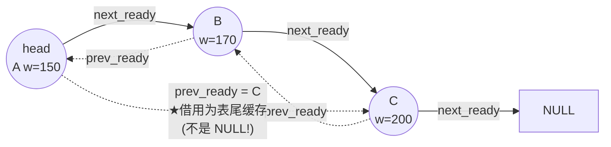

</details>

收益：**取表尾变成 O(1)**（无需遍历），而"新唤醒点是否晚于所有现有节点"这个判断只需比较一次即可完成——这就是插入快路径的基础。代价是**摘除表头时必须特殊处理**（表头的 `prev_ready` 不是真实前驱），见下面的 `delay_list_remove`。

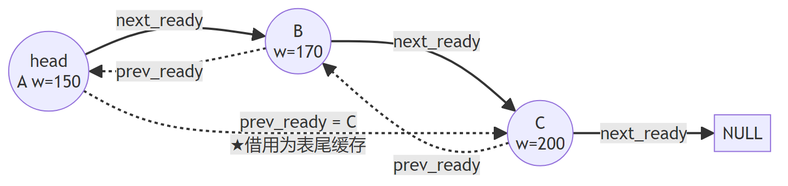

<details><summary>图形源码（mermaid）</summary>

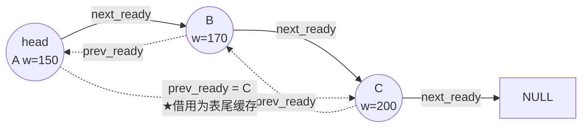

</details>

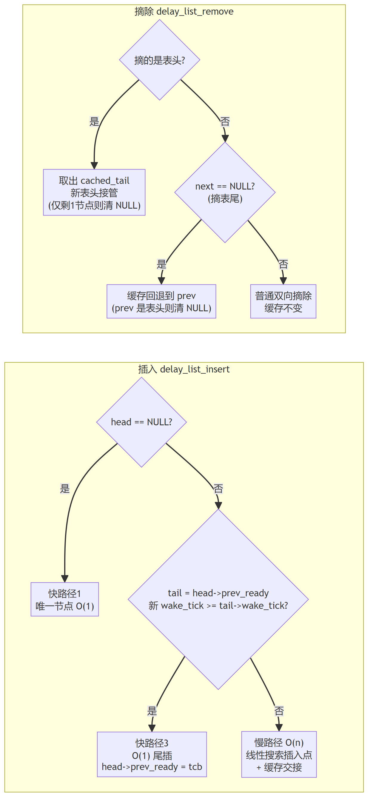

<details><summary>图形源码（mermaid）</summary>

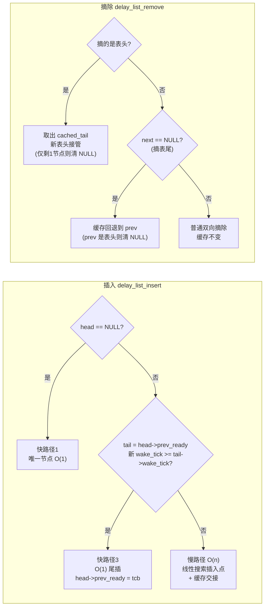

</details>

> 等价性论证：链长 ≥ 2 时 `表头.prev_ready == 表尾`，且 `表尾.prev_ready == 真实前驱`；
> 链长 == 1 时表头即表尾，缓存退化为 NULL。插入/摘除的每个分支都显式维护这条不变式。

**插入：三级快路径 + 一条慢路径**

```c
static void delay_list_insert(rtos_tcb_t *tcb)
{
    rtos_tcb_t *head = rtos_kernel.delay_head;

    /* 快路径 1: 空链 → O(1) */
    if (head == NULL) { tcb->next_ready = NULL; tcb->prev_ready = NULL;
                        rtos_kernel.delay_head = tcb; return; }

    rtos_tcb_t *tail = head->prev_ready;            /* 取表尾缓存 */

    /* 快路径 2: 单节点链 / 缓存异常修复 */
    if (head->next_ready == NULL)      { tail = head; }
    else if (tail == NULL) {                        /* 缓存异常: 重算并修复 */
        tail = head;
        while (tail->next_ready != NULL) { tail = tail->next_ready; }
        head->prev_ready = tail;
    }

    /* 快路径 3: 新唤醒点不早于表尾 → O(1) 尾插 */
    if (sched_tick_after(tcb->wake_tick, tail->wake_tick) >= 0) {
        tcb->next_ready = NULL; tcb->prev_ready = tail;
        tail->next_ready = tcb; head->prev_ready = tcb;   /* 缓存前移 */
        return;
    }

    /* 慢路径: 线性搜索插入点(仅当新节点早于当前表尾) */
    rtos_tcb_t *prev = NULL, *cur = head;
    while ((cur != NULL) && (sched_tick_after(cur->wake_tick, tcb->wake_tick) <= 0)) {
        prev = cur; cur = cur->next_ready;
    }
    tcb->next_ready = cur;
    if (prev == NULL) { tcb->prev_ready = tail;          /* 成为新表头, 接管缓存 */
                        head->prev_ready = tcb;
                        rtos_kernel.delay_head = tcb; }
    else { tcb->prev_ready = prev; prev->next_ready = tcb;
           if (cur != NULL) { cur->prev_ready = tcb; }
           else             { head->prev_ready = tcb; } } /* 新表尾, 更新缓存 */
}
```

**快路径的适用条件**：`delay_list_insert` 由 `sched_block` 在内核临界区中调用；新 wake_tick 不早于现有表尾时，尾插只需一次比较，避免 O(n) 搜索。较短超时、多个不同周期或乱序截止时刻可能走慢路径，命中率取决于业务负载，不能从“周期任务”这一标签推导极高命中率。

插入实例（当前 tick = 100，表尾缓存已建立）：

```
任务A delay(50)        → wake=150: 链空, 快路径1           [A(150)]
任务B delay(10)        → wake=110: 110 < 表尾150 → 慢路径   [B(110), A(150)]
任务C sem_take(超时50) → wake=150: 150 >= 表尾150 → 快路径3 尾插
                                                          [B(110), A(150), C(150)]
任务D delay(100)       → wake=200: 200 >= 表尾150 → 快路径3 尾插(仅 1 次比较)
                                                          [B(110), A(150), C(150), D(200)]
```

**摘除：O(1)，但要处理"表头缓存"的三种交接**

```c
static void delay_list_remove(rtos_tcb_t *tcb)
{
    rtos_tcb_t *prev = tcb->prev_ready;      /* 注意: 若 tcb 是表头, 这是表尾缓存 */
    rtos_tcb_t *next = tcb->next_ready;
    rtos_bool_t is_head = (rtos_kernel.delay_head == tcb);

    if (is_head) {
        rtos_tcb_t *cached_tail = prev;      /* 先把缓存取出来 */
        rtos_kernel.delay_head = next;
        if (next != NULL) {
            if (next->next_ready == NULL) { next->prev_ready = NULL; }  /* 只剩1个: 无独立缓存 */
            else                          { next->prev_ready = cached_tail; } /* 新表头接管缓存 */
        }
    } else if (prev != NULL) {
        prev->next_ready = next;
        if (next != NULL) { next->prev_ready = prev; }
        else {                                /* 摘除表尾: 缓存要回退 */
            if (prev == rtos_kernel.delay_head) { prev->prev_ready = NULL; }
            else { rtos_kernel.delay_head->prev_ready = prev; }
        }
    } else { return; }                        /* 不在链上(防御) */
    tcb->next_ready = NULL; tcb->prev_ready = NULL;
}
```

**三个设计决定**：

**① 复用 `next_ready`/`prev_ready`，不新增 `next_delay` 字段**——在本 32 位目标上节省 8 字节/任务。就绪环和延时链的归属必须互斥；离链时清链接，入链时按新的结构规则重建。安全性依赖所有状态迁移均维护这一协议，不能由 `state` 字段本身自动保证。

**② 三条快路径 + 一条慢路径：用"比较一次"换掉"遍历一遍"**——升序排列的价值在于 tick 侧只需看链首一眼（`sched_tick_after(delay_head->wake_tick, now) > 0` 即收工），"找谁该醒"不是搜索而是摘链首。而**插入侧**通过表尾缓存把最常见的"追加到最晚"变成一次比较。FreeRTOS 同为有序链表，但其插入固定 O(n)；本内核在保持同等 tick 侧效率的前提下把常见插入降为 O(1)。

**③ 同一 `wake_tick` 的任务按 FIFO**——慢路径的循环条件用 `<= 0`（即"当前节点不晚于我"就继续走），使新节点插到所有同值节点**之后**；先睡的排前面、先被唤醒。

> **tick 回绕安全**（原限制 L1，已修复）：任务延时链的到期与排序比较统一走
> `sched_tick_after(a, b) = (int32_t)(a - b)`（模 2³² 减法取半平面），
> 当前有限等待域为 `1..0x7FFFFFFF` tick；`0` 由公共 API 解释为不等待或 yield。
> `rtos_sched_block()` 把 `0x80000000..0xFFFFFFFF` 转为永久阻塞。
> 本实现只有一条 `delay_head` 双向链，没有按 tick 回绕拆分的 current/overflow 延时链。
> 对象等待链 + 延时链的“双链登记”（3.5）也不是两条延时链。
> `rtos_task_delay_until()` 的 period 应遵守有限域；当前入口没有直接拒绝大 period，
> 计算出的 remain 最终受 `sched_block` 约束。软件定时器则显式拒绝 `period >= 0x80000000`。
> 早期实现用无符号比较，
> 跨 49.7 天回绕点时延时会被排到链首并在下一 tick 立即"到期"。

**回绕算例**：当前 `now=0xFFFFFFF0`，请求 32 tick 后到期，模 2³² 相加得到 `wake=0x00000010`。

| 观测 tick | `(int32_t)(wake-now)` | 判定 |
|---|---|---|
| `0xFFFFFFF0` | `+32` | 未到期，跨回绕等待正常 |
| `0x0000000F` | `+1` | 尚差 1 tick |
| `0x00000010` | `0` | 本 tick 到期 |
| `0x00000011` | `-1` | 已经过期 |

这一有符号差值只能在约定的半平面内区分先后：相隔 `0x80000000` 的两个值无法无歧义排序。因此延长单次有限等待需要改变时间表示或链管理协议，不能只删除上界判断。合法有限等待在回绕后继续工作，不要求系统到 24.8 天或 49.7 天停机。

注意实例里的任务 C：它不是单纯延时，而是**带超时的对象等待**——它会同时出现在延时链**和**信号量等待链上。这正是 3.5 / 3.7 的主角。

## 3.5 唤醒的两条路径: 对象侧与时间侧

正常等待完成有对象侧成功与时间侧到期两条主要路径，它们从不同索引找到任务，但都必须清理全部等待归属。对象 deinit、任务挂起/删除等中止另见第五章，不能把这些生命周期路径遗漏在清理协议之外。

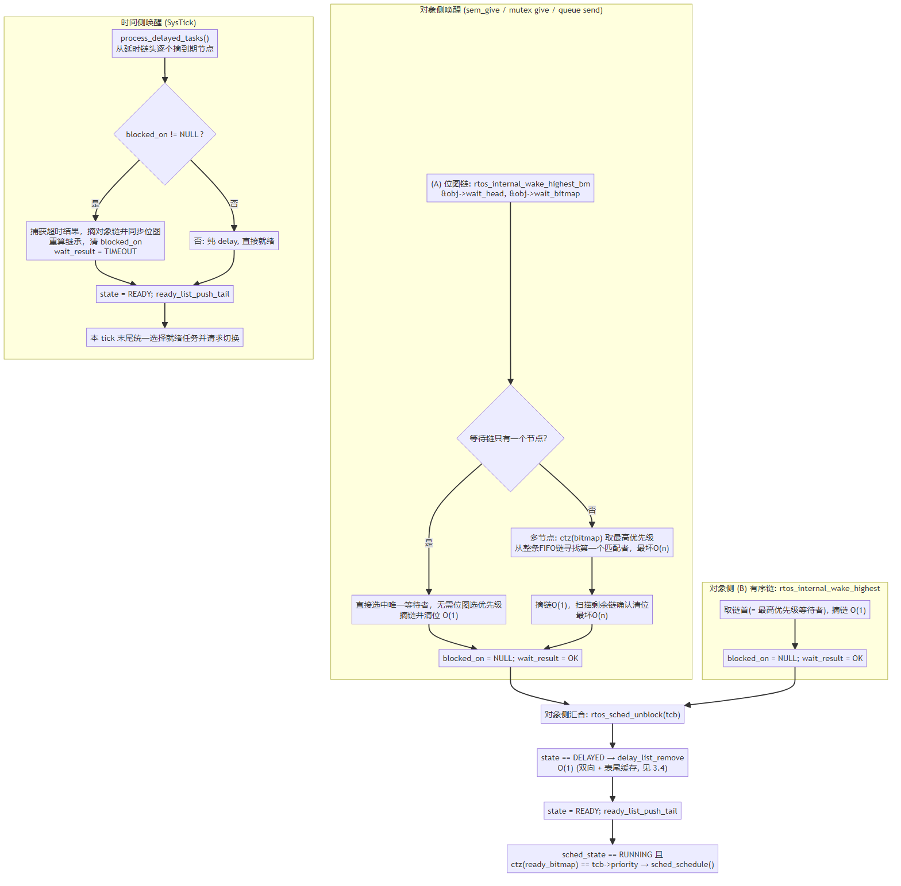

<details><summary>图形源码（mermaid）</summary>

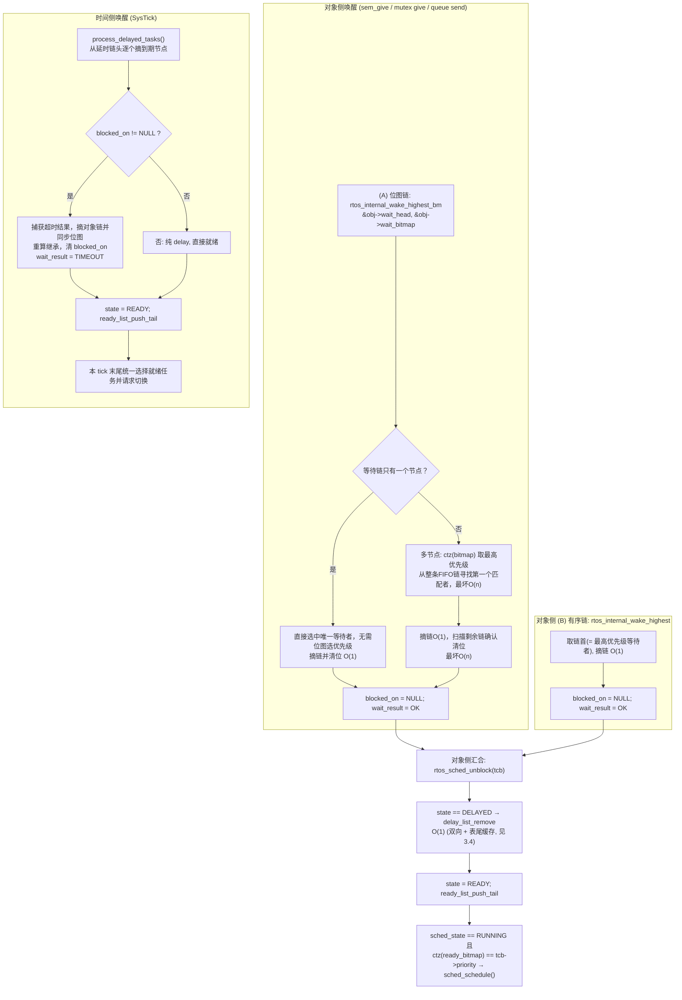

</details>

`rtos_sched_unblock()` 之所以先查延时链（`state == DELAYED → delay_list_remove`），是因为对象侧唤醒发生时，任务的超时时刻可能还没到——**提前醒来要把剩余的守夜义务注销**（从延时链摘掉，否则到点时 tick 还会再"唤醒"它一次，造成双重唤醒）。

时间侧 `process_delayed_tasks()` 已摘掉延时节点，直接置 READY 并尾插就绪表，由本 tick 的末尾统一做调度决策；它不再调用 `rtos_sched_unblock()`。对象链清理由 `rtos_internal_wait_remove_sync_bitmap()` 完成：普通双向摘链是 O(1)，信号量链还需扫描剩余节点确认优先级位是否可清除。

入就绪队尾后，该任务的优先级位已置位，所以这里的 `ctz` 输入必非零。唤醒任务所在优先级是最高就绪优先级时，继续调用 `sched_schedule()` 完整选择该优先级的 **`ready_heads[p]`**；同级 FIFO 队列中它不一定就是刚被唤醒的任务。整个选择过程必须保持在同一临界区内，不能在读取候选前允许合法 RTOS ISR 改变调度状态或就绪位图。

**双链登记不变式（理解整个内核的钥匙）**——一个带超时阻塞在对象上的任务，同时挂在两条链上：

| 挂在哪条链 | 用什么字段串接 | 谁会来摘它 |
|---|---|---|
| 对象等待链（双向；纪律见 1.3 不变式 III） | wait_node.next / .prev | give 方的 `wake_highest` / `wake_highest_bm`；或超时路径经 list_head |
| 内核延时链（双向，按 wake_tick 升序 + 表尾缓存） | tcb->next_ready / tcb->prev_ready | 到期时的 process_delayed_tasks；或对象唤醒时的 delay_list_remove |

两条链各自回答一个独立的问题：对象链回答**"谁来唤醒我"**（give 顺着它找到该唤醒谁），延时链回答**"我最晚何时必须醒"**（tick 顺着它找谁该醒）。**先到的一方负责把两条链都摘干净，后到的一方自然扑空**——这就是"不会既算成功又算超时"的结构性保证。"摘两条链"是复合动作，其原子性由 BASEPRI 临界区背书（3.7 阶段四详述）。

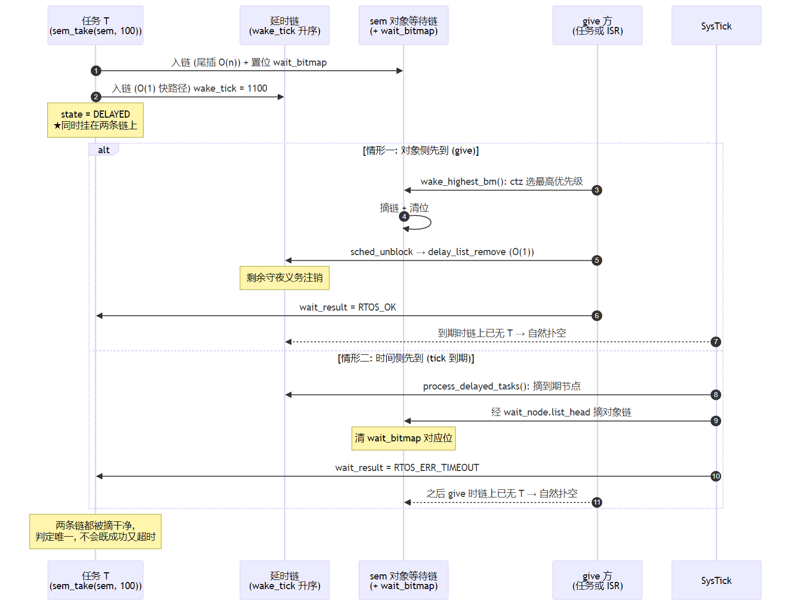

<details><summary>图形源码（mermaid）</summary>

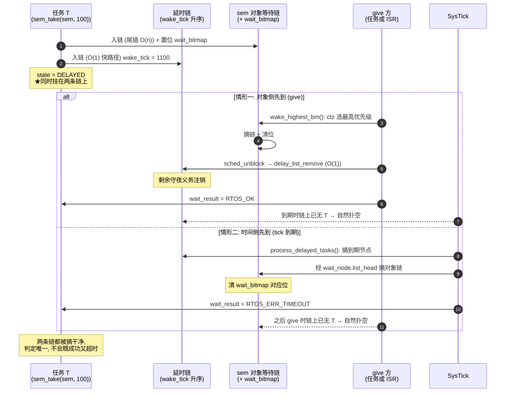

</details>

被唤醒任务进入本优先级就绪队尾。稳定态中 current 是最高就绪链首，同级新任务通常等待轮转，不直接越过它；若唤醒优先级等于当前最高就绪优先级，`unblock` 会调用 schedule 重算最高链首，以处理已有轮转、阻塞或失效候选窗口。实际是否请求切换取决于最终链首、current 状态和配置，见 3.3。

> **两条唤醒路径的等价性**（重要）：`wake_highest_bm` 与 `wake_highest` 的可观察语义完全相同
> ——都唤醒"最高优先级等待者，同优先级取最早入链者"。`_bm` 版本额外做了两件防御：
> ① 位图与链表理论上不会不一致（同一临界区维护），但若位图位残留导致在链上找不到该优先级的
> 节点，它退化为**全链扫描取最高优先级**，而**绝不退化为"取链首"**——后者会唤醒错误的任务
> 并破坏唤醒序语义；② 摘除后若该优先级已无其它等待者则清位，避免位图残留引发后续空扫描。

## 3.6 一个 tick 的完整旅程

以 1kHz SysTick 为例，从硬件到调度：

```
① SysTick 硬件计数到 0 → 拉起 SysTick 异常 (向量: SysTick_Handler)
② SysTick_Handler (stm32f4xx_it.c):
     rtos_port_sys_tick_handler():
       sched_state != RUNNING → 直接返回
       ENTER_CRITICAL                      ← BASEPRI=0x50, nesting=1
       rtos_sched_tick():
         (a) tick_count++
         (b) process_delayed_tasks():
              now = tick_count
              while delay_head && sched_tick_after(delay_head->wake_tick, now) <= 0:
                  tcb = delay_head; 摘链
                  if tcb->blocked_on != NULL:      ← 对象等待超时
                      on_timeout != NULL → 捕获对象结果到 wait_node（摘链之前）
                      wait_node.timed_out = TRUE
                      wait_result = RTOS_ERR_TIMEOUT
                      if list_head != NULL:
                          wait_remove_sync_bitmap(list_head, &wait_node)
                          list_head = NULL
                      mutex_waiter_left(tcb)        ← 若等的是互斥锁, 重估 owner 优先级
                      blocked_on = NULL
                  state = READY; ready_list_push_tail(tcb)
         (c) 单次调度决策:
              top = ctz(ready_bitmap)
              next = ready_heads[top]; cur = current_tcb
              next != cur → next_tcb=next; pend PendSV        ← 抢占
              否则若时间片开启 && cur 是 RUNNING && 同级链>1:
                   rotate(top); next_tcb=新head; pend PendSV  ← 轮转
       EXIT_CRITICAL                      ← 恢复进入前 mask
③ SysTick_Handler 继续执行 HAL_IncTick()（HAL 时基，与 RTOS 独立）
④ SysTick 异常退出后，PendSV（若被 pend）才有机会执行切换
```

**为什么超时摘除必须经 list_head**：任务阻塞在信号量上且带超时 → 它同时在 sem->wait_head（对象链）和 delay_head（延时链）两条链上（不变式 II 允许：一条调度链 + 一条等待链）。超时时若只从延时链摘、不从对象链摘，节点就留在 sem->wait_head 里成为悬空指针——之后任何 sem_give 的 wake_highest 都会解引用已就绪任务的节点，状态机立即错乱。这是侵入式链表方案必须付出的对价：**离开任何一条链都要显式摘除**。完整的逐步解剖见下一节。

## 3.7 超时如何定位任务: sem_take(sem, 100) 超时的完整解剖

以任务 T（优先级 3）在 tick=1000 调用 `rtos_sem_take(sem, 100)`、随后没有 give 为例，追踪对象登记、到期处理和任务恢复三个阶段的状态。

### 阶段一: 入睡 (tick=1000, 任务上下文, 临界区内)

```
1. sem->count == 0 → 走慢路径
2. sem_take 自行登记位图等待节点（不调用 block_current_on）：
     T->blocked_on = sem                        ← TCB 记下"我睡在 sem 上"
     T->wait_node.list_head = &sem->wait_head   ← ★自记"我的节点挂在哪条链上"
     queue_bitmap = &sem->wait_bitmap; queued_priority = T->priority
     FIFO 尾插 sem->wait_head；置 wait_bitmap 中 T 的优先级位
3. rtos_sched_block(T, 100):
     T 从就绪表摘除
     T->wake_tick = 1000 + 100 = 1100           （T 进入延时链, 按 1100 有序插入）
     T->state = RTOS_TASK_DELAYED
     T->wait_result = RTOS_OK                   ← 预填的乐观结果
4. rtos_sched_schedule() → 选出别的任务, pend PendSV
5. EXIT_CRITICAL → PendSV 执行: 保存 T 的任务现场，再恢复被选中任务
```

入睡完成时，T 的行踪登记在三处：**sem 的等待链**（等谁）、**内核延时链**（最晚何时醒）、**TCB 的 wait_result**（预填的判决占位）。此刻 T 同时挂在两条链上——这就是 3.5 的双链登记不变式。

### 阶段二: 守夜 (tick 1001~1099, 每 1ms, ISR 上下文)

延时到期检查先做一次带符号比较：`sched_tick_after(delay_head->wake_tick, now) <= 0 ?`——链首未到期即结束该阶段。此项检查不遍历睡眠任务；整个 tick 仍包含就绪任务选择和可选时间片处理。

### 阶段三: 到期处理 (tick=1100, SysTick ISR, 临界区内)

"如何找到超时任务"的答案：**不需要寻找——延时链的升序不变式保证所有到期任务必然集中在链首**，摘链首即可：

```
process_delayed_tasks():
  now = 1100
  while (delay_head != NULL && sched_tick_after(delay_head->wake_tick, now) <= 0):
      tcb = delay_head;  摘链                   ← 链首 = 全内核最早到期的睡眠者
      if (tcb->blocked_on != NULL):             ← 区分: 对象等待超时 / 纯 delay
          on_timeout != NULL → 捕获超时时刻的对象结果
          tcb->wait_node.timed_out  = TRUE
          tcb->wait_result = RTOS_ERR_TIMEOUT   ← ★趁 T 还睡着, 把判决写进它的 TCB
          if (tcb->wait_node.list_head != NULL):
              rtos_internal_wait_remove_sync_bitmap(list_head, &wait_node)
                                                 ← O(1) 摘链；位图链额外扫描确认清位
              tcb->wait_node.list_head = NULL
          rtos_internal_mutex_waiter_left(tcb)  ← 若等的是互斥锁, 重估持有者优先级(7.4)
          tcb->blocked_on = NULL
      tcb->state = RTOS_TASK_READY
      ready_list_push_tail(tcb)                 ← 进入就绪表, 排队等运行
```

两个关键机制：

**① 定位和双向摘链是 O(1)**：TCB 的 `wait_node.list_head` 记录链表头地址，prev/next 可直接定位邻居。信号量摘链后还需最坏 O(n) 的清位确认，互斥锁需重算继承；因此完整超时处理不能一概写成 O(1)。事件组在摘链前调用内部 `on_timeout` 捕获位值，恢复任务后不再读取可能已销毁的对象。notify_wait 不挂对象链，list_head 为 NULL；该清理流程覆盖 delay/sem/mutex/queue/event/notify 六类等待。

**结果快照**：到期处理把 `wait_result` 写入 TCB，任务恢复执行后读取该值。结果确定与任务真正返回之间可以经过就绪排队、其他任务和中断；保存在 TCB 中的结果使返回路径无需再次争抢资源或访问已失效的对象。

### 阶段四: 竞争裁定——先到者全摘, 后到者扑空

give 与超时都想摘同一个 T，竞态如何裁决？

- **give 先到**（某 tick < 1100）：wake_highest 把 T 从**对象链**摘掉 → sched_unblock 发现 `state == DELAYED` → delay_list_remove 把 T 从**延时链**也摘掉。1100ms 的 tick 到来时延时链上已无 T——超时路径碰不到它。T 醒来读到 wait_result=OK。
- **超时先到**（tick=1100）：T 从延时链摘除 + 经 list_head 从对象链摘除。此后任何 give 到达时，wake_highest 在对象链上扑空（T 的节点已不在），唤醒别的等待者或 count++。T 醒来读到 TIMEOUT。
- **事件可以同时发生，受保护修改依次执行**：give（任务或合法 ISR）与 tick 对两条链的修改使用同一内核保护协议。先完成摘链的一方写入结果并发布就绪，后续路径看到的节点已脱链；硬件事件同时挂起并不意味着两个内核修改者会并行执行。

这是双链登记的预期协议：成功与超时只提交一次等待结果。保证依赖合法 ISR 优先级、成对保护和所有离链路径完整维护节点；越过保护域或提前复用对象仍会破坏结构。

### 阶段五: 恢复并返回结果

T 在就绪队尾排队 → 轮到 T → PendSV 恢复其上下文 → 从 `sem_take` 自身的最外层 `EXIT_CRITICAL` 之后继续执行 → 读取该次等待结果返回。信号量自行登记位图链，不经过 `rtos_internal_block_current_on`：

```c
return cur->wait_result;   /* cur 也随任务寄存器恢复；结果为 RTOS_ERR_TIMEOUT */
```

注意 T 的局部世界（栈帧、寄存器）在整个超时过程中原封不动——被改写的只有 TCB 里的全局字段。醒来后读 wait_result，即拿到判决。

### 附: 互斥锁超时与继承重算

若 T 等的是 mutex，阶段三还多一步连锁反应：T 的等待曾让持锁者的优先级被提升（优先级继承），T 超时离开后这次提升失去依据。`rtos_internal_mutex_waiter_left(T)` 拿 `wait_node.wait_obj` 到全局锁注册表（s_mutex_registry）里匹配，确认"T 等的确实是一把活着的锁"后调 `mutex_recompute_inheritance` 重算持锁者有效优先级（综合其全部持有锁的有序等待链首与 `base_priority`，7.4、7.6 详述）。信号量/队列等对象的 wait_obj 在注册表里匹配不到，自动忽略——**同一个超时路径，只有锁需要善后**。

另一个相关边界：notify_wait 超时瞬间的通知去留——超时已置 TIMEOUT 但 T 尚未运行期间通知到达，notify_state 仍为 PENDING 被保留，下次 notify_wait 立即取走、不丢失（5.7 详述）。

## 3.8 时间片轮转的边界情形

轮转仅在 `next == cur`、当前任务为 RUNNING、时间片开启且当前优先级链表多于一个任务时发生。刚被唤醒的同优先级任务进入队尾；若前面有多名同级任务，需要多轮轮转才轮到它。更高优先级任务持续就绪、中断负载和显式挂起也会延长等待，不能承诺最迟 1 tick 执行。

## 3.9 挂起调度器: 与阻塞 API 的互斥契约

`rtos_sched_suspend()` 在任务上下文维护 `suspend_depth`：首次挂起置 SUSPENDED 并清除未执行的 `next_tcb`，嵌套挂起增加深度；`resume()` 逐层减深度，最后一层才恢复 RUNNING 并重算调度。二者在 ISR 中均不执行。非 RUNNING 时 tick 不推进，故会阻塞的 API 必须由守卫拒绝；历史缺陷曾使挂起期间 delay 永久挂死，当前版本不会再登记这种等待。挂起期间 ISR 仍可运行，合法 IPC 唤醒仍可修改就绪集合，但不会提交任务切换。

契约写在 `rtos_sched.h`：挂起期间**禁止任何会阻塞的 API**，一律立即返回，非阻塞路径不受影响——

| 类别 | API | 挂起期间行为 |
|---|---|---|
| 阻塞 | `rtos_task_delay` / `rtos_task_delay_until` | 不阻塞，立即返回（void 接口无法报错误码，与 ISR 上下文的处理一致） |
| 阻塞 | `rtos_task_notify_wait` / `rtos_sem_take` / `rtos_mutex_take` / `rtos_queue_send` / `rtos_queue_recv` | **`RTOS_ERR_SCHED`(-9)** |
| 阻塞 | `rtos_event_wait` | **0**（该接口返回位掩码，无法报错误码） |
| 非阻塞 | `RTOS_NO_WAIT`、计数充足、队列未满… | 不受影响 |

统一守卫 `rtos_internal_block_permitted()`（`rtos_internal.h`，`static inline`，检查 RUNNING 且 current_tcb 非 NULL，不自行进入临界区）必须在**修改任何阻塞状态之前**判定：否则会留下"已入链却无人唤醒"的半初始化 `wait_node`。`rtos_mutex_take` 的判定还必须早于 `mutex_try_inherit()`——否则会留下一次无人恢复的优先级提升（恢复动作在释放路径上，而释放者可能正是被挡住的调用者）。

> **与临界区的分工**（4.5）：临界区屏蔽 syscall 域中断，必须尽量短；挂起影响任务调度与 RTOS tick，仍允许 ISR。长业务流程不能直接套在关中断临界区里，需要拆分工作并设计同步；具体最长持有时间取决于调用路径和配置，当前测量不能当作 WCET 保证。

---

# 第四章 移植层: PendSV, SVC 与临界区的指令级流程

## 4.1 两级现场保存的分工

### 执行模式、栈与保存职责

本工程启动准备在 Thread 模式使用 MSP；调度启动后，各任务在 Thread 模式使用自己的 PSP。异常处理程序在 Handler 模式使用 MSP，但从 PSP 任务进入异常时，硬件先把被打断任务的异常帧保存到该任务栈上。ISR 本体的 C 调用链以及后续嵌套异常消耗 MSP，不能将所有中断开销都计入每个任务 PSP，也不能用扩大任务栈补救 MSP 空间不足。

TCB 的 `top_of_stack` 记录最近一次保存现场的起点；任务运行时，实时 PSP 随调用链变化，TCB 中的旧值不是实时栈指针。任务现场由硬件核心帧、可选的硬件浮点扩展区和移植层保存的软件区组成：

| 保存项目 | 基本现场 | 浮点扩展现场 | 保存与恢复方 |
|---|---:|---:|---|
| R0–R3、R12、任务 LR、PC、xPSR | 8 字 / 32 B | 8 字 / 32 B | 异常入口和返回硬件 |
| S0–S15、FPSCR、架构保留字 | 无 | 18 字 / 72 B | 硬件；lazy 模式先保留空间 |
| R4–R11 | 8 字 / 32 B | 8 字 / 32 B | PendSV 软件区 |
| R3 占位、EXC_RETURN | 2 字 / 8 B | 2 字 / 8 B | PendSV 软件区 |
| S16–S31 | 无 | 16 字 / 64 B | PendSV 按 EXC_RETURN.bit4 判断 |
| 固定现场合计 | **18 字 / 72 B** | **52 字 / 208 B** | 不含业务调用链及可选异常对齐字 |

本移植中每字为 32 位。扩展硬件帧共 **26 字**，已经包含核心帧的 8 字；新增浮点区是 18 字，不能把 S0–S15 与 FPSCR 的 17 个有效寄存器值直接当作完整扩展区大小。架构保留字与 CCR.STKALIGN 引入的可选对齐填充是不同项目，应分别计算。

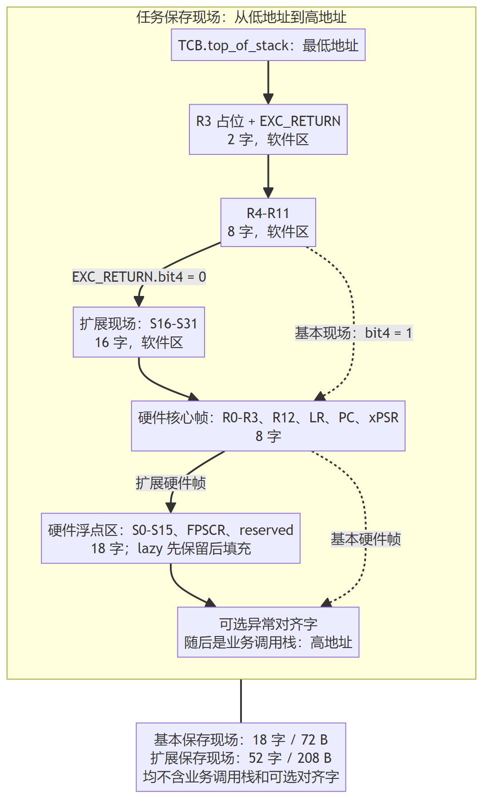

<details><summary>图形源码（mermaid）</summary>

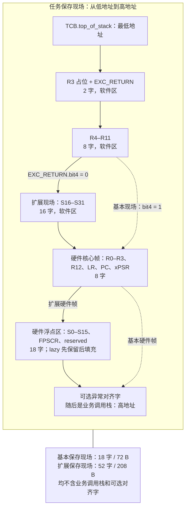

</details>

图中的基本、扩展分支互斥。基本现场从软件 R4–R11 直接接硬件核心帧；扩展现场在两者之间多出软件 S16–S31，并在核心帧高地址侧多出硬件浮点区。以下偏移以 PendSV 完整保存后的 `top_of_stack` 为零点，块内寄存器按编号递增排列，可与调试器内存窗口逐项核对：

| 内容（低地址到高地址） | 基本现场字节偏移 | 扩展现场字节偏移 |
|---|---:|---:|
| R3 占位、EXC_RETURN | 0、4 | 0、4 |
| R4–R11 | 8–36 | 8–36 |
| 软件 S16–S31 | 无 | 40–100 |
| 硬件 R0–R3、R12、任务 LR、PC、xPSR | 40–68 | 104–132 |
| 硬件 S0–S15 | 无 | 136–196 |
| FPSCR、架构保留字 | 无 | 200、204 |

`STMDB` 按寄存器编号决定内存 slot 顺序；最后执行 `stmdb r0!, {r3,lr}`，使占位和 EXC_RETURN 位于最低地址。任务硬件帧中的 LR 保存被中断程序的调用返回地址；软件区中的 EXC_RETURN 则控制返回模式、栈选择及帧类型，二者不能混淆。初始任务硬件 LR 指向 `rtos_task_exit_handler`。

**R3 的正确保存语义**：普通 C 调用允许改写 R3，并不意味着异步任务切换可以丢失 R3。任务的真实 R3 已由硬件保存到核心帧，异常返回时恢复；软件区额外的 R3 slot 只用于让 `{r3,lr}` 共占 8 B。恢复软件占位后 R3 还会作为临时寄存器使用，最终由硬件帧恢复真实值。

### Lazy stacking：节省写入时机，不节省空间预算

移植层设置 FPCCR.ASPEN/LSPEN。浮点上下文活跃时，异常入口预留扩展硬件帧空间，lazy 策略可以推迟 S0–S15/FPSCR 的实际写入。PendSV 按每个任务的 EXC_RETURN.bit4 判断：bit4 为 0 时执行 `vstmdbeq r0!, {s16-s31}`，该浮点指令会在存在待保存的 lazy 上下文时触发硬件先填充低半浮点现场，再保存高半寄存器。因此本实现减少普通 ISR 的浮点保存成本，但真正跨任务切换时仍完成所需现场。

任务曾执行浮点指令后，后续没有 `float` 运算的调用点也可能带有活跃浮点上下文。不能按当前函数是否出现浮点类型估算帧大小。最小 96 字任务栈是 API 接受下限，不是业务栈足够的证明；预算还需覆盖最大调用链、可选对齐和裕量，并独立检查 MSP 的嵌套中断开销。

源码定位：[rtos_port.h](../RTOS/Core/Inc/rtos_port.h) 120–134 行、[port.c](../RTOS/Port/GCC/ARM_CM7/port.c) 236–314、352–398、519–520 行。硬件块序及 EXC_RETURN 依据 [ST PM0214](https://www.st.com/resource/en/programming_manual/dm00046982-stm32-cortex-m4-mcus-and-mpus-programming-manual-stmicroelectronics.pdf) 第 2.3.7 节；lazy 与 VSTM 的配合见 [Arm AN298](https://documentation-service.arm.com/static/5f0352c0cafe527e86f5bc66?token=) 第 2 节、第 4.3 节 Figure 8。本地 [core_cm4.h](../Drivers/CMSIS/Include/core_cm4.h) 554–555、1321–1325、1635–1641 行提供对齐、FPCCR 及异常返回常量。任务/异常栈的预算方法见 [Arm 栈空间分析](https://developer.arm.com/community/arm-community-blogs/b/architectures-and-processors-blog/posts/how-much-stack-memory-do-i-need-for-my-arm-cortex--m-applications) 第 5 节。

## 4.2 PendSV 逐指令流程

当前移植层在 naked 汇编中保存旧任务现场，调用内部 `rtos_sched_commit_context_switch()`，再从 AAPCS 返回寄存器 R0 取得实际运行 TCB。公共 `void rtos_sched_context_switch(void)` 入口继续保留。返回 TCB 的方式省掉了 C 调用后重新取得内核地址和 current_tcb 的两条 LDR；实板对照与 ABI 检查见 [底层优化报告](rtos_lowlevel_optimization_20261012.md)。

下面为默认 BASEPRI 配置的当前指令流程，偏移由 `offsetof` 的命名常量传入汇编，不硬编码结构体布局：

```asm
rtos_port_pend_sv_handler:         ; naked，运行于 Handler 模式/MSP
  mrs   r0, psp                    ; 旧任务硬件帧地址
  tst   lr, #0x10                  ; 旧任务 EXC_RETURN 帧类型
  it    eq
  vstmdbeq r0!, {s16-s31}          ; 扩展帧补存 16 个高位浮点寄存器
  stmdb r0!, {r4-r11}
  stmdb r0!, {r3, lr}              ; R3 填充 + EXC_RETURN 保持任务栈 8 字节对齐
  mrs   r2, basepri                ; 保存原来的屏蔽值
  movs  r3, #MAX_SYSCALL_PRIORITY
  msr   basepri_max, r3            ; 不降低已有的更强屏蔽
  isb                             ; 同步中断屏蔽
  push  {r2, r3}                   ; 在 MSP 上保存原屏蔽值，保持 C 调用 8 字节对齐
  ldr   r1, =rtos_kernel
  ldr   r1, [r1, #OFF_CUR_TCB]
  str   r0, [r1, #OFF_TOP_STACK]   ; 保存旧任务栈顶
  bl    rtos_sched_commit_context_switch
                                   ; R0 = 实际运行 TCB；EXC_RETURN 已保存在任务栈
  ldr   r0, [r0, #OFF_TOP_STACK]   ; 直接读取返回 TCB 的栈顶
  ldmia r0!, {r3, lr}              ; 恢复新任务 EXC_RETURN
  ldmia r0!, {r4-r11}
  tst   lr, #0x10
  it    eq
  vldmiaeq r0!, {s16-s31}
  msr   psp, r0                    ; 安装新任务硬件帧地址
  pop   {r2, r3}
  msr   basepri, r2                ; 恢复调用者原来的屏蔽值
  bx    lr                         ; 异常返回，由硬件恢复基本/扩展帧
```

`RTOS_CONFIG_USE_BASEPRI=0` 时，相同窗口改用保存 PRIMASK、`cpsid i` 和还原 PRIMASK。旧任务上下文必须先完整保存，再提交任务身份；新 PSP 安装后才能解除屏蔽。此次优化没有缩短这个保护窗口，也没有删除其中的 ISB。历史图 [rtos_design_10.png](images/rtos_design_10.png) 仅展示保存/恢复主体，当前调用和中断保护以上述流程及 `port.c` 为准。

`push {r2,r3}` / `pop {r2,r3}` 在 **MSP 上额外占 8 B**，用于保存进入前的 mask 并维持 C 调用对齐；它不属于任务栈的 72 B / 208 B 固定现场。提交函数自身的编译器栈帧、更高优先级 ISR 的调用链和嵌套异常也消耗 MSP，应另行预算。任务软件现场写入 PSP 指向的内存，PendSV 内的 C 提交调用运行在 MSP，两份栈的职责不同。

C 提交函数的主要逻辑如下（省略测试专用注入钩子）：

```c
rtos_tcb_t *rtos_sched_commit_context_switch(void)
{
    rtos_tcb_t *current_task = rtos_kernel.current_tcb;
    if (rtos_kernel.sched_state != RTOS_SCHED_RUNNING) {
        rtos_kernel.next_tcb = NULL;
        return current_task;
    }
    if (rtos_kernel.next_tcb != NULL) {
        rtos_tcb_t *prev = current_task;
        rtos_tcb_t *next = rtos_kernel.next_tcb;
        rtos_kernel.next_tcb = NULL;
        RTOS_ASSERT((next->state == RTOS_TASK_READY) || (next == prev));
        if ((prev != NULL) && (prev->state == RTOS_TASK_RUNNING)) {
            prev->state = RTOS_TASK_READY;
        }
        next->state = RTOS_TASK_RUNNING;
        next->switch_count++;
        rtos_kernel.current_tcb = next;
#if RTOS_CONFIG_PERF_HOTPATH_STATS
        rtos_perf_on_context_switch(prev, next);
#endif
        return next;
    }
    return current_task;
}
```

无候选或调度器暂停时返回原任务，供 PendSV 恢复刚保存的原现场；尚未安装当前任务时内部函数可返回 NULL，这不是已启动 PendSV 的合法运行情形。公共 void 包装函数只调用该内部入口，不改变外部接口。统计开启时，编译器将 next 保存在 callee-saved 寄存器中，调用统计钩子后再返回 R0；该分支已做独立反汇编核验和真实浮点任务混合测试。

PendSV 的优先级最低，合法 RTOS ISR 能在未屏蔽时抢占它，因此读取候选、提交 current/next、恢复上下文必须在同一保护窗口中。BASEPRI 模式下，优先级 0–4 的中断仍可运行，但必须遵守不调用 RTOS API 的契约。完整验证覆盖取消切换、暂停、无候选、自切换及公共入口；有限测试通过不等于任意负载或最坏时延保证。

该窗口保护的是 **TCB 身份与已安装 CPU 现场的一致交接**。如果提交 `current_tcb` 后提前恢复屏蔽，合法内核 ISR 可能按新 TCB 操作调度状态，而 CPU 仍承载旧任务的寄存器或栈。仅保护 C 提交函数内部的一次赋值不足以代替整个保存/提交/恢复协议。

`top_of_stack` 的结构体偏移由编译期断言约束为 0，`current_tcb` 偏移由 `offsetof` 传入汇编；修改 TCB 或内核结构布局时必须保留这些约束。PendSV 是单层 naked 入口，不能在其外面包普通 C 函数记录耗时：编译器放在 R4–R11 的包装函数局部值会被新任务现场替换，导致包装函数返回路径错误。统计钩子位于 C 提交函数内。

源码定位：[port.c](../RTOS/Port/GCC/ARM_CM7/port.c) 319–398 行、[rtos_sched.c](../RTOS/Core/Src/rtos_sched.c) 653–701 行。候选任务与稳定状态的区别见 1.3、3.3；优先级违约检查由 `rtos_config.h` 的断言提供，关闭断言不放宽 ISR 契约。

## 4.3 任务栈初始化: 伪造一次中断

`rtos_port_init_stack(stack_top, size, entry, arg)` 从高向低依次压入（`*--sp` 序）：

```
xPSR  = 0x01000000      ← bit24(Thumb)=1, 否则首次异常返回即 INVSTATE
PC    = entry           ← 首次"恢复"后从这里执行
LR    = rtos_task_exit_handler  ← 任务函数 return 时自动跳这里 → 自删除
R12/R3/R2/R1 = 0x?0?0?0?0 图案
R0    = arg             ← AAPCS 第一个参数, 任务入口的原型是 void(*)(void*)
R11..R4 = 图案
EXC_RETURN = 0xFFFFFFFD ← 基本帧(新任务未用过 FPU)
R3(填充) = 0xDEDEDEDE   ← 对齐垫片, 值无所谓
返回 sp                 ← 写入 tcb->top_of_stack
```

初始化得到 18 字基本现场，没有 S16–S31 保存区。它与 4.1 的基本布局相同，因此 **首个启动任务由 SVC 恢复，后续新任务由 PendSV 恢复**。两条路径都先消费软件区，再以 EXC_RETURN=`0xFFFFFFFD` 进行异常返回，由硬件恢复 R0=`arg`、PC=`entry`。设计复用异常恢复格式，避免另设一套不兼容的任务入口现场。

栈顶先向下对齐到 8 B；参数 `stack_size` 的单位是字而不是字节。移植层本身只构造固定初始现场，最小栈和长度溢出等校验由公共创建接口执行，调用者提供的存储仍必须足够且寿命覆盖任务使用期间。源码定位：[port.c](../RTOS/Port/GCC/ARM_CM7/port.c) 236–314 行、[rtos_task.c](../RTOS/Core/Src/rtos_task.c) 497–549 行。

## 4.4 首任务启动: SVC 的必要性

EXC_RETURN 是 Handler 模式的异常返回编码，不能在 Thread 模式中直接当普通函数返回地址使用。本实现通过 `svc 0` 进入 Handler 模式，然后从人工任务帧异常返回。SVC 在这里承担一次性的首任务启动，不是日常任务 API 的调用网关。

启动前，应用须完成时钟树及 `SystemCoreClock` 初始化，并配置中断优先级分组、SVC、PendSV 和 SysTick。移植层负责 SysTick 周期及 FPCCR.ASPEN/LSPEN，不负责板级 NVIC 优先级配置，也不替代系统启动代码对 CP10/CP11 的 FPU 访问许可设置。本工程 F446 有 4 个优先级位，建议使用 GROUP_4；逻辑优先级 5 对应寄存器 `0x50`，最低逻辑优先级 15 对应 `0xF0`。以下采用默认阈值：

```
rtos_sched_start():
  拒绝 ISR / 重复启动
  previous_mask = BASEPRI
  BASEPRI_MAX = 0x50；ISB                     ← ① 先保护首任务 PSP 尚未有效的窗口
  sched_state = RUNNING
  top = find_highest_priority(ready_bitmap)
  top 无效 → 恢复 NOT_STARTED 和 previous_mask；ERR_SCHED
  current_tcb = ready_heads[top]             ← 手动选出第一个任务
  current_tcb 非空 → state = RUNNING
  perf 初始化窗口基准
  rtos_port_start_scheduler():
      FPU->FPCCR |= ASPEN|LSPEN             ← 使能惰性 FPU 保存
      临界区计数和保存 mask 清零
      SysTick->LOAD = SystemCoreClock / TICK_RATE_HZ - 1
      SysTick->VAL = 0；CTRL = 使能+中断     ← 计数开始，异常仍受①屏蔽
  rtos_port_start_first_task():
      msr basepri, 0x50                     ← 延续启动屏蔽
      cpsie i                               ← ② 开总中断
      isb                                   ← 当前启动路径保留 ISB，未使用 DSB
      svc 0                                 ← ③ SVC 保持不受阈值屏蔽的优先级
  (永不返回)

rtos_port_svc_handler:                      (naked, 运行于 Handler 模式/MSP)
  push {r1, lr}                             ← 保护 EXC_RETURN, 保持 MSP 8 对齐
  bl rtos_port_get_first_sp                 ← C: return current_tcb->top_of_stack
  pop {r1, lr}
  msr psp, r0                               ← PSP = 首任务栈
  isb
  ldmia r0!, {r3, lr}                       ← 恢复 R3 填充 + EXC_RETURN
  ldmia r0!, {r4-r11}
  tst lr, #0x10; it eq; vldmiaeq r0!, {s16-s31}
  msr psp, r0
  mov r1, #0; msr basepri, r1               ← ④ 完成首任务恢复后解除启动屏蔽
  bx lr                                     ← 异常返回 → 进入首任务
```

启动不变式是：**从置 RUNNING 到首任务 PSP 安装完成，SysTick/PendSV 仍受屏蔽，SVC 则可执行。** 在 `sched_start` 入口阶段就增强屏蔽，避免已由 HAL 配置的 SysTick 在状态变成 RUNNING 后提前进入内核；仅在后面的 `start_first_task` 屏蔽会留下窗口。当前路径随后 `cpsie i`，执行 SVC，恢复首任务现场后才解除 BASEPRI。若板级把 SVC 配成受阈值屏蔽的优先级，或把 PendSV 配成最高优先级，前提就不成立。

`rtos_start()` 不返回到 `main()`；它也不是保持调用者中断屏蔽状态的普通函数，首任务按启动路径解除屏蔽后运行。源码定位：[rtos_sched.c](../RTOS/Core/Src/rtos_sched.c) 395–443 行、[port.c](../RTOS/Port/GCC/ARM_CM7/port.c) 439–535 行；F446 优先级位数见 [stm32f446xx.h](../Drivers/CMSIS/Device/ST/STM32F4xx/Include/stm32f446xx.h) 49 行，编码见 [core_cm4.h](../Drivers/CMSIS/Include/core_cm4.h) 1809–1823 行；FPU 访问许可见 [system_stm32f4xx.c](../Core/Src/system_stm32f4xx.c) 170–172 行。

## 4.5 临界区: 进出与屏障

2026-10-12 的实现先读取调用者屏蔽值，用 `BASEPRI_MAX` 加强屏蔽，最外层保存原值；嵌套归零时恢复原值，而非固定清零。因此已存在的更强 BASEPRI、PRIMASK 关中断状态不会被 RTOS 临界区削弱。以下代码对应当前 `rtos_port.h`；本节后面的周期数字记录旧版性能优化。

```c
/* 二者均为 rtos_port.h 中的 static inline；exit 侧无屏障 */
static inline void rtos_port_enter_critical(void)
{
    uint32_t previous_mask;
#if RTOS_CONFIG_USE_BASEPRI
    __asm volatile(" mrs %0, basepri      \n"
                   " msr basepri_max, %1 \n"
                   " isb                 \n" : "=&r"(previous_mask)
                   : "r"(RTOS_CONFIG_MAX_SYSCALL_INTERRUPT_PRIORITY)
                   : "memory");
#else
    __asm volatile(" mrs %0, primask \n"
                   " cpsid i        \n" : "=r"(previous_mask) :: "memory");
#endif
    uint32_t nesting = rtos_port_crit_nest;
    if (nesting == 0U) {
        rtos_port_saved_mask = previous_mask;
    }
    rtos_port_crit_nest = nesting + 1U;
}

static inline void rtos_port_exit_critical(void)
{
    uint32_t nesting = rtos_port_crit_nest - 1U;
    rtos_port_crit_nest = nesting;
    if (nesting == 0U) {
#if RTOS_CONFIG_USE_BASEPRI
        __asm volatile(" msr basepri, %0 \n" :: "r"(rtos_port_saved_mask) : "memory");
#else
        __asm volatile(" msr primask, %0 \n" :: "r"(rtos_port_saved_mask) : "memory");
#endif
    }
}
```

**本轮局部计数优化的约束**：每次 enter/exit 对 `volatile` 嵌套计数只读取一次，用局部 `nesting` 同时计算新值和判断最外层边界，再写回一次。enter 必须先完成屏蔽和进入屏障，随后才能读共享计数；合法 RTOS ISR 在这段读写期间被屏蔽，优先级 0~4 的 ISR 禁止调用内核，所以不会丢失另一个合法调用者的计数更新。嵌套进入仍执行屏蔽指令与原有屏障，最外层退出仍恢复保存的原始 mask。enter/exit 必须成对；此优化没有增加全局 RAM 或改变 API。

- **默认使用 BASEPRI，PRIMASK 为替代配置**：默认允许优先级 0~4 的硬实时中断（电机环等）抢占内核临界区；替代配置保存 PRIMASK、关全局中断，并在最外层退出时恢复原值；
- **当前屏障配置**：默认 BASEPRI enter 保留 ISB，使后续指令在增强屏蔽后执行；exit 恢复原屏蔽值，没有额外 ISB。PRIMASK 替代路径则使用保存原值、`cpsid i`、最外层还原。该说明描述本移植的现状，不能推广成“DSB 在任何系统寄存器操作中都无用”；设备访问、缓存/MPU 配置及其他处理器移植须按各自架构要求分析。
- **历史性能背景**：早期测量中临界区进出对由 55 周期降到 23 周期，对照 FreeRTOS 为 47 周期；这些数字用于说明当时内联与屏障调整的成本，不是当前配置的最坏执行时间或跨工程保证。
- **共享计数的调用契约**：ISR 与任务共用 `rtos_port_crit_nest`。默认优先级 0–4 的 ISR 不能调用内核，否则会绕过内核屏蔽，破坏共享状态操作的串行化。违约检测由断言提供，关闭断言后契约仍然适用；enter/exit 必须成对，不能在未进入时执行退出或跨上下文配对。
- **内联化的收益**：早期实现是 `port.c` 里的 out-of-line 函数 + TU 内 static 计数，每次 enter/exit 都要付函数调用序言/尾声；改为头文件 `static inline` + 全局 `rtos_port_crit_nest` 后，每对节省约 10 周期。计数改放移植层也顺带解决了"跨 TU 访问"的问题——内联函数必须能看到定义，而 `static` 变量做不到。
- **一次被实测否决的进一步优化**：曾尝试"嵌套时跳过冗余的 `msr` + `isb`"（用计数判断，仅在 0→1 时真正写 BASEPRI）。实测**净负收益**并已回退：`give_no_waiter` 91→99、`give_w01` 1246→1277 周期。原因是 `rtos_port_crit_nest` 为 `volatile`，判断+自增+分支引入的读-改-写访存开销超过了省下的写入；且信号量 give 路径本身并不嵌套，收益面根本不存在。该结论已写入源码注释，避免后续重复尝试。
- **`rtos_port_context_switch()`**（挂起 PendSV）：先记 perf 时间戳（仅当 `RTOS_CONFIG_PERF_HOTPATH_STATS` 打开，默认关），再 `SCB->ICSR = PENDSVSET`，当前路径保留 DSB/ISB。不要把临界区入口的屏障配置直接复制到请求切换路径；二者操作对象和用途不同。

源码定位：[rtos_port.h](../RTOS/Core/Inc/rtos_port.h) 55–93 行、[port.c](../RTOS/Port/GCC/ARM_CM7/port.c) 219–231 行；屏蔽寄存器的硬件语义见 [ST PM0214](https://www.st.com/resource/en/programming_manual/dm00046982-stm32-cortex-m4-mcus-and-mpus-programming-manual-stmicroelectronics.pdf) 第 2.1.3 节。本章固定帧和指令说明只解释当前 Cortex-M4F 实现，不能据此认定所有 Cortex-M7 型号、编译 ABI、存储系统配置都已完成验证。

---

## 4.6 ISR 保护域与从中断到任务的完整路径

本工程 F446 的 `__NVIC_PRIO_BITS=4`，NVIC API 接收逻辑优先级 0–15，寄存器按高 4 位编码。当前 syscall 阈值为 `5 << 4 = 0x50`，配置使全部实现位用于抢占优先级。任务优先级 0–31 是另一套调度编号，不能直接作为 IRQ 配置值。

| 中断域 | 逻辑 / 寄存器优先级 | BASEPRI 内核临界区中的行为 | 应用责任 |
|---|---|---|---|
| 高优先级非 RTOS 中断 | 0–4 / 0x00–0x40 | 仍可抢占 | 不调用修改内核结构的 API；与任务共享数据需另设计协议 |
| syscall 域外设中断 | 5–15 / 0x50–0xF0 | 被屏蔽，允许后响应 | 只使用支持 ISR 的非阻塞路径；控制复制和扫描成本 |
| SysTick、PendSV | 当前均配置为逻辑 15 | 被屏蔽；同级挂起按异常规则处理 | SysTick 推进逻辑时间，PendSV 承接现场切换 |


<details><summary>图形源码（mermaid）</summary>

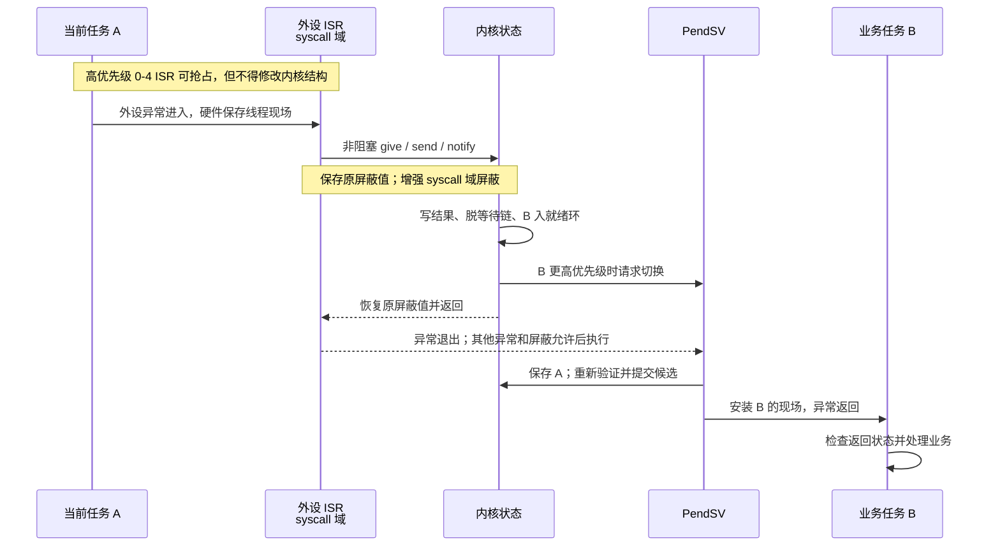

</details>

“ISR 已唤醒任务”只表示任务取得就绪资格，实际响应仍受中断嵌套、屏蔽窗口、更高优先级任务和切换恢复影响。工程移植必须一起核对 NVIC 优先级分组、CMSIS 位数、编码后的阈值以及 SVC/PendSV/SysTick 配置。关闭断言不会使违规优先级变安全；PRIMASK 配置虽然屏蔽可配置中断，也不扩展各 API 的 ISR 使用契约。

内核 tick 是成功执行 `rtos_sched_tick` 的逻辑计数，非硬件经过时间的自动积分。调度器挂起期间不推进它；SysTick 长时间被屏蔽时，多次周期可能合并为一个 pending 异常，当前没有 elapsed-tick 补偿。外设 FIFO、DMA 和设备协议还各有容量/时限，NVIC 保留 pending 不保证所有原始数据都被保存。应按最长保护窗口和外设缓冲设计中断及背压策略。

源码入口：[rtos_config.h](../RTOS/Core/Inc/rtos_config.h)、[rtos_port.h](../RTOS/Core/Inc/rtos_port.h)、[stm32f4xx_it.c](../Core/Src/stm32f4xx_it.c) 与 [stm32f4xx_hal_msp.c](../Core/Src/stm32f4xx_hal_msp.c)。硬件优先级及异常规则见 [ST PM0214](https://www.st.com/resource/en/programming_manual/dm00046982-stm32-cortex-m4-mcus-and-mpus-programming-manual-stmicroelectronics.pdf)。

---

# 第五章 任务管理: 每个 API 的逐步执行流程

## 5.1 rtos_task_create() (动态)的完整流程

创建过程分离“存储与现场构造”和“可运行资格发布”。任务一旦入就绪集合，可能在创建者返回前获得 CPU；因此入口参数、人工栈帧和监视字段都必须先完整建立。与此同时，填充整个栈水位是 O(栈字数) 的工作，不应把这部分全部放进屏蔽中断的临界区。

```
1. 拒绝 ISR；参数校验: tcb_out/entry 非空, priority < 配置上限, stack_size >= 96字
   用 uint64_t 检查栈字节数不大于当前最大连续可分配块；分配 TCB 后仍可能因不足返回 ERR_NO_MEM
2. tcb = rtos_heap_alloc(sizeof(rtos_tcb_t))       ← first-fit 扫描(11.1)
   失败 → ERR_NO_MEM
3. stack_buf = rtos_heap_alloc(stack_size * 4)
   失败 → free(tcb); ERR_NO_MEM                    ← 分配失败不留半成品
4. task_create_core(tcb, stack_buf, ...):
   a. ENTER_CRITICAL；查全任务登记链拒绝重复地址
      memset(tcb, 0)；priority = base_priority = prio；state = INITIALIZING
      task_id = rtos_internal_alloc_task_id()；next_all 登记地址；EXIT_CRITICAL
   b. 临界区外复制 name（截断至配置长度-1，并 NUL 终止）
   c. top_of_stack = rtos_port_init_stack(...)      ← 4.3 的伪帧
   d. stack_magic = 0xDEADBEEF; *stack_buf = 0xDEADBEEF
   e. rtos_perf_on_task_created(tcb):
        perf 字段清零
        栈水印: [stack_base, top_of_stack) 全填 0xA5A5A5A5
                (会覆盖 d 写入的栈底魔数副本——无害, 检测只认 TCB 内那份)
        注册进 perf 任务表 (临界区内 add)
   f. ENTER_CRITICAL
      sched_add_ready(tcb) → ready_list_push_tail   ← 进入就绪表
      state = READY; *tcb_out = tcb                 ← 先发布，再允许抢占
      if 调度器RUNNING && prio < current->priority:
          sched_schedule()                          ← 高于当前 → 请求切换
      EXIT_CRITICAL
      → 此处 PendSV 可能立即切入新任务
5. return RTOS_OK
```

**当前创建顺序**：最小栈为 96 字。第一段临界区按地址预留 TCB，并标为 INITIALIZING；栈初始化和水印填充在临界区外进行，此时外部 resume/delete/set_priority/notify/suspend 均拒绝该 TCB。第二段临界区加入就绪表、置 READY，并在请求抢占之前执行 `*tcb_out = tcb`。创建函数返回前新任务可能已经运行；调用者的其他共享数据仍需自行同步。重复使用仍存活或正在构造的静态 TCB 返回 `RTOS_ERR_ALREADY`。

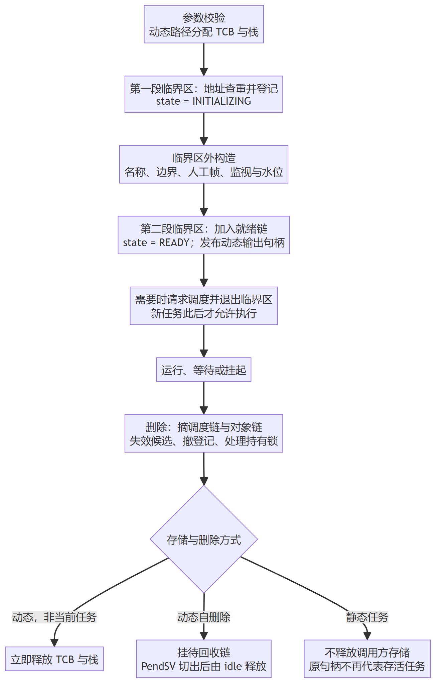

<details><summary>图形源码（mermaid）</summary>

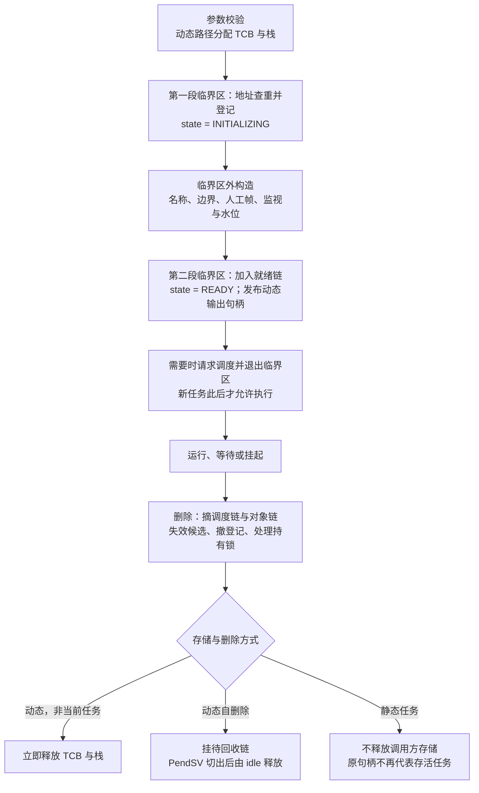

</details>

两阶段发布保持两个不变式：**构造期间地址已被占用**，第二个静态 create 不能清空正在初始化的同一 TCB；**发布 READY、就绪链和动态输出句柄在同一临界区完成**，退出后新任务即使先运行，也能看到已经发布的句柄。静态创建复用相同核心构造过程，但不分配 TCB/栈、不通过输出参数发布句柄，存储由调用方提供。

`s_all_tasks` 是独立的全任务地址登记链，包含正在构造和存活的任务，任务删除时摘除。公开修改 API 先在临界区内验证登记，再读写已知 TCB；对象重新 init 也借此检查是否有任务仍挂在该对象等待链上，返回 `RTOS_ERR_ALREADY` 保护存活等待者。地址查找最坏 O(任务数)，不是 O(1)。该登记也不赋予裸指针句柄永久身份：调用方仍不得使用释放后的句柄或跨对象复用的陈旧句柄。

公开任务句柄只有 TCB 指针，没有由 API 强制检查的“地址 + 代次”身份；若存储被另一个存活任务复用，旧指针可能再次命中登记地址。`task_id` 是观测字段，不能代替应用对句柄引用的失效与同步管理。创建前先准备新任务要访问的业务对象和参数；删除后通知相关模块停止使用旧引用，静态 TCB、栈和参数存储的寿命必须覆盖实际使用期间。图中的回收分支详见 5.2；动态自删除依赖 PendSV 完成保存以及 idle 后续得到运行机会。

源码定位：[rtos_task.c](../RTOS/Core/Src/rtos_task.c) 43–80、433–575、577–694 行。最小栈校验只提供输入下限，实际业务栈预算见 4.1，不能把“创建成功”当作栈空间足够的证明。

## 5.2 rtos_task_delete(): 两条路径, 一个陷阱

```
1. ISR 中调用 → ERR_ISR (删除需要触发调度, ISR 环境下不安全, 统一禁止)
2. tcb == NULL → 使用 current_tcb；显式 tcb == current_tcb 同样是 self_delete
3. ENTER_CRITICAL
   登记/DELETED/idle 校验失败 → ERR_PARAM；调度器未运行时自删 → ERR_SCHED
4. 状态分派摘链:
   READY/RUNNING → rtos_sched_remove_ready
   DELAYED       → rtos_sched_remove_delayed
                   ★不能复用 unblock! unblock 会把任务放回就绪表并
                   可能在"其优先级更高"时请求切换 → next_tcb 指向即将
                   释放的 TCB → PendSV 切换到已释放内存 = use-after-free
   BLOCKED       → 不在任何调度链, 跳过
5. 若 blocked_on != NULL (阻塞在 IPC 对象上):
   list_head != NULL → wait_remove_sync_bitmap 摘对象链并同步信号量位图
   mutex_waiter_left(tcb)  ← 重估被等互斥锁 owner 的继承优先级
   blocked_on = NULL
6. state = DELETED；摘全任务登记链；若 next_tcb == tcb 则清除候选
7. perf_on_task_deleted(tcb) ← 线性定位后以末项替换移除；完整 O(观察任务数)
8. mutex_release_all(tcb):                     ← 释放其持有的所有互斥锁
   遍历 s_mutex_registry, owner == tcb 的每把锁:
     restore_priority(owner)
     woken = wake_highest(&mutex->wait_head)   ← 移交给最高优先级等待者
     woken ? (owner=woken, recursion=1) : (owner=NULL)
   ★必须在释放 TCB 内存之前执行——否则 mutex->owner 指向已释放 TCB,
     其余等待者永久死锁
9. (可选) delete_hook
10. 内存处置:
    静态任务: 不释放(用户管理)
    动态+非自删: free(stack_base); free(tcb)    ← 不在运行位, 立即安全
    动态+自删:   defer_free_tcb(tcb)            ← 挂入待删链
11. 调度器 RUNNING 时重算 sched_schedule()        ← 包括删除其他候选任务
    EXIT_CRITICAL
    → 删除其他任务：返回 RTOS_OK，必要时当前调用者也会被抢占
    → 自删：屏蔽允许 PendSV 后切出，此任务不再被调度
      若外层临界区仍屏蔽 PendSV，return 可能先执行；不应在该上下文自删并继续业务
```

**defer_free + idle 清理的因果链**（为什么自删不能立即 free）：

```
delete(自身) 挂入 pending_free_list
  → schedule() pend PendSV
  → EXIT_CRITICAL
  → PendSV: mrs r0, psp / stmdb {r4-r11} / stmdb {r3, lr}
  → 汇编直存: current_tcb->top_of_stack = r0        ★写的就是这个 TCB!
  → 若已 free: 写入已释放内存, 破坏堆结构
  → idle 任务运行: process_pending_free() 逐个 free
    (此刻 PendSV 早已完成, TCB 不再被任何上下文引用)
```

**idle 的清理代码**（每轮循环开头检查）：

```c
if( s_pending_free_list != NULL ) {
    临界区摘下整条链并清空表头;      ← 批量摘除, 缩短临界区
    退出这段临界区后逐个 free;        ← 每次 heap_free 自行保护堆，避免批量清理整段占用临界区
}
```

## 5.3 rtos_task_suspend(): 从任何状态拉停一个任务

```
1. tcb==NULL(自挂起) 且在 ISR → ERR_ISR
2. ENTER_CRITICAL; 校验登记且非 idle；self_suspend = (tcb == current)
   自挂起且在 ISR/调度器未运行 → ERR_ISR/ERR_SCHED
3. READY/RUNNING → remove_ready
   DELAYED → rtos_sched_remove_delayed(tcb) 摘除(O(1), 双向 + 表尾缓存, 见 3.4)
             [fix S-7] 原实现手写复制了 delay_list_remove 的循环(与 rtos_sched.c
             重复且**漏清 prev_ready**), 现统一调用公共实现
4. 若 blocked_on != NULL (阻塞在对象上):
   wait_remove_sync_bitmap + mutex_waiter_left
   ★wait_result = RTOS_ERR_DELETED                ← 2026-08 修复
   blocked_on = NULL
   (修复前残留 RTOS_OK → resume 后 take 虚假成功 → 互斥锁被"偷")
5. state = SUSPENDED
6. 若 next_tcb == tcb 则失效候选；调度器 RUNNING 时重新 sched_schedule()
7. EXIT_CRITICAL
```

**语义要点**：挂起阻塞任务时，其等待被中止，节点从对象/延时索引移除。恢复（`resume`）后，任务从阻塞点之后继续执行，`sem_take`/`mutex_take` 读到 `wait_result == RTOS_ERR_DELETED` 返回失败；调用方应判断该结果，再决定是否重试。恢复不会自动重新登记原来的资源等待。

**挂起持锁任务**：suspend 不主动释放其拥有的锁，可能延长其他任务的等待；有限等待仍可超时，外部 mutex_deinit 也可中止等待。调用方应避免在未协调业务一致性时挂起持锁者，不能认为锁会在 suspend 时自动移交。

## 5.4 rtos_task_resume()

```
ENTER_CRITICAL
登记校验失败 → ERR_PARAM
仅 state == SUSPENDED 时: state = READY; add_ready
    若调度器 RUNNING、current 非 NULL 且优先级高于当前 → schedule()
其他存活状态 → 无操作 OK（幂等）
EXIT_CRITICAL → 可能立即切换
```

状态判断与入就绪表位于同一临界区，避免任务路径检查后被 ISR resume，同一个 TCB 重复插入就绪环。

## 5.5 rtos_task_yield(): 同级让出

```
ISR → 无操作返回
ENTER_CRITICAL
仅调度器 RUNNING、current 非 NULL 且为 RUNNING 时，若同级链表多于一个任务:
    heads[p] = heads[p]->next        ← 自己到队尾
    next_tcb = 新 head; pend PendSV  ← 让给同级伙伴
EXIT_CRITICAL → 切换
```

注意 yield **不调用** sched_schedule()——它不跨优先级让出（低优先级任务不会因 yield 得到运行权），只做同级轮转。这与"yield=自愿降到同级队尾"的标准语义一致。

## 5.6 rtos_task_delay() 与 delay_until() 的算术

**delay(ticks)**：

```
ticks == 0 → 等价 yield (立即让出)
ISR 中 → 无操作返回
ENTER_CRITICAL
调度器非 RUNNING 或 current 为 NULL → EXIT；不阻塞
sched_block(cur, ticks)      ← 出就绪表, 入延时链(wake_tick = now+ticks)
sched_schedule()             ← 选下一个
EXIT_CRITICAL                ← PendSV 切出; n tick 后被 3.6 流程唤醒
```

**delay_until(last_wake_tick, period)**（周期任务的相位锁定算法）：

```
last_wake_tick == NULL 或 period == 0 → 无操作返回
ISR 中 → 无操作返回
ENTER_CRITICAL
调度器非 RUNNING 或 current 为 NULL → EXIT；不修改 *last_wake_tick
elapsed = now - *last_wake_tick             ← 模2³²经过量；不识别完整绕圈数
remain   = (period > elapsed) ? period - elapsed : 0
if remain == 0:                              ← 已经落后(执行超过了周期)
    missed = elapsed / period
    *last_wake_tick += (missed + 1) * period ← ★跳过所有错过的相位,
    remain = *last_wake_tick - now              直接对齐到未来最近相位
else:
    *last_wake_tick += period                 ← 正常推进一个相位
remain > 0 → block(cur, remain); schedule()
EXIT_CRITICAL
```

**为什么落后时跳相位**：当前选择放弃已错过的执行相位，将下一次唤醒对齐到未来，避免循环立即返回以追赶积压。业务若要求每个错过的周期都执行一次，应另设计积压与背压协议，不能假定此 API 会补做。period 须遵守 3.4 的有限域；两个采样点跨越完整 tick 绕圈后，仅靠 32 位 elapsed 无法恢复真实经过时长。

## 5.7 任务通知: notify 与 notify_wait

**rtos_task_notify(tcb, value, type)**（ISR 可调用）：

```
ENTER_CRITICAL
先验证 tcb 已登记且构造完成
switch(type):
    VALUE      → notify_value = value       (覆盖)
    BIT        → notify_value |= value      (按位或)
    INCREMENT  → notify_value++
notify_state = PENDING
★唤醒判定(跨模块精确匹配):
if (state == BLOCKED || state == DELAYED) && blocked_on == (void*)tcb:
    ↑ 前者覆盖无限等待与带超时等待两种状态(旧版只查 BLOCKED,
      带超时的 notify_wait 永远收不到通知——已修复的跨模块 bug)
    blocked_on = NULL
    sched_unblock(tcb)                      ← 入就绪+可能抢占
EXIT_CRITICAL
```

`blocked_on == (void*)tcb` 这个"自指标记"是 notify 等待区别于对象等待的唯一签名——因为 notify 没有对象，任务把等待标记写在"等的是我自己"上。

**rtos_task_notify_wait(timeout, *recv)**（阻塞侧）：

```
ISR 中 → ERR_ISR
ENTER_CRITICAL
current == NULL → ERR_SCHED
快路径: notify_state == PENDING?
    → *recv = notify_value; 清值清状态; EXIT; return OK
timeout == 0 → ERR_TIMEOUT
真正需要阻塞前检查 block_permitted；失败 → ERR_SCHED
慢路径:
    blocked_on = (void*)cur          ← 自指标记
    wait_node.list_head = NULL       ← 无对象链表, 超时清理自动跳过
    wait_result = OK
    sched_block(cur, timeout); schedule()
EXIT_CRITICAL
--- 此处被切换出去; 被 notify 唤醒或超时后从这里恢复 ---
ENTER_CRITICAL
result = wait_result
*recv = notify_value
if result == RTOS_OK:                ← ★只有确实被通知唤醒才清除
    notify_value = 0; notify_state = IDLE
    (超时后瞬间到达的通知保留 PENDING, 下次 wait 立即返回——不丢失)
EXIT_CRITICAL
return result
```

### 任务通知的合并、覆盖和超时竞争

VALUE 将当前通知值覆盖为新值，BIT 执行按位或，INCREMENT 使 32 位无符号值加一；目前没有增量溢出报错。一次成功 `notify_wait` 取走整个通知值，并将值和 pending 状态清零。这不等价于一次 take 只减少一个计数，也不提供多个独立通知索引。

等待通知用 `blocked_on == tcb` 标识，并不挂独立对象等待链。通知到达正在等其他对象的任务时，仅更新通知槽，不越过其 queue/sem/event 等待。超时先发生、通知随后到达但任务尚未运行时，失败等待不清除新 pending 状态；下一次等待仍可消费该通知。调用方应先看返回状态，再决定是否使用 `recv_value`。

源码依据：类型分支（`rtos_task.c:1015–1029`）、限定唤醒对象（`:1037–1040`）、超时后保留通知（`:1096–1113`）。

## 5.8 rtos_task_set_priority() 与"等待链重挂"

修改任务优先级看似只是改一个字段，但它牵扯到**三处**由优先级派生出来的状态，漏掉任何一处都会造成静默错误。这是全内核最容易写错的一个 API。

```
rtos_task_set_priority(tcb, prio):
  ENTER_CRITICAL
  先验证 tcb 已登记且构造完成，idle 不允许改为非最低优先级
  ① was_ready = (state == READY || state == RUNNING)
     if was_ready: ready_list_remove(tcb)        ← 它挂在 ready_heads[旧优先级] 上
  ② tcb->base_priority = prio
     tcb->priority = rtos_internal_mutex_compute_effective_priority(tcb)
         ↑ ★不能直接 priority = prio: 若该任务正持有互斥锁且有更高优先级等待者,
           必须维持优先级继承带来的提升, 否则等待者再也无法抢占持锁者
  ③ if was_ready: ready_list_add(tcb)            ← 挂到 ready_heads[新优先级]
  ④ rtos_internal_requeue_wait_lists(tcb)        ← 重挂"对象等待链"
  ⑤ mutex_waiter_requeued(tcb)                 ← 同步所等锁持有者的继承
  ⑥ 调度器 RUNNING 时重算 sched_schedule()     ← 提升或降低均需处理
  EXIT_CRITICAL
```

**第 ④ 步是本节的核心**，也是两套链纪律（1.3 不变式 III）必须分别处理的唯一位置：

```c
void rtos_internal_requeue_wait_lists(rtos_tcb_t *tcb)
{
    /* 前置: 阻塞在对象上且确实在链上; 否则无事可做 */
    if (tcb->blocked_on == NULL || tcb->wait_node.list_head == NULL) {
        return;
    }

    rtos_wait_node_t **head = tcb->wait_node.list_head;
    rtos_prio_t new_prio = tcb->priority;
    rtos_prio_t old_prio = tcb->wait_node.queued_priority;

    if (new_prio == old_prio) return; /* 无效变化不改变 FIFO */
    rtos_internal_wait_remove(head, &tcb->wait_node);   /* 先摘出来 */

    if (tcb->wait_node.queue_bitmap != NULL) {
        /* ---- (A) 位图索引链: 旧位由同级等待者共享 ---- */
        bool still_waiting = false;
        for (rtos_wait_node_t *p = *head; p != NULL; p = p->next) {
            if (p->tcb->priority == old_prio) still_waiting = true;
        }
        if (!still_waiting && old_prio < RTOS_CONFIG_MAX_PRIORITIES) {
            *tcb->wait_node.queue_bitmap &= ~(1UL << old_prio);  /* 清旧位 */
        }
        *tcb->wait_node.queue_bitmap |= (1UL << new_prio);       /* 置新位 */
        tcb->wait_node.queued_priority = new_prio;
        rtos_internal_wait_append(head, &tcb->wait_node);  /* 新优先级组末尾 */
        return;
    }

    /* ---- (B) 有序链: 按新优先级重新插入 ---- */
    rtos_internal_wait_insert_by_prio(head, &tcb->wait_node);
    tcb->wait_node.queued_priority = new_prio;
}
```

**优先级与 FIFO**：位图负责选择最高优先级，链表负责同级 FIFO。实际有效优先级发生变化时，节点重新进入相应优先级组；有效优先级不变时必须保留原位置。本次实板复现并修复了相同优先级设置也重新入链、使先等待者被排到后面的错误。当前只有信号量采用位图等待链，队列、事件与互斥锁使用有序等待链。

**旧位不能无条件清除**：同优先级等待者共享同一个存在位。摘除节点后，必须确认链上没有其他同优先级等待者，才能清除旧位；该修复在本次审计前的源码中已存在，旧文档解释错误。

> 相关缺陷（均已修复，保留在此作为反面教材）：
> **PI-2** 优先级变化后不重挂等待链 → 对象释放时仍按旧优先级取牺牲者 → **唤醒顺序倒置**（低优先级先得资源）；
> **PI-1** 释放锁时无条件把持有者降回 `base_priority` → 若它仍持有别的锁且有人在等，继承被提前丢弃 → 持续到它释放第二把锁为止的**确定性优先级反转**。修复方式是改为重算"全部持有锁的综合有效优先级"（`rtos_internal_mutex_compute_effective_priority`）。

---

# 第六章 信号量: take/give 的完整路径

## 6.1 数据结构

```c
struct rtos_sem {
    uint8_t is_initialized;
    volatile uint32_t count;       /* 当前可用资源数 */
    uint32_t max_count;            /* 上限(max=1 即二值) */
    rtos_wait_node_t *wait_head;   /* 等待链: 尾插 FIFO(不再按优先级有序) */
    volatile uint32_t wait_bitmap; /* ★存在等待者的优先级位图(bit p = 优先级 p 有人等) */
};
```

结构与 [rtos_sem.h](../RTOS/Core/Inc/rtos_sem.h) 一致。通用信号量不含对象池的 `in_use` 字段；USB 等上层适配可以在自己的封装中增加槽位状态，但不能把封装字段视作内核对象布局。

**`wait_bitmap` 是本章的核心机制**，它与 `wait_head` 配对，以 O(1) 选出最高等待优先级；实际等待节点仍从 FIFO 链首寻找，摘链后也需扫描确认清位。下图比较有序链与当前 FIFO 位图链的操作：

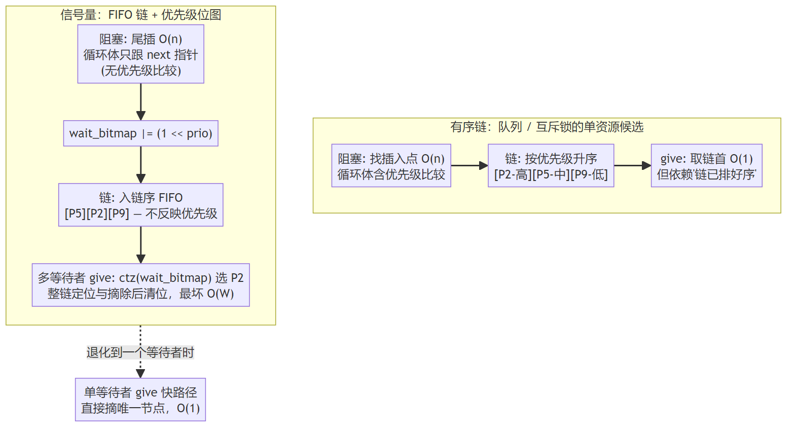

<details><summary>图形源码（mermaid）</summary>

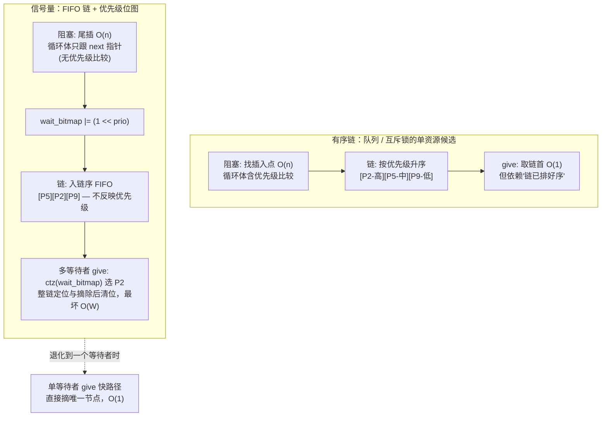

</details>

| 结构 | 入链（阻塞时） | 单资源候选选择与摘链 |
|---|---|---|
| **当前有序链** | 沿等待链找优先级插入点：O(W) | 取链首并摘除，O(1)；完整 API 另计继承或复制等成本 |
| **当前信号量 FIFO 位图链** | 沿等待链走到尾部：O(W)，无需逐节点优先级比较 | 单等待者 O(1)；多等待者位图选择后整链定位与清位，最坏 O(W) |

**关键澄清（避免误读为"入链变 O(1)"）**：尾插同样要遍历到链尾，因此**入链仍是 O(n)**。
尾插循环体比有序插入更轻，但唤醒侧也保留线性扫描；给定负载下的性能收益需实测。阻塞与释放各自的调用频率由业务决定，不能统一假定阻塞总是低频。

两种结构采用相同的单资源候选选择规则：最高优先级优先、同级 FIFO。不同对象仍有各自的资源与返回契约，不能据此说全部 IPC 行为相同。

`wait_bitmap` 与链表应在同一临界区内同步维护。若位图残留导致找不到对应节点，`rtos_internal_wake_highest_bm` 退化为全链扫描取最高优先级；这项防御不能代替对入链、改优先级和清位不变式的验证。

历史实测中 give 随等待者数的退化曾从 +18.4% 降到 +4.8%（见[历史性能报告](rtos_performance_report.md)）；这是该版本、负载与布局下的测量，不代表当前完整路径为常数时间。

## 6.2 rtos_sem_take(sem, timeout) 逐步流程

```
1. sem 非法/未初始化 → 错误码
2. ISR 判定: in_isr && timeout != NO_WAIT → ERR_ISR
   (ISR 里允许 try: count>0 就拿, 拿不到立即失败)
3. ENTER_CRITICAL
4. ── 快路径: count > 0 ──
   count--; EXIT_CRITICAL; return RTOS_OK
   (只描述计数快路径；完整耗时还包含参数、ISR 优先级检查与临界区进出)
5. timeout == NO_WAIT → EXIT; return ERR_TIMEOUT
   真正需要阻塞前检查 block_permitted；失败 → ERR_SCHED
6. ── 慢路径: 阻塞 ──
   ★ 信号量**不走** rtos_internal_block_current_on, 而在本函数内手工初始化
     等待节点后自行入链 —— 因为它需要多设两个与"位图索引链"相关的字段。
     a. cur->blocked_on = sem
     b. wait_node 初始化: tcb=cur, wait_obj=sem, timed_out=FALSE,
        next/prev=NULL, list_head=&sem->wait_head,
        queue_bitmap    = &sem->wait_bitmap,  ← ★声明本链为"位图索引链"
        queued_priority = cur->priority        ← ★记下入链时的优先级
         on_timeout = NULL                    ← 不沿用其他对象的超时钩子
         (transfer_buf 不承载信号量数据；每个使用该字段的模块须自行初始化)
        wait_result = RTOS_OK
     c. rtos_internal_wait_append(&wait_head, node)  ← 尾插 O(n)(遍历到链尾; 同优先级 FIFO)
     d. sem->wait_bitmap |= (1UL << cur->priority)   ← 置存在位；选优先级为 O(1)
     e. sched_block(cur, timeout)          ← 3.4: 出就绪/入延时链，表尾快路径或乱序扫描
     f. sched_schedule()                   ← 3.3: 决策+pend PendSV
7. EXIT_CRITICAL
   最外层临界区恢复进入前的 mask；待屏蔽与异常优先级条件允许，PendSV 执行
   本任务现场被保存，CPU 转去运行下一个任务
8. --- 时间流逝: 或被 give 唤醒, 或超时 ---
   PendSV 恢复本任务现场，从该阻塞调用暂停的位置继续
9. return cur->wait_result  ← 复用阻塞前的 cur，随 callee-saved 寄存器恢复
   (give 唤醒 → OK; 超时 → process_delayed_tasks 已把它置为 ERR_TIMEOUT)
```

> **`queued_priority` 为什么必须单独存**：`cur->priority` 之后可能被用户
> `set_priority` 或内核优先级继承改写。若优先级变化时只把新位写进 `wait_bitmap`，
> **旧位会永远残留** —— 位图再也回不到 0，后续每次 give 都要白扫一遍链。
> `queued_priority` 让"清旧位"有据可依（见 5.8 的 `rtos_internal_requeue_wait_lists`）。

**一次拷贝都没有**——信号量的传递语义是"计数与唤醒"，不带数据。带超时阻塞时任务同时挂上对象等待链与延时链的完整解剖（含超时如何定位任务、give 与超时的竞争裁定），见 **3.7**。

## 6.3 rtos_sem_give(sem) 逐步流程

```
1. 校验
2. ENTER_CRITICAL
3. woken = rtos_internal_wake_highest_bm(&sem->wait_head, &sem->wait_bitmap):
     ┌ 单节点快路径: 链上仅 1 个等待者 → 直接取它，无需 ctz；摘链后仍清位
     │   (是否命中取决于实际业务等待者数量)
     ├ 多节点: top = __builtin_ctz(wait_bitmap)     ← 2 条指令选出最高优先级
     │         从链首找第一个 priority == top 的节点
     │           ↑ FIFO 物理链没有按优先级分组，可能经过所有前置节点，最坏 O(n)
     │         若找不到(位图位残留) → 退化为全链扫描取最高优先级
     ├ rtos_internal_wait_remove(head, victim)      ← 双向链 O(1) 摘除
     ├ 扫描剩余链确认该优先级已无其它等待者 → 清 bitmap 位；最坏 O(n)
     ├ victim->tcb->blocked_on = NULL
     ├ victim->tcb->wait_result = RTOS_OK     ← 告诉它: 你成功了
     ├ victim->list_head = NULL               ← 标记已离开链表
     └ sched_unblock(victim->tcb):            ← 3.5
        DELAYED → 从延时链摘除(O(1), 提前醒, 剩余超时作废)
        READY + push_tail
        若本优先级等于最高就绪优先级 → sched_schedule() 重算链首与候选
4. woken != NULL:
   ★count 不变! 这次 give 的"资源"不变成计数, 而是直接被 woken 消费
   EXIT; return OK
5. woken == NULL (无等待者):
   count >= max_count → ERR_OVERFLOW      ← 二值信号量重复 give 的典型报错
   count++
   EXIT; return OK
```

**"唤醒即传递"的不变量**：`等待者非空 ⇒ count == 0`（空链也可以 count 为 0，因此不是双向等价）。give 优先满足等待者而不增加 count，take 优先消费已有 count，避免一次资源重复记账。`wake_highest_bm` 摘对象链 + `sched_unblock` 摘延时链的语义，见 3.5。

> **`wake_highest_bm` 与 `wake_highest` 的分工**：信号量用前者（位图链），
> 队列和互斥锁取有序等待链的链首；事件组依次判定有序等待链中的位条件。最高优先级选择与同级 FIFO 语义一致，
> 差别只在"最高优先级"是**算出来的**（`ctz`）还是**排出来的**（有序插入）。
> 这是 1.3 不变式 III 两套约定在代码上的落点。

**中断里 give 的效果**：ISR 可请求 PendSV，待异常退出且屏蔽条件允许后切换。实际响应时延还包括嵌套或 pending 的中断、现有临界区、PendSV 和更高优先级任务，不能只等同于该 ISR 的剩余执行时间。

## 6.4 sem_deinit

```
ENTER_CRITICAL
wake_all(&wait_head, RTOS_ERR_DELETED):
    逐个摘节点: blocked_on=NULL, wait_result=DELETED, unblock
    (所有等待者以失败告终, 调用方需自己处理对象存储生命周期)
wait_bitmap = 0; is_initialized = 0
EXIT
```

## 6.5 设计分析

**优点**：计数快路径短；唤醒即授予，不重复记账；按有效优先级选择等待者；合法 ISR 可非阻塞使用；二值与计数模型统一。

**使用边界**：信号量没有拥有者，也不实施优先级继承。用于共享设备的互斥访问时，应根据业务协议选择 mutex；用于累计完成次数时，必须检查 `give` 的 `RTOS_ERR_OVERFLOW`，否则计数饱和后的事件可能被应用忽略。

`deinit` 在临界区内摘除对象等待链、撤销有限超时并使等待调用返回 `RTOS_ERR_DELETED`；恢复路径从 TCB 读取结果，不再读取 sem。但这不证明其他任务或 ISR 已停止发起新调用。释放对象存储之前，应用仍须协调所有使用者退出，并禁止陈旧句柄继续使用。无等待者时允许重新 init，也不等于对象可以与仍在运行的使用方并发重置。

实现入口：[rtos_sem.c](../RTOS/Core/Src/rtos_sem.c) 的 `rtos_sem_init/take/give/deinit`；等待协议见 3.5–3.7。

---

# 第七章 互斥锁: 优先级继承的每一步

## 7.1 数据结构与注册表

```c
struct rtos_mutex {
    uint8_t          is_initialized;
    rtos_tcb_t      *owner;               /* 当前持有者(NULL=自由) */
    uint32_t         recursion_count;
    rtos_wait_node_t *wait_head;
};
static rtos_mutex_t *s_mutex_registry[RTOS_CONFIG_MAX_MUTEXES];
```

**为什么需要注册表**：本内核 TCB 没有持锁链，删除任务或重算继承时从注册表找 `owner == tcb`。容量为 `RTOS_CONFIG_MAX_MUTEXES`，满时 init 显式返回 `RTOS_ERR_NO_MEM`。重复 init 一个无持有者、无等待者且递归计数为0的锁幂等返回 OK，不重复登记；存活持有/等待时返回 `RTOS_ERR_ALREADY`。deinit 必须配对注销，避免残留对象地址。

## 7.2 rtos_mutex_take(mutex, timeout) 逐步流程

```
1. 校验; ISR → ERR_ISR (中断没有"拥有者"语义, 从 API 层堵死)
2. ENTER_CRITICAL; cur = current_tcb
3. ── 情形A: 锁自由 ──
   owner = cur; recursion_count = 1
   EXIT; return OK
4. ── 情形B: 递归重入 ──
   owner == cur → recursion_count++; EXIT; return OK
5. timeout == NO_WAIT → ERR_TIMEOUT
6. ── 情形C: 他人持有 → 阻塞 + 优先级继承 ──
   block_permitted 失败 → ERR_SCHED；此时不得先提升拥有者
   mutex_try_inherit(mutex, cur->priority):
     if owner->priority > cur->priority:          ← owner 数值更大=更低优先级
         was_ready = owner 处于 READY/RUNNING?
         was_ready → ready_list_remove(owner)    ← 必须先摘出
         owner->priority = cur->priority          ← 提升到等待者级别
         was_ready → ready_list_push_tail(owner)  ← 挂进更高优先级的链表+置位图
         requeue_wait_lists(owner)                ← 对象等待链也必须按新优先级维护
     若 owner 正阻塞在别处，不改就绪表，但仍重挂其对象等待链
   block_current_on(mutex, &mutex->wait_head, timeout)
   → 与 6.2 的 6-8 步完全相同: 挂链/出就绪/决策/EXIT/切出
7. --- 唤醒后 ---
   return cur->wait_result
   (OK 的场合: 所有权已在 give 里预移交, 此刻已持有锁——见下)
```

`base_priority` 属于 TCB，不在 mutex 中保存单个“原优先级”。恢复时必须综合拥有者仍持有的全部锁。`take/give` 依赖有效的当前任务，应在调度器启动后的任务中调用；仅处于 Thread 模式不足以使启动前取锁合法。

**优先级继承解决的问题**（优先级反转）：

```
无继承:  H(高) 等锁 → L(低) 持锁 → M(中) 抢占 L → H 被 M 间接阻塞(时间不可控)
有继承:  H 等锁 → L 被提升到 H 级 → M 无法抢占 L → L 尽快放锁 → H 立即运行
```

## 7.3 rtos_mutex_give(mutex) 逐步流程 (顺序是正确性核心)

```
1. 校验; ISR → ERR_ISR
2. ENTER_CRITICAL; cur = current_tcb
3. owner != cur → ERR_PARAM               ← 只有持有者能释放
4. recursion_count--; > 0 → 仍持有, EXIT; return OK
5. ── 真正释放 ──
   ★第一步: 先摘掉本锁所有权，再重算 old_owner 的优先级
   mutex->owner = NULL
   mutex_restore_priority(cur):
     effective = compute_effective_priority(cur)  ← 全部仍持有锁的等待链首与 base 取最小值
     priority 未变 → 无事
     否则: 摘出就绪表 → priority = effective → 放回对应优先级链
   ★第二步: 再唤醒最高优先级等待者
   woken = wake_highest(&wait_head)        ← 同 6.2 的唤醒五连(unblock 可能触发 schedule)
   ★第三步: 所有权预移交
   woken != NULL:
       owner = woken; recursion_count = 1
       → 被唤醒任务运行时【已经持有锁】, 它的 take 直接返回 OK,
         不存在 "owner=NULL 窗口被第三方 take 窃取" 的竞争
   woken == NULL:
       owner = NULL; 锁自由
6. EXIT_CRITICAL; return OK
```

**为什么必须"先恢复、再唤醒"**：调度决策需要看到 old_owner 释放本锁后的有效优先级。若仍把本锁算作它持有，继承重算会保留来自本锁等待者的提升；若先唤醒再重算，unblock 选择候选时也仍看到旧优先级。先摘本锁所有权、综合其余持有锁恢复优先级，再唤醒，才能让本次决策基于正确的就绪关系，同时保留其他锁要求的继承提升。

**为什么所有权预移交是安全的**：摘旧 owner、恢复旧优先级、唤醒新任务并写入新 owner 都处于同一临界区，第三方取锁不能插入这组修改。临界区退出后，在新拥有者实际得到 CPU 前，其他任务或 ISR 仍可能运行；此时锁已属于新拥有者，第三方不能把它当成空闲锁抢走。等待调用恢复后仅检查 `wait_result`，无需再次竞争所有权。

## 7.4 等待者中途退出的善后: mutex_waiter_left

三个场景会让等待者"不经过 give"离开等待链表：

| 场景 | 触发点 | 善后 |
|------|--------|------|
| 超时 | process_delayed_tasks | wait_remove + `mutex_waiter_left(tcb)` |
| 挂起 | task_suspend 第 4 步 | 同上 |
| 删除 | task_delete 第 5 步 | 同上 |

```
mutex_waiter_left(waiter):
  obj = waiter->wait_node.wait_obj
  扫描 s_mutex_registry: 注册表里 == obj ?
    是 → mutex_recompute_inheritance(mutex):
           遍历注册表中 owner 仍持有的全部锁，每把只取有序等待链首
           owner->priority = min(base_priority, 各非空等待链首的有效优先级)
           在就绪表则摘出重挂
           若仍在对象等待链上则按新优先级重挂该节点
    否 → 非 mutex 对象(sem/queue/event 的 wait_obj), 自动忽略
```

**用指针身份匹配的隐患**：理论上若一个已销毁信号量的地址恰好被新互斥锁复用且已注册，匹配会误命中。工程上"等待中的对象仍被复用"意味着用户已 use-after-free，防御成本远大于收益——设计上接受此边界。

## 7.5 任务删除时的锁大扫除: mutex_release_all

```
task_delete 第 8 步调用(此时任务状态已 DELETED, 不在就绪表):
遍历 s_mutex_registry:
  mutex->owner == 被删任务:
      mutex->owner = NULL                ← 先摘所有权，重算时不再计入本锁
      restore_priority(owner)            ← 恢复(但任务已不在就绪表, 只改字段)
      woken = wake_highest(...)
      woken ? 移交所有权 : owner = NULL
```

若不做这一步，mutex->owner 会指向已删除任务，等待者可能永久等待。释放流程扫描 M 把注册锁，每把被释放的锁还会重算其余锁的继承，最坏 O(M²)，并包含必要的等待链重挂；不是对每把锁再遍历 W 个等待者。

## 7.6 rtos_task_set_priority 与继承的交互

```
set_priority(tcb, prio):
  was_ready → 摘出就绪表
  base_priority = prio
  ★priority = mutex_compute_effective_priority(tcb)
      ← 不能直接 priority = prio! 若任务持锁且有更高优先级等待者,
        直接覆盖会丢弃继承提升, 等待者永远抢不到持锁者
      遍历注册表: owner==tcb 的每把锁只取非空 wait_head, 与 base 取最小值
  was_ready → 放回
  requeue_wait_lists(tcb) ← 若正在等待，按新有效优先级重排对象等待链
  mutex_waiter_requeued(tcb) ← 若正等 mutex，重算该锁持有者的继承
  schedule() ← 升降都可能引发切换
```

**本轮只查看等待链首的依据**：互斥锁等待链始终按任务的有效 `priority` 排序，数值最小者在链首；初次阻塞按优先级插入，等待任务优先级变化时先重挂等待链，再通知其所等待互斥锁的持有者重算继承。超时、挂起、删除和成功唤醒只摘节点，保持剩余节点的顺序。这些操作及继承重算都在内核临界区中完成，因此每把锁的链首已经代表该锁全部等待者的最高有效优先级。

`compute_effective_priority` 仍从 `base_priority` 出发，检查注册表中该任务持有的**每一把锁**，保留多锁继承和逐把释放后的正确恢复。若注册表有 M 把锁，重算为 O(M)，不再逐一遍历各锁等待者；并未增加元数据 RAM 或改变 API，也没有增加跨多把锁的传递式优先级继承能力。

## 7.7 设计分析

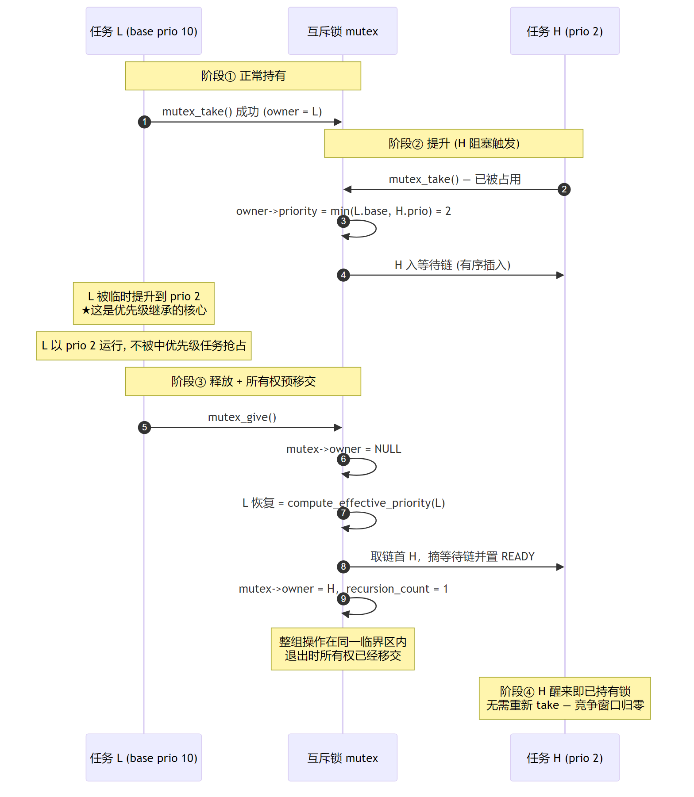

<details><summary>图形源码（mermaid）</summary>

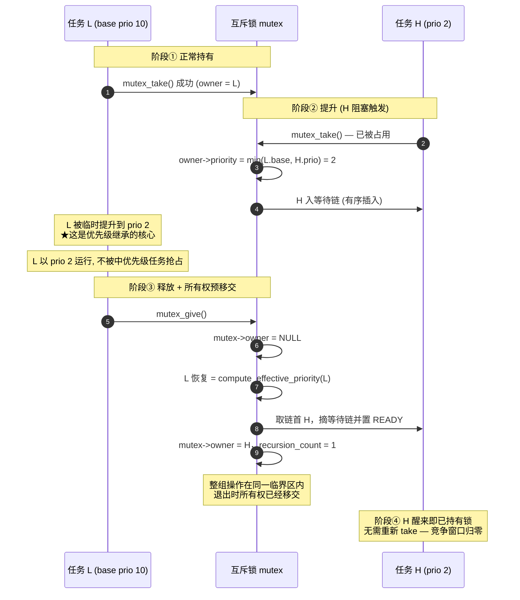

</details>

**优点**：直接等待者触发拥有者提升；释放与等待者离开时重算继承；支持递归和预移交所有权；超时、挂起、删除共享清理机制。

**缺点/已知限制**：

1. ~~多锁 give 丢弃其他锁的继承~~ → ✅ **已修复**（PI-1）：释放时不再无条件降回 `base_priority`，
   而是调用 `rtos_internal_mutex_compute_effective_priority(owner)` **重算"全部持有锁的综合有效优先级"**。
   原缺陷场景：A 持 L1、L2，H1 等 L1、H2 等 L2；give L1 后若直接恢复 base，
   A 仍持 L2 却丢掉 H2 带来的提升 → 持续到 A 释放 L2 为止的**确定性优先级反转**。
   代价是最终 give 需扫描 M 把注册锁重算，即使本锁无等待者也会执行；持锁者若正在对象链上，还包含重挂成本。
2. 当前未实现跨多把锁的传递式优先级继承（L10）；
3. 注册表查找 O(M)、容量由配置限制，满时显式失败，不是静默失去继承；
4. waiter_left 用等待对象地址扫描注册表匹配，是 O(M)；不增加额外类型标签。

**业务一致性边界**：删除任务时移交其持有的锁，保护的是内核 owner 指针和等待者进展，不会回滚该任务已经修改的设备或数据，也没有“拥有者死亡后状态已恢复”的事务协议。业务仍需规定锁顺序、限制持锁时间，并在有序停止任务时处理半完成状态。源码见 [rtos_mutex.c](../RTOS/Core/Src/rtos_mutex.c) 的 `mutex_set_owner_priority`、`rtos_internal_mutex_compute_effective_priority` 与 `rtos_internal_mutex_release_all`。

---

# 第八章 消息队列: 四条路径与单次拷贝直传

## 8.1 数据结构与环形缓冲

```c
struct rtos_queue {
    uint8_t   is_initialized;
    uint8_t  *storage;               /* 用户提供, item_size*capacity 字节 */
    uint32_t  item_size, capacity;
    volatile uint32_t count;         /* 当前消息数(判空/判满的唯一依据) */
    uint32_t  head, tail;            /* 读/写游标, 环形回绕 */
    rtos_wait_node_t *send_wait_head; /* 队满时的发送者(优先级序) */
    rtos_wait_node_t *recv_wait_head; /* 队空时的接收者(优先级序) */
};
```

不变量：`recv_wait_head 非空 ⟹ count == 0`（接收者只在空时阻塞）；`send_wait_head 非空 ⟹ count == capacity`。

init 检查 item_size×capacity 的乘法溢出，并拒绝清空仍有存活等待者的队列。storage 的实际数组容量仍由调用方保证。等待者记录 transfer_size，直传/代办前检查长度与非 NULL 缓冲，不匹配则以 `RTOS_ERR_PARAM` 中止该等待并继续处理合法等待者。

## 8.2 rtos_queue_send() 的四条路径

```
入口: 校验; ISR 判定(必须 NO_WAIT); ENTER_CRITICAL

── 路径1: 单次拷贝直传(接收者正在等) ──
recv_wait_head != NULL:
    node = 链首(最高优先级接收者)
    缓冲为NULL或transfer_size不等于item_size → 摘除并返回等待者ERR_PARAM；检查下一个
    wait_remove
    node->list_head = NULL
    recv_buf = node->transfer_buf     ← 接收者阻塞前存的缓冲指针
    node->transfer_buf = NULL         ← 三态标记: "已直传"
    memcpy(recv_buf, item, item_size) ← ★全流程唯一一次拷贝
    node->tcb->blocked_on = NULL; wait_result = OK
    sched_unblock(接收者)
    EXIT; return OK
    ★消息不经过环形缓冲! to_front 在空队列无意义, 统一走直传
      （接收者等待时队列必为空；空队列不一定有接收者等待）

── 路径2: 直接入队(有空间) ──
count < capacity:
    to_front==FALSE: memcpy(storage + tail*item_size, item); tail 环形+1
    to_front==TRUE : new_head = (head==0) ? capacity-1 : head-1
                     memcpy(storage + new_head*item_size, item); head = new_head
    count++
    EXIT; return OK

── 路径3: 满且不等待 ──
timeout == NO_WAIT → EXIT; return ERR_TIMEOUT

── 路径4: 满 → 阻塞发送者 ──
先检查 block_permitted；失败 → ERR_SCHED
transfer_buf  = (void*)item      ← 记录发送缓冲
transfer_size = item_size
to_front      = 调用者插队意图
block_current_on(queue, &send_wait_head, timeout)
EXIT_CRITICAL → PendSV 切出
--- 唤醒后 ---
wait_result != OK      → return (超时/被中止)
transfer_buf == NULL   → return OK   ← 接收者"代办入队"了(见 8.3), 消息已在队里
否则 → 重试循环:
    ENTER_CRITICAL
    有空间 → 入队(同路径2,含to_front分支); EXIT; return OK
    又满了 → 重设 transfer_buf; 再 block_current_on; EXIT; 再切出 …
```

**当前正常路径与保留重试代码**：对端在唤醒前已完成直传或代办复制，并将 transfer_buf 置 NULL；等待者恢复后直接返回成功，不重新竞争槽位。源码仍保留 transfer_buf 非 NULL 时的重试分支，沿用原始 timeout；本轮没有在合法 API 路径复现该分支引发 L5，不能将“超时必然超预算”列为已确认缺陷。

## 8.3 rtos_queue_recv() 与"代办入队"

```
入口: 校验; ISR 判定; ENTER_CRITICAL

── 路径1: 有消息 ──
count > 0:
    memcpy(item, storage + head*item_size); head 环形+1; count--
    ★腾出的空位立刻补给阻塞的发送者(代办入队):
    send_wait_head != NULL:
        node = 链首
        缓冲为NULL或长度不匹配 → 以ERR_PARAM中止该等待者；再检查下一个
        wait_remove
        queue_storage_push(queue, node->transfer_buf, node->to_front)
                                ← 按等待时记录的插队意图写队首或队尾
        count++                 ← 空位被重新填上
        node->transfer_buf = NULL ← 三态标记: "已代办"
        node->list_head = NULL
        node->tcb->blocked_on=NULL; wait_result=OK
        sched_unblock(发送者)
    EXIT; return OK

── 路径2: 空且不等待 → ERR_TIMEOUT ──

── 路径3: 空 → 阻塞接收者 ──
先检查 block_permitted；失败 → ERR_SCHED
transfer_buf = item               ← 记录接收缓冲, 供发送者直传
transfer_size = item_size
block_current_on(queue, &recv_wait_head, timeout)
EXIT → 切出
--- 唤醒后 ---
result != OK → return
transfer_buf == NULL → return OK  ← 发送者已直传进 item
否则 → 重试循环(同 8.2 路径4 的对称结构)
```

**拷贝次数**：接收者已等待时，发送缓冲→接收缓冲只有一次 memcpy，省去环形队列中转；这属于单次拷贝直传。满队接收先把已有队首消息拷出，再把阻塞发送者的消息代办拷入，是两条不同消息各一次拷贝；代办消息之后被另一 recv 拷出，仍经过环形缓冲。

**L2 已修复**：独立 `wait_node.to_front` 记录插队意图，代办调用与普通入队相同的 `queue_storage_push()`，不会固定写 tail，也不借 transfer_size 的位编码。

## 8.4 交付协议与缓冲区寿命

普通发送先复制到环形 storage，普通接收再复制到目标，共两次复制。接收者已经等待时，发送者直接复制到接收者登记的目标缓冲，只执行一次 `memcpy`；不经过环形缓冲不等于没有复制，也不会自动转移应用数据对象的所有权。

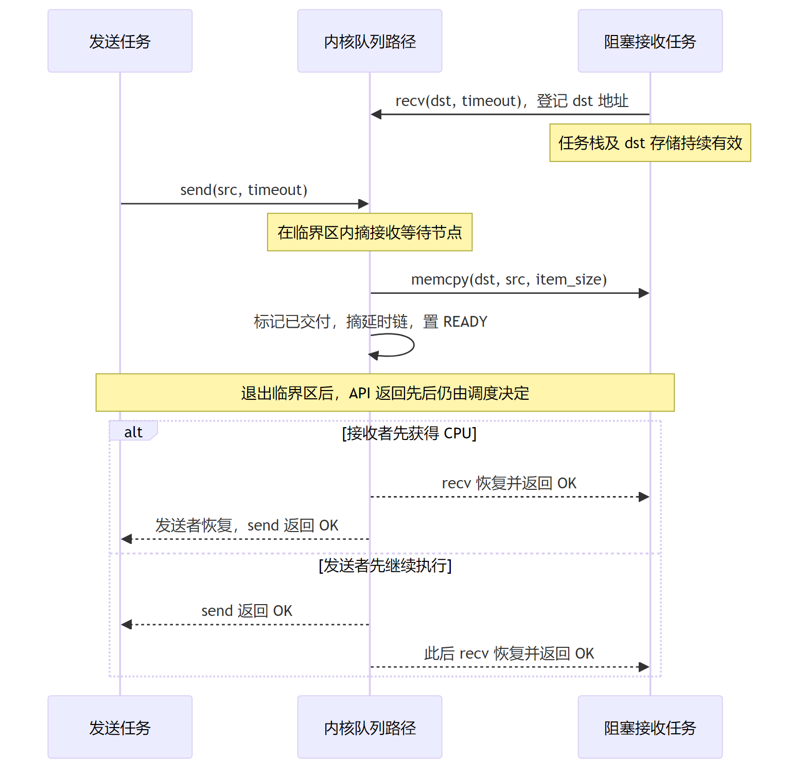

<details><summary>图形源码（mermaid）</summary>

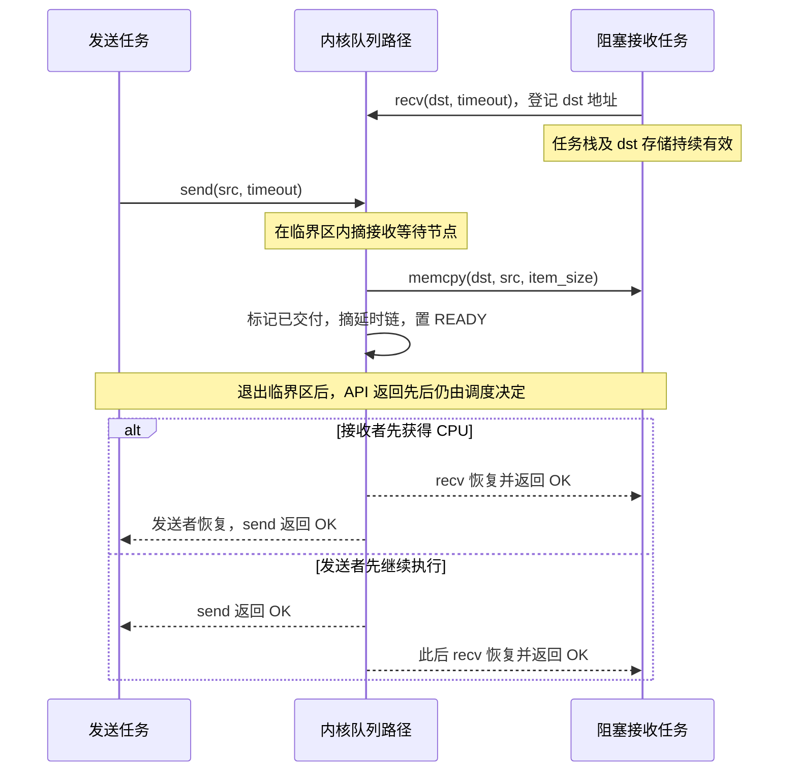

</details>

发送调用阻塞时，内核保存的是源缓冲地址，不是源内容的私有副本。接收调用阻塞时，内核保存的是目标缓冲地址。因此，两种缓冲都必须在 API 返回前持续有效；发送源还必须保持内容不变。局部变量可以在自身阻塞调用中保持有效，因为任务栈仍在，但其他任务或 ISR 提前修改、释放共享源缓冲仍会破坏消息。

| 交付方式 | 成功返回之前内核完成的事 | 调用方仍需保证的事 |
|---|---|---|
| 发送到环形 storage | 消息按值复制进一个槽位 | storage 在整个队列寿命内有效，实际容量足够 |
| 发送给已等待接收者 | 消息复制到该等待者的目标，并撤销其等待登记 | 目标容量至少为 item_size，阻塞期间不得销毁 |
| 满队列发送阻塞 | 对端腾出槽位后代办入队并唤醒发送者 | 源地址及内容保持到发送调用返回；to_front 意图由节点记录 |
| 队列中传递指针 | 只复制指针值 | 指向数据的所有权、归还和消费者退出协议由应用另行定义 |

消息通常按队尾发送、队首接收形成 FIFO；`to_front` 可改变消息顺序。等待任务按有效优先级选取、同级按入链先后选取，这是另一个维度，不代表所有业务消息都按生产者优先级重新排序。`get_count/get_free` 只给出瞬时快照，不为下一次发送预留槽位。

源码定位：[rtos_queue.c](../RTOS/Core/Src/rtos_queue.c) 的 `rtos_queue_send`、`queue_wake_sender_on_free_slot` 与 `rtos_queue_recv`。

## 8.5 设计分析

**优点**：接收等待时单次拷贝直传；优先级唤醒；ISR 非阻塞收发；普通及代办路径都保留 to_front。
**限制**：消息定长且按值拷贝，临界区包含 memcpy；大消息可传指针并另行管理缓冲寿命。当前没有 Peek。

---

# 第九章 事件标志组

事件组表达条件状态，不保存同一位被重复置位的次数。若业务要求每次发生都恰好消费一次，应采用计数或带序号的消息协议。等待模式和事件数据是两个独立参数：`CLEAR_ON_EXIT` 的 bit24 位于 **mode**，不会占用 event->bits 的 bit24。

头文件注释约定应用使用低 24 位，实际 `rtos_event_bits_t` 为 uint32_t；当前 `set/clear/wait` 未掩码或拒绝高 8 位，也没有事件位数配置宏。应将低 24 位写成接口使用约定，不能声称源码已经强制验证该范围。源码见 [rtos_event.h](../RTOS/Core/Inc/rtos_event.h) 与 [rtos_event.c](../RTOS/Core/Src/rtos_event.c)。

## 9.1 rtos_event_wait(bits, mode, timeout)

```
mode = ANY(0)/ALL(1) | 可或上 CLEAR_ON_EXIT(1<<24)
校验: bits 非零; mode 无非法位; ISR 需 NO_WAIT
ENTER_CRITICAL

── 快路径: 条件已满足 ──
event_check(bits&wait_bits 按 ANY/ALL):
    result = 当前 bits                ← 返回"清除前的真实值"
            (旧版曾回填 |wait_bits, ANY 模式会把没置位的位也报成1——已修)
    CLEAR_ON_EXIT → bits &= ~wait_bits
    EXIT; return result

NO_WAIT → 返回当前位(未满足)
真正需要阻塞前检查 block_permitted；不允许阻塞 → 返回0，不入链

── 慢路径: 阻塞 ──
blocked_on = event
wait_node:
    transfer_size = wait_bits   ← 借用字段存参数
    transfer_buf  = NULL        ← event_set 将写入结果
    wake_tick     = mode        ← 借用字段存模式
    list_head     = &event->wait_head
    queue_bitmap  = NULL；queued_priority = cur->priority
    on_timeout    = event_capture_timeout  ← 在超时摘链前记录位快照
block_current_on 风格: insert_by_prio + sched_block + schedule
EXIT → 切出
--- 唤醒后 ---
result = (bits)transfer_buf               ← 成功或超时均从TCB读取快照
超时: process_delayed_tasks 在对象等待链摘除前调用 on_timeout 捕获位值
销毁/挂起中止: transfer_buf 保持 NULL，返回0
恢复后不再解引用 event                   ← 对象此时可能已 deinit/复用
return result
```

## 9.2 rtos_event_set(bits)

```
ENTER_CRITICAL
bits |= 新位
遍历 wait_head(先存 next 再处理——当前节点会被移除):
    wait_bits = node->transfer_size; mode = node->wake_tick
    if event_check(当前 bits, wait_bits, mode):
        result_bits = bits                   ← 清除前的快照
        CLEAR_ON_EXIT → bits &= ~wait_bits   ← 可能影响后续等待者的判定
        wait_remove; blocked_on=NULL; wait_result=OK; list_head=NULL
        transfer_buf = (void*)result_bits    ← 回传给等待者
        sched_unblock(该等待者)               ← 可能触发抢占
EXIT; return 当前 bits
```

**多等待者 + CLEAR 的当前语义**：按优先级有序链依次检查，同级 FIFO；第一个满足且请求 CLEAR 的等待者会立即清位，后续等待者使用清除后的位值判定，可能继续等待。这是本实现的消费式语义，不能宣称与 FreeRTOS 在一次 set 中让多个等待者观察同一置位快照的行为完全相同。

例如 H 和 L 都等待 bit0，且 H 优先级高、两者都请求 CLEAR：一次 `set(bit0)` 先满足 H，并保存其清位前快照；随后 bit0 被清除，L 继续等待。若 H 不清位、L 清位，则两者都可能满足。每个成功等待者观察的是轮到它判定时的快照，不是整个 set 调用统一冻结的广播快照。

**设计分析**：优点是一对多/多对一解耦同步、ISR 可 set。缺点：set 是 O(等待者) 遍历无提前终止；参数借存 wake_tick/transfer_size 提高了阅读门槛（历史上曾因借存 notify_value 与任务通知互相覆盖出过 bug，现方案各字段独占）。

## 9.3 返回快照与条件判断

`event_wait` 返回全部实际事件位快照，而不是 `result & wait_bits`，也不是 `rtos_status_t`。ANY 成功应检查 `(result & wait_bits) != 0`，ALL 成功应检查 `(result & wait_bits) == wait_bits`；非零值本身不能证明 ALL 已满足。

| 返回路径 | 快照来源 | 调用方判断 |
|---|---|---|
| 条件已满足或由 set 满足 | 满足时清位之前的全部位值 | 按 ANY/ALL 与等待掩码重新判断 |
| NO_WAIT 且条件未满足 | 当前全部位值 | 可能包含与本次等待无关的非零位 |
| 有限等待到期 | `event_capture_timeout` 在摘对象链前保存的位值 | 快照仍未满足条件，不读恢复时刻的对象 |
| 参数非法、非法阻塞 ISR、不可阻塞、deinit 或挂起中止 | 返回零 | 不能仅由位值区分这些失败原因 |

超时快照保存在 TCB 的等待节点中，恢复后的任务不再解引用 event 对象。这是生命周期安全的结果传递方式；内部 `on_timeout` 只用于捕获结果，不是执行用户业务回调的入口。应用需要区分失败原因时，应增加自己的状态协议，不能把零统一翻译为“超时”。

---

# 第十章 软件定时器

## 10.1 架构: 服务任务串行处理控制与回调

```
普通任务/合法 ISR:
  rtos_timer_start/stop/change_period/delete
      → timer_send_cmd: 打包 {type, timer*, new_period, generation}
      → rtos_queue_send(16条命令队列, ISR使用NO_WAIT / 任务使用100 tick预算)
                                  │
                                  ▼
定时器服务任务(优先级30, 静态栈256字, 创建于 rtos_init):
  for(;;) { 三阶段循环 + queue_recv(超时=距下次到期) }
                                  │
                                  ▼
活跃链表 s_active_head: 双向链, 按 expire_tick 升序
服务任务自身在回调中调用控制API → 临界区内就地执行，不等自己的队列
```

**设计分工**：其他任务和合法 ISR 投递控制命令；服务任务维护活跃链、处理命令并执行回调。`rtos_timer_init` 创建静态服务任务，只允许 Thread 模式；`create` 建立调用方提供的静态对象，检查参数、活跃链和当前回调身份，允许首次使用未清零存储。服务初始化成功后再调用返回 `RTOS_ERR_ALREADY`，保留既有子系统状态。

命令队列长度目前为 [rtos_timer.c](../RTOS/Core/Src/rtos_timer.c) 中的内部常量 `TIMER_CMD_QUEUE_LEN=16`，未通过 `rtos_config.h` 暴露。队列满时，ISR 非阻塞发送可失败；任务使用 100 tick 的等待预算，也必须检查返回值。服务任务内的就地控制与外部队列命令都在临界区内更新链表，存储和调用方生命周期仍需应用协调。

**命令接受与生效分离**：普通调用返回 `RTOS_OK` 表示命令已入队或直接交付到正在等待命令队列的服务任务，不保证命令已经执行。`start` 的计时起点为命令被处理时的 `tick_count`，而不是 API 入口时刻。已有命令、正在执行的回调和更高优先级任务都会影响生效延迟，当前接口没有“一 tick 内生效”的承诺。

## 10.2 服务任务循环与回调重入

每轮只摘下一个已到期定时器。旧实现把所有到期对象用 `next` 串成临时链；回调中的 `start/stop/delete` 会复用这些链接，使其他回调遗漏，或把尚未到期的对象带进回调遍历。

```
loop:
  [临界区] 摘下一个到期对象，保存 previous_expire，登记 s_callback_timer
  [临界区外] 执行它的回调
  [临界区] 若仍有效且未自行重启/停止/删除：
              PERIODIC：从 previous_expire + period 推进到下一未来时刻
              ONE_SHOT：保持不活跃
            清 s_callback_timer，消费回调期间排入的控制命令
            按当前 tick 重新计算下一等待时间
  若本轮执行了回调：立即重新检查到期链
  否则 queue_recv(剩余等待时间)，收到命令后继续处理
```

周期定时器以 `previous_expire + period` 推进原绝对相位；如果该相位已经错过，则直接跳到下一个未来相位，避免回调耗时逐轮累加形成漂移，以及补发所有漏期产生的回调风暴。这不保证每一个周期都执行一次回调。回调自行 `start` 已重新挂入活跃链，服务任务不会再插一次。

只有服务任务本身在任务上下文调用控制 API 时，命令才直接执行。即使 ISR 打断的是服务任务，ISR 也只入命令队列。每条命令带创建代次 `generation`，服务任务验证对象仍初始化且代次匹配后再处理，隔离同一有效地址重新创建后的旧命令。它仍须读取对象存储才能验证，不能据此提前释放 storage。

回调在临界区外，可以调用阻塞 API；阻塞的是整个定时器服务任务，其他回调和外部命令都会等待。生产代码宜让回调只投递短工作请求，再由业务任务处理长操作。服务任务不能在自己的控制命令队列上阻塞等待空位。

## 10.3 timer_handle_cmd 的四种命令

```
START:  is_active → 先 remove(支持重复 start 重置计时)
        expire = now + period; insert
STOP:   is_active → remove
        随后置 deactivated 标志，阻止回调收尾时自动重插
CHANGE_PERIOD:
        active → remove; period 新值; expire = now+新值; insert
        idle  → 只改 period (不自动启动, 与 FreeRTOS xTimerChangePeriod 略异)
DELETE: is_active → remove; is_initialized = 0; deactivated = 1
        外部调用为异步接受；服务任务内调用就地处理，但回调收尾仍访问节点
```

## 10.4 删除、代次与对象寿命

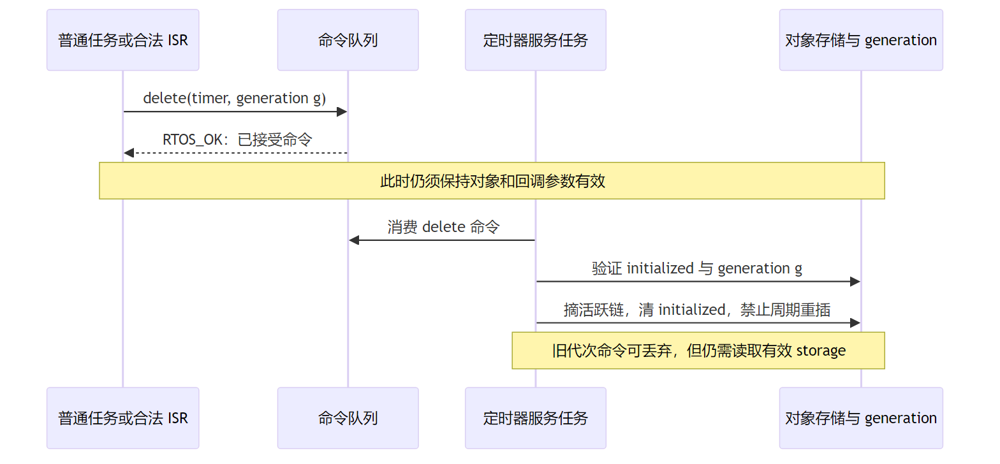

<details><summary>图形源码（mermaid）</summary>

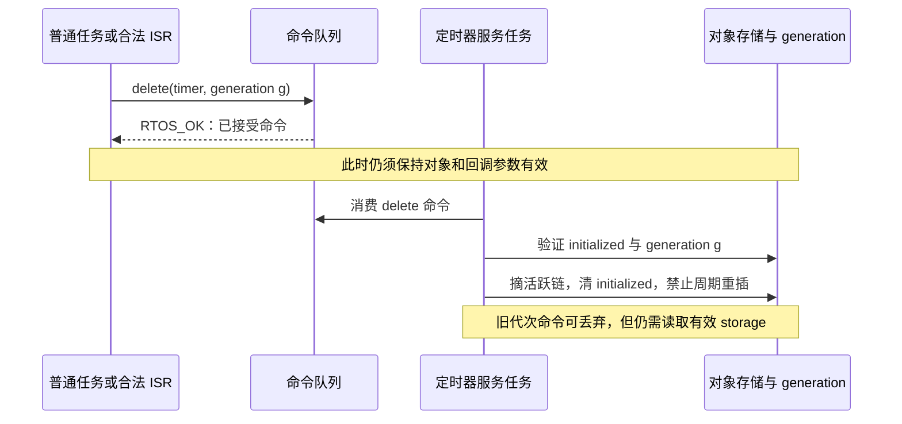

</details>

`generation` 在 create 时递增并跳过零，用于拒绝同一有效地址上的旧控制命令；它是有限代次校验，不是内存所有权机制。`delete/stop` 没有单独的完成等待 API，返回成功不是“所有命令和回调均已结束”的屏障。

定时器对象及回调参数必须持续有效，直到所有在途命令和正在执行的回调收尾都不再引用它们。即使回调内自删已就地清除 initialized，服务循环在回调返回后仍会访问该节点，不能在回调中释放自己的 timer。需要动态销毁时，应由应用设计完整的结束确认协议；采用与子系统同寿命的静态对象可减少此类生命周期风险。`name` 仅保存指针，与任务名称复制进 TCB 的方式不同。

实现入口：`timer_send_cmd`、`timer_handle_cmd`、`timer_reinsert_periodic` 和 `rtos_timer_service_task`，见 [rtos_timer.c](../RTOS/Core/Src/rtos_timer.c)。

## 10.5 设计分析

**优点**：回调在任务上下文、临界区外执行；命令带 generation 防旧命令作用于同地址新对象；服务任务串行维护链；静态控制对象；周期重插按上一 expire 推进并跳过错过相位。
**限制**：长回调拖延其他回调和命令；控制队列固定 16 条；异步 delete 后存储必须持续有效；有限 period 为 `1..0x7FFFFFFF`。到期链首检查 O(1)，活跃链插入仍 O(活跃定时器数)，回调执行成本由用户代码决定，不能把整轮服务写成 O(到期数)。控制命令接受失败也不是内核替调用方自动重试或完成删除。

---

# 第十一章 内存管理

## 11.1 动态堆: first-fit + 前向合并 (32KB 静态缓冲)

**块布局与隐式链表**：

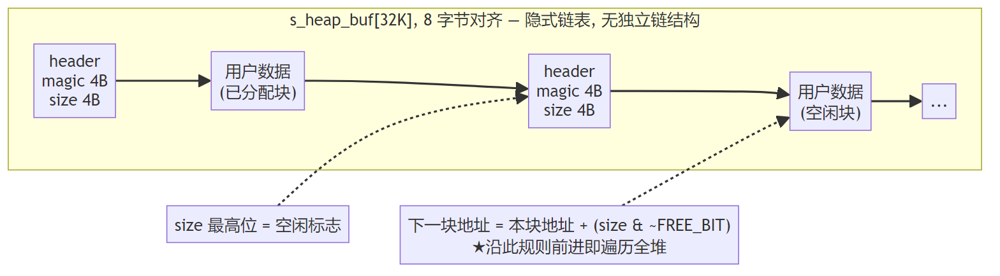

<details><summary>图形源码（mermaid）</summary>

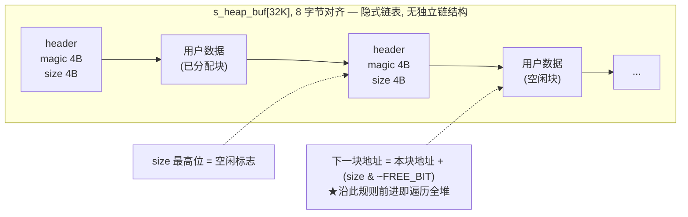

</details>

**rtos_heap_alloc(size) 逐步**：

```
need = align8(size) + 8(header); 不足 MIN_BLOCK(16) 按此
ENTER_CRITICAL
hdr = 堆首
while hdr 在堆内:
    magic != MAGIC → 堆已损坏, break            ← 越界写的哨兵检测
    空闲 && 块 >= need:
        block_split(hdr, need):
            原块总大小 >= need + 16 + 8 → 在 need 处造新空闲块(写magic/size/FREE)
                                    hdr->size = need
            否则整块分配(剩余不足24B，不创建新块头)
        若分裂新 header，s_heap_free 先扣除8字节元数据
        标记已分配; s_heap_free 再扣已分配块的payload；增加alloc计数
        EXIT; return hdr+8                       ← 跳过 header
    hdr += 块大小                                  ← 沿隐式链走
EXIT; return NULL
```

**rtos_heap_free(ptr) 逐步**：

```
范围检查(必须在堆内) → magic 检查(防双重释放/野指针) → FREE 位检查(防重复释放)
块大小记录; 标记 FREE
block_merge_next: 下一块也空闲 → size += 下一块大小; 下一块 magic=0(防复用)
                 合并回收的8字节header重新计入s_heap_free
   (每次仅检查下一高地址块一次，不后向合并，也不循环合并整个空闲段，L7)
```

**任务删除的释放顺序**：`rtos_task_create` 先分配 TCB 后分配栈，`process_pending_free` 先 free 栈、后 free TCB。如果这两次分配得到相邻且地址递增的块，TCB 释放时可以向高地址合并刚释放的栈。first-fit 在碎片化堆中不保证分配地址随调用递增，因此该收益取决于实际布局，不能把创建顺序视为内存位置保证。

**设计分析**：隐式链通过块大小定位下一块，省去独立链指针，但每个块仍有 8 字节 header、8 字节对齐及不分裂尾部的开销。alloc 与最大连续块查询均扫描全部物理块，复杂度 O(K)，K 包含已分配和空闲块。free 是 O(1) 标记及一次前向合并，不保证消除全部外部碎片。magic 和 FREE 位提供有限防御检查，不能替代“只释放分配器原样返回的有效指针”这一契约。

`rtos_heap_get_free` 是空闲 payload 总和，`rtos_heap_get_max_alloc` 是最大单个连续 payload 的对齐上界。前者不能证明大请求可满足；后者也只描述查询时刻，不锁定后续分配。动态任务需要 TCB 和栈两次请求，必须同时预算块头、对齐及碎片，而不是只将 stack_words×4 与总空闲量比较。

当前堆缓冲容量由 `RTOS_CONFIG_HEAP_SIZE` 决定，默认 32 KiB；堆并未因 `USE_STATIC_ALLOCATION=1` 而关闭。适合低频任务创建等路径；高频固定尺寸数据可使用内存池。源码见 [rtos_heap.c](../RTOS/Core/Src/rtos_heap.c) 的 `block_split`、`block_merge_next`、`rtos_heap_alloc/free/get_max_alloc`。

## 11.2 固定块内存池: 分配 O(1)，释放 O(n)

```
init:  块大小 max(align4(block_size), sizeof(void *))；本32位目标至少4B
       从最后一块往前串单链 → free_list = 第 N-1 块(第0块在链尾)
alloc: ENTER; node = free_list; free_list = node->next; free_count--; EXIT
free:  范围和块边界检查; 扫描空闲链拒绝重复释放;
       node->next = free_list; free_list = node; free_count++
```

空闲块起始空间复用为 next 指针，没有逐块独立 header；池描述符和对齐仍占用资源。通用池将 block_size 向上对齐到 4 字节，因此 `mempool_init(..., 33, ...)` 在当前 32 位目标中得到 36 字节块。USB 的 64/512 字节双档池是上层选定的尺寸档位，不是通用池自动按 2 的幂舍入。

init 还检查基址指针对齐、块大小向上对齐溢出、总容量乘法和地址加法溢出。free 用整数地址校验范围及精确块边界，再在临界区内有界扫描空闲链，重复释放返回 `RTOS_ERR_ALREADY`；不能为追求 O(1) 释放而绕过该健壮性检查。调用方负责提供实际足够大的存储，不能以参数算术检查替代数组容量约束。

pool 在 alloc/free 前必须初始化；仍有在用块时不能重新 init，因为初始化会重建全部空闲链，没有存活分配保护。初始化还自动将 pool 描述符登记到性能观察表，当前没有 unregister 接口；即使全部块已归还，局部 pool 描述符提前失效仍会使后续内存查询访问无效存储。pool 描述符宜采用子系统同寿命的静态存储，并保持实际 storage 有效直到所有使用结束。源码见 [rtos_mem.c](../RTOS/Core/Src/rtos_mem.c) 与 `rtos_perf_register_pool`。

---

# 第十二章 性能监视器

## 12.1 配置与有效指标

性能监视器既包含诊断查询，也包含切换热路径记账，必须分别理解。当前默认 `USE_PERF_MONITOR=1`、`PERF_HOTPATH_STATS=0`、`PERF_STACK_WATERMARK=1`；监视器保留，但切换记账钩子被条件编译去除。

| 指标或能力 | 默认热统计关闭时 | 开启热统计时的解释 |
|---|---|---|
| DWT 原始周期读数 | 可读，适合独立短区间测量 | 相同，仍需回绕和采样约束 |
| uptime、观察表任务身份、内存池和栈查询 | 保留 | 保留，观察表有容量限制 |
| 系统 CPU/idle 占比 | CPU=0、idle=10000，为关闭记账后的占位值 | 基于已结算 idle 周期与查询区间计算 |
| 全局切换总数、频率、派发延迟 | 未累计，不能作为零负载/零延迟证据 | 由切换提交钩子累计与查询 |
| 任务 run_cycles、run_time_us、CPU 占比 | 未累计 | 32 位周期账目，包含该任务运行区间内的 ISR 时间 |
| 任务 switch_count | 调度器独立维护，仍可查看 | 不应与未启用的全局 perf 切换计数混淆 |

`USE_PERF_MONITOR=0` 时公共查询为宏化桩，完整查询返回 `RTOS_ERR_PARAM`，不会填写真实统计。`GENERATE_RUN_TIME_STATS=1` 的旧字段和 idle 计数也不能替代未开启的 DWT 热记账。报告必须写明配置、测量窗口与指标有效性，不能把占位数值绘制成真实负载。

配置见 [rtos_config.h](../RTOS/Core/Inc/rtos_config.h)，字段和调用契约见 [rtos_perf.h](../RTOS/Core/Inc/rtos_perf.h)。

## 12.2 时基、单位与回绕约束

```
perf_init: DEMCR |= TRCENA; CYCCNT = 0; DWT_CTRL |= CYCCNTENA
DWT模式: cycles = 32位 CYCCNT，每CPU时钟周期递增
Tick回退: cycles API 返回内核 tick_count，单位变为tick
差值: uint32_t delta = now - previous
前提: 真实区间小于该32位计数器的一个完整周期
```

168 MHz 下 DWT 的完整周期为 `2^32 / 168000000 ≈ 25.565 s`。无符号减法可以处理跨边界、但不到一个完整周期的间隔；跨过完整周期无法仅凭两个 32 位读数识别绕圈数。高优先级任务长期运行、没有同级伙伴或查询窗口过长，都可能违反约束，不能假定每次 tick 必然产生一次真正的上下文切换。

`rtos_perf_cycles_to_us` 在 DWT 模式下按 `SystemCoreClock/1000000` 整数 MHz 换算；固定 168 MHz 时适用当前测试口径，改频后必须核对时钟值和跨频测量区间。Tick 回退按配置频率换算，粒度为 tick，不具备周期级精度。

`uptime_ticks` 是原样输出的 32 位内核 tick，`uptime_ms` 经 64 位中间运算换算后仍存入 uint32_t；两者都不是长期 64 位时基。默认 1 kHz 下约 49.710 天回绕，调度器挂起期间内核 tick 不推进。它们不能直接作为跨多次回绕的设备运行年限或 RTC 时间。

任务 `run_cycles` 也为 32 位累计值，`run_time_us` 由当前累计周期值换算，不是独立的 64 位长期积分。长期监控应在满足区间约束的前提下，由应用积累短区间差值，或另行设计长期时基；本接口不会自动重建已经丢失的完整计数周期。

## 12.3 切换记账与测量误差

```
sched_commit_context_switch → perf_on_context_switch(prev, next):   /* 热统计开关内 */
    now = get_cycles()
    delta = now - last_switch_cycle; last_switch_cycle = now
    prev->perf_run_cycles += delta
    total_cycles += delta; prev==idle → idle_cycles += delta
    latency = now - perf_pend_cycle
    更新 latency max/sum/count 与全局切换次数
```

两个提交点之间的完整时间段归到 prev，包含任务执行、打断它的 ISR，以及区间边界附近的内核执行时间；监视器没有独立 ISR 时间账。打断 idle 的 ISR 也归入 idle 区间，可能使基于 idle 的忙碌率低估真实 IRQ 工作量。它测量的是任务占据的调度区间，不能等同于业务函数净执行周期。

查询不会把当前正在运行、尚未发生下一次切换的区间补记到该任务。墙上周期分母已经走到查询时刻，而任务及 idle 分子只记到最近一次提交，因此短窗口、长连续运行段和窗口边界会造成偏差，任务占比之和也不保证严格等于系统占比。源码提供防御截断，不代表这些误差已经消失。

派发延迟使用 `perf_pend_cycle` 与切换提交时刻的差值，包含请求之后的中断和屏蔽等待；重复请求可能更新记录起点。它不是从任意设备事件产生到业务任务首条指令的端到端响应，也不包含提交点之后的全部恢复指令。若需要该指标，应为具体事件设置独立时间戳并在任务入口采样。

代码入口见 [rtos_perf.c](../RTOS/Core/Src/rtos_perf.c) 的 `rtos_perf_on_pend_switch`、`rtos_perf_on_context_switch` 和 `rtos_perf_get_system`；热钩子条件分别位于 port 的切换请求路径和 `rtos_sched_commit_context_switch`。

## 12.4 查询窗口与调用顺序

`rtos_perf_get_system` 有状态副作用：返回当前窗口指标后，推进系统周期、idle、切换、延迟 sum/count 基准，并同步推进观察表中任务的运行周期基准。它不是可以无限重复读取而结果不变的纯快照接口。`rtos_perf_get_task/get_all_tasks` 不推进窗口，使用当前系统窗口基准计算任务占比。

采样任务应先收集需要的任务统计，再调用一次 system 查询关闭本窗口；若先调用 system，再读取任务，任务查询已进入新的很短窗口。多个监控者各自调用 system 也会互相改变窗口，应集中由单一采样任务发布统计快照。任务与系统查询并非一份同一时刻的原子联合采样，解释结果时仍需考虑执行间隔。

`rtos_perf_reset` 仅重置窗口基准，不清除累计运行周期、切换次数或历史 latency max。`sched_latency_avg_us/count` 按窗口差值计算，`sched_latency_max_us` 取累计最大值；不能把 reset 后的 max 自动标注为新窗口最大值。

按头文件调用契约，完整查询在任务上下文执行；实现没有统一的 ISR 拒绝守卫，不能据此扩展推荐使用范围。`get_all_tasks` 在整个遍历及栈扫描期间持临界区，避免期间任务删除释放 TCB；开销随观察任务数和栈容量增长。`get_cpu_usage/get_switch_rate` 才是 ISR 只读快速快照，数值由之前的 system 查询刷新，不会主动采样。

## 12.5 观察容量、内存与栈水位

perf 任务观察表默认容量为 `MAX_TASKS+2=18`，满后新任务不再加入，但任务创建不因此失败。它与内核存活任务登记是两套结构：system.task_count 和 get_all_tasks 只覆盖观察表，不能证明系统没有第 19 个任务。get_all_tasks 还受调用方数组容量限制，返回数量可能是截断后的数量。使用裸 TCB 的单任务查询时，调用方必须保证句柄仍然有效。

`get_memory` 聚合的是已登记固定池，不是完整 SRAM 账目，也不包含 RTOS 堆、所有任务栈和任意应用缓冲。`task_pool_capacity` 被赋值为 `MAX_TASKS=16`，`task_pool_used` 是 perf 观察表条目数；名称属于历史接口，当前并不存在由该字段描述的 16 槽 TCB 创建池，两数也不能用来执行任务准入控制。通用堆应另读 `heap_get_free/get_max_alloc`。

栈水印在创建时用 0xA5A5A5A5 填充尚未占用区域，查询从栈底扫描首个改变字，估算已写入路径的历史最深使用量。字段单位为字节，而任务创建的 stack_size 单位为字；关闭水印时退化为保存栈指针对应的位置，不代表历史最大值。水印可能漏掉尚未触发的调用路径或仍保持填充值的空间，不能替代异常帧预算和独立越界保护。

默认 idle 溢出巡检使用有限的 perf 任务表；超出观察容量的任务可能未被巡检。关闭 perf 后巡检改为扫描就绪链和延时链，永久 BLOCKED/SUSPENDED 任务不在同一覆盖范围。检查还依赖 idle 获得 CPU，属于运行期诊断，不能声称实时阻止栈越界或保证所有任务任意时刻均安全。

观察注册和查询见 `rtos_perf_on_task_created`、`rtos_perf_register_pool`、`rtos_perf_get_memory/all_tasks`；idle 巡检见 [rtos_task.c](../RTOS/Core/Src/rtos_task.c) 的 `rtos_idle_task`。没有 pool 注销接口这一寿命约束同时适用于本章内存查询与 11.2 的固定池。

---

# 第十三章 USB 子系统

> 本章描述 USB 子系统的完整实现：如何把第三方协议栈 **CherryUSB** 以最小代价移植到本内核之上，做成 **CDC 虚拟串口 + MSC 大容量存储 + HID** 三合一复合设备；以及把这套方案搬到其他平台时，哪些东西必须重写、哪些可以直接复用。

**定位**：纯适配层，不侵入内核。向下把本内核的 sem/mutex/queue/timer/task 五原语包装成 CherryUSB 期望的 `usb_osal_*` 句柄式接口；向上把 CherryUSB 的异步端点回调翻译成 `rtos_usb_cdc_read/write` 这类阻塞式串口感 API。

## 13.1 分层架构与一帧数据的旅程

```
+----------------------------------------------------------+
| 用户应用        main.c: task_usb_cdc / task_usb_msc /    |
|                task_usb_hid                              |
+----------------------------------------------------------+
| 用户友好封装    rtos_usb.c: 描述符表、端点回调、          |
|                CDC/HID 阻塞式 API、MSC RAM 盘读写        |
+----------------------------------------------------------+
| CherryUSB 设备栈  usbd_core.c (枚举状态机/标准请求)       |
|                + class: usbd_cdc_acm / usbd_msc /        |
|                  usbd_hid (类协议)                       |
+----------------------------------------------------------+
| DCD 驱动       usb_dc_dwc2.c (DWC2 寄存器级驱动)         |
| 胶水层         usb_glue_st.c (时钟/GPIO/NVIC/IRQ 入口)   |
+----------------------------------------------------------+
| OSAL 适配      rtos_usb_osal.c: usb_osal_* 26 个函数     |
+----------------------------------------------------------+
| USB 引擎      rtos_usb.c: 静态对象池/双档堆/ISR 注册表   |
+----------------------------------------------------------+
| 内核          rtos_sem / mutex / queue / timer / task    |
|               (第五~第十章所述的五原语)                   |
+----------------------------------------------------------+
```

以"CDC 收到主机发来的一行数据"为例，一帧数据的完整旅程：

1. 主机发出 OUT token，DWC2 硬件收包入 RX FIFO，置中断挂起；
2. `OTG_FS_IRQHandler`（usb_glue_st.c 提供）→ `USBD_IRQHandler(0)`（usb_dc_dwc2.c 的总入口）；
3. DWC2 驱动读 GRXSTSP 弹出 FIFO 数据，按端点号调用 `usbd_event_ep_out_complete_handler`（usbd_core.c）；
4. usbd_core 查端点注册表，转到我们注册的 `rtos_usb_cdc_bulk_out` 回调（rtos_usb.c，仍在 ISR 上下文）；
5. 回调把数据 memcpy 进 RX 环形缓冲（临界区保护 head/tail），`rtos_sem_give(rx_sem)`；
6. 给信号量触发调度决策，ISR 退出后 PendSV 切换到阻塞在 `rtos_usb_cdc_read` 的任务；
7. 任务从环形缓冲拷出数据返回给用户。

**并发模型**：CDC/HID 端点完成回调在 ISR 中维护状态、复制接收数据并通知任务；这些复制和驱动处理仍占用 ISR 时间，不能统一标注为微秒级。当前 `CONFIG_USBDEV_EP0_THREAD` 关闭，EP0 setup、标准请求和类控制请求直接在 ISR 路径处理。`CONFIG_USBDEV_MSC_THREAD` 开启后，MSC 数据端点投递消息，由 `usbd_msc` 线程串行处理 SCSI 与扇区读写；ISR 仍负责硬件事件和投递。应用钩子必须按实际调用上下文设计。

## 13.2 使用了 CherryUSB 的哪些部分

### 13.2.1 保留的源文件: 6 个 .c + 两组头文件

| 文件 | 层 | 功能 | OSAL 依赖 |
|---|---|---|---|
| `core/usbd_core.c` | 协议栈核心 | 设备枚举状态机；标准请求（SET_ADDRESS / GET_DESCRIPTOR / SET_CONFIGURATION）；接口与端点注册表；EP0 数据阶段与 ZLP；类请求按接口号分发到各 class 的 handler | 仅 `CONFIG_USBDEV_EP0_THREAD` 开启时用 mq+thread（本工程关闭 → EP0 在 ISR 内直接处理，零 OSAL 依赖） |
| `class/cdc/usbd_cdc_acm.c` | 类 | CDC ACM：通信接口类请求（SET_LINE_CODING 等，5 个 `__WEAK` 钩子留给用户）；IAD 双接口初始化 | 零 |
| `class/msc/usbd_msc.c` | 类 | BOT 传输协议；SCSI 命令译码（INQUIRY / READ(10) / WRITE(10) / REQUEST_SENSE…）；CBW/CSW 状态机 | mq+thread（本工程开启 `CONFIG_USBDEV_MSC_THREAD`） |
| `class/hid/usbd_hid.c` | 类 | HID 类请求（GET/SET_REPORT / IDLE / PROTOCOL，6 个 `__WEAK` 钩子）；报告描述符挂接 | 零 |
| `port/dwc2/usb_dc_dwc2.c` | DCD | DWC2 IP 寄存器驱动：端点使能、FIFO 编程、中断处理、软断开（DCTL.SDIS）；把硬件事件翻译成 `usbd_event_*` 回调 | 零 |
| `port/dwc2/usb_glue_st.c` | 胶水 | ST 平台胶水层（详见 13.5.1） | 零 |
| `common/*.h` | 头 | `usb_def.h`（描述符初始化宏模板）、`usb_osal.h`（OSAL 契约）、`usb_dc.h`（DCD API）、`usb_log.h`、`usb_errno.h`、`usb_dcache.h` 等 | — |
| `class/*/usb_*.h` | 头 | 各类协议常量与描述符宏（`CDC_ACM_DESCRIPTOR_INIT` / `MSC_DESCRIPTOR_INIT` / `HID_CUSTOM_INOUT_DESCRIPTOR_INIT`） | — |
| `port/dwc2/usb_dwc2_reg.h, usb_dwc2_param.h` | 头 | DWC2 寄存器定义、硬件参数探测（`dwc2_get_hwparams`）、用户参数结构 | — |

**一个值得注意的事实**：CDC、HID 两个类与 DWC2 驱动对 OSAL 的依赖是**零**——设备模式的类是纯回调驱动的。整个构建里真正调用 `usb_osal_*` 的只有 usbd_msc.c（mq+thread）。OSAL 的其余部分是为配置可扩展性而完整实现的契约（见 13.4.4）。

### 13.2.2 删除了什么, 为什么

上游 CherryUSB 是完整仓库（设备+主机+全部类+全部芯片端口+多 OS 的 OSAL+文档测试工具）。本工程只保留上表 6 个 .c，物理删除了：

| 删除项 | 原因 |
|---|---|
| `osal/`（FreeRTOS/RT-Thread/Zephyr/LiteOS/ThreadX/NuttX/IDF 等适配） | 当前由 `rtos_usb_osal.c` 替代。此前递归收集全部源码使其他 OSAL 混入构建并报缺失头文件；本工程用裁剪目录规避。其他集成也可用明确的源码清单排除未选适配 |
| `third_party/`（FreeRTOS 源码、nimble 等） | 当前功能不依赖，移除以避免无关构建依赖 |
| `core/usbh_core.c, usbotg_core.c` | 主机/OTG 栈（`RTOS_CONFIG_USB_HOST_MODE=0`），且 usb_glue_st.c 中对 `usbh_core.h` 的引用已加宏守护 |
| 其余 30 余个 class（audio/video/dfu/hub/serial/wireless…） | 用不到，减目录噪音 |
| 其余 33 个 port（ch32/chipidea/musb/rp2040/ehci/…） | 非 DWC2 平台 |
| `demo/ docs/ tests/ tools/ platform/` | 示例与文档，不参与编译 |

### 13.2.3 三个类如何"同时"工作: 复合设备

USB 物理上只有一对差分线，"同时"是分时复用的宏观效果：

- **枚举期**，主机从配置描述符读到 4 个接口（CDC 通信 0 / CDC 数据 1 / MSC 2 / HID 3），**各自绑定独立驱动**（Windows：`usbser.sys` / `disk.sys` / `hidclass.sys`）。后续每个请求携带接口号/端点号，路由互不交叉。
- **数据期**，每端点一条独立管道；interrupt 端点（HID、CDC 通知）按 `bInterval` 保留带宽，bulk 端点（CDC、MSC 数据）公平瓜分剩余带宽——串口狂传时 U 盘变慢是性能竞争，不是错误。
- **设备端**，USB IRQ 串行分发本次中断中的端点事件，仍会与任务及其他优先级的 ISR 交错；三个用户任务与 CherryUSB 内部 `usbd_msc` 线程共同调度。
- **背压**，设备未挂接收请求时硬件自动回 NAK，主机重试——流量控制无需软件参与。

竞争点与消解手段：

| 竞争场景 | 消解方式 |
|---|---|
| ISR 与任务共享数据（RX 环形缓冲 head/tail、`hid_rx_len`） | 单生产者单消费者 + `RTOS_PORT_ENTER_CRITICAL()` |
| ISR 通知任务 | 信号量（ISR `give` / 任务 `take`） |
| 多任务并发 `rtos_usb_cdc_write` | `tx_mutex` 互斥锁串行化 |
| OSAL 对象池/USB 堆并发分配 | 分配扫描+标记全程临界区 |
| MSC 的 SCSI 命令序 | 消息队列投递给单一线程串行执行，天然保序 |
| 三类功能之间 | 使用各自端点缓冲及同步对象；仍共享控制器、FIFO/总线资源、EP0 和 USB 对象池，需要共同配置容量 |

## 13.3 本 RTOS 侧的自研文件

| 文件 | 职责 |
|---|---|
| `Core/Inc/rtos_usb.h` | 对外 API（CDC/HID/MSC + ISR 注册）；`RTOS_CONFIG_USE_USB=0` 时全部宏化为空桩，零开销裁剪 |
| `Core/Src/rtos_usb.c` | USB 引擎：静态对象池、双档堆、ISR 注册表；复合设备描述符与初始化序列；CDC/HID 阻塞式 API；MSC RAM 盘回调；DWC2 自定义 FIFO 划分 |
| `Core/Src/rtos_usb_osal.c` | `usb_osal_*` 26 函数：CherryUSB 契约 → 本内核五原语 |
| `Core/Inc/usb_config.h` | CherryUSB 编译期配置入口 + OSAL 桥接（`#include "rtos_usb.h"`），CherryUSB 源文件经 `#include "usb_config.h"` 读取 |

五个关键设计：

1. **静态对象池**：sem(8)/mutex(8)/mq(4)/thread(4, 内嵌 2KB 栈)/timer(8) 各一数组，create 扫描 `in_use` 取槽、delete 还槽——弥合"本内核静态对象"与"USB 栈 create 返回句柄"的范式差；池满返回 NULL 不崩溃。
2. **双档固定块堆**（8KB 对半）：≤64B 小块池 + ≤512B 大块池，分配 O(1)，释放为拒绝重复释放扫描空闲链、最坏 O(块数)；>512B 请求失败（当前 device 模式）。
3. **CDC ACM 封装**：RX 环形缓冲用"原始计数器"模式（head/tail 恒增、访问时掩码/取模——回绕免疫、count=减法）；TX 用完成信号量 + `tx_busy` 在途标记（超时返回后 DMA 未完成时不覆盖缓冲，下次调用先等在途传输）；`ep_in_buf` 为 DMA 安全的独立缓冲（D-cache 一致性 + 超时后用户缓冲复用两大问题一并解决）。
4. **ZLP 处理**：IN 回调中 nbytes 为 MPS 整数倍时补零包（主机据此识别传输结束）；`tx_busy` 门防陈旧回调污染信号量。
5. **硬约束**：USB ISR 优先级必须在 syscall 域（本工程 5~15，实配 6）——ISR 内调用 sem_give 会改内核结构，必须能被 BASEPRI 临界区屏蔽。

当前 CDC/HID 多阶段操作共用一次超时预算：开始 tick 只记一次，互斥锁、旧传输和新完成等待均使用 `usb_timeout_remaining()`；RESET、DISCONNECTED、CONFIGURED 增加 session_seq，等待者检查连接与会话变化，避免跨会话继续使用旧状态。线程自删的槽位待切出后才由分配器回收，删除其他线程用 in_use=2 保护删除窗口；定时器 delete 只有命令投递成功才允许归还封装槽位，仍须遵守内核异步删除和回调存储寿命。

审计还覆盖 CherryUSB EP0 描述符/请求长度校验、MSC 块范围与乘法边界、DWC2 FIFO 尾部复制和传输状态。相关实板用例验证代码路径、状态及寄存器行为；本轮没有连接目标 USB 数据总线，不能据此宣称已通过真实主机枚举或 CDC/HID/MSC 端到端传输。覆盖边界与原始证据见 [审计报告](rtos_audit_20261012.md) 和 [发布汇总](rtos_release_20261013.md)。

## 13.4 OSAL 契约: 必须实现的 26 个函数

### 13.4.1 为什么要实现这一层

CherryUSB 面向"动态内核"（FreeRTOS 式）设计，与本内核存在四个范式差异，OSAL 就是翻译层：

| 差异 | CherryUSB 期望 | 本内核现实 | 翻译 |
|---|---|---|---|
| 对象生命周期 | `create` 返回句柄、`delete` 销毁 | 用户传入静态对象指针 | 静态对象池取槽/还槽 |
| 超时单位 | 毫秒；`USB_OSAL_WAITING_FOREVER`(0xFFFFFFFF) | Tick；`RTOS_WAIT_FOREVER` | `usb_osal_ms_to_ticks()` |
| 栈单位 | 字节 | 字（4 字节） | 除以 sizeof 后向上取整，0 使用配置默认栈 |
| 返回值 | int：0 成功、`-USB_ERR_TIMEOUT` 超时 | `rtos_status_t` | `rtos_status_to_osal()` 映射 |

优先级语义两边一致（小值=高优先级）直接透传，仅做越界钳位。

### 13.4.2 函数清单与实现要点

**线程组（3 个）**

| 函数 | 当前构建的调用者 | 实现要点 |
|---|---|---|
| `usb_osal_thread_create(name, stack_size, prio, entry, args)` | usbd_msc.c（MSC 线程） | 字节→字换算；prio≥MAX_PRIORITIES 时钳位到 MAX-1；从线程池取槽（TCB+内嵌栈）；`rtos_task_create_static` 创建，自动接入 perf 与栈高水位 |
| `usb_osal_thread_delete(thread)` | 同上 | 自删切出后再回收；删他人保护槽位直到删除 API 返回 |
| `usb_osal_thread_schedule_other()` | （契约，暂无调用者） | 降到最低优先级 → yield → 恢复 |

**信号量组（6 个）**

| 函数 | 要点 |
|---|---|
| `usb_osal_sem_create(initial)` | 二值语义：max=1, init=initial（与 FreeRTOS `xSemaphoreCreateCounting(1, init)` 对齐） |
| `usb_osal_sem_create_counting(max)` | max=max, init=0 |
| `usb_osal_sem_take(sem, timeout_ms)` | ms→tick；**ISR 中禁止阻塞** |
| `usb_osal_sem_give(sem)` | ISR 与任务均安全（内核 give 本身 ISR-safe） |
| `usb_osal_sem_reset(sem)` | 临界区内清 count（本内核 sem 无 reset API，手动清零；等待者不丢失） |

**互斥锁组（4 个）**：`create/delete/take/give`。`take` 无 timeout 参数 → 永久等待；带优先级继承；**不可在 ISR 调用**（本内核互斥锁限制）。

**消息队列组（4 个）**：`mq_create(max_msgs)`（深度受内嵌 storage 限制）、`delete`、`send`（**ISR 中强制 NO_WAIT、任务中 WAIT_FOREVER**——与 FreeRTOS OSAL 行为一致）、`recv`（支持超时）。

**定时器组（4 个）**：`timer_create(name, ms, handler, arg, is_period)` 等。特殊处理：CherryUSB 的 `usb_osal_timer_create` 返回**堆分配**的 `struct usb_osal_timer *`，其 `->timer` 字段存内部句柄——实现上从 USB 堆分配外壳结构、从对象池分配内部定时器，start/stop/delete 经 `->timer` 间接访问。

**内存组（2 个）**：`malloc/free` → 双档块池（13.3 第 2 点）。

**时间组（1 个）**：`msleep` → `rtos_task_delay`，禁止 ISR 调用。

**临界区组（2 个）**：`enter` 返回 flag、`leave(flag)` 恢复。本内核临界区（BASEPRI+嵌套计数）自带上下文自适应与嵌套能力，flag 无用武之地——`enter` 返回 0、`leave` 忽略参数直接调 `EXIT_CRITICAL`。

### 13.4.3 单位换算的精确规则

```
ms → tick:  FOREVER 透传
            0 → NO_WAIT
            其余使用uint64_t计算 (ms × TICK_RATE_HZ + 999) / 1000（向上取整）
            超过0x7FFFFFFF则钳到有限上限，不将有限毫秒请求变为永久等待
返回值映射:  RTOS_OK → 0
            RTOS_ERR_TIMEOUT → -USB_ERR_TIMEOUT
            其他负值 → -1
```

### 13.4.4 诚实说明: 当前构建到底用了多少

对本工程保留的 6 个 .c 全量 grep `usb_osal_` 的结论：

- `usbd_msc.c`：mq 4 函数 + thread 2 函数（`CONFIG_USBDEV_MSC_THREAD` 开启）
- `usbd_core.c`：mq+thread 调用全部位于 `#ifdef CONFIG_USBDEV_EP0_THREAD` 内，**本工程关闭该选项** → EP0 setup 在 ISR 内直接处理
- 其余四个文件：零调用

即：**当前链接真正消费的 OSAL 服务只有 6 个函数**。其余 20 个仍然实现，理由有三：①契约完整性——一旦开启 EP0 线程、增加类（audio 用 sem、RNDIS 用 sem+mq）或 host 模式立即需要；②工程开了 `--gc-sections`，未被引用的实现自动裁掉，无 Flash 代价；③我们自己的 CDC/HID 封装走 `rtos_usb_*` 内部接口，与 `usb_osal_*` 同池同源，全实现等于一份代码两处受益。

## 13.5 硬件胶水层 (DWC2 + STM32)

### 13.5.1 usb_glue_st.c 提供的六件事

| 提供项 | 说明 |
|---|---|
| `usb_dc_low_level_init(busid)` | DWC2 驱动初始化时回调。建立 busid→IRQ 映射，然后调用 `HAL_PCD_MspInit`——**借 CubeMX 生成的时钟/GPIO/NVIC 代码**：CLK48=PLLQ 48MHz、PA11/PA12 AF10、OTG_FS 外设时钟、NVIC 优先级 6（syscall 域） |
| `usb_dc_low_level_deinit(busid)` | 反向清理 |
| `OTG_FS_IRQHandler / OTG_HS_IRQHandler` | 中断入口，查表调 `USBD_IRQHandler(busid)`——用户 IRQ 文件里**不需要写任何 USB 代码** |
| `usbd_dwc2_delay_ms(ms)` | 忙等延时。用在初始化阶段（调度器未启动时），不能依赖 rtos_task_delay |
| `usbd_dwc2_get_system_clock()` | 返回 `SystemCoreClock`，驱动据此计算寄存器超时 |
| `dwc2_get_user_params(reg_base, params)` | 按宏探测 `stm32fXxx_hal.h` 选家族参数（FIFO 尺寸/PHY 类型/GCCFG 位）；F446 等新料号附加 `b_session_valid_override=true`（无 VBUS 检测也枚举） |

**关键纪律**：不要调用 `MX_USB_OTG_FS_PCD_Init()`。HAL PCD 与 CherryUSB DWC2 驱动操作同一组寄存器，两者并存会互相破坏；只借 MspInit 做引脚/时钟级初始化。

### 13.5.2 自定义 FIFO: 复合设备的入场券

F446 OTG_FS 只有 **6 个端点（EP0~EP5）、320 字（1280B）FIFO**。CherryUSB 默认 ST 参数只给 EP0~EP3 分配 TX FIFO，而三合一复合设备需要 **4 个非控制 IN 端点**（CDC 批量 IN、CDC 通知 IN、MSC 批量 IN、HID 中断 IN）。

解法是两点：

1. **利用"同端点号 IN/OUT 是两个独立端点"**：HID OUT 借 EP1-OUT（与 CDC 的 EP1-IN 同号不同向），HID IN 借 EP5-IN（与 MSC 的 EP5-OUT 同号不同向）；
2. **启用 `CONFIG_USB_DWC2_CUSTOM_FIFO`**，在 rtos_usb.c 实现 `dwc2_get_user_fifo_config()` 重新划分：

| FIFO | 字数 | 服务对象 |
|---|---|---|
| RX（共享） | 176 | 所有 OUT 端点（最小要求 47 字） |
| TX[0] | 16 | EP0 控制 |
| TX[1] | 64 | EP1 IN：CDC 批量（全速 MPS=64B，余量充足） |
| TX[2] | 16 | 保留（EP2 仅用作 OUT） |
| TX[3] | 16 | EP3 IN：CDC 通知 |
| TX[4] | 16 | EP4 IN：MSC 批量（MPS=64B 恰好） |
| TX[5] | 16 | EP5 IN：HID 中断 |
| **合计** | **320** | 与 GHWCFG3 报告的 DFIFO 深度一致 |

### 13.5.3 复合设备资源规划总表

| 接口号 | 类 | 端点 | 类型 | 轮询间隔 |
|---|---|---|---|---|
| 0 + 1（IAD） | CDC ACM | IN 0x81 / OUT 0x02 / IN 0x83(通知) | bulk / bulk / interrupt | — / — / 2ms |
| 2 | MSC | IN 0x84 / OUT 0x05 | bulk | — |
| 3 | HID | OUT 0x01 / IN 0x85 | interrupt | 1ms |

## 13.6 配置桥 usb_config.h 必须提供什么

CherryUSB 每个源文件开头 `#include "usb_config.h"`，从这里读取全部 `CONFIG_USB*` 宏。本工程的提供清单：

| 类别 | 宏 | 值 | 说明 |
|---|---|---|---|
| 桥接 | `#include "rtos_usb.h"` | — | 使 OSAL 类型与本内核衔接 |
| 日志 | `CONFIG_USB_PRINTF` | `printf` | **必须是宏**。usb_log.h 不包含 usb_config.h，假设包含者已定义 |
| 日志 | `CONFIG_USB_DBG_LEVEL` | `USB_DBG_INFO` | 0~3，ERR/WRN/INFO/LOG |
| 通用 | `CONFIG_USB_ALIGN_SIZE` | 4 | DMA 对齐 |
| 设备栈 | `CONFIG_USBDEV_MAX_BUS` | 1 | 单 USB IP |
| 设备栈 | `CONFIG_USBDEV_REQUEST_BUFFER_LEN` | 512 | EP0 控制请求缓冲 |
| 设备栈 | `CONFIG_USBDEV_EP_NUM` | 8 | 端点数上限 |
| MSC | `CONFIG_USBDEV_MSC_MAX_LUN / MAX_BUFSIZE` | 1 / 512 | 逻辑单元数 / 块缓冲 |
| MSC | `CONFIG_USBDEV_MSC_THREAD` | 定义 | 线程模式（与 POLLING 二选一） |
| MSC | `CONFIG_USBDEV_MSC_STACKSIZE / PRIO` | 2048B / 16 | 线程参数 |
| MSC | `CONFIG_USBDEV_MSC_MANUFACTURER / PRODUCT / VERSION_STRING` | "RTOS" / "RAM Disk" / "1.00" | SCSI INQUIRY 字段，**各 ≤8/16/4 字符，缺失即编译错**（实际踩过的坑） |
| DWC2 | `CONFIG_USB_DWC2_CUSTOM_FIFO` | 定义 | 启用 13.5.2 的自定义划分 |

## 13.7 移植到其他平台: 完整步骤

### Step 0: 按 USB IP 选 DCD 端口

| USB IP | 典型芯片 | CherryUSB 端口 |
|---|---|---|
| Synopsys DWC2 | STM32F2/F4/F7/L4/H7、GD32、沁恒 CH32 部分 | `port/dwc2` |
| ST FS 设备 IP | STM32F0/F1/F3 | `port/fsdev` |
| ChipIdea CI | NXP Kinetis、MM32 | `port/chipidea`（注意：上游其余 port 已按本工程需要裁剪，需从上游仓库补回） |
| RP2040 / CH58x / BL618 / Nuvoton / HPM / AIC / MUSB | 各家 | 对应 `port/<name>` |
| 全新 IP | — | `port/template/usb_dc.c` 骨架 |

**平台无关、直接复用的部分**：`core/usbd_core.c` + 全部 `class/` + `common/` + 本工程 4 个自研文件中的 `rtos_usb.c/h`、`usb_config.h`（改参数即可）。

### Step 1: DCD 驱动 (仅全新 IP 需要)

实现 `usb_dc.h` 声明的完整契约——**13 个主动函数**：

```
usb_dc_init / usb_dc_deinit                  初始化/反初始化控制器
usbd_set_address / usbd_set_remote_wakeup / usbd_get_port_speed
usbd_ep_open / usbd_ep_close                 端点配置
usbd_ep_set_stall / clear_stall / is_stalled 端点 stall 控制
usbd_ep_start_write / usbd_ep_start_read     异步收发（完成后必须回调，类似 UART+DMA）
```

**9 个事件上报函数**（硬件中断里调用，通知协议栈）：

```
usbd_event_reset / connect / disconnect / resume / suspend / sof_handler
usbd_event_ep0_setup_complete_handler        EP0 收到 setup 包
usbd_event_ep_in / ep_out_complete_handler   端点传输完成（回调用户注册的 ep_cb）
USBD_IRQHandler(busid)                       DCD 总中断入口（用户 IRQ 调它）
```

### Step 2: 胶水层五件事 (照抄 usb_glue_st.c 模式)

① 时钟+GPIO+NVIC（`usb_dc_low_level_init`，可借厂商 HAL 的 MspInit）；② USB IRQ 入口 → `USBD_IRQHandler(busid)`；③ 忙等 `delay_ms`；④ 返回系统时钟；⑤ `dwc2_get_user_params` 家族参数（FIFO/PHY/GCCFG，照寄存器手册填）。

### Step 3: OSAL 26 函数 (带 RTOS 的平台)

照 `rtos_usb_osal.c` 模式实现 13.4.2 的全部函数即可——它是"静态对象内核"对接"句柄式协议栈"的通用模板，与具体 USB 硬件无关。若目标平台无 RTOS，CherryUSB 上游另有 standalone（轮询）OSAL，可从上游仓库取 `osal/usb_osal_none.c` 参考。

### Step 4: usb_config.h 按平台调整

`CONFIG_USBDEV_EP_NUM` 改为实际端点数；FIFO 划分按 `GHWCFG3.DFIFO_DEPTH` 等寄存器实测值重算（13.5.2 的表是 F446 的 320 字特例）；高速 IP 加 `CONFIG_USB_HS`（MPS 自动切 512）。

### Step 5: 用户层 (照 rtos_usb.c 模式)

- 描述符表 + 初始化序列（照 `rtos_usb_cdc_init`）：`usbd_desc_register` → `usbd_add_interface`（CDC×2 / MSC / HID，各类 `init_intf`）→ `usbd_add_endpoint` → `usbd_initialize(busid, reg_base, event_handler)`；
- **必须实现** MSC 三回调（非 weak，链接期强制）：`usbd_msc_get_cap` / `usbd_msc_sector_read` / `usbd_msc_sector_write`——把三个函数里的 memcpy 换成真实介质（SPI Flash / SD 卡）读写，U 盘即告完成；
- 可选覆盖 CDC 的 `__WEAK` 钩子（`usbd_cdc_acm_set_line_coding` 拿到主机设定的波特率、`set_dtr` 感知串口打开）；HID 的 `get_report` 等 6 个钩子按需覆盖。

### Step 6: 中断优先级 (带 RTOS 平台的硬约束)

USB ISR 调用 sem_give 等内核 API，会修改就绪表/等待链表。**USB IRQ 必须位于 syscall 域**（当前逻辑优先级 ≥5，实配 6；寄存器阈值为 0x50），使 BASEPRI 临界区能够屏蔽它。保护时间随复制、扫描和等待者数量变化；pending 仅保留异常请求，不能证明 FIFO 不溢出或传输时限满足。换芯片后需重新验证优先级编码、缓冲容量和实际总线负载。

### 完整初始化时序 (供移植对照)

```
rtos_init()                          内核起来（SysTick/PendSV）
rtos_usb_init()                      清零对象池/ISR 表, 初始化双档堆
rtos_usb_cdc_init(0, USB_OTG_FS)     一步完成:
  ├─ 创建同步对象(rx/tx/hid 信号量, tx 互斥锁)
  ├─ usbd_desc_register              挂描述符
  ├─ usbd_add_interface ×2           CDC IAD 双接口
  ├─ usbd_add_endpoint ×2            CDC bulk IN/OUT
  ├─ usbd_add_interface(msc)         MSC(端点类内管理)
  ├─ usbd_add_interface(hid) + ×2    HID + 中断端点
  ├─ usbd_initialize                 → usb_dc_init(DWC2 寄存器)
  │    └─ usb_dc_low_level_init      → HAL_PCD_MspInit(48MHz/GPIO/NVIC=6)
  │    └─ DCTL 清 SDIS               软连接, 主机开始枚举
  └─ MSC notify_handler              创建 usbd_msc 线程(经 OSAL)
rtos_start()                          调度器接管, 枚举在 ISR+任务中自动完成
```

## 13.8 已知陷阱与经验教训

| 症状 | 根因 | 规则 |
|---|---|---|
| `undefined reference to CONFIG_USB_PRINTF` | usb_log.h 假设包含者已定义该宏；自研文件用 `USB_LOG_*` 却没含 usb_config.h，宏被当函数调用 | 任何使用 USB_LOG 的自研文件，`usb_config.h` 必须先于 `usb_log.h` 包含 |
| MSC 编译报 `MANUFACTURER_STRING undeclared` | 文档标"可选"实为必填 | usb_config.h 补齐三个 INQUIRY 字符串宏 |
| `FreeRTOS.h not found` | 上游 osal/third_party 混入编译 | 物理裁剪，只保留 6 个 .c；不靠"不勾选" |
| USB 枚举失败/寄存器互踩 | HAL_PCD_Init 与 DWC2 驱动抢寄存器 | 不调 MX_USB_OTG_FS_PCD_Init，只借 MspInit |
| DWC2 断言 `fifo config is overflow` | 复合设备 IN 端点多于默认 TX FIFO | CONFIG_USB_DWC2_CUSTOM_FIFO 重新划分（13.5.2） |
| 随机 HardFault/调度器损坏 | USB IRQ 优先级 0~4，临界区屏蔽不了 | IRQ 优先级 ≥5（syscall 域） |
| 链接 RAM 溢出 | RAM 盘 32K + 线程池内嵌栈 | 调小 MSC_RAM_DISK_SIZE / OSAL_THREAD_COUNT |
| 运行期 create 返回 NULL | 对象池耗尽 | 加大 rtos_config.h 对应池容量 |

---

# 第十四章 复杂度与开销总表

本表按实际数据结构分析：N 为存活/构造中任务登记数，W 为相关对象等待者数，D 为延时任务数，M 为注册互斥锁数，K 为堆的全部物理块数，T 为活跃定时器数，B 为消息字节数。“屏蔽区”在 BASEPRI 模式下只屏蔽 syscall 域中断，高优先级非 RTOS 中断仍可运行；不能把所有临界区称为全关中断。

| 操作 | 复杂度 | syscall 域屏蔽区 | 主要触发条件 |
|------|--------|-----------|------|
| find_highest_priority | O(1)，RBIT + CLZ（整体含零输入判定） | — | 每次调度 |
| 就绪表 push/remove/rotate | O(1) | 含于调用者 | 高频 |
| enter/exit_critical | O(1)，保存原 mask、嵌套计数和进入屏障 | 持有时间取决于被保护操作 | 结构修改与一致快照 |
| PendSV 切换核心 | O(1) 上下文保存/恢复；FPU、统计开关影响成本 | 提交 current/next 至安装 PSP 的窗口屏蔽 syscall ISR | 每次切换 |
| **延时链插入** | **O(1) 快路径**(表尾缓存) / O(D) 慢路径(乱序) | 含插入搜索 | delay 与有限对象超时 |
| **延时链摘除** | **O(1)**(双向 + 表尾缓存交接) | 含于调用者 | 提前唤醒/到期/中止 |
| sem take 快路径 | O(1) | 低 | 最高频 IPC |
| sem take 阻塞入链 | O(W) 尾插；另含延时链插入 | 含入链搜索 | 无可用计数且允许阻塞 |
| sem give 唤醒路径 | 单等待者 O(1)；多等待者定位/清位最坏 O(W) | 含扫描、摘链和调度决策 | 有等待者的释放 |
| mutex take 直接继承 | 提升字段及就绪重挂 O(1)；阻塞拥有者的对象重挂 O(W) | 含拥有者重挂 | 更高优先级任务开始等待 |
| mutex 阻塞登记 | 有序等待链插入 O(W)，另含延时链插入；不在此路径扫描全部已持锁 | 含入链和直接继承 | 锁被其他任务持有 |
| mutex 跨已持锁有效优先级重算 | O(M)，每把锁只读有序链首；应用新值时可能另含对象重挂 O(W) | 含注册表扫描和重挂 | 最终 give、deinit、等待者离开、set_priority |
| mutex waiter_left | 对象地址匹配 O(M)，命中后再执行 O(M) 重算及必要重挂 | 含于超时/中止路径 | 等待者因超时、挂起、删除离链 |
| mutex release_all | 最坏 O(M²)，还含各被释放锁的唤醒 | 同左 | 删除持锁任务 |
| queue 空队直传 | O(B)，正常等待者链首选择 O(1) | 含复制和唤醒 | 已有接收等待者 |
| queue 阻塞入链 | O(W)，按有效优先级有序插入；另含延时链插入 | 含入链搜索 | 满队发送/空队接收 |
| event set | O(W)，逐个判条件、即时清位及唤醒 | 含全部等待者遍历 | 更新条件状态 |
| tick 处理 | O(到期数)+各节点对象清理成本；信号量清位可能 O(W) | 同左，互斥锁还需重算继承 | 每 tick |
| 堆 alloc / max_alloc / free | O(K) 扫描 / O(K) 扫描 / O(1) 标记及一次前向合并 | 与实际扫描物理块数相关 | 分配、预算查询、释放 |
| mempool alloc/free | alloc O(1)；free 最坏 O(块数)，拒绝重复释放 | free 含有界扫描 | 高(USB) |
| 定时器到期派发 | 链首检查 O(1)；重插 O(T)；回调及命令批次成本另计 | 仅摘链/控制/重插段，回调在外 | 到期和控制命令 |
| task_registered / 对象 init 存活等待检查 | O(N)，独立任务登记链扫描 | 含身份查找 | 任务修改、sem/queue/event 重初始化 |
| **rtos_task_set_priority** | 登记 O(N)、重算 O(M)、对象重挂 O(W)；另查锁等待链，最坏 O(M+ΣW)，ΣW为注册锁等待者总数 | 含登记、继承和相关等待链扫描 | 业务改基础优先级 |

> **复杂度与测量要分别解读**：位图选择、就绪表、单等待者唤醒等有 O(1) 快路径，但多等待者信号量、有序入链/重挂、对象重新初始化守卫、任务登记、堆扫描、内存池重复释放检查和定时器重插仍有线性成本。23 周期临界区、16 条 PendSV 等历史数据不描述当前加固后的完整路径；当前实测见 [底层优化报告](rtos_lowlevel_optimization_20261012.md)。关键中断/任务的最坏响应时间必须结合配置、消息大小、等待者数和外部 ISR 负载重新评估。

**容量与复杂度不能互相替代**：当前 MAX_MUTEXES 真正限制注册表容量；MAX_TASKS 只参与部分诊断标签和观察容量计算，不限制任务 create；MAX_SEMAPHORES/MAX_QUEUES/MAX_EVENT_GROUPS 未在对应内核路径形成数量限制。固定配置下的数据规模有上界，也不等于所有受规模影响的路径都具备相同恒定时延。实际生效配置与预算见第十六章。

---

# 第十五章 已知限制与设计债务

| 编号 | 问题 | 触发条件 | 影响 | 状态 |
|------|------|----------|------|----------|
| ~~**L1**~~ | ~~tick 回绕(49.7天@1kHz): 延时链/定时器链无符号比较~~ | — | — | ✅ **已修复**：任务延时使用 `sched_tick_after`，软件定时器使用 `timer_tick_diff`，均按 `(int32_t)(a-b)` 比较。原跨回绕排序问题已修复；有限等待仍受 L16 约束 |
| ~~**L2**~~ | ~~队列代办入队丢 to_front~~ | — | — | ✅ **已修复**(BUG-6)：`wait_node.to_front` 记录阻塞发送者的插队意图，代办入队时据此选写入位置 |
| ~~**L3**~~ | 调度决策失效与 PendSV ISR 竞态 | 合法 ISR 唤醒刚阻塞任务 | 过期候选/丢失新决策 | 已修复并实板复现：失效候选取消、RUNNING 恢复、PendSV 屏蔽保护；见 2026-10-12 审计报告 |
| ~~**L4**~~ | ~~多锁 give 丢继承~~ | — | — | ✅ **已修复**(PI-1)：释放时改为重算"全部持有锁的综合有效优先级"，而非无条件降回 base_priority |
| **L5** | 历史队列重试超时说法 | 正常直接传递路径 | 当前等待者由对端完成消息复制后返回，不重新争抢槽位 | 本次未在合法 API 路径复现；不能据此宣称仍存在。USB 多阶段等待另已修为统一预算 |
| ~~**L6**~~ | 回调前计算剩余等待时间 | 长回调 | 多睡一段旧剩余时间 | 当前代码回调后重新计算，本次真实板用例通过；长回调串行排队仍是设计限制 |
| **L7** | 堆不后向合并，free 只合并下一块一次 | 交错分配释放或连续多块空闲 | 总空闲量不等于单次可分配上界 | 当前设计限制；若引入边界标记/循环合并需重新验证账目与临界区成本 |
| ~~**L8**~~ | notify_wait 超时后 blocked_on 残留 | 超时唤醒 | 状态不洁 | 当前超时与恢复路径已清理；见现有 FIX 自测 |
| **L9** | 硬容量、诊断容量与未消费配置宏不同 | 扩大任务或对象规模 | mutex 注册满会失败；perf 表满仍允许创建但不再观察；MAX_TASKS 不是任务硬上限 | MAX_MUTEXES 与观察表大小实际生效；MAX_SEMAPHORES/MAX_QUEUES/MAX_EVENT_GROUPS 未形成内核数量限制，详见第十六章 |
| L10 | 链式继承不传递 | A→B→C 三层锁 | 深嵌套反转残留 | 当前实现限制，不能据此概括其他 RTOS |
| **L11** | 信号量 FIFO 位图链入链、唤醒、清位最坏 O(n) | 大量任务阻塞在同一信号量 | 临界区随等待者数增长 | 表尾可优化尾插；要优化唤醒/清位还需要每优先级链首或计数，当前未实现 |
| **L12** | 有序链插入/重挂 O(n) | 大量任务阻塞在同一队列、事件组或互斥锁 | 临界区随等待者数增长 | 当前设计取舍，不能宣称整体 IPC 常数时间 |
| **L13** | `rtos_kernel.critical_nesting` 为死字段 | — | 误读该字段会得到恒 0 | 卫生问题：计数实际在 `rtos_port_crit_nest`；建议后续删除该字段 |
| ~~**L14**~~ | ~~`rtos_task_suspend` 手写复制延时链摘除循环~~ | — | — | ✅ **已修复**(S-7)：原实现复制了 `delay_list_remove` 的循环且**漏清 `prev_ready`**（残留指针可被误当就绪环解引用）；现统一调用 `rtos_sched_remove_delayed()` |
| ~~**L15**~~ | 历史第二轮审计条目 | 队列重初始化/传递长度/周期相位 | 越界复制或永久漂移 | 本次修复队列存活等待者保护、传递长度校验、绝对周期相位；EXC_RETURN 注释已校正。伪造 NULL TCB 节点不是合法 API 输入，未把该加固项计作已复现缺陷 |
| **L16** | 有限延时/超时域上限 | 需要单次超过 0x7FFFFFFF tick 的等待 | sched_block 转为永久阻塞；定时器拒绝大 period；delay_until 大 period 未统一入口拒绝 | 当前单条延时链的半平面约束（3.4）；回绕修复和 BD-1 上界修复均未解除此约束 |
| **L17** | 实板覆盖边界 | 真实 USB 数据总线、外部传感器/DMA 或长期最坏时延要求 | 当前记录不能证明这些业务通过 | 已验证板载寄存器/软件路径与合成业务负载，真实端到端业务需专门 HIL |
| **L18** | 性能计数与采样约束 | 热记账关闭、DWT 完整绕圈、窗口/当前未结算段 | 占位或有误差的统计不能当真实负载、长期积分或 WCET | 第十二章列明有效字段、32 位回绕、归账和查询副作用 |
| **L19** | 诊断观察与 idle 巡检覆盖有限 | 任务数超观察表，关闭 perf 后永久等待/挂起，或 idle 饥饿 | 部分任务未被自动列出或巡检；栈检查可能滞后 | 当前诊断设计限制；不能以 perf task_count 代替全部任务枚举 |
| **L20** | 定时器及固定池描述符的生命周期依赖应用 | timer 异步删除后过早释放，pool 登记后局部描述符失效 | 在途命令/回调/诊断查询仍可能访问该存储 | timer 无完成等待、pool 无 unregister；需结束协议或同寿命静态存储 |
| **L21** | 非抢占配置未形成完整协作式语义 | `USE_PREEMPTION=0` 且 tick 发现不同的最高就绪任务 | schedule 路径受宏限制，tick 仍可请求切换 | 当前默认启用抢占；修改该配置须按完整调度路径另行适配和验证，见 16.4 |

> 已修复项保留编号用于关联历史记录；现存限制与潜在演进方案须分开。本文没有因重写文档再次修改内核，具体缺陷、源码身份和实板证据见带日期的审计与验证报告。

---

## 15.1 如何评审后续改动

改变内部结构前，应明确受影响的全部路径。等待节点改动要覆盖成功、超时、中止、优先级变化和 deinit；调度改动要覆盖 current/next 暂时不同、候选失效和 ISR 交错；回收改动要覆盖 CPU 是否仍在保存旧任务、在途命令/回调和外部引用。局部代码看起来正确，不能替代这些组合条件的验证。

保留性能收益的同时维护可证明的边界：热路径成本、保护时间、存储寿命和观察覆盖分别记录。下一章把这些内部约束转成业务集成、资源预算和测试组织方法。

---

# 第十六章 工程集成、资源预算与验证

## 16.1 从业务协议选择同步原语

选择原语时，先明确业务需要传递的是“资源数量”“互斥所有权”“消息内容”还是“条件状态”。任务优先级、消息顺序和缓冲区所有权是三个独立维度，不能用一个优先级字段替代完整业务协议。

| 业务需求 | 首选原语 | 当前实现的关键约束 |
|---|---|---|
| ISR 通知单个已知任务处理事件 | 任务通知 | 每个 TCB 只有一个通知槽；VALUE 覆盖、BIT 合并、INCREMENT 累加，均不是消息队列 |
| 表示若干同类可用资源或累计完成次数 | 计数信号量 | 无拥有者，不实施优先级继承；达到 `max_count` 后 `give` 返回溢出 |
| 保护跨多个语句的共享状态 | 互斥锁 | 任务拥有、支持递归；只允许拥有者 `give`；取锁和释放锁禁止 ISR |
| 传递定长、需要保存顺序的消息 | 消息队列 | 按值复制；消息字节数影响临界区耗时；发送者/接收者的阻塞缓冲必须保持有效 |
| 等待多个条件任一成立或全部成立 | 事件组 | 位状态会合并重复置位；消费式清位影响同次 `set` 的后续等待者 |
| 到期触发非硬实时后台工作 | 软件定时器 | 共享服务任务串行执行回调；控制命令接受成功不等于已经执行 |

源码入口：`rtos_sem_take/give`（`rtos_sem.c:46/115`）、`rtos_mutex_take/give`（`rtos_mutex.c:138/196`）、`rtos_queue_send/recv`（`rtos_queue.c:140/256`）、`rtos_event_wait/set`（`rtos_event.c:132/73`）、`rtos_task_notify/notify_wait`（`rtos_task.c:1003/1046`）。

## 16.2 上下文与返回语义矩阵

以下“合法 ISR”指中断在内核 syscall 保护域内，本工程 BASEPRI=0x50、4 位 NVIC 优先级时为数值 5–15。优先级 0–4 不得调用修改内核结构的 API。`RTOS_ASSERT_ISR_OK` 只有在断言开启时检查优先级，关闭断言不会扩大允许上下文。

| API | 任务上下文 | 合法 ISR 的当前路径 | 返回值/边界 |
|---|---|---|---|
| `sem_take` | 可立即成功或阻塞 | 仅 `NO_WAIT`；其他 timeout 返回 `ERR_ISR` | 成功/超时/销毁/调度状态等明确错误码 |
| `sem_give` | 立即授予或增计数 | 可调用，入口有优先级断言 | 满计数且无等待者返回 `ERR_OVERFLOW` |
| `queue_send/recv` | 可立即完成或阻塞 | 仅 `NO_WAIT`；其他 timeout 返回 `ERR_ISR` | 空/满的立即失败同样返回 `ERR_TIMEOUT` |
| `event_set/clear` | set 可唤醒；clear 仅清位 | 可调用，入口有优先级断言 | 返回最终全部位值；无单独状态码 |
| `event_wait` | 可立即满足或阻塞 | 仅 `NO_WAIT`；其他 timeout 返回零 | 返回快照，须重新判断 ANY/ALL 条件 |
| `mutex_take/give` | 有拥有者语义，可递归 | 直接拒绝并返回 `ERR_ISR` | give 非拥有者返回 `ERR_PARAM` |
| `task_notify` | 更新目标槽，可唤醒 | 可调用，入口有优先级断言 | 检查目标存活登记，非法类型/句柄报错 |
| `task_notify_wait` | 当前任务消费/等待 | 即使 `NO_WAIT` 也返回 `ERR_ISR` | 成功消费整槽；超时不抹掉后来通知 |
| `timer_init` | 初始化一次，创建服务任务 | 返回 `ERR_ISR` | 已成功初始化再调用返回 `ERR_ALREADY` |
| `timer_create` | 建立调用方提供的对象 | 当前实现有优先级断言和临界区，可建立对象 | period 仅 `1..0x7FFFFFFF`；活跃/回调中的对象不可重建 |
| `timer_start/stop/change_period/delete` | 通常发送命令，队列空位等待预算为 100 tick | 只非阻塞投递命令，入口有优先级断言 | `OK` 通常仅为命令接受；不是完整调用墙钟耗时上界 |
| `mempool_alloc/free` | 非阻塞分配/释放 | 当前有优先级断言和临界区 | alloc 空池为 NULL；free 双重释放为 `ERR_ALREADY` |
| `heap_alloc/free` | 适合低频分配/释放 | 没有显式 ISR 拒绝，也没有优先级断言；仅临界区保护 | 推荐任务上下文；高优先级 ISR 调用仍违约；alloc 可能线性扫描 |

初始化与销毁不是一律禁止 ISR：sem、queue、event、mutex 的 `init/deinit` 当前均执行 `RTOS_ASSERT_ISR_OK` 后进入临界区；与 mutex `take/give` 的直接拒绝不同。生产集成宜由管理任务集中处理对象生命周期，避免 ISR 执行全任务登记扫描或唤醒整条等待链。mutex 的 take/give 还依赖有效的 `current_tcb`，应在调度器启动后的任务中使用，不能仅凭“Thread 模式”将启动前调用视为合法。

简单 `get_count/get_free/event_get` 读取的是瞬时值，不锁定未来资源，也不为对象寿命提供保护。perf 的完整查询可能扫描注册表和栈水印；只有 `rtos_perf_get_cpu_usage/get_switch_rate` 明确只读已有快照，且快照需要之前的系统查询刷新。不要把整个 perf 模块概括为同一种 ISR 开销。

ISR 的 API 选择应遵循“快速捕获必要状态—投递短描述符或通知—由任务处理长业务”的分工。API 名称没有 `FromISR` 后缀不表示所有超时值都可以使用，临界区存在也不表示任意 NVIC 优先级都安全。

源码 guard 复核位置：`rtos_sem.c:51/57/123`、`rtos_queue.c:146/152/261/267`、`rtos_event.c:78/124/138/144`、`rtos_mutex.c:146/204`、`rtos_mem.c:49/80/111`、`rtos_timer.c:199/220/231/275`。堆实现 `rtos_heap.c:201/253` 没有同类断言。

## 16.3 对象与存储的寿命责任

| 存储 | 分配者 | 释放或复用的必要条件 |
|---|---|---|
| 静态任务的 TCB、栈 | 应用 | 任务退出且内核切换/清理已不再访问；自删调用不能自行证明这个时刻 |
| 动态任务的 TCB、栈 | RTOS 堆 | 删除其他任务由内核回收；自删由 idle 延迟回收；应用不得再使用旧句柄 |
| sem/mutex/event/queue 对象 | 应用或上层对象池 | 禁止与使用方并发复用；等待者必须经正确 deinit/中止协议脱链 |
| queue 环形 storage | 应用 | 整个队列可用期间有效，并实际提供不少于 `item_size * capacity` 字节 |
| 阻塞 queue 的源/目标 item 缓冲 | 调用方 | API 返回前持续有效；发送缓冲还必须维持内容不变 |
| timer 对象、回调 arg、name 指向存储 | 应用 | 控制命令和在途回调不再引用后才能销毁；timer 名称是指针保存，不会复制 |
| mempool 对象及块 storage | 应用 | 所有块使用结束；pool 被 perf 注册后没有 unregister API，描述符不能提前销毁 |

动态任务自删的延期回收见 `defer_free_tcb/process_pending_free`（`rtos_task.c:91/102`）。任务创建时复制名称，而定时器创建仅保存 `name` 指针（`rtos_timer.c:297`），这两者的调用方寿命责任不同。

`is_initialized` 是对象状态标志，不是防止地址复用的完整句柄身份。当前存活任务登记可以拒绝未登记 TCB，以及发现仍挂在对象上的等待者；它不能让一个已释放指针永久安全。如果同一地址被新对象重新使用，旧句柄不能继续作为新对象的授权句柄。

sem、queue、event 的 `init` 允许首次传入未清零存储；有存活等待者时拒绝重置。空闲但仍有其他使用者的对象是否允许重置，必须由应用协调，不能将“当前没有等待者”解释为“所有使用者已经退出”。mutex 还通过注册表保护重复登记和存活拥有者。

源码依据：`rtos_internal_object_has_waiters`（`rtos_task.c:63`）、`rtos_sem_init`（`rtos_sem.c:24`）、`rtos_queue_init`（`rtos_queue.c:29`）、`rtos_event_init`（`rtos_event.c:54`）、`rtos_mutex_init`（`rtos_mutex.c:99`）。

## 16.4 配置实效与资源预算

| 资源 | 当前预算依据 | 不应推断的能力 |
|---|---|---|
| 任务 TCB、栈 | 静态 create 使用调用方存储；动态 create 使用同一 32 KiB 堆 | `MAX_TASKS=16` 不是创建硬上限，也不是预建 TCB 池 |
| 就绪优先级 | 当前 `MAX_PRIORITIES=32`，位图选择范围为 0–31 | 增大任务数不增加优先级数量；超过 32 位需另设计位图 |
| 互斥锁 | 注册数组容量 `MAX_MUTEXES=8`，满时 init 返回 `ERR_NO_MEM` | sem/queue/event 不共享这张注册表 |
| sem/queue/event 对象数量 | 调用方实际分配多少对象与 storage | `MAX_SEMAPHORES/MAX_QUEUES/MAX_EVENT_GROUPS` 尚未成为内核创建限制 |
| timer 控制路径 | 静态服务 TCB、256 字栈、16 条命令存储 | 没有由 `MAX_TASKS` 限制的定时器个数池 |
| perf 任务观察 | 默认注册表 `MAX_TASKS+2=18`，满时新任务不再入观察表 | perf 返回的 task_count 不能证明系统全部任务都被列出 |
| perf pool 观察 | 默认 8 个描述符指针，初始化自动注册 | 池满时观察表静默不再登记，不限制池实际分配能力 |

`USE_STATIC_ALLOCATION`、`MAX_SEMAPHORES`、`MAX_QUEUES`、`MAX_EVENT_GROUPS` 当前只见配置定义或注释，不参与这些模块的选择/限额路径。修改它们不能视为功能已经裁剪或容量已经改变。`USE_TIMERS=0` 取消 `rtos_init` 中的自动初始化，不能直接等同于从构建中排除全部 timer 源码。

`USE_PREEMPTION=0` 目前只约束 `rtos_sched_schedule` 的主动请求路径；`rtos_sched_tick` 在最高就绪任务与 current 不同时仍请求 PendSV，时间片逻辑也另受 `USE_TIME_SLICING` 控制。因此这个开关不能被描述为完整协作式调度模式。配置矩阵编译通过不证明关掉该宏后已具有其他 RTOS 的非抢占语义。

栈预算统一用字数，Cortex-M4 目标一字为 4 字节。推荐同时列出 `stack_words` 与 `stack_bytes`；API 的 96 字最低检查只是初始化帧和基本 FPU 切换余量，不是应用调用链安全保证。水印反映已写入路径的历史使用量，必须结合深调用链、ISR 嵌套和异常帧预留空间。

动态分配请求的典型块消耗为 `max(16, align8(payload)+8)`；不足以形成有效剩余块时会整块分配。一个动态任务有 TCB 和栈两次独立请求，应同时预算对齐、两个块头及碎片。`heap_get_free` 是各空闲 payload 的总和，`heap_get_max_alloc` 是单个最大连续 payload 上界，两者不同；查询也不为紧随其后的分配保留内存。

固定池 storage 至少为 `max(align4(block_size), sizeof(void *)) * block_count`，并满足基址对齐。固定池分配 O(1)，释放为防重复释放扫描当前空闲链，最坏 O(block_count)；不应把两者统称为常数时间。块大小的舍入取决于选定档位，例如 USB 的 64/512 字节双档池；通用 `mempool_init(33)` 在此 32 位实现中向上对齐到 36 字节，不会自动变成 64 字节。pool 在 alloc/free 前必须已初始化；仍有在用块时不得重新 init，因为初始化会重建全部空闲链，没有存活分配的保护守卫。

堆为 first-fit 扫描所有物理块，n 应定义为总块数，包含已分配块，而不只是空闲块数。free 仅与下一高地址空闲块合并一次，既不后向合并，也不保证一次吞并所有连续空闲块。magic 和 FREE 位属于有限防御检查，不证明任意错误指针都安全。

源码依据：`rtos_task_create/static`（`rtos_task.c:524/497`）、任务观察表入表（`rtos_perf.c:237–243`）、mutex 容量（`rtos_mutex.c:119`）、heap 扫描/分裂/合并（`rtos_heap.c:223/133/156`）、pool 对齐与注册（`rtos_mem.c:39–69`）。

## 16.5 综合业务模型与有界关停

一个常见模型是：中断捕获输入，工作任务处理数据，控制任务按周期读取结果，维护任务统计进展。任务优先级确定 CPU 资格，queue 确定数据交付，event/notify 确定条件；三者共同构成业务协议，而不是由内核自动推断业务先后关系。

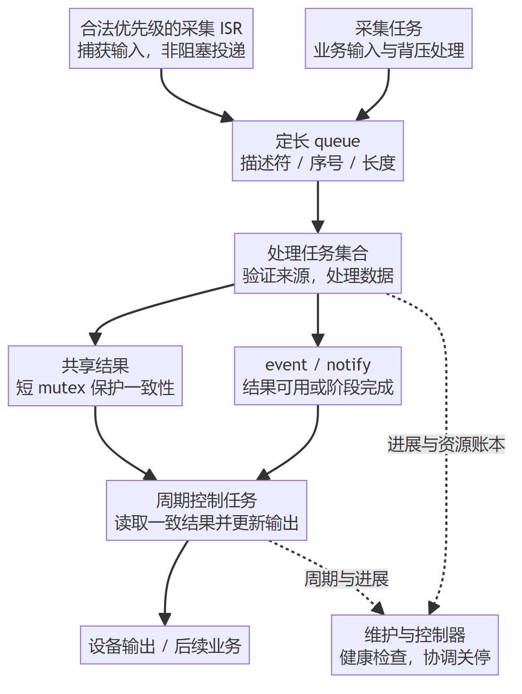

<details><summary>图形源码（mermaid）</summary>

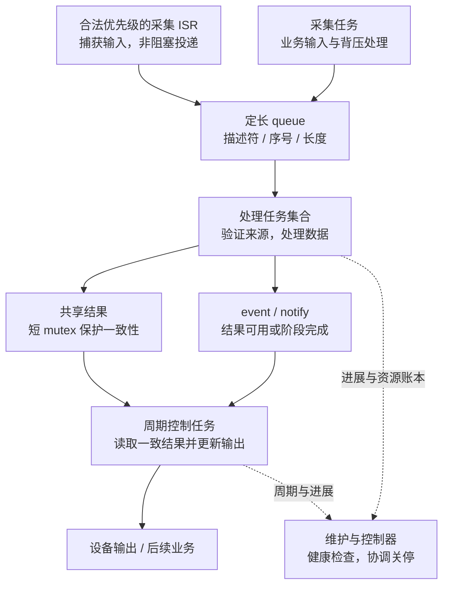

</details>

该图是业务集成模型，不是默认 `main.c` 的完整任务图。现有综合压力夹具采用四个任务来源、TIM6/TIM7 两个中断来源和四个 queue 消费者，同时覆盖共享 sem、mutex、ANY/ALL/timeout event 与控制/维护角色；真实外部传感器和 DMA 数据链路不在该夹具的证明范围内。实现见 [production_stress.c](../hil/fw/Src/production_stress.c) 和 [production_irq.c](../hil/fw/Src/production_irq.c)。

容量评估需要同时考虑输入突发、消费者被高优先级任务延迟的时间，以及持续服务能力。若长期输入量超过处理能力，增加 queue 容量只能延后满队时刻。应用应明确满队后的丢弃、重试或节流策略，并分别记录已接纳消息、拒收和超时；不能只统计 `send` 尝试次数。

有界关停建议采用下面的时序，每一步都需要应用级确认：

| 阶段 | 完成条件 | 保留的资源 |
|---|---|---|
| 1. 停止输入 | 外设/IRQ/DMA、生产者任务及产出消息的 timer 均不再发起交付；已在途操作已处理 | queue、信号量、任务句柄和数据池仍有效 |
| 2. 通知工作任务停止 | 每个角色知道不会再收到新工作 | 消费者仍可完成或归还已持有的数据 |
| 3. 排空或明确丢弃 | 消息、令牌和缓冲账本满足约定；每个角色已确认退出工作 | 对象保持有效，直到最后使用方结束 |
| 4. 停止其余 timer 与后台控制 | 非生产者控制命令和在途回调不再引用待回收存储 | 异步 delete 的成功返回不能单独充当确认 |
| 5. 解除等待并销毁 | 任务和对象按其生命周期协议退出，清除外部缓存的旧句柄 | 最后才释放 queue storage、回调参数和数据池 |

`deinit` 唤醒等待者或删除任务自动移交锁，不会自动完成外设停机、数据事务回滚或缓冲归还。强制删除必须与业务一致性恢复协议一起设计。对长期静态对象，优先让管理任务协调生命周期，减少跨 ISR 与任务并发重用地址的情况。

## 16.6 验证层次与故障定位入口

验证应围绕可失败的不变式组织，不以“所有测试都打印 PASS”代替覆盖说明。不同层次回答不同问题：

| 验证层次 | 主要问题 | 当前仓库入口 | 结论边界 |
|---|---|---|---|
| 源码/编译 | ABI 偏移、条件编译、头文件与配置是否成立 | 内核与端口；配置矩阵记录 | 编译通过不代表该配置的调度语义已上板 |
| 功能/边界 | 参数、超时、销毁、等待链重挂是否符合契约 | [selftest.c](../Core/Src/selftest.c)、[boundary_test.c](../hil/fw/Src/boundary_test.c) | 构造 tick 验证不是连续运行几十天 |
| 竞态与上下文 | 启动窗口、候选失效、寄存器/FPU 和屏蔽值是否保持 | [audit_regressions.c](../hil/fw/Src/audit_regressions.c)、[lowlevel_checks.c](../hil/fw/Src/lowlevel_checks.c)、[lowlevel_fpu_probe.c](../hil/fw/Port/ARM/lowlevel_fpu_probe.c) | 只证明所执行的上下文与交错，仍需对新改动补触发条件 |
| 综合压力 | 混合 IPC、IRQ 嵌套、背压、数据守恒与关停 | [综合压力报告](rtos_production_stress_20261013.md) | 合成业务不等于真实设备端到端链路 |
| 测试器对照 | 输入损坏是否被真实检测，结束判据是否可信 | 故意损坏单条消息的负向批次 | 预期失败单独分类，不计入正常 PASS |

当前记录包括 117 项专项回归的三次复位、432 PASS 与 10 INFO 的基础自测、103 项边界检查，以及默认/统计配置的上下文检查；综合压力有五轮正常运行、805 次检查、2,433,735 条成功接纳消息和 900 秒持续运行。详细配置、失败尝试和排除项以[发布汇总](rtos_release_20261013.md)、[底层报告](rtos_lowlevel_optimization_20261012.md)及原始证据为准，本次文档加工没有新增板载执行结果。

排障时先记录实际状态，再追踪负责改变它的路径：

| 观测到的问题 | 优先检查的状态/路径 |
|---|---|
| 任务一直没有运行 | 有效 priority、state、所在就绪链、是否有持续就绪的更高优先级任务 |
| 阻塞任务提前或重复唤醒 | `blocked_on`、`list_head`、延时链接、结果写入方及清理是否完成 |
| sem give 变慢或位图异常 | FIFO 链实际节点、共享优先级位、动态改优先级与超时清位 |
| 取锁后优先级恢复不正确 | 注册锁的 owner、各有序等待链首、base/effective priority 与重挂 |
| queue 数据错误 | item_size、源/目标缓冲寿命、消息序号、`to_front`、满队策略 |
| timer 停止后仍有访问 | 命令是否只是入队、回调是否在途、generation、周期重插和存储寿命 |
| HardFault 或栈水位异常 | MSP/PSP、EXC_RETURN、基本/扩展帧偏移、具体业务调用链 |
| CPU/时延统计异常 | 热统计开关、DWT 采样跨度、观察表覆盖、查询窗口及中断归属 |

完整 HIL 脚本及复现条件见 [hil/README.md](../hil/README.md)。Git 保存可读文本证据；历史 ELF 和部分回滚副本只在测试机归档，重新构建的镜像不能冒充历史实测镜像。新增测试应使用新的批次标识和输出路径。

## 16.7 演进方案与评审原则

| 演进方向 | 可以改善的问题 | 修改前须覆盖的协议 |
|---|---|---|
| 每优先级等待链首/计数 | sem 多等待者定位与清位扫描 | 同级 FIFO、改优先级、超时、删除、挂起和 ISR 交错 |
| current/overflow 双延时链 | 扩展有限 tick 等待范围 | 回绕切换、提前唤醒、清理、永久等待和周期 API 输入契约 |
| 每任务持锁链/类型索引 | 注册锁扫描及退出路径成本 | 获取/递归/释放、移交、deinit、任务删除及继承重挂 |
| 双向合并或其他堆策略 | 释放顺序相关的碎片 | 对齐、非法输入、统计守恒、最大片段、并发及失败回滚 |
| 长期时基与统计扩展 | DWT/tick 完整绕圈造成的观测歧义 | 采样间隔、低功耗、调试暂停、读写原子性和开销 |

这些是待设计的方案，不是当前已实现的能力。性能优化先定位完整调用路径中的成本，再修改最小必要机制；源码指令数减少不能替代实测，也不能以删掉生命周期或中断屏蔽保护换取更好的微基准数字。

设计手册维护应与实现变更同行：更新受影响的不变式、API 契约、图源和复杂度；用新的源码身份执行相关验证；把结果、退步与缺失覆盖留在测试报告。历史优化数据继续保存在[历史性能报告](rtos_performance_report.md)、[第一阶段优化](rtos_optimization_20261012.md)和[底层优化](rtos_lowlevel_optimization_20261012.md)，无需在本手册重复多组版本数字。
