# 自研 RTOS 架构与实现设计手册

> 文档更新：2026-10-29。源码起点为adad20c967005a4aea9291688969de6345989d94，
> 生产实现仍与87bfbe4回退基线一致。本轮重写文档和独立示例，不改变内核或日常固件。
> 核对目标：STM32F446RE、单核Cortex-M4F、GNU Arm hard-float，默认168MHz/1kHz；其他目标须另行移植验证。

## 阅读方法与实现边界

这份手册同时回答“为什么这样设计”“一次调用究竟改了什么”和“应用该怎样用”。
前五章建立调度、等待、异常和任务生命周期模型；第六至十三章分别解释每种对象/服务；
第十四至十六章把机制转成成本、资源预算、完整例程和工程验收方法。

| 阅读目标 | 建议顺序 | 读完应能回答 |
|---|---|---|
| 首次写应用 | 1→5→所需IPC章→16.11完整例程 | 谁先初始化、单位是什么、如何检查失败与保持存储 |
| 理解内核 | 1→2→3→4→各对象状态机 | 就绪/对象/延时索引如何协作，谁完成等待，CPU何时真正切换 |
| 集成高吞吐或实时业务 | 6–10→11→14→16 | 背压、锁等待、消息寿命与中断域怎样进入预算 |
| 移植/底层修改 | 2→3→4→13→16.8 | 栈帧/ABI、向量、屏蔽/屏障、FPU及BSP哪些必须一致 |
| 排障 | 15→16.6→[调试指南](ai/debugging.md) | 区分活着但结果错、等待/屏蔽问题和真正故障异常 |

### 通用约定先于API记忆

- 优先级数值越小越高；任务基础优先级与互斥继承后的有效优先级不同。
- 普通任务栈以32位字计，256字为1024字节，应用提供8字节对齐；USB桥接的字节/字按具体接口区分。
- 普通延时/IPC超时用tick，USB外部超时多用毫秒，不能到处套用1tick=1ms。
- NO_WAIT为0，FOREVER为0xffffffff；普通有限等待使用1..0x7fffffff，更大值按永久处理。
  约24.8天是默认配置下一次有限等待上界，约49.7天是tick回绕周期，均不是固定运行寿命。
- 任务Thread/PSP与异常Handler/MSP分工不同；系统调用级IRQ与高优先级纯硬件IRQ是两种保护域。
- 禁止调用、断言能否抓到和运行时能否安全拒绝是三回事，关断言不放宽上下文契约。

### 从正文定位到可核对的实现

| 资料层 | 职责 |
|---|---|
| 本手册 | 解释职责、共享状态、不变式、调用分支、设计取舍与使用协议 |
| [完整API契约](ai/README.md)及[机器索引](ai/api_index.json) | 16公共头逐符号签名/单位/上下文/返回/寿命，内部入口单列 |
| [独立C示例](ai/examples/README.md) | 真正参与ARM编译的用法源；正文是由它同步的函数/文件摘录 |
| [源码导览](../RTOS/README.md) | 当前16个自研C单元的职责与构建清单 |
| [HIL入口](../hil/README.md)和[验证工具](../hil/ai_docs/README.md) | 分清编译、部分链接、逻辑注入与真实物理测试 |
| [每日日志](README.md#daily-logs) | 修改、失败、真实执行结果及证据缺失；不当作现版本自动通过证明 |

带example标记的C块与实际示例源逐字核对；摘录仍依赖完整文件中的对象/类型/宏，不能把单个函数
当作独立.c。明确标为机制摘要的伪代码和字段表用于解释，不是可替换头文件的ABI。
汇编仅解释本端口，不作为脱离宏、处理器和SDK可直接复制的通用实现。
PNG图保留对应Mermaid源码；另有原生Mermaid直接展示，箭头含义以图注/正文为准。

本手册介绍当前能力和已知偏差，不把未实现方案列为功能，也不把现有缺陷自动固化为正确设计。
默认main的音频/命令等演示有未启用路径，不能因手册提供例程就认为日常固件已执行它们。
新手册/示例的实际验证范围统一见[2026-10-29记录](logs/2026-10-29.md)。

## 目录

- [第一章 架构总览与设计哲学](#第一章-架构总览与设计哲学)
- [第二章 核心数据结构详解](#第二章-核心数据结构详解)
- [第三章 调度器: 从就绪表到上下文切换的完整链路](#第三章-调度器-从就绪表到上下文切换的完整链路)
- [第四章 移植层: PendSV, SVC 与临界区的指令级流程](#第四章-移植层-pendsv-svc-与临界区的指令级流程)
- [第五章 任务管理: 每个 API 的逐步执行流程](#第五章-任务管理-每个-api-的逐步执行流程)
- [第六章 信号量: take/give 的完整路径](#第六章-信号量-takegive-的完整路径)
- [第七章 互斥锁: 优先级继承的每一步](#第七章-互斥锁-优先级继承的每一步)
- [第八章 消息队列: 四条路径与单次拷贝直传](#第八章-消息队列-四条路径与单次拷贝直传)
- [第九章 事件标志组](#第九章-事件标志组)
- [第十章 软件定时器](#第十章-软件定时器)
- [第十一章 内存管理](#第十一章-内存管理)
- [第十二章 性能监视器](#第十二章-性能监视器)
- [第十三章 USB 子系统](#第十三章-usb-子系统)
- [第十四章 复杂度与开销总表](#第十四章-复杂度与开销总表)
- [第十五章 已知限制与设计债务](#第十五章-已知限制与设计债务)
- [第十六章 工程集成、资源预算与验证](#第十六章-工程集成资源预算与验证)

<details><summary>展开各章小节索引</summary>

- [1.1 分层结构](#11-分层结构)
- [1.2 五条贯穿全内核的设计原则](#12-五条贯穿全内核的设计原则)
- [1.3 任务状态机与迁移触发点](#13-任务状态机与迁移触发点)
- [2.1 内核全局状态 rtos_kernel_t (rtos_sched.c 定义唯一实例)](#21-内核全局状态-rtos_kernel_t-rtos_schedc-定义唯一实例)
- [2.2 TCB: 字段分组与三个易错点](#22-tcb-字段分组与三个易错点)
- [2.3 等待节点: 对象模块共用的字段多路复用表](#23-等待节点-对象模块共用的字段多路复用表)
- [2.4 状态归属、登记结构与评审不变式](#24-状态归属登记结构与评审不变式)
- [3.1 find_highest_priority: 两条指令选出下一个任务](#31-find_highest_priority-两条指令选出下一个任务)
- [3.2 ready_list 三操作: push_tail / remove / rotate](#32-ready_list-三操作-push_tail--remove--rotate)
- [3.3 rtos_sched_schedule(): 调度决策 (不执行切换)](#33-rtos_sched_schedule-调度决策-不执行切换)
- [3.4 rtos_sched_block(): 任务退出运行, 进入等待](#34-rtos_sched_block-任务退出运行-进入等待)
- [3.5 唤醒的两条路径: 对象侧与时间侧](#35-唤醒的两条路径-对象侧与时间侧)
- [3.6 一个 tick 的完整旅程](#36-一个-tick-的完整旅程)
- [3.7 超时如何定位任务: sem_take(sem, 100) 超时的完整解剖](#37-超时如何定位任务-sem_takesem-100-超时的完整解剖)
- [3.8 时间片轮转的边界情形](#38-时间片轮转的边界情形)
- [3.9 挂起调度器: 与阻塞 API 的互斥契约](#39-挂起调度器-与阻塞-api-的互斥契约)
- [4.1 两级现场保存的分工](#41-两级现场保存的分工)
- [4.2 PendSV 逐指令流程](#42-pendsv-逐指令流程)
- [4.3 任务栈初始化: 伪造一次中断](#43-任务栈初始化-伪造一次中断)
- [4.4 首任务启动: SVC 的必要性](#44-首任务启动-svc-的必要性)
- [4.5 临界区: 进出与屏障](#45-临界区-进出与屏障)
- [4.6 ISR 保护域与从中断到任务的完整路径](#46-isr-保护域与从中断到任务的完整路径)
- [5.0 应用API速查与调用顺序](#50-应用api速查与调用顺序)
- [5.1 rtos_task_create() (动态)的完整流程](#51-rtos_task_create-动态的完整流程)
- [5.2 rtos_task_delete(): 两条路径, 一个陷阱](#52-rtos_task_delete-两条路径-一个陷阱)
- [5.3 rtos_task_suspend(): 从任何状态拉停一个任务](#53-rtos_task_suspend-从任何状态拉停一个任务)
- [5.4 rtos_task_resume()](#54-rtos_task_resume)
- [5.5 rtos_task_yield(): 同级让出](#55-rtos_task_yield-同级让出)
- [5.6 rtos_task_delay() 与 delay_until() 的算术](#56-rtos_task_delay-与-delay_until-的算术)
- [5.7 任务通知: notify 与 notify_wait](#57-任务通知-notify-与-notify_wait)
- [5.8 rtos_task_set_priority() 与"等待链重挂"](#58-rtos_task_set_priority-与等待链重挂)
- [6.1 数据结构](#61-数据结构)
- [6.2 rtos_sem_take(sem, timeout) 逐步流程](#62-rtos_sem_takesem-timeout-逐步流程)
- [6.3 rtos_sem_give(sem) 逐步流程](#63-rtos_sem_givesem-逐步流程)
- [6.4 sem_deinit](#64-sem_deinit)
- [6.5 设计分析](#65-设计分析)
- [7.1 数据结构与注册表](#71-数据结构与注册表)
- [7.2 rtos_mutex_take(mutex, timeout) 逐步流程](#72-rtos_mutex_takemutex-timeout-逐步流程)
- [7.3 全图求解：传递继承与撤销](#73-全图求解传递继承与撤销)
- [7.4 rtos_mutex_give(mutex)：在最终所有权拓扑上重算](#74-rtos_mutex_givemutex在最终所有权拓扑上重算)
- [7.5 等待者退出、对象销毁与任务删除](#75-等待者退出对象销毁与任务删除)
- [7.6 rtos_task_set_priority 与继承的交互](#76-rtos_task_set_priority-与继承的交互)
- [7.7 开销与设计边界](#77-开销与设计边界)
- [8.1 数据结构与环形缓冲](#81-数据结构与环形缓冲)
- [8.2 rtos_queue_send() 的四条路径](#82-rtos_queue_send-的四条路径)
- [8.3 rtos_queue_recv() 与"代办入队"](#83-rtos_queue_recv-与代办入队)
- [8.4 交付协议与缓冲区寿命](#84-交付协议与缓冲区寿命)
- [8.5 设计分析](#85-设计分析)
- [9.1 rtos_event_wait(bits, mode, timeout)](#91-rtos_event_waitbits-mode-timeout)
- [9.2 rtos_event_set(bits)](#92-rtos_event_setbits)
- [9.3 返回快照与条件判断](#93-返回快照与条件判断)
- [10.1 架构: 服务任务串行处理控制与回调](#101-架构-服务任务串行处理控制与回调)
- [10.2 服务任务循环与回调重入](#102-服务任务循环与回调重入)
- [10.3 timer_handle_cmd 的四种命令](#103-timer_handle_cmd-的四种命令)
- [10.4 删除、代次与对象寿命](#104-删除代次与对象寿命)
- [10.5 设计分析](#105-设计分析)
- [11.1 动态堆: first-fit + 前向合并 (32KB 静态缓冲)](#111-动态堆-first-fit--前向合并-32kb-静态缓冲)
- [11.2 固定块内存池: 分配 O(1)，释放 O(n)](#112-固定块内存池-分配-o1释放-on)
- [12.1 配置与有效指标](#121-配置与有效指标)
- [12.2 时基、单位与回绕约束](#122-时基单位与回绕约束)
- [12.3 切换记账与测量误差](#123-切换记账与测量误差)
- [12.4 查询窗口与调用顺序](#124-查询窗口与调用顺序)
- [12.5 观察容量、内存与栈水位](#125-观察容量内存与栈水位)
- [13.1 分层架构与一帧数据的旅程](#131-分层架构与一帧数据的旅程)
- [13.2 使用了 CherryUSB 的哪些部分](#132-使用了-cherryusb-的哪些部分)
- [13.3 本 RTOS 侧的自研文件](#133-本-rtos-侧的自研文件)
- [13.4 OSAL 契约: 必须实现的 26 个函数](#134-osal-契约-必须实现的-26-个函数)
- [13.5 硬件胶水层 (DWC2 + STM32)](#135-硬件胶水层-dwc2--stm32)
- [13.6 配置桥 usb_config.h 必须提供什么](#136-配置桥-usb_configh-必须提供什么)
- [13.7 移植到其他平台: 完整步骤](#137-移植到其他平台-完整步骤)
- [13.8 已知陷阱与经验教训](#138-已知陷阱与经验教训)
- [14.1 从算法成本到响应时间预算](#141-从算法成本到响应时间预算)
- [15.1 如何评审后续改动](#151-如何评审后续改动)
- [16.1 从业务协议选择同步原语](#161-从业务协议选择同步原语)
- [16.2 上下文与返回语义矩阵](#162-上下文与返回语义矩阵)
- [16.3 对象与存储的寿命责任](#163-对象与存储的寿命责任)
- [16.4 配置实效与资源预算](#164-配置实效与资源预算)
- [16.5 综合业务模型与有界关停](#165-综合业务模型与有界关停)
- [16.6 验证层次与故障定位入口](#166-验证层次与故障定位入口)
- [16.7 实现与资料的一致性](#167-实现与资料的一致性)
- [16.8 重组后的源码集成与构建约束](#168-重组后的源码集成与构建约束)
- [16.9 AI辅助开发资料与精确接口检索](#169-ai辅助开发资料与精确接口检索)
- [16.10 文档分层与结果清理](#1610-文档分层与结果清理)
- [16.11 从启动到结果的完整使用样例](#1611-从启动到结果的完整使用样例)
- [16.12 工程师集成验收清单](#1612-工程师集成验收清单)

</details>

---

# 第一章 架构总览与设计哲学

## 1.1 分层结构

本RTOS要回答三类问题：**现在谁具备运行资格；一次资源等待由谁完成；CPU何时真正更换寄存器现场**。调度器、对象等待协议和处理器异常分别承担这些职责。模块不是按API数量平均分文件，而是按共享状态、保护域和生命周期划分。

<!-- diagram:inline -->

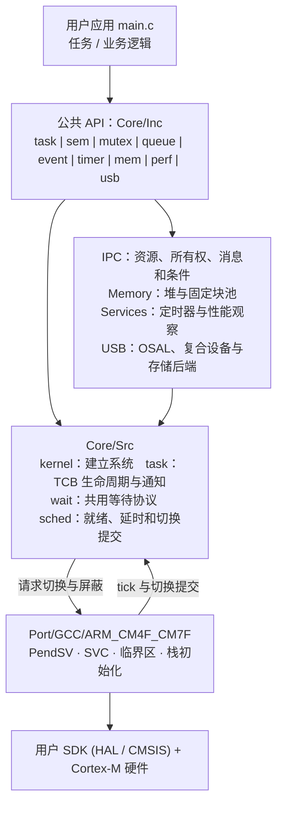

| 模块 | 拥有的状态及主要职责 | 与其他模块的协作 |
|---|---|---|
| `Core/Src/rtos_kernel.c` | 初始化顺序、启动入口、版本和默认弱钩子 | 先perf、heap，再sched/idle，最后按配置timer |
| `Core/Src/rtos_task.c` | 存活任务地址登记、TCB构造、通知、自删延期回收 | 创建发布就绪资格；删除协调等待、mutex、perf和heap |
| `Core/Src/rtos_sched.c` | 唯一rtos_kernel、就绪位图/环、延时链、current/next | 选择与提交任务，处理有限等待到期 |
| `Core/Src/rtos_wait.c` | 等待节点入链、摘链、唤醒及优先级重挂机制 | 不独占对象存储，调用方持有内核临界区 |
| `IPC/` | 令牌、所有权、消息和事件条件及各对象等待链首 | 共享等待机制，分别维护资源授予状态机 |
| `Memory/Services/USB` | 分配器、软件定时器、性能观察、USB适配 | 使用任务与IPC服务，各有独立容量和寿命约束 |
| `Port/GCC/ARM_CM4F_CM7F` | CPU现场、栈帧、异常、屏蔽与tick | 硬件指令收口；PendSV反向调用C调度提交 |
| 用户工程/BSP | 时钟、链接、启动向量、外设、中断、业务缓冲 | 满足端口输入和上下文规则，管理物理输入及资源停机 |

图中双向箭头表示受约束协作，不是严格无环的函数依赖图。任务删除必须查找多个索引；IPC会读写TCB并请求调度；PendSV又调用内核提交。把这些依赖隐藏在“每一层只能往下调用”的模型里，反而不利于定位竞态。

应用通常包含[rtos.h](../RTOS/Core/Inc/rtos.h)。公共目录也含内部/端口导出；“声明可见”不等于应用可以直接改就绪表、调用block或提交切换。逐项分类见[内核契约](ai/contracts_kernel.md)。

### 1.1.1 一次可控的启动

初始化必须让被引用资源先有效，再允许任务或IRQ访问。推荐顺序如下：

| 阶段 | 操作 | 设计理由和失败责任 |
|---|---|---|
| 板级准备 | 时钟、内存、SystemCoreClock、异常向量、FPU基础及优先级 | RTOS不代替BSP；业务输入尚未放行时完成或报告失败 |
| 内核初始化 | 启动Thread调用一次rtos_init | 检查返回；前序可能已初始化，没有跨全部模块事务回滚 |
| 业务对象初始化 | 建立queue/sem/mutex/event及实际缓冲 | 不由rtos_init预先创建应用对象；逐项检查init |
| 任务构造 | 建立TCB/栈、保存句柄、发布持久参数 | 运行中创建高优先级任务可在create返回前抢占，需启动握手 |
| 放行输入 | 对象和任务有效后再使能生产IRQ或输入 | ISR可能立即发生；必须处理满队、溢出和拒收 |
| 启动调度 | 调用rtos_start，经SVC进入首任务 | 正常不返回；错误返回不能作为“已启动”继续业务 |

rtos_init的实际顺序是perf→heap→sched/静态idle→按USE_TIMERS初始化timer。perf必须早于idle创建，避免之后清观察表时把idle登记清掉；heap必须在后续动态任务请求之前建立。idle静态分配，不依赖堆才能承担延期回收。

初始化失败可能保留已建立的前序服务，不能在运行系统上反复调用rtos_init当成重置。应用需要记录已建立资源，再选择确定的受控复位或专项恢复。定时器服务、外设和业务状态没有自动组成一个全系统回滚事务。

下面样例在BSP准备完成后调用，完整支持存储在示例文件中；不在ISR或已有运行系统中调用。其核心顺序是检查init、创建持久任务、最后start；成功后不会回到调用者。

<!-- example-function: ai_example_handbook_start -->

```c
rtos_status_t ai_example_handbook_start(void)
{
    rtos_status_t status = rtos_init();
    if (status != RTOS_OK) {
        return status;
    }
    status = ai_example_handbook_pipeline_init();
    if (status != RTOS_OK) {
        return status;
    }
    status = rtos_task_create_static(&handbook_producer, handbook_producer_stack,
        HANDBOOK_STACK_WORDS, ai_example_handbook_periodic, NULL, 12U, "book-producer");
    if (status != RTOS_OK) {
        return status;
    }
    /* BSP clock/exception routing is the caller's responsibility; success never returns. */
    return rtos_start();
}
```

### 1.1.2 任务栈不等于内存隔离

当前是单核、共享地址空间、固定优先级内核。任务各有PSP栈，但没有MPU隔离；一个越界写仍可破坏别的TCB、对象或内核。优先级只决定CPU资格，不能自动表达消息事务、锁顺序、背压或停机协议。后文介绍API时，都会分别说明内核保证的原子状态变化和应用仍需承担的存储/业务责任。

## 1.2 五条贯穿全内核的设计原则

| 原则 | 机制 | 收益与代价 |
|---|---|---|
| 基础服务不依赖可耗尽的动态资源 | 静态idle和timer服务，业务任务可选动态/静态 | 堆紧张时仍有基础角色；静态不表示容量无限或无扫描 |
| 状态变化在同一保护域内完成 | BASEPRI/PRIMASK、等待双链、资源先交付再READY | 合法修改方不见半状态；复制/搜索/继承重算仍拉长保护时间 |
| 决策与执行分离 | C选择next，PendSV保存/恢复现场 | 连续唤醒可合并成最终切换；中间窗口不能靠current指针推断CPU已换任务 |
| 侵入式节点和受约束复用 | TCB内嵌wait_node，ready/delay复用链接 | 每次等待不malloc节点；链归属互斥是必须维持的协议 |
| 等待结束统一清理所有归属 | 成功/超时/挂起/删除/deinit协调两侧索引 | 避免迟到操作写旧缓冲；不替应用保证外部存储寿命 |

“不阻塞”仅表示不进入任务等待。NO_WAIT队列操作仍可复制item_size字节、扫描节点、进入临界区或请求调度。位图选择是O(1)，也不表示整个give、创建或继承路径是O(1)。性能应评估实际完整API、配置和负载，不能拿一条指令或历史平均值代替最坏响应时间。

## 1.3 任务状态机与迁移触发点

状态包含运行资格及生命周期，不等同于CPU模式。先看任务何时进入索引，再看何时完成现场交接。


<details><summary>图形源码（mermaid）</summary>

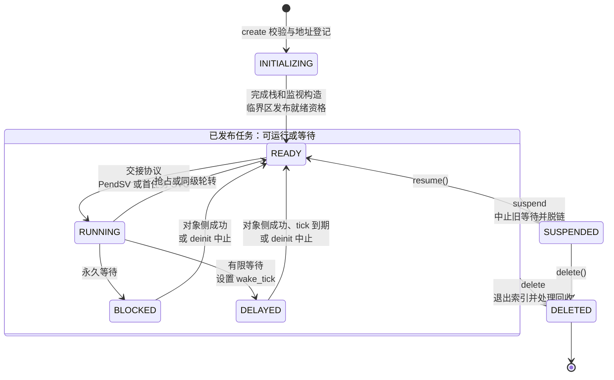

</details>

| 状态 | 调度资格与常见路径 | 集成时的含义 |
|---|---|---|
| INITIALIZING | 地址已预留，尚未READY | 栈在临界区外构造，公开修改API不接受它 |
| READY | 在一个优先级就绪环 | 等待CPU资格；资源结果通常已经完成 |
| RUNNING | 内核已提交的当前任务 | Handler提交到异常返回之间，目标Thread还未执行 |
| DELAYED | 有限等待，进入延时链 | 可以同时在等对象，不能仅凭状态当作纯delay |
| BLOCKED | 无有限超时登记 | 对象完成或显式中止才结束；永久纯delay无自动授予者 |
| SUSPENDED | 管理操作取消资格 | resume恢复READY，不恢复原来的资源等待 |
| DELETED | 退出存活登记 | 旧句柄失效；动态自删等待idle回收，静态由用户管理 |

图中的ACTIVE只是合并箭头的分组，不是额外枚举。三项贯穿实现的不变式是：

1. **运行资格与现场交接分离**。稳定态RUNNING位于就绪环；轮转可先移动head，阻塞可先改state，PendSV前current仍指旧任务。不能把短暂head/current不等直接当损坏。
2. **调度链互斥、对象链独立**。TCB至多属于一条ready环或delay链，同时可通过wait_node属于一条对象链。有限对象等待两侧都登记，完成一侧必须撤销另一侧资格。
3. **等待链纪律不可混用**。sem是FIFO加位图；queue/mutex/event为有序链。单资源授予遵循最高优先级、同级FIFO；event仍要逐个判位条件。

sem的位图只有优先级集合，没有独立分组链首。ctz选出优先级之后仍要在整条FIFO链中找首个匹配节点，摘除后还可能扫描以决定清位，所以多等待者完整give最坏O(W)。

---

# 第二章 核心数据结构详解

## 2.1 内核全局状态 rtos_kernel_t (rtos_sched.c 定义唯一实例)

[rtos_sched.h](../RTOS/Core/Inc/rtos_sched.h)声明布局，[rtos_sched.c](../RTOS/Core/Src/rtos_sched.c)定义唯一rtos_kernel。应用不创建第二份，也不直接写字段“修复”任务。

| 字段组 | 用途与实际解释 |
|---|---|
| sched_state、suspend_depth | 启动/运行/嵌套挂起；最后一层resume才重选 |
| tick_count | RUNNING tick处理时递增；32位，不是UTC或连续物理时间 |
| ready_bitmap、ready_heads[] | 位p恰表示该优先级存在就绪节点；head决定同级选择起点 |
| delay_head | 唯一有限延时链；没有独立overflow链 |
| current_tcb、next_tcb | 已提交任务与尚未执行候选；next可覆盖或取消 |
| idle_tcb | 最低优先级静态idle，不允许应用删除、挂起或改成其他优先级 |
| kernel.switch_count | 请求/选择路径计数，不是实际完成切换次数 |
| TCB.switch_count | 提交选中该任务时递增，与请求计数不是一套口径 |
| critical_nesting | 历史保留成员；实际深度在独立rtos_port_crit_nest |
| perf字段 | 条件编译的窗口及采样状态，部分查询会推进窗口 |

向空环插第一个节点才置位，最后节点离开才清位；中间节点变化不能清共享位。同级轮转只改head。单字位图最多表达32个优先级，不能只放大MAX_PRIORITIES就当成多级位图实现。

volatile不提供跨字段快照。在运行中依次读取bitmap、head、state可能拼接不同瞬间；判断不变式是否被破坏前，先确认采样上下文、保护域及指针寿命。详见[调试指南](ai/debugging.md)。

## 2.2 TCB: 字段分组与三个易错点

完整类型以[rtos_task.h](../RTOS/Core/Inc/rtos_task.h)为准。应用不复制“精简TCB”或按旧sizeof手动分配；配置不同会改变条件字段，所有参与链接的单元必须使用一致头文件。

| 字段 | 设计职责 | 使用边界 |
|---|---|---|
| top_of_stack | PendSV恢复起点，偏移0由静态断言保护 | 是最近保存SP，不是运行中实时PSP |
| stack_base/stack_size | 栈最低地址和32位字容量 | 字节数需乘sizeof(rtos_stack_t)，预算含调用链及现场 |
| priority/base_priority | 有效值/用户基础值 | mutex可临时提高有效优先级 |
| state/is_static | 生命周期与存储回收责任 | static不是“不可删除”，而是内核不free调用方存储 |
| next_ready/prev_ready | 就绪环或有限延时链 | 两种用途互斥，切换归属前先清旧链接 |
| next_all | 独立存活地址登记 | 不依赖perf观察表容量，含构造保留态 |
| wait_node/blocked_on/wait_result | 一次等待的归属与结果 | 资源先完成、结果先写，再发布READY |
| wake_tick | 调度绝对到期点 | 不单看值0/FFFFFFFF来判断是否永久 |
| notify_value/notify_state | 内嵌32位通知邮箱 | 无消息历史队列，不替业务缓冲管理所有权 |
| name/task_id | 名字和创建序号 | name截断复制，32位ID会回绕，不是永久代次句柄 |
| stack_magic/perf字段 | 有限防御及观察 | magic未变、水印有余量都不是无越界写证明 |

**易错点一：链接复用有严格前提。** 就绪环tail.next指回head，延时链tail.next=NULL且head.prev可能缓存tail；动态自删又复用next_ready挂延期free链。任务必须先退出原归属，才能开始新用途。应用不得把这些字段借作业务链表。

**易错点二：栈容量、对齐和余量独立。** API最小96字只是硬拒绝下限，不保证库函数、浮点及局部数组足够。静态栈应8字节对齐；实现只检查自然对齐，port向下对齐栈顶，所以“没有报错”不等于调用者容量/对齐责任已经被全面检查。

**易错点三：TCB magic与栈内图样不同。** 栈内最初的DEADBEEF可能被perf的A5未用区染料覆盖；巡检读取TCB.stack_magic和保存SP是否低于base。不能检查栈第一字等于DEADBEEF判健康，也不能因TCB magic未变就宣称没有越界。

### 2.2.1 裸地址句柄与同址重建

部分修改API先在独立登记链中匹配地址，再检查已知TCB，拒绝未登记/INITIALIZING地址；getter未必有该校验。登记不增加引用计数，也不防止旧任务A的指针命中新任务B复用的同址存储。删除时应停止ISR/其他使用方、撤回外部句柄，不能拿get_priority探测悬空地址。

任务参数arg只借用，不复制；名字name在create期间复制。静态TCB/栈与参数必须覆盖任务可运行及全部内核引用期间。把局部数组交给create_static后从初始化函数返回，即使create成功，存储仍已失效。

## 2.3 等待节点: 对象模块共用的字段多路复用表

每个TCB只有一个内嵌wait_node，避免每次阻塞malloc节点；它不是可同时挂入多个对象的通用wait-set。

| 字段 | sem/mutex | queue | event/notify |
|---|---|---|---|
| tcb、wait_obj | 等待者及对象，供授予/继承识别 | 等待者及queue | event对象；notify用TCB自指 |
| next/prev、list_head | 对象节点与链首地址 | send/recv两条链之一 | event有链；notify的list_head=NULL |
| queue_bitmap | sem指向位图；mutex为NULL | NULL，实际为有序链 | NULL |
| queued_priority | 重挂时知道旧有效优先级 | 同左 | 同左 |
| transfer_buf | 不作载荷传递 | 借用发送源/接收目标 | event结果位编码，notify另用TCB值 |
| transfer_size | 不使用 | item_size字节 | event等待位掩码 |
| 节点wake_tick | 不作有限到期键 | 不作有限到期键 | event存等待模式，与TCB.wake_tick不同 |
| on_timeout | 通常为空 | 通常为空 | event脱链前捕获位快照 |
| timed_out | 等待原因辅助标记 | 同左 | 结合wait_result解释 |

list_head是“链首指针的地址”，不是当时head的值：等待期间其他任务可改变head，timeout仍须更新真实链首并精确摘自己。notify不入对象链而置NULL，但有限通知等待仍会进入delay链。

queue先写transfer参数再调用共用helper；helper不能为“清零所有字段”无条件memset节点，否则会丢掉待传数据。下一次换一种对象等待时，又必须重新初始化对该协议有意义的字段，不能遗留旧bitmap、list_head或自指blocked_on。

queue_bitmap成员名字不代表对象类别：当前只有sem设置非NULL。位图链重挂要同步旧/新共享位并尾插，有序链要按新优先级重排；有效值不变则不重挂，保留同级FIFO。

## 2.4 状态归属、登记结构与评审不变式


<details><summary>图形源码（mermaid）</summary>

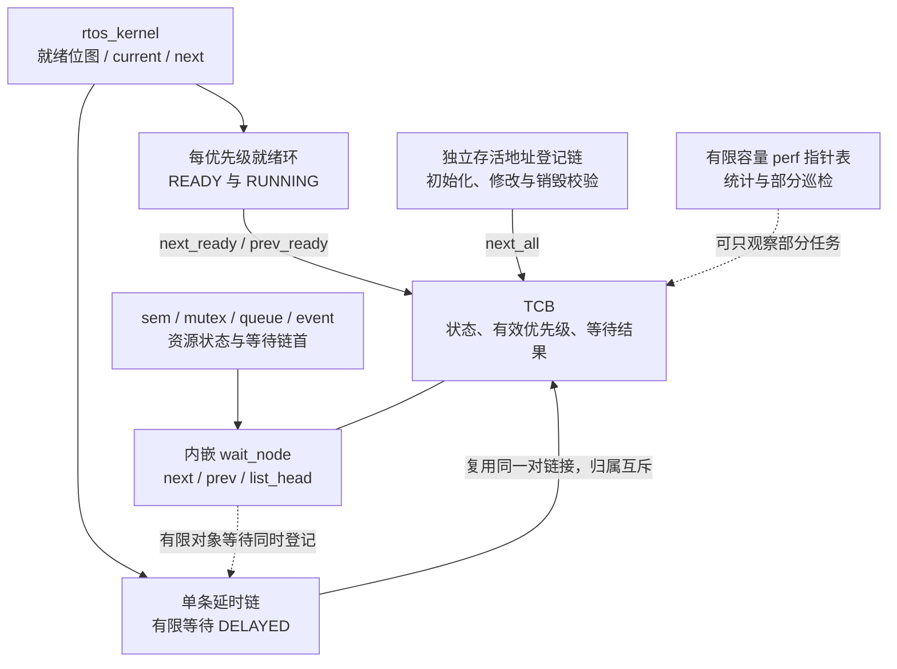

</details>

TCB是多种索引的交汇点。存活地址登记不参与选择最高优先级；perf有限数组仅用于观察。观察表满了不表示新任务不能创建，关闭perf也不应影响地址登记。

| 状态/动作 | 调度归属 | 对象侧要求 | 关联责任 |
|---|---|---|---|
| READY/稳定RUNNING | 一个就绪环 | 无未完成对象等待 | 位图/环一致，CPU交接另由端口完成 |
| 有限纯delay | 延时链 | blocked_on为NULL | 到期只恢复资格，不授予资源 |
| 有限对象等待 | 延时链 | 一对象链；notify例外自指 | 完成方取消另一来源资格 |
| 永久对象等待 | 无就绪/延时链 | 一对象链或notify自指 | 仍由登记/对象找到，不是任务丢失 |
| SUSPENDED | 无就绪/延时链 | 旧等待已中止并脱链 | resume不继承旧资源成功 |
| 优先级变化 | 就绪换环，延时键不变 | 按纪律重挂及传播捐赠 | 基础值与有效值分开 |
| DELETED | 退出全部运行/等待/存活索引 | 移交所持mutex，注销perf | 自删等待切出；外部使用方先停机 |

评审一次状态操作，应列出“改哪些索引、谁保护、失败保留什么”。只验证state最终值不够；漏掉时间侧、共享位或next候选，都可能在后续另一API才出错。存储有效是全部链表协议的前提，不由is_initialized或一个NULL检查替调用者保证。

---
# 第三章 调度器: 从就绪表到上下文切换的完整链路

把一次唤醒分成四步：资源条件成立、取消等待、恢复就绪资格、CPU现场交接。前三步通常在临界区内完成，最后一步由PendSV承担。应用看到一个同步函数调用，内部却跨越其他任务和多次异常；这正是缓冲寿命、阻塞结果和屏蔽协议必须一起设计的原因。

## 3.1 find_highest_priority: 两条指令选出下一个任务

优先级0最高，优先级p对应bitmap的bit p，所以算法取最低置位bit索引`__builtin_ctz`。位3和位10同时置位应选择3；`31-clz`会选10，方向相反。bitmap为0必须先返回MAX_PRIORITIES哨兵，不能对0调用ctz后继续索引。

对当前M4编译，ctz通常成为RBIT/CLZ，标题表示典型指令序列，不承诺两个周期。随后读取ready_heads[p]取得同级候选。这一步是O(1)，但没有替等待链插入、任务登记、消息复制或mutex继承重算提供常数复杂度；完整响应时间仍需包含整条调用路径。

## 3.2 ready_list 三操作: push_tail / remove / rotate

同优先级使用双向环，以head为下一选择点，tail即head.prev。空环head=NULL，单节点next/prev自指，多节点保持相邻对称关系。

| 操作 | 完整动作 | 设计原因 |
|---|---|---|
| push_tail | 空环建立自环；否则插到head前；置该优先级位 | 新就绪成员排在已有同级成员之后 |
| remove | 最后节点离开时head=NULL/清位；其余情况跨过节点、必要时移动head；清节点链接 | 位图必须恰反映环是否非空 |
| rotate | 仅head=head.next | 环相对次序不变，后移选择点即可轮转 |

三个基本操作均O(1)。RUNNING通常仍在就绪环，时间片先移动head再PendSV，因此中间current/head不等不一定损坏。内部链操作不检查所有重复入链情况；公开resume在同一临界区检查SUSPENDED并入环，避免两上下文各自判断后插入两次。应用不能调用内部add_ready“确保就绪”。

## 3.3 rtos_sched_schedule(): 调度决策 (不执行切换)

该函数由已持有内核临界区的调用方执行：检查RUNNING，取最高就绪优先级及合法head，再与current比较。默认抢占配置下，候选不同便写next_tcb、增加请求计数并置PendSV pending；候选就是current则清过期next，必要时把刚恢复的READY修回RUNNING。

```text
对象/时间状态已更新
    ↓
选择最高就绪环head
    ├─ 不是current → 发布next + 挂起PendSV
    └─ 就是current → 取消旧next，修正READY/RUNNING窗口
    ↓
退出最外层保护 → 异常优先级允许 → PendSV真正搬现场
```


<details><summary>图形源码（mermaid）</summary>

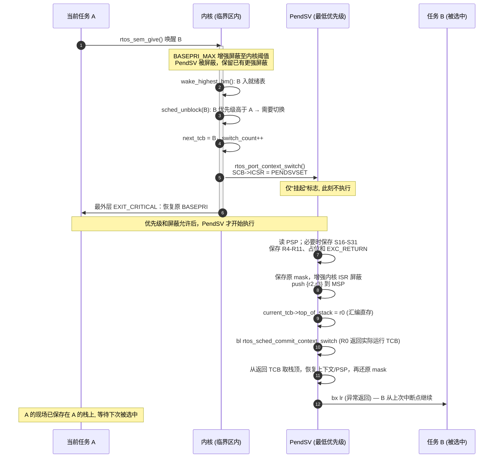

</details>

例如一个ISR先唤醒prio10的A，再唤醒prio3的B，next可从A覆盖为B，不需两次实际切换。又如A被选next后被合法操作挂起/删除，必须在释放前失效候选并重选。current刚登记阻塞但尚未切出时，如果对象立即完成其等待，schedule又可选中current，取消这次切换。

这些窗口由受保护协议有意允许，不表示任意写state也安全。提交对next READY的校验主要是断言，断言关闭不替代候选失效和存储寿命。Handler中看到current已经改变，也只能证明“提交身份已发布”，不证明目标Thread已经执行。

USE_PREEMPTION=0只改变本函数部分分支；当前tick还会选择另一就绪head并请求切换，同级时间片又受独立开关控制。不能据一个宏的注释宣称已经获得完整协作式调度。

## 3.4 rtos_sched_block(): 任务退出运行, 进入等待

block处理时间侧：从READY/RUNNING环摘任务，再根据ticks决定状态和时间登记。它不知道sem令牌或queue内容；资源侧由对象模块先准备节点参数。

| 等待输入 | 当前时间侧行为 | 谁能结束 |
|---|---|---|
| NO_WAIT=0 | 公开API先处理即时分支，delay(0)转yield | 不登记阻塞 |
| 1..0x7FFFFFFF | wake=now+ticks，置DELAYED并入延时链 | tick到期或对象先完成 |
| WAIT_FOREVER=0xFFFFFFFF | 置BLOCKED，不入延时链 | 对象授予/销毁或显式中止 |
| 其他>0x7FFFFFFF | 普通等待也按永久BLOCKED处理 | 不是截到最大有限值，也不报PARAM |

公开入口须先检查上下文、即时资源条件及阻塞许可；内部block不是供应用任意调度其他任务的替代API。

### 延时链表: 按"睡到几点"排序的**双向**链 (含表尾缓存)

当前只有一条有限延时链，复用next_ready/prev_ready，按有界模时序排序。tail.next=NULL；多节点时head.prev借作tail缓存，单节点时prev=NULL。它不是就绪环，更不是current/overflow两条延时链。


<details><summary>图形源码（mermaid）</summary>

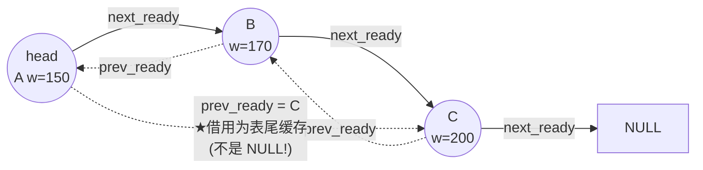

</details>


<details><summary>图形源码（mermaid）</summary>

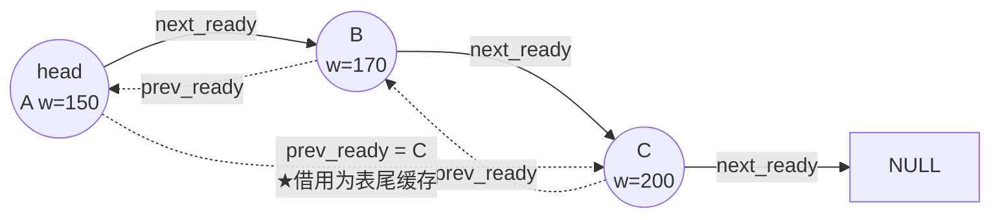

</details>

| 情况 | 必须维护的链接 |
|---|---|
| 空链插入 | 新head，next/prev均NULL |
| 单节点追加 | old.next=new、new.prev=old、head.prev=new |
| 多节点追加 | tail.next=new、new.prev=旧tail、head.prev=new、new.next=NULL |
| 插到head之前 | 新head接管tail缓存，旧head.prev成为新head |
| 中间插入 | 相邻next/prev对称，head尾缓存保持 |
| 删除head | 新head接管缓存；只剩一节点则prev=NULL |
| 删除tail | 缓存退回真实前驱；退化为单节点则清缓存 |
| 删除中间节点 | 前后跨过目标，目标链接清空 |


<details><summary>图形源码（mermaid）</summary>

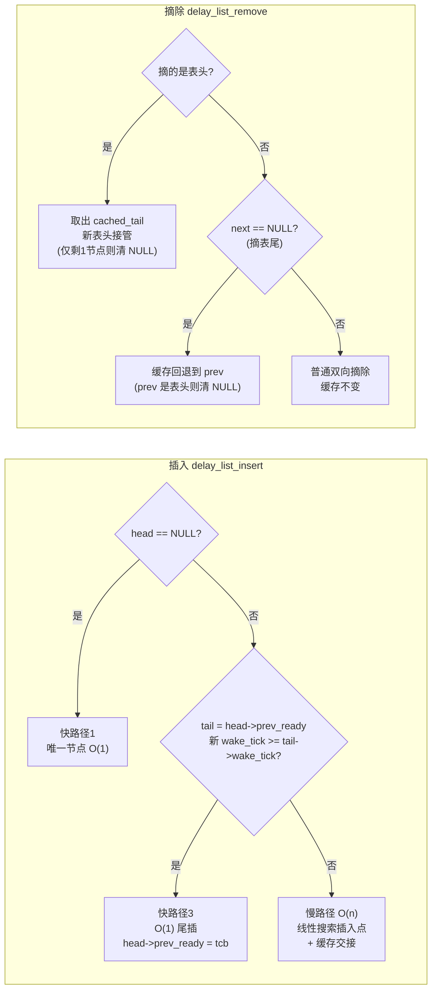

</details>

空链、单节点和尾追加O(1)，中间插入O(D)，已知节点摘除O(1)，D为有限等待任务数。head.prev是特殊缓存，不能套用“head的prev一定NULL”的普通双向链模板。tick会处理全部已到期head，若同一tick到期K项，还要处理各对象清理，不能说整次tick固定O(1)。

### 3.4.1 回绕比较的数学前提

排序和到期用`(int32_t)(a-b)`的模2³²差值，在单次有限距离小于2³¹的约束内辨先后。当前tick=0xFFFFFFFE、等待3tick，wake=1：

| now | 有符号wake-now | 解释 |
|---:|---:|---|
| 0xFFFFFFFE | 3 | 尚未到期 |
| 0xFFFFFFFF | 2 | 尚未到期 |
| 0 | 1 | 尚未到期 |
| 1 | 0 | 到期，恢复READY资格 |

wake_tick=0可以是跨回绕的正常到期点，0xFFFFFFFF也可能是有效绝对时刻；永久等待须结合state/是否入时间链判断。1kHz下约24.8天是单条有限等待上限，约49.7天是tick回绕周期，均不是系统固定运行寿命。更长有限总时长需应用分段并重复判断总目标；当前没有任意32位有限等待域。

## 3.5 唤醒的两条路径: 对象侧与时间侧

关键不是“两条路都会设READY”，而是同一个等待只完成一次，完成一侧后另一侧不再有继续完成资格。


<details><summary>图形源码（mermaid）</summary>

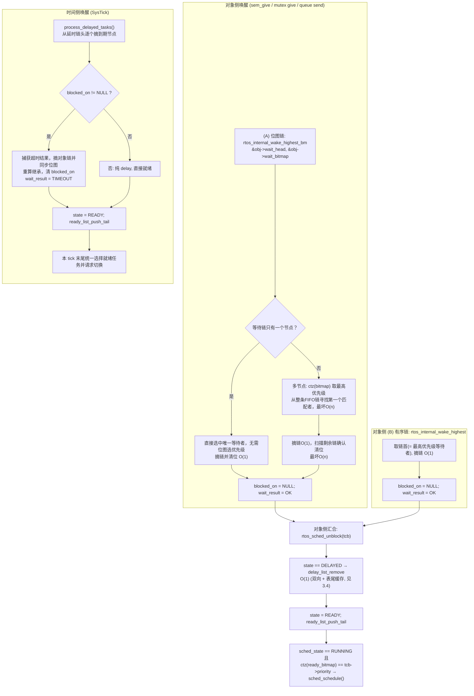

</details>

| 完成方 | 发布READY前先做什么 | 另一侧清理 |
|---|---|---|
| 对象成功 | sem授令牌、queue复制、mutex移交owner、event存快照，写OK | 摘对象链；有限等待摘延时链 |
| tick超时 | 必要时on_timeout捕获结果，再写TIMEOUT/timed_out | 摘对象链和共享位，撤销捐赠，清blocked_on |
| 对象deinit | 先确认对象失效，逐个标中止原因 | 对象链/延时登记全部脱离 |
| 任务suspend/delete | 取消该次等待及候选 | 两链、继承及相关索引按生命周期清理 |

unblock只处理时间/就绪侧，不猜资源结果；waker必须先完成数据和所有权，再恢复资格。否则高优先级任务可能立刻读到半条消息。


<details><summary>图形源码（mermaid）</summary>

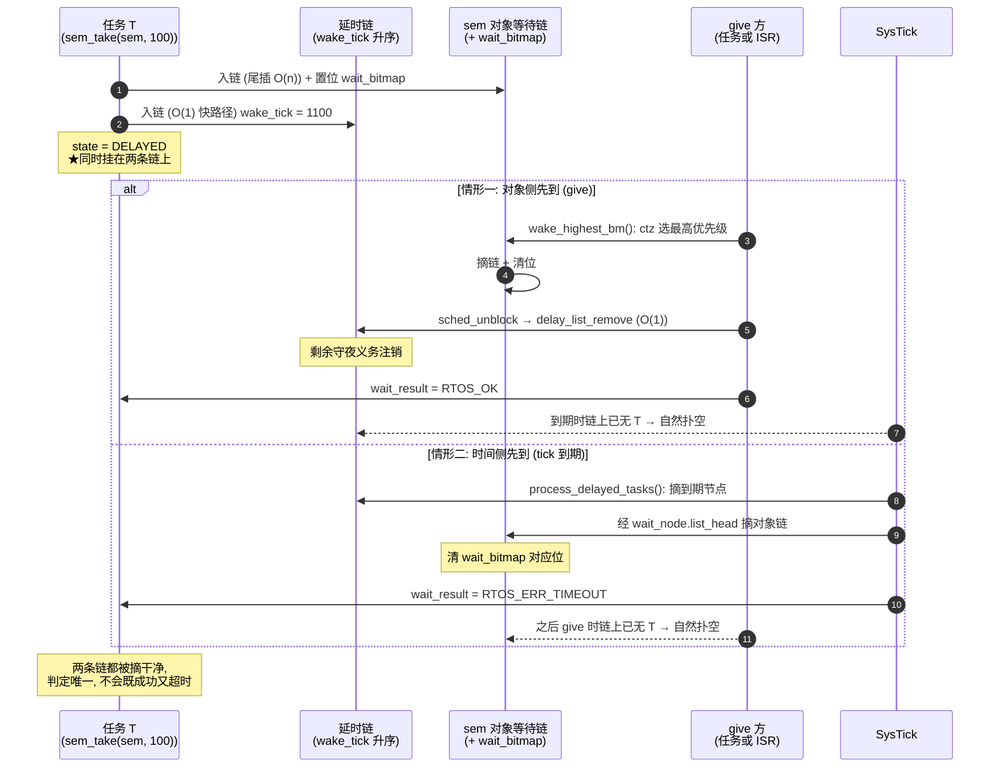

</details>

合法完成方在同一保护域竞争，先完成者全摘、后到者找不到有效旧节点。READY不表示立即获得CPU；超时承诺的是tick到期资格，实际返回可更晚。临界区共同出口ISB还保证PendSV识别先于阻塞调用后续读取初始结果，不能因“这里恰有几条其他指令”就删掉。

## 3.6 一个 tick 的完整旅程

1. SysTick硬件到期，依据异常优先级及mask决定何时激活。
2. BSP[SysTick_Handler](../Core/Src/stm32f4xx_it.c)先调用RTOS端口，随后HAL_IncTick；HAL和RTOS是两份时间计数。
3. 端口检查RUNNING，进入内核临界区，再调用sched_tick；非RUNNING不处理RTOS tick。
4. tick_count加1，连续处理延时head到期，包括对象解绑及继承撤销。
5. 从最终就绪集合选择最高head；若不同current则pend，否则按时间片判断同级轮转。
6. 退出保护与SysTick，其余较高Handler完成后才轮到最低优先级PendSV。
7. PendSV搬现场、提交身份、装PSP、异常返回，目标从原暂停点继续。

1kHz是硬件周期配置，不是任务必在1ms以内响应的保证。SysTick pending不是无界计数队列，长期屏蔽多个周期可合并；当前端口没有按丢失物理周期补账。需要严格物理时间的产品应另立受控时基并测量IRQ/任务负载。

## 3.7 超时如何定位任务: sem_take(sem, 100) 超时的完整解剖

假定tick=1000，任务A正常运行，空sem没有giver，A等待100tick。下列计数用于解释归属，不承诺物理1100ms整返回。

### 阶段一: 入睡 (tick=1000, 任务上下文, 临界区内)

sem先检查确实需要等待、阻塞许可成立；设置wait_node对象、链首地址、sem位图、有效优先级，清timeout标志，再尾插FIFO链并置共享位。sched_block把A摘就绪环，置wake=1100和DELAYED，插入时间链。schedule选别人并pend。

```text
sem.wait_head ... → A.wait_node
A.wait_node.list_head = &sem.wait_head
delay_head ... → A，A.wake_tick=1100
A.blocked_on=sem；A已退出ready环；current可暂仍是A
```

直到最外层退出、PendSV保存现场，A才真正停止使用CPU。不能在这之前释放它的栈，也不能把初始wait_result=OK当成已得到令牌。

### 阶段二: 守夜 (tick 1001~1099, 每 1ms, ISR 上下文)

有序时间链只查head；head未到期便不扫描更晚节点。A不忙轮询。对象链让give能找等待者，时间链让tick不必知道每个sem的地址，二者分工独立。

### 阶段三: 到期处理 (tick=1100, SysTick ISR, 临界区内)

取A并维护新head尾缓存；因blocked_on有效，必要时先调用对象on_timeout，随后设TIMEOUT/timed_out，通过list_head摘sem节点。若同级B仍在等待，bit必须保留；不能“摘了A就清该bit”。清list_head/blocked_on，处理可能的mutex捐赠后，将A入就绪环。sem.count不加1，因为没有发生give。

### 阶段四: 竞争裁定——先到者全摘, 后到者扑空

give先取得保护域且A中选：直接授令牌、设OK、摘两链，tick找不到A。tick先完成超时：give只能授给剩余等待者或增加空闲计数，不再访问A旧等待。本规则由真实先后决定，不能从“同一tick”推出必然成功或必然超时。

### 阶段五: 恢复并返回结果

A获得最高就绪资格后，PendSV恢复寄存器与PSP，从take原暂停点继续，再读取wait_result。TIMEOUT分支应重试、降载或报告，不消费未授予资源。A局部参数指向的对象和缓冲必须覆盖整个暂停期间；函数没返回不代表别的上下文不会访问这些存储。

### 附: 互斥锁超时与继承重算

mutex等待还捐赠优先级到owner及更深锁链。等待者必须先离开最终对象拓扑，再通知重算，否则已超时者仍参与捐赠。完整算法见第七章；sem令牌授予不能直接代替mutex所有权移交。

## 3.8 时间片轮转的边界情形

同级时间片以tick为机会，没有每任务独立可调剩余量。当前最高head就是current且同环多人时，时间片移动head。更高优先级就绪时先选择它，不先对旧优先级无意义轮转。

| 场景 | 当前效果 | 业务影响 |
|---|---|---|
| 同级只有当前一个READY | 不轮转 | 多任务已创建不等于当前存在同级竞争 |
| yield且有同级伙伴 | 后移head并pend | 不表示任意低优先级任务得到CPU |
| 无同级伙伴、低级任务积压 | yield通常无帮助 | 高优先级须阻塞、延时或调整资格 |
| 时间片关闭 | tick不因同级轮转切换 | 主动yield仍有自己的逻辑 |
| 多次请求尚未执行 | next保留最终候选 | 请求次数不等于实际现场交接次数 |
| 高优先级始终READY | 低优先级及idle可能饥饿 | 延期free、低优先级timer服务均可能延后 |

## 3.9 挂起调度器: 与阻塞 API 的互斥契约

Thread中suspend/resume成对维护depth。首次挂起置SUSPENDED并取消next，重复增加深度，最后resume才RUNNING并重选。ISR调用这两个管理函数实际无操作。它不关闭外设IRQ：合法ISR仍可更改对象和就绪集合，只是不提交任务切换。

挂起期间RTOS tick冻结，resume不会补已过墙钟时间；已有延时相对物理时刻变晚。长业务一般应拆阶段，不能用长期挂起掩盖同步。block_permitted仅检查RUNNING/current，在任何等待关系修改前拒绝；不完整检查外层临界区或外部mask。

| 调用情况 | 当前行为 |
|---|---|
| 资源即时可得 | 按原快路径完成，不需要阻塞 |
| sem/mutex/queue/notify确需等待 | 状态型API返回ERR_SCHED |
| event确需等待 | 返回0，无状态码通道 |
| 非零delay/delay_until | void立即返回，不登记；delay_until不改基准 |
| 最后一层resume | 重选，挂起期间合法ISR唤醒的高优先级任务可抢占 |

外层临界区内调用实际会阻塞的API仍是错误：守卫可能见RUNNING而放行，但外层mask阻止PendSV，代码便可能先继续执行。安全规则是临界区只做短非阻塞状态操作，解除保护后再调用业务等待，不能指望FOREVER自动提供切出保证。

---
# 第四章 移植层: PendSV, SVC 与临界区的指令级流程

本章解释算法如何变成处理器执行。当前端口面向GCC/ARMv7E-M的M4F/M7F特征，实际验证平台是F446 M4F；目录包含CM7不等于H7时钟、存储、缓存或全部FPU模式已完成产品适配。当前编译期检查拒绝非ARMv7E-M目标，M3/M0并非只改一个配置即可使用本port。

## 4.1 两级现场保存的分工

### 执行模式、栈与保存职责

启动代码通常在Thread/MSP上执行；任务运行在Thread/PSP，每任务各有栈。异常处理本体使用MSP，但从PSP任务进入异常时，硬件先把被中断任务的帧压在该任务PSP上。之后ISR的C调用链和嵌套异常消耗MSP，扩大任务栈不能补救主异常栈不足。

| 保存内容 | 基本现场 | 浮点扩展现场 | 谁负责 |
|---|---:|---:|---|
| R0-R3、R12、任务LR、PC、xPSR | 8字/32B | 8字/32B | 硬件异常入口/返回 |
| S0-S15、FPSCR、保留字 | 无 | 18字/72B | 硬件，lazy可以先保留后填充 |
| R4-R11 | 8字/32B | 8字/32B | PendSV软件 |
| R3占位、EXC_RETURN | 2字/8B | 2字/8B | PendSV软件 |
| S16-S31 | 无 | 16字/64B | PendSV按EXC_RETURN.bit4选择 |
| 固定现场总和 | 18字/72B | 52字/208B | 不含任务调用链及可选对齐字 |


<details><summary>图形源码（mermaid）</summary>

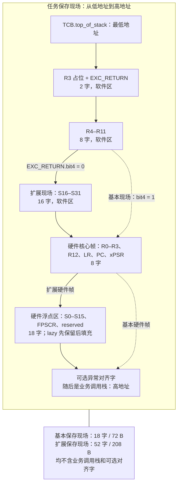

</details>

扩展硬件帧是26字，已经包含8字核心帧，不能再重复相加。浮点新增区为18字，不是只有17个有效寄存器值；架构保留字和异常栈可选对齐字是不同项目。

从保存后的TCB.top_of_stack起，基本帧布局为：offset0/4是R3占位/EXC_RETURN，8..36为R4-R11，40..68为硬件核心帧。扩展情况下，40..100增加软件S16-S31，104..132为核心帧，136..196为S0-S15，200/204为FPSCR/保留字。硬件帧的R0仍在该硬件帧最低地址。可对照[ST PM0214](https://www.st.com/resource/en/programming_manual/pm0214-stm32-cortexm4-mcus-and-mpus-programming-manual-stmicroelectronics.pdf)的异常栈帧图，不根据其他架构或示意图方向猜偏移。

两种LR不能混淆：核心硬件帧内保存的是被打断程序的函数返回地址；软件区EXC_RETURN控制返回Thread/Handler、PSP/MSP及基本/扩展帧。首次任务的核心LR指向任务退出处理，而EXC_RETURN初始为0xFFFFFFFD。

额外软件R3并非任务R3的唯一保存位置：真实R3已在核心硬件帧；软件占位和EXC_RETURN合占8字节维持对齐。恢复过程中R3可继续作临时寄存器，最终异常返回会从硬件帧恢复真实值。

### Lazy stacking：节省写入时机，不节省空间预算

端口设置FPCCR.ASPEN/LSPEN。浮点上下文活跃时，硬件可先预留扩展区，推迟低半浮点寄存器写入。PendSV检测EXC_RETURN.bit4=0，执行保存高半S16-S31的浮点指令；存在待保存lazy上下文时，硬件先落实该上下文。真正跨任务切换仍需完整保留所需现场，lazy不是“浮点任务只用基本帧”的许可。

任务先前执行过浮点指令，当前函数没有float局部变量，也可能携带活跃浮点上下文。因此栈预算按最坏调用链、可能的扩展现场、对齐及裕量建立；96字只是API接受下限。MSP另计嵌套IRQ、PendSV内C提交、8字节临时mask保存及启动残留调用链。栈水印只能反映已发生路径，不证明所有异常深度都覆盖。

## 4.2 PendSV 逐指令流程

端口通过ICSR.PENDSVSET请求最低优先级PendSV，并执行DSB/ISB。请求可以发生于任务或合法ISR，实际激活仍受mask及异常优先级限制。处理函数为naked，编译器不能自动为它加普通C序言/尾声；上下文寄存器本身就是要被替换的数据。

| 顺序 | 指令/动作 | 为什么这个顺序不能随意改 |
|---|---|---|
| 1 | MRS取旧PSP | 硬件已把当前任务核心/可选FP帧保存到该栈 |
| 2 | TST LR.bit4，必要时VSTM保存S16-S31 | 各任务浮点状态不同，必须依据旧EXC_RETURN |
| 3 | STMDB保存R4-R11，再保存R3占位/LR | 顺序须与初始构造和恢复布局一致；BL前保存EXC_RETURN |
| 4 | 保存旧mask，增强屏蔽；MSP PUSH两字 | 保护提交至新PSP安装窗口，保持调用AAPCS的8字节对齐 |
| 5 | 经命名偏移找到current，STR旧栈顶 | 旧TCB仍在运行位置，尚不可回收 |
| 6 | BL rtos_sched_commit_context_switch | C函数只提交身份，不再次搬寄存器；R0返回实际TCB |
| 7 | 读返回TCB.top_of_stack | 即使候选取消，也从实际当前任务恢复 |
| 8 | 恢复R3/EXC_RETURN、R4-R11、条件S16-S31 | 浮点恢复依据新任务的EXC_RETURN |
| 9 | MSR安装新PSP，再POP/恢复临时mask | 不能在新现场还未安装前允许syscall域ISR观察不一致身份 |
| 10 | BX LR异常返回 | 硬件从新PSP取核心/扩展帧，真正回到目标Thread |

汇编直接访问current/top字段，偏移由`__builtin_offsetof`作为立即数传入，top_of_stack还受偏移0静态断言保护。新增TCB条件字段或修改内核布局时，不能靠记住旧数字修汇编。

C提交路径有三个分支：非RUNNING时取消next并返回原current；有next时清候选、将仍RUNNING的prev置READY、next置RUNNING并更新current/计数；无next时返回原current。候选状态断言依赖此前合法API已处理删除/挂起失效，不能把它当作对任意坏指针的安全验证器。

**PSP与current一起发布才构成完整交接。** C提交后CPU仍在Handler，syscall域中断继续被屏蔽；装好新PSP才还原mask。若提前开放IRQ，新current和旧PSP可能被另一内核操作混用。高优先级纯硬件IRQ可以抢占部分窗口，但不得读改这些内核对象。

PendSV的mask保存在MSP临时槽，不是按任务存入TCB。合法配置下它是最低优先级异常，非零有效BASEPRI或PRIMASK会阻止其激活；任务持有正常临界区时不会被PendSV切出。因此当前不需要每任务临界区栈。若BASEPRI泄漏0x50，它首先阻止PendSV/SysTick进入，不能解释成“经已被屏蔽的PendSV自然传播给新任务”。

普通C包装不能跨过naked切换后继续依赖旧r4-r11：这些寄存器已经成为另一任务的值。需要观测开销应在明确的C提交或专用验证点设计，不在异常处理外随意套普通调用包装。

## 4.3 任务栈初始化: 伪造一次中断

`rtos_port_init_stack`把一个从未运行的任务构造成可被异常返回恢复的任务。这样首次启动与以后切换共享恢复协议，不需另写一种“用C直接调用任务”的路径。

1. 以stack_buf+stack_size作为高地址起点，向下对齐到8字节。
2. 按硬件基本帧写xPSR的Thumb位、PC=entry、LR=退出处理、R0=arg，以及其余调试填充值。
3. 写软件R4-R11，再写EXC_RETURN=0xFFFFFFFD和R3占位。
4. 返回最低地址作为TCB.top_of_stack。初始共18字，不预先写S16-S31；任务真正使用FPU后，由异常入口和PendSV形成扩展现场。

这是内核构造过程，不建议应用按图自行写栈。stack_size虽传给端口，真实容量校验主要在任务创建入口；伪帧仅占很小一段，不能证明调用链余量足够。静态栈基址及容量须匹配对齐和真实存储，不能通过传入“比数组更大的字数”骗过接口。

name复制和arg借用也发生在任务发布之前：名字只需在create调用中稳定有效；arg所指内容要保持到任务和所有引用结束。任务入口返回将进入`rtos_task_exit_handler`，执行自删除；业务仍应使用明确的长期循环/退出协议，不能依赖返回自动清理外设或普通heap块。

## 4.4 首任务启动: SVC 的必要性

首任务尚无可保存的旧PSP，不能走普通PendSV的“保存旧任务”开头。启动流程先在Thread/MSP上选择current，再通过SVC进入Handler，使EXC_RETURN异常返回协议合法生效。

```text
BSP准备 + rtos_init + 应用对象/任务
    ↓
sched_start保存原BASEPRI，增强屏蔽，设RUNNING并选首任务
    ↓
port_start_scheduler配置lazy FPU、清端口计数、设置SysTick
    ↓
BASEPRI阈值下CPSIE I → SVC（SVC优先级必须不被阈值屏蔽）
    ↓
SVC取首任务已构造SP → 恢复软件区 → 装PSP → 清BASEPRI
    ↓
BX EXC_RETURN → 从PSP弹硬件帧 → entry(arg)
```

在普通Thread中直接BX到0xFFFFFFFD不是一次合法异常返回；必须先进入Handler。启动时先阻止SysTick/PendSV，再置RUNNING和初始化PSP，防止HAL时代残留SysTick在“标运行、PSP还无效”窗口请求切换。

BSP责任包括：SVC可激活，PendSV/SysTick最低优先级；默认F446逻辑15编码0xF0；SystemCoreClock有效且SysTick重载适合24位寄存器；启动文件向量映射正确；FPU授权和实际ABI一致。端口不代为修正优先级分组，SystemCoreClock断言也不是全部时钟配置校验。

当前BSP的SVC/PendSV函数使用汇编B转跳到端口naked入口，但函数本身是普通C声明。移植或改变编译优化时，必须核对最终反汇编没有破坏现场的前后序；不能简单把“普通C包装里调用port handler”当通用安全移植模板。本轮说明这一结构要求，不把它写成已经新复现的运行故障。

SVC进入使用MSP，原启动C调用链和入口异常帧不会作为普通调用逐层返回。MSP预算应包含这些背景，不把任务PSP预算用来覆盖它。start正常不返回；若调用返回错误，应用必须停止后续运行期假设。

## 4.5 临界区: 进出与屏障

### 4.5.1 两种屏蔽域和数值约定

F446当前采用4个实现的NVIC优先级bit。CMSIS/HAL传入逻辑优先级5，BASEPRI比较的是编码值0x50。数值越小紧迫性越高：默认阈值屏蔽5..15，保留0..4给纯硬件IRQ。高IRQ可运行不意味着它能安全调用RTOS对象API，恰恰因为BASEPRI不会屏蔽它，所以它不能与内核共享修改。

| 配置 | 临界区主体 | 进入/退出元数据事务 | 仍不能阻止 |
|---|---|---|---|
| USE_BASEPRI=1 | BASEPRI_MAX增强到阈值，保留调用者更强mask | 短暂PRIMASK保护计数与保存槽，再还原调用者PRIMASK | NMI/HardFault；主体允许高优先级纯硬件IRQ |
| USE_BASEPRI=0 | PRIMASK屏蔽可配置优先级异常 | 依旧保存进入前PRIMASK并正确嵌套 | NMI/HardFault；也不授权高IRQ使用内核 |

### 4.5.2 为什么计数和保存槽还需短事务

全局`rtos_port_crit_nest`记录当前嵌套深度，`rtos_port_saved_mask`记录最外层之前的mask。不能只依靠BASEPRI保护它们，因为0..4仍能抢占；若nest刚归零而旧mask尚未恢复，另一次进入可覆盖保存槽。当前进/出用短暂CPSID保护这些共同发布动作，不把整个BASEPRI主体都扩大成全局屏蔽。

| 操作阶段 | 实际协议 |
|---|---|
| enter事务开始 | 先保存PRIMASK，再CPSID；BASEPRI模式读取旧BASEPRI并BASEPRI_MAX增强 |
| enter计数 | 检查上溢；最外层保存旧mask；nest加1；BASEPRI模式恢复原PRIMASK |
| 嵌套主体 | 只增加深度，不覆盖最外层保存槽 |
| exit事务 | 保存当前PRIMASK并CPSID；检查零退出；nest减1 |
| 最外层exit | 恢复最外层旧mask；BASEPRI模式还原事务前PRIMASK |
| exit末尾 | ISB加编译器memory约束，同步后续指令和挂起异常识别 |

BASEPRI_MAX不会削弱已有更强屏蔽。例如调用者旧值0x20，内核阈值0x50，进入后仍维持更强的0x20，退出恢复0x20；旧值0则增强到0x50，退出回0。PRIMASK已为1时也不能在退出时擅自打开。把退出写成无条件BASEPRI=0，只有在更窄且可证明的调用约定下才可能成立，并不是当前接口契约。

正常配对0→1→2→1→0只在最外层还原。零层退出和UINT32_MAX层进入走错误处理；关闭断言时也避免计数回绕并保留既有状态，但这不能恢复已经错误的业务嵌套。

### 4.5.3 出口ISB是阻塞协议的一部分

阻塞API先写wait_result初始OK、登记等待并pend，再退出临界区。若解mask后CPU先加载结果到寄存器，再识别PendSV，寄存器中的初始OK会随任务现场保存，超时后不一定重新加载，导致无授予者却返回成功。当前共同出口ISB要求挂起异常识别先于后续取指；volatile只能约束访问，不能替代此异常同步。依据见[Arm AN321 §4.7](https://documentation-service.arm.com/static/5efefb97dbdee951c1cd5aaf)。

memory clobber限制编译器跨越保护边界搬动内存访问；ISB同步处理器指令流；DSB用于要求此前存储完成的端口请求路径。这些作用不同，也不能被解释成RTOS自动提供DMA缓存一致性。不得依据一轮平均周期或某个邻近NOP删屏障。

### 4.5.4 应用只做短而可界定的共享交换

下面例子在Thread中交换一个32位值。target和previous必须真实可访问、自然对齐、互不别名，并由所有参与者遵循同一保护域；高IRQ/DMA不受此约定自动保护。函数内不等待、打印或访问慢外设。调用次数少不等于可把大块复制放进来。

<!-- example-function: ai_example_critical_exchange -->

```c
rtos_status_t ai_example_critical_exchange(volatile uint32_t *target, uint32_t value,
    uint32_t *previous)
{
    if ((target == NULL) || (previous == NULL)) {
        return RTOS_ERR_NULL;
    }
    if ((uintptr_t)target == (uintptr_t)previous) {
        return RTOS_ERR_PARAM;
    }
    RTOS_PORT_ENTER_CRITICAL();
    uint32_t original = *target;
    *target = value;
    *previous = original;
    RTOS_PORT_EXIT_CRITICAL();
    return RTOS_OK;
}
```

`RTOS_PORT_DISABLE_INTERRUPTS/ENABLE_INTERRUPTS`是原始CPSID/CPSIE封装，不记录旧值、不更新嵌套计数；不能把它们混入普通enter/exit当作等价恢复。raw get/set mask同样需要调用者掌握低层协议，不是应用随意改BASEPRI后继续用阻塞API的授权。

## 4.6 ISR 保护域与从中断到任务的完整路径


<details><summary>图形源码（mermaid）</summary>

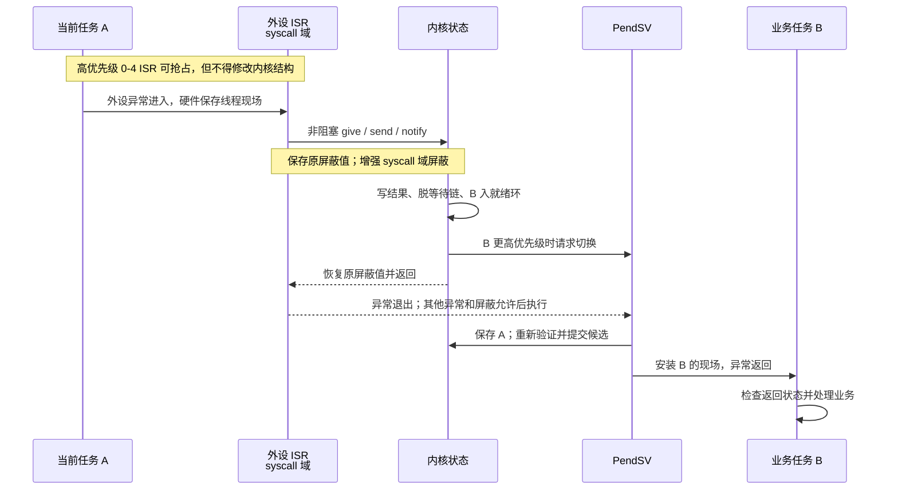

</details>

| 上下文 | 可以承担什么 | 不应承担什么 |
|---|---|---|
| 逻辑优先级0..4 IRQ | 最短硬件服务、自己设计并证明的无内核共享路径 | 操作TCB/queue/sem/event/mutex等对象；关闭断言不改变禁令 |
| 逻辑优先级5..15 syscall IRQ | 逐项允许的NO_WAIT投递/令牌/通知等；检查返回 | 阻塞、删除任务、mutex take/give等Thread限定操作 |
| SysTick | 端口tick流程 | 未满足保护规则时自行调用内部调度函数 |
| PendSV/SVC | 真实异常现场交接/首任务启动 | 作为普通Thread函数直接调用 |
| NMI/HardFault | 最小故障捕获，依据独立硬件规则处理 | 重入临界区原语或修改内核对象 |

同一API没有统一FromISR后缀，不代表所有参数/上下文相同。许多对象入口通过断言检测IRQ优先级；关闭断言只是移除诊断，不提供运行时安全拒绝。ISR阻塞参数通常必须NO_WAIT，但还有各API特别限制，精确返回见契约。

一个正确通知链是：硬件IRQ先处理真实原因/清标志→向已创建任务notify→内核登记READY并pend→IRQ返回→PendSV交接→任务消费通知并处理较重业务。清外设原因与发送业务通知是两件事；只发通知不清中断会再次进入，只清中断不处理投递失败会丢工作。

使用现有样例时，先成功创建worker，再把句柄发布给合法IRQ并放行输入；下面调用只保留最新VALUE，不能表示每个采样都保留。需要逐消息账本应选择queue或额外业务序号协议。

<!-- example-function: ai_example_notify_from_irq -->

```c
rtos_status_t ai_example_notify_from_irq(uint32_t value)
{
    /* Caller must publish the worker only after create returned RTOS_OK. */
    return rtos_task_notify(&worker, value, RTOS_NOTIFY_VALUE);
}
```

---
# 第五章 任务管理: 每个 API 的逐步执行流程

任务管理不是只改一个状态枚举。一次create要建立存储、地址身份、初始现场和运行资格；一次delete要撤回全部索引并保证CPU已不再使用将被释放的栈。业务集成还要管理arg、外设和普通缓冲，内核不会随任务删除自动推断这些资源的所有权。

## 5.0 应用API速查与调用顺序

下表概括常用路径；完整参数/失败输出以[逐项契约](ai/contracts_kernel.md)为准。合法syscall ISR默认指逻辑优先级5..15，并非任意ISR。

| 应用入口 | 适合解决的问题 | 单位/结果 | 关键前提 |
|---|---|---|---|
| rtos_task_create | 动态寿命业务任务 | 栈字数；状态码及成功句柄 | Thread、heap可用，arg持久；可能立即抢占 |
| rtos_task_create_static | 预先规划存储的任务 | 调用方TCB/8字节对齐栈；状态码 | Thread；存储不可在任务仍运行时重用 |
| rtos_task_delete | 已完成外部停机协议后的任务撤销 | NULL/显式current都为自删 | 仅Thread；不自动清业务heap/设备 |
| rtos_task_suspend/resume | 管理运行资格 | 状态码 | suspend中止旧等待，resume不补旧资源 |
| rtos_task_yield | 同级轮流 | void | Thread；不帮助低优先级绕过当前高优先级 |
| rtos_task_delay | 相对暂停 | tick；void | RUNNING Thread且外层可切换 |
| rtos_task_delay_until | 周期相位对齐 | 独占可写基准+周期tick；void | 初始化last为当前tick，错过周期跳到未来 |
| rtos_task_get_current | 只读当前发布身份 | 借用TCB，启动前可NULL | 不增加引用，Handler读到新值不证明Thread运行 |
| rtos_task_get_priority | 只读有效优先级 | NULL表示current；无current返回MAX_PRIORITIES | 非NULL须真实存活，getter不做登记校验 |
| rtos_task_set_priority | 改基础优先级并维护继承 | 状态码 | Thread/合法IRQ，可能调度和多锁图重算 |
| rtos_task_notify | 给指定任务送值/位/计数 | 状态码；无独立对象 | Thread/合法IRQ；句柄已发布且存活 |
| rtos_task_notify_wait | 当前任务消费单邮箱 | timeout tick、状态及可选输出 | 仅Thread；只在OK时把输出当本次工作 |

不要用业务优先级调整代替同步：先暂停一个任务也不自动冻结它曾启动的DMA、定时器回调或ISR。生产代码通常先建立业务“停止产生新工作”的协议，再进行任务管理。

## 5.1 rtos_task_create() (动态)的完整流程

### 5.1.1 两条创建入口如何选择

动态入口从RTOS通用heap分别分配TCB和栈；静态入口接收调用方真实TCB和栈。当前USE_STATIC_ALLOCATION宏不在这两条路径之间作选择，MAX_TASKS也不是全局静态任务池硬上限。`rtos_task_create`始终走heap，`create_static`始终使用给定存储。

| 选择 | 适用情形 | 需要规划什么 |
|---|---|---|
| static | 固定任务集合、确定RAM布局、避免运行期分配 | TCB与栈真实大小、8字节栈对齐、参数寿命、删除后重用时机 |
| dynamic | 按连接/工作阶段创建，允许分配失败 | TCB+栈两次分配、块头/对齐/碎片、失败回滚、idle回收机会 |

动态创建先检查Thread、非NULL输出和entry、合法priority、至少96字；请求超过当前heap最大单块的预检可返回PARAM。之后申请TCB和栈，任一真实分配失败返回NO_MEM并回收本次已分配块。最大块预检不是预留：TCB消耗同一heap，其他上下文也可能分配，不能据预检推断一定成功。

调用方将输出句柄初始设NULL，检查RTOS_OK后才对外发布；失败不承诺把调用方原输出自动清零。静态创建的硬检查只有自然对齐/长度/priority等，不能检查真实数组容量或所有存储重叠；这些仍由应用保证。

### 5.1.2 INITIALIZING与二阶段发布


<details><summary>图形源码（mermaid）</summary>

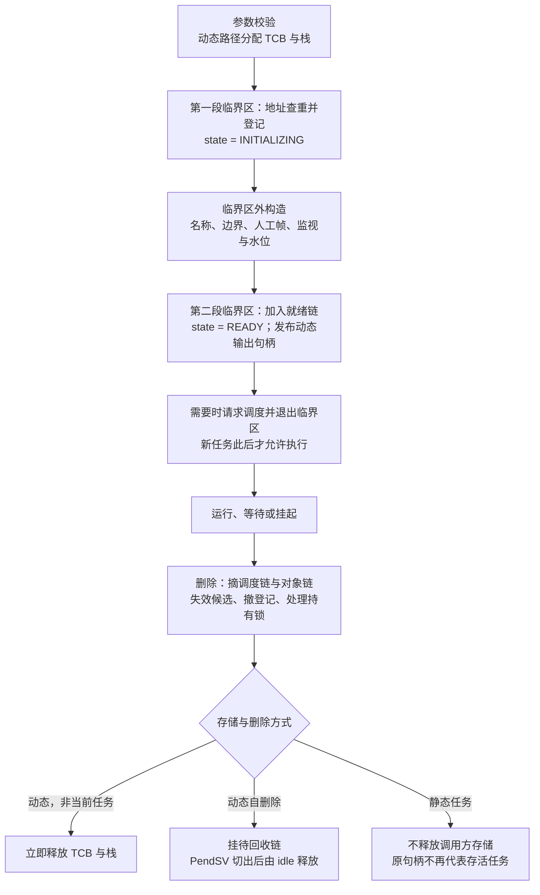

</details>

共用task_create_core按以下顺序构造：

1. 在临界区查独立地址登记，拒绝同TCB已经存活或正在构造，避免二次create清掉第一份现场。
2. 初始化TCB基本字段，赋task_id，置INITIALIZING并加入next_all登记链；此时未进入就绪集合。
3. 退出临界区，复制/截断name，设置栈属性，调用port构造初始帧，建立magic和perf登记/水印。较大的栈填充不占整个核心保护窗口。
4. 再进临界区，将任务入就绪环并置READY；动态入口在此发布`*tcb_out`。
5. 若系统已运行且新任务优先级更高，请求调度，退出后新任务可能在create返回前运行。

地址保留解决“另一个调用用同TCB覆盖构造中对象”；句柄先于READY抢占发布解决“任务已运行，调用方句柄尚未写”的窗口。但这不是自动join协议：新任务若很快自删，创建者随后再用旧句柄仍可能失效。arg中业务数据也必须先构造，不能在create返回后才填写而无启动握手。

### 5.1.3 静态worker与运行参数

下面创建函数与完整示例中的静态TCB、对齐栈及worker_entry配套使用。它应调用一次，检查OK后再放行产生通知的IRQ。名字在调用内复制；TCB、栈和worker所读参数保持整个任务寿命。

<!-- example-function: ai_example_prepare_worker -->

```c
rtos_status_t ai_example_prepare_worker(void)
{
    /* Once only. Keep TCB and stack alive while the task can execute.
     * The name is copied by create and only needs to be valid during that call. */
    return rtos_task_create_static(&worker, worker_stack, 256U, worker_entry,
        NULL, 10U, "ai-worker");
}
```

任务入口的典型形态是长期等待具体工作，不在无事可做时保持高优先级忙循环。样例完整worker在`task_notify.c`中等待通知，只有OK才消费value，错误分支不会把可能变化的输出当新输入。该worker的详细通知语义见5.7。

## 5.2 rtos_task_delete(): 两条路径, 一个陷阱

delete仅允许Thread。NULL和显式current都表示自删；无当前、未登记/已删和idle等目标被拒绝，自删还要求能够切出。不要因“目标不是我”就从ISR删除任务，当前入口统一返回ISR。

### 5.2.1 删除是一组撤回动作

| 步骤 | 为什么必须做 |
|---|---|
| 从就绪环或延时链移除 | 后续调度/tick不再找到即将失效TCB；删除不能用unblock临时重新加入READY |
| 从对象等待链摘除并同步bitmap | 给/收/事件不能再授予旧等待节点 |
| 撤销mutex等待捐赠，清blocked_on | 已退出的等待者不能继续提高owner |
| 置DELETED、注销地址登记、取消next候选 | 旧句柄和未执行切换不再命中这个任务 |
| perf注销，移交所有持有mutex | 观察表不保留悬空指针，mutex.owner不指向将释放TCB |
| 按配置调用删除钩子，决定回收方式，再重选 | 内存/现场交接时机要符合是否自删 |

持有mutex的任务被删时，内核可移交锁所有权或释放锁，但并不回滚该任务刚写了一半的业务结构。锁“有人能拿到”不等于受保护数据仍一致。强制删除之前应让worker停止业务、交还缓冲并满足一致性协议。

### 5.2.2 为什么动态自删必须等待idle

| 目标类别 | TCB/栈回收 | 应用注意事项 |
|---|---|---|
| 其他动态任务 | 从全部索引移除后立即heap_free | 返回后不能继续使用句柄/栈 |
| 当前动态任务 | 挂入延期free链，PendSV切出后idle再free | 当前CPU仍用旧栈，PendSV还要写旧top_of_stack，不能立即free |
| 静态任务 | 内核不free | 存储责任留给调用方，自删后仍须等真正切出才能重用 |

自删的陷阱不是只写一条free：执行delete的代码正使用将要释放的栈，PendSV尚需写current->top_of_stack。延期链使用已离开ready的next_ready，idle先在临界区取走整批，再逐块释放。若所有高优先级任务长期READY，idle得不到CPU，动态自删存储可能持续积压；不是删除函数漏了free，而是回收角色没得到调度。

当前没有通用task join/引用计数API。业务ACK通常只表示“已停止某段工作”，不能自动证明worker已经经过最后一次异常交接。对静态存储重建和外部句柄回收，管理方须另行安排可证明的结束阶段，不能发一个停止通知就立刻memset TCB和栈。

## 5.3 rtos_task_suspend(): 从任何状态拉停一个任务

suspend是取消运行资格，不是原业务调用的透明暂停。目标READY/RUNNING时摘就绪环；DELAYED时摘时间链；等待对象时摘对象链/bitmap，撤销mutex捐赠，写ERR_DELETED并清blocked_on；最后置SUSPENDED，失效next并重选。

因此，对一个正在sem_take或queue_recv的任务执行suspend，再resume后，它原来的等待通常以中止失败返回，不能假装获得了令牌或消息。纯delay也不会在resume后自动补齐原剩余时长；它从原调用后续继续。应用若要“暂停业务后保留工作进度”，应自己保存进度并在每次循环边界响应暂停命令。

NULL表示自挂起，Thread限定；显式传current在ISR中同样拒绝。合法IRQ可挂起其他已登记任务，但仍须遵守优先级和存储寿命，idle不能成为目标。自挂起在调度已挂起时返回SCHED，避免取消自身资格却没有切出。

管理方在调用前还应确认worker没有持有需要等待者立即取得的业务锁。suspend不会像delete一样自动放掉所有已持有mutex；随意挂起持锁任务可能让等待者一直无法继续。

## 5.4 rtos_task_resume()

resume在同一临界区验证目标地址登记并检查SUSPENDED，再置READY入环，必要时请求高优先级抢占。把检查放在环更新之外会让两个上下文都看到SUSPENDED并二次入环，因此不能为减少保护长度拆开。

NULL返回NULL，未登记地址返回PARAM；已存活但不是SUSPENDED时通常返回OK且不重复入链，不是统一返回ALREADY。这是管理运行资格接口，不是可记忆事件：先resume后任务才suspend，并不会积存一次“恢复许可”。需要无丢失握手，应使用sem、notify或queue。

下面控制样例只在明确协调好的Thread上下文使用。其调用者已保证worker寿命、业务可暂停、没有并发delete/重建；它不把管理操作变成通用互斥协议。完整函数会检查实际状态码，不直接写state/priority。

<!-- example-function: ai_example_handbook_control_worker -->

```c
rtos_status_t ai_example_handbook_control_worker(rtos_tcb_t *worker, rtos_prio_t priority)
{
    if (RTOS_PORT_IN_ISR()) {
        return RTOS_ERR_ISR;
    }
    if (worker == NULL) {
        return RTOS_ERR_NULL;
    }
    if (priority >= RTOS_CONFIG_MAX_PRIORITIES || worker == rtos_task_get_current()) {
        return RTOS_ERR_PARAM;
    }
    rtos_status_t status = rtos_task_suspend(worker);
    if (status != RTOS_OK) {
        return status;
    }
    status = rtos_task_set_priority(worker, priority);
    rtos_status_t resume_status = rtos_task_resume(worker);
    if (resume_status != RTOS_OK) {
        return resume_status;
    }
    return status;
}
```

## 5.5 rtos_task_yield(): 同级让出

yield在当前RUNNING且调度RUNNING、同级就绪环多人时移动head、发布next并pend。无同级伙伴时通常无效果；不会让低优先级任务绕过仍READY的当前高优先级。

当前实现的ISR入口直接return，与旧头注释所称“ISR标记待切换”不同。ISR需要唤醒任务时调用逐项允许的投递API，不能寄希望于随后yield让它工作。纯忙循环每轮yield仍可能饿死低级任务；应在无工作时阻塞到具体条件。

## 5.6 rtos_task_delay() 与 delay_until() 的算术

### 5.6.1 相对延时与周期相位

delay(n)的到期点来自调用时now+n。周期任务若每次“处理5tick再delay10”，理论起点间隔是15tick并随处理时间波动。delay_until使用调用者独占的last_wake_tick，按原周期相位推进；它仍只是让任务到点READY，不保证到点必获得CPU。

当前接口是`rtos_task_delay_until(rtos_tick_t *last_wake_tick, rtos_tick_t period)`，并非只传绝对tick的单参接口。首次last取当前tick；period非零、遵守有限范围，每个任务拥有自己的基准，不能由另一任务并发改写。

| 场景，last=100、period=10 | 当前now | 更新后的last | 等待 |
|---|---:|---:|---:|
| 工作及时结束 | 105 | 110 | 5tick |
| 恰好到边界才调用 | 110 | 120 | 10tick，选择严格未来点 |
| 已错过两周期 | 125 | 130 | 5tick，跳过过期周期 |

算法用无符号elapsed=now-last；若period>elapsed则推进一个period并睡剩余量，否则按elapsed/period跳过错过周期到最近未来点。它不全速补做每个错过周期，避免长期占满CPU，但错过业务次数需要应用另做记录。last不是任意未来时间戳，也不能跨多个完整2³²周期仍期待唯一推算；业务应保持正常调用和有界时间跨度。

<!-- example-function: ai_example_handbook_periodic -->

```c
void ai_example_handbook_periodic(void *argument)
{
    (void)argument;
    rtos_tick_t phase = rtos_sched_get_tick_count();
    uint32_t sequence = 0U;
    for (;;) {
        rtos_status_t status = ai_example_handbook_publish(sequence, 42);
        if (status != RTOS_OK) {
            /* Explicit lossy backpressure policy: skip this sample; no infinite retry. */
            handbook_mark_failure();
        }
        sequence++; /* Message identity is modulo 2^32, independent of acceptance. */
        rtos_task_delay_until(&phase, 20U);
    }
}
```

### 5.6.2 返回不证明真正延时过

ISR调用delay/delay_until是void空操作；调度未RUNNING或无current时非零延时也直接返回；delay_until在这些情况下不更新last。delay(0)转yield，不入时间链。普通值>0x7FFFFFFF会被时间侧当永久等待，不是报错或最大有限等待。初始化期间需要阻塞式等待硬件应使用启动阶段自己的BSP方法，不能以任务delay的返回作为时长证明。

## 5.7 任务通知: notify 与 notify_wait

通知把一个32位值和pending状态放进TCB，无独立对象和对象等待链。适合一个固定worker的“有新状态/有工作数量”提示，不适合需要逐条保留不同payload的消息流。

| 类型 | 当前更新 | 能表达什么 | 不能表达什么 |
|---|---|---|---|
| VALUE | notify_value=value | 最新状态覆盖旧状态 | 每次采样的完整历史 |
| BIT | notify_value OR value | 多个条件合并，重复同bit折叠 | 每bit发生次数 |
| INCREMENT | notify_value加1，value实参不作加数 | 累积次数后一次读走 | 自动饱和/溢出报错；当前32位会回绕 |
| NONE/其他 | 返回PARAM | 无合法更新 | 不可当作“只唤醒不改值”的已实现模式 |

发送端先检查非NULL/已登记目标，更新值并置PENDING；只有目标确在本TCB自指notify等待且为BLOCKED/DELAYED才unblock。若它在等queue、sem或普通delay，通知可以积存，但不会打断不属于notify的等待。FINITE notify等待为DELAYED，永久为BLOCKED，不能只检查一种状态。

wait仅Thread，读取当前任务。已有PENDING时立刻返回值并把值清0/状态IDLE；没有pending且NO_WAIT时返回TIMEOUT；确需等待时检查阻塞许可，设置blocked_on=self、list_head=NULL及其余节点字段，然后登记有限或永久时间侧。

成功恢复后，wait在保护下读取结果和值并消费pending；输出可NULL，表示只同步不取值。所有示例都只在OK时消费输出。超时/中止后的输出可能具有旁边到达的新值，不能因数值看起来合理就将错误状态改成成功。

下面给出实际worker等待循环，与[完整task_notify.c](ai/examples/task_notify.c)中的静态worker、对齐栈和私有latest_value共同使用；函数体不是独立完整程序。它只在OK时消费通知值，错误时不将可能改变的输出当成新工作，避免超时邻近到达的通知被重复处理。

<!-- example-function: worker_entry -->

```c
static void worker_entry(void *argument)
{
    (void)argument;
    for (;;) {
        uint32_t value = 0U;
        rtos_status_t status = rtos_task_notify_wait(RTOS_WAIT_FOREVER, &value);
        if (status == RTOS_OK) {
            latest_value = value;
        } else {
            /* Do not consume a possibly changed error-path output as new work. */
            rtos_task_delay(1U);
        }
    }
}
```
### 任务通知的合并、覆盖和超时竞争

通知不是队列：任务尚未运行前连续VALUE会覆盖，BIT合并，INCREMENT累加，不能用“发送了N次所以worker一定执行N次”验收。若每个输入必须处理，queue携带序号或业务缓冲账本更适合。

超时先完成后，任务尚未获得CPU时可能又收到notify。当前wait在结果不是OK时不清这份新pending，保留给下一次wait；本次仍返回TIMEOUT。若应用错误地在TIMEOUT时消费输出，又在下一次OK时再消费，就可能重复处理。

建议固定worker只选择一种通知语义，并明确谁有权发送、pending值如何对应业务缓冲。通知本身不冻结payload，也不为共享数组提供引用计数或所有权；发通知后继续覆盖仍被worker处理的数据，属于业务协议错误。

## 5.8 rtos_task_set_priority() 与"等待链重挂"

set_priority的输入是用户基础优先级，不直接覆盖继承后的最终有效值。NULL表示current，合法范围为0..MAX_PRIORITIES-1；未登记任务和把idle改成非最低优先级被拒绝。Thread和合法syscall IRQ均可能调用，路径会重挂和求图，不应当作固定几条指令的轻量寄存器设置。

| 目标位置 | 必须随有效优先级变化做什么 |
|---|---|
| READY/RUNNING | 从旧优先级环摘，重算有效值，再加入新环 |
| 有限时间等待 | wake_tick和时间次序不变；不要因调优先级重算超时 |
| sem位图链等待 | 用queued_priority处理旧共享位，置新位并尾插，保留同级FIFO纪律 |
| queue/mutex/event有序等待 | 有效值确实变化才按新优先级重挂；未变化不扰乱FIFO |
| 正在等mutex的持锁者 | 捐赠沿锁依赖传播，不能只更新一个节点 |

修改基础值后，如果仍持有高优先级等待者需要的mutex，有效值可能仍保持继承提升；get_priority读的是有效值，不能据“没降回新基础值”判断接口无效。离开等待、移交锁和删除等变化也会触发继承撤销，细节见第七章。

### 5.8.1 调试与管理任务的职责边界

管理代码应调用公开接口并检查返回值，不通过直接写priority/state“恢复现场”。真正的任务暂停/停止需要业务协作：停止新输入、到达可暂停边界、归还缓冲、再管理资格。一个通知ACK、一次state读取或一次get_current都不自动提供内存回收屏障。

### 5.8.2 Idle、用户钩子与有限防御

| 入口 | 当前调用环境及默认行为 | 用户覆盖时的边界 |
|---|---|---|
| rtos_idle_hook | idle循环；默认WFI | 短、不阻塞，不删除/挂起idle；不要让回收和巡检长期饿死 |
| rtos_task_delete_hook | USE_DELETE_HOOK开启才在删除流程调用，仍处内核保护 | 不阻塞、不调用依赖解屏蔽完成的操作；参数为借用TCB |
| rtos_stack_overflow_hook | idle周期巡检后在临界区外回调，默认死循环 | 异常系统下只做受控记录/复位，不能把TCB指针长期保存 |
| rtos_assert_fail | 断言点原上下文，默认死循环 | 可能发生在ISR/临界区；不能依赖同一被屏蔽IRQ完成printf |
| rtos_idle_task | 内部长期任务主体 | 应用不直接当普通函数调用或重新创建替换 |

idle每256次自身循环安排栈巡检，不是每256tick固定执行。perf开启时只覆盖已登记到有限观察表的任务；perf关闭时退化扫描ready和delay，永久BLOCKED/SUSPENDED不一定被覆盖。CHECK_FOR_STACK_OVERFLOW非零启用当前检查，不能把注释里的1/2档视为已实现两套完整独立机制。magic、保存SP和A5水印都是有限证据，不能证明没有任意越界写。

完整调用语义、输出变化及端口导出分类继续查[公共契约](ai/contracts_kernel.md)，实际实现定位到[rtos_task.c](../RTOS/Core/Src/rtos_task.c)、[rtos_wait.c](../RTOS/Core/Src/rtos_wait.c)和[rtos_sched.c](../RTOS/Core/Src/rtos_sched.c)。本章用例是源代码调用示范，编译覆盖与实板执行范围须分别查当日日志，不能从一段可编译C推出所有时序已经上板。

---

# 第六章 信号量: take/give 的完整路径

信号量解决的是“现在有多少份资源可以领取，或者多少次完成通知尚未领取”，而不是“哪个任务拥有某段共享数据”。它将一个有上限的计数与一组等待任务组合起来：计数可用时立即领取；计数为零时等待；新的资源到达时优先授予等待者。该模型适合完成通知、缓冲空位和同类资源限额。

阅读本章时须区分三个时刻：give 完成授予、等待任务成为 READY、take 返回到业务代码。前两者发生在内核临界区中，最后一个还要等待任务获得 CPU。信号量传递的是领取资格，不携带完成结果数据；业务数据若由多个执行者共同修改，还需要自己的发布与一致性协议。

精确原型和参数契约见 [rtos_sem.h](../RTOS/Core/Inc/rtos_sem.h) 与 [信号量契约](ai/contracts_ipc_memory.md#信号量)；实现位于 [rtos_sem.c](../RTOS/IPC/rtos_sem.c)，共用等待机制位于 [rtos_wait.c](../RTOS/Core/Src/rtos_wait.c)。本章的步骤是实现说明，不是要求应用直接调用内部调度或链表函数。

## 6.1 数据结构

信号量控制块由调用者分配，内核维护其中的计数、位图和等待链。TCB 的等待节点属于任务，挂入对象只是临时登记；对象不会为每次等待动态分配节点。

| 字段 | 维护者与含义 | 必须保持的关系 |
|---|---|---|
| `is_initialized` | init/deinit 及入口检查使用 | 仅表示对象逻辑状态，不证明地址有效 |
| `count` | take/give 修改的可领取计数 | 合法操作下 `0 <= count <= max_count` |
| `max_count` | init 设置的计数上限 | 必须大于零；设为 1 得到二值信号量 |
| `wait_head` | 任务等待节点构成的 FIFO 物理链 | 链首不一定是最高优先级任务 |
| `wait_bitmap` | 存在等待者的优先级集合 | bit p 为 1 表示仍有有效优先级 p 的等待者 |

通用信号量没有 `owner` 或对象池 `in_use` 字段。USB 等适配层可以另有槽位封装，但封装的分配状态不属于通用信号量布局。`MAX_SEMAPHORES` 也不是本 init 路径的全局对象数量限制。

**计数与等待链的核心不变量**：有等待者时 count 为零。反过来不成立：count 为零也可以无人等待。有 give 到达时，资源要么授予一个等待者，要么进入 count，不会同时做两次记账。

**位图选择不是整体常数时间**：`ctz(wait_bitmap)` 可以 O(1) 选择最高等待优先级，但节点仍要从一条 FIFO 链中寻找；摘链后还须检查该优先级是否仍有其他等待者。当前尾插没有独立尾指针，入链也要遍历。因此 W 个等待者时，入链、定位和清位仍可能为 O(W)；仅单等待者等路径有 O(1) 快路径。


<details><summary>图形源码（mermaid）</summary>

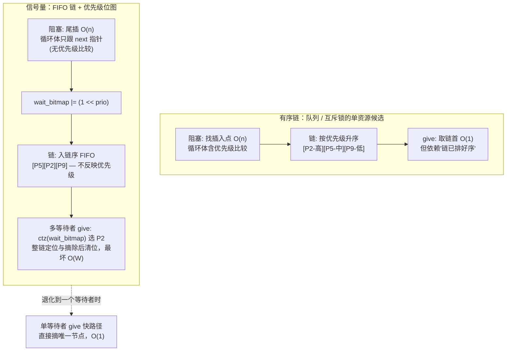

</details>

| 等待结构 | 入链 | 选择一个可授予候选 |
|---|---|---|
| 当前信号量 FIFO 位图链 | 寻找链尾后追加，O(W) | 位图选优先级，再整链定位同级最早节点，必要时扫描清位 |
| 队列、互斥锁有序链 | 依有效优先级寻找插入点，O(W) | 单资源候选通常取链首；完整 API 还含复制或继承成本 |

动态改变等待者有效优先级时，`queued_priority` 保存旧登记优先级。重挂逻辑先摘原节点，确认旧优先级是否还有同级等待者，再清旧位、置新位并尾插。优先级没有实际变化时不重挂，避免改变同级先后关系。

## 6.2 rtos_sem_take(sem, timeout) 逐步流程

timeout 单位为 tick。`RTOS_NO_WAIT` 表示只尝试一次；支持的有限域为 `1..0x7FFFFFFF`；`RTOS_WAIT_FOREVER` 表示不登记时间到期。当前更大的非永久常量也被调度器按永久等待处理，应用不能把它当超长有限等待。

```text
1. NULL → RTOS_ERR_NULL；读取 ISR 状态并执行系统调用优先级断言。
2. 未初始化 → RTOS_ERR_PARAM；ISR 且 timeout 非零 → RTOS_ERR_ISR。
3. 进入临界区，再次检查 initialized；期间被 deinit → RTOS_ERR_PARAM。
4. count > 0：count--，退出临界区，返回 RTOS_OK。
5. count == 0 且 NO_WAIT：退出，返回 RTOS_ERR_TIMEOUT。
6. 确实需要等待：检查调度器运行且有当前任务，否则 RTOS_ERR_SCHED。
7. 当前 TCB 登记 blocked_on=sem，初始化 wait_node：
   wait_obj、list_head、queue_bitmap、queued_priority、on_timeout=NULL、wait_result。
8. FIFO 尾插等待节点，置 wait_bitmap 对应位。
9. sched_block：退出就绪链；有限等待另入延时链，永久等待不入延时链。
10. 请求调度并退出最外层临界区，PendSV 在允许时切出。
11. 将来恢复：读取自己的 TCB.wait_result 并返回，不重新减少 count。
```

入口外的初始化检查用于快速拒绝，临界区内复查保护后续状态访问和等待登记。这能应对存储仍有效、但合法 ISR 恰好在两次检查之间 deinit 的交错；不能应对存储已经被释放或指针任意伪造的情况。

立即成功路径不因调度器尚未启动或暂时挂起而自动失败；只有确实需要阻塞时才返回 `RTOS_ERR_SCHED`。调用方仍不得在外层临界区或自行屏蔽 PendSV/SysTick 时发起可能阻塞的调用，阻塞许可守卫不等于检查了全部屏蔽状态。

有限等待有两项同时有效的登记：信号量链负责 give 找到等待者，延时链负责到期找到任务。任务状态为 DELAYED 并不表示它没有等待某个对象；永久等待才使用不入延时链的 BLOCKED。不能只凭状态名判断是否应唤醒。

## 6.3 rtos_sem_give(sem) 逐步流程

give 不要求调用者此前 take，也不记录资源拥有者。合法系统调用级 ISR 可调用，不能由此推导高优先级 IRQ、NMI 或 HardFault 也可以进入内核。

```text
1. 检查 NULL、初始化和 ISR 优先级；进入临界区并复查 initialized。
2. 等待链非空：
   a. 单节点直接选中；多节点用位图选最高优先级并定位该级最早节点。
   b. 双向摘除节点，检查剩余同级等待者后同步清位。
   c. 清 blocked_on/list_head，写 wait_result=RTOS_OK。
   d. sched_unblock 撤销有限超时、加入就绪表，必要时重算候选。
   e. count 不增加，本次 give 已授予这个等待者，返回 RTOS_OK。
3. 等待链为空：
   count 已达 max_count → RTOS_ERR_OVERFLOW，计数保持不变。
   否则 count++，返回 RTOS_OK。
```

位图没有匹配节点时，共用 helper 会退回整链扫描，选真正最高优先级，而不是直接选 FIFO 链首。这是防御路径，不能代替位图和链表一致性的验证，也不是支持应用自行改等待节点的理由。

**give 与超时的互斥裁定**：give 先完成授予时，节点已经离开对象链和延时链，后续 tick 不再使该等待超时；超时先到时，tick 先摘两条链并记录 `RTOS_ERR_TIMEOUT`，随后 give 在对象链中找不到它，改授予别人或增加 count。两条修改路径在内核临界区内串行，成功和超时不会重复授予同一次资源。

**READY 不等于仍可取消的等待**：give 已授予、任务尚未返回 take 时，如果随后挂起该 READY 任务，挂起不会自动撤销已记录成功或退回资源。恢复后它仍可得到原成功结果。任务若此时被直接删除，则不会恢复原调用；已经领取的令牌也不会因为任务删除被内核自动补回。资源归还需要应用协议。

## 6.4 sem_deinit

销毁解决的是“中止此对象上尚未完成的等待并禁止继续正常使用”，不负责释放控制块，也不表示所有调用者都已消失。

```text
前置：对象曾成功 init，存储和等待链完整；停止新业务访问。
进入临界区：逐个摘 wait_head 节点，写 RTOS_ERR_DELETED 并解除等待。
清 wait_bitmap，清 is_initialized；保留 count/max_count。
退出临界区，返回 RTOS_OK；对象存储仍由应用管理。
```

deinit 可以使仍在等待链中的调用返回 `RTOS_ERR_DELETED`；任务挂起中止该等待也使用这一状态码，而不是新的“取消”状态码。被删除的任务本身不再返回原 take。反之，已经完成授予的 READY 调用不在等待链上，deinit 不会追溯修改它的结果。

恢复的阻塞 take 只读取 TCB 结果，不再访问旧 sem；但其他尚未进临界区的调用、IRQ 的旧指针或业务引用仍可能存在。正确顺序是停止生产者与新访问、确认旧使用方退出、执行对象取消/清理协议，最后释放或复用存储。重复 deinit 仅能用于尚未释放复用且结构仍完整的对象，不能用于探测未初始化垃圾字节。

## 6.5 设计分析

信号量将快计数、优先级授予和统一等待清理组合在很小的控制块中，适合表达数量。其边界也由这个模型决定：不传消息、不记录拥有者、不实施互斥优先级继承；二值计数不能保存任意多次事件。

若只需通知一个已知任务且不需要独立资源对象，可考虑任务通知；若需要保护一个共享结构体的多字段一致性，应选 mutex；若每次通知还必须携带独立序号和结果，应选 queue。不要为了减少对象数量，将“数据已经写好”和“某一位被置位”混成未经证明的共享数据协议。

### 信号量 API 使用清单

| API | 使用目的 | 关键返回与调用规则 |
|---|---|---|
| `rtos_sem_init` | 建立计数及上限 | 参数非法 `RTOS_ERR_PARAM`；仍有登记等待者 `RTOS_ERR_ALREADY`；无等待者的重 init 会重置计数 |
| `rtos_sem_take` | 领取一个计数或等待授予 | OK 才可使用资源；NO_WAIT 无资源与实际超时都为 `RTOS_ERR_TIMEOUT` |
| `rtos_sem_give` | 归还资源或发送一次完成通知 | 检查 `RTOS_ERR_OVERFLOW`，不能静默假定通知已被保存 |
| `rtos_sem_get_count` | 观察当前计数 | 不验证初始化、不预留资源；NULL 和合法零都返回零，deinit 后可能保留旧值 |
| `rtos_sem_deinit` | 中止尚在登记中的等待 | NULL 为 `RTOS_ERR_NULL`；不释放存储、不退回任务已经取得的令牌 |

### 正确使用步骤与实际例子

以下是 [ipc.c](ai/examples/ipc.c) 的独立示例函数，`signal` 是该文件的静态对象，不是临时栈对象；这些 `ai_example_*` 函数是应用示例，不是新增 RTOS API。

1. 在启用产生通知的 IRQ 前调用初始化封装并检查返回状态。
2. ISR 只给信号，检查是否饱和；该 IRQ 必须处于系统调用级。
3. 任务有限等待，成功后再处理一次业务；超时是任务恢复控制权的机会，不表示业务设备一定故障。
4. 若每个采样结果都要保留，二值 sem 只负责唤醒，实际结果必须由另一个有明确容量/序号的存储协议承载。

<!-- example-function: ai_example_prepare_signal -->

```c
rtos_status_t ai_example_prepare_signal(void)
{
    return rtos_sem_init(&signal, 0U, 1U);
}
```

<!-- example-function: ai_example_signal_from_irq -->

```c
rtos_status_t ai_example_signal_from_irq(void)
{
    return rtos_sem_give(&signal);
}
```

<!-- example-function: ai_example_wait_signal -->

```c
rtos_status_t ai_example_wait_signal(void)
{
    return rtos_sem_take(&signal, 10U);
}
```

示例初始计数为 0、上限为 1，等待预算为 10 tick。它表达“至少有一次待处理通知”，不保证统计每次中断。默认 1 kHz 时 10 tick 对应约 10 ms 的 tick 预算；改变 tick 配置后应重新换算，API 返回时刻还受调度影响。

| 常见反例 | 后果 | 合理处理 |
|---|---|---|
| 先 get_count>0，再直接访问资源 | 查询后计数可能已被别的任务领取 | 始终依据 take 的实际结果 |
| take 失败后仍执行设备操作并 give | 无资源时进入业务，还凭空增加计数 | 失败立即退出该次资源操作 |
| 把上限 1 的 sem 当成无限事件日志 | 多次 give 饱和，无法恢复发生次数 | 明确合并策略，或改计数/队列并记录拒收 |
| 任务持有令牌时被强删，期望自动归还 | 通用 sem 无拥有者，令牌不会自动补回 | 有序停止并确认资源账本，再删除任务 |

---

# 第七章 互斥锁: 优先级继承的每一步

互斥锁解决“共享资源的一组访问只能由一个任务执行”的问题。与信号量相比，它增加了拥有者和递归计数，因此可以拒绝其他任务释放、识别同任务重入，并根据等待关系对拥有者进行优先级继承。继承缩短的是被中等优先级任务推迟的机会，不能替业务完成设备操作、保证锁按时释放或解除死锁。

声明见 [rtos_mutex.h](../RTOS/Core/Inc/rtos_mutex.h)，精确调用规则见 [互斥锁契约](ai/contracts_ipc_memory.md#互斥锁)，实现见 [rtos_mutex.c](../RTOS/IPC/rtos_mutex.c)。本实现已经使用有界全图求解，不能再按旧版一跳 PI 说明当前行为。

## 7.1 数据结构与注册表

| 字段或结构 | 负责的协议 | 应用应遵守的边界 |
|---|---|---|
| `owner` | 当前被授权访问资源的任务 | 只由内核转移，不能写 NULL 来“强制解锁” |
| `recursion_count` | 当前 owner 成功 take 的未配对次数 | 每次成功 take 必须有对应 give；到零才真正释放 |
| `wait_head` | 按有效优先级排序的等待节点 | 同级在当前级别的入链先后用于选择 |
| `is_initialized` | 生命周期标志 | 不代替对象地址、寿命或业务数据健康检查 |
| `s_mutex_registry` | 已初始化锁的地址集合 | 默认 `MAX_MUTEXES=8` 是真实注册容量，满时 init 失败 |

TCB 不维护逐任务持锁链，内核通过注册表反查一个任务持有的锁。首次 init 可以使用未清零存储；同址已登记且空闲时 init 返回 OK，不重复清零或追加登记；有 owner、等待者或非零递归计数时返回 `RTOS_ERR_ALREADY`。对象不用后必须按生命周期协议 deinit 注销，避免注册表保留无效地址。

`base_priority` 属于任务，表示应用设定的基础等级；`priority` 是当前有效等级，可能包含继承。mutex 不保存一个可无条件恢复的 owner_orig_priority，因为任务可能持多把锁并同时等待另一把锁。

## 7.2 rtos_mutex_take(mutex, timeout) 逐步流程

take/give 只用于调度器启动后的任务上下文，即使 timeout 为 NO_WAIT 也拒绝 ISR。启动阶段可 init 对象，但不应在没有有效 current_tcb 时取锁。init/deinit 允许系统调用级 ISR 的实现路径与 take/give 的运行时拒绝不同，不能将这两个层次混为一谈。

```text
1. NULL → RTOS_ERR_NULL；未初始化 → RTOS_ERR_PARAM；ISR → RTOS_ERR_ISR。
2. 进入临界区并复查 initialized，随后取得当前任务 cur。
3. owner 为空：owner=cur，recursion_count=1，返回 RTOS_OK。
4. owner==cur：
   计数为 UINT32_MAX → RTOS_ERR_OVERFLOW，保持原所有权和计数；
   否则递归计数加一，返回 RTOS_OK。
5. 其他任务持有且 NO_WAIT：返回 RTOS_ERR_TIMEOUT，不登记等待或捐赠。
6. 需要阻塞：先检查 block_permitted，失败为 RTOS_ERR_SCHED。
7. block_current_on 发布等待关系、超时和候选切换。
8. 依赖已发布后执行 mutex_refresh_priority_graph(NULL)，求解最终等待图。
9. 退出最外层临界区后才可能切出；恢复时读取 wait_result。
```

第 7 步的内部 helper 返回 OK 只表示阻塞登记已完成，不表示 mutex 已经到手。该 helper 仍在外层临界区内返回，图求解和后续状态发布可以先完成；真正恢复业务调用发生在之后的上下文切换中。内部 helper 不是供应用使用的另一种取锁接口。

已等待的 take 仅在 `RTOS_OK` 时获得所有权；实际超时为 `RTOS_ERR_TIMEOUT`，deinit 或挂起中止仍登记等待时为 `RTOS_ERR_DELETED`。等待任务被删除后不再返回。失败不会自动授权调用方访问受保护数据。

## 7.3 全图求解：传递继承与撤销

设 H 的优先级为 4，L 的基础优先级为 15，D 的基础优先级为 16。L 持锁 A 并等待 D 的锁 B；H 开始等 A 时，只提高 L 不够，因为实际能够推进的是 D。当前实现把 H→L→D 的捐赠沿依赖传播，使 D 也能以优先级 4 参与调度。

<!-- diagram:inline -->


`mutex_refresh_priority_graph(detached_owner)` 在内核临界区内完成以下步骤：

1. 收集注册锁中不同 owner，必要时加入刚释放最后一把锁的旧 owner；节点数组最大为 `MAX_MUTEXES+1`。
2. 所有临时有效优先级从各任务的 base 开始，不从上次继承结果开始。
3. 扫描全部注册锁和全部等待节点。等待者若也是图中 owner，使用它的临时求解值捐赠；其他等待者使用当前有效优先级。
4. 对等待者→拥有者的每条边取较高优先级，即数值较小者；最多执行 V 轮，某轮无变化则提前停止。
5. 得到新解之后统一应用，重挂受影响任务的就绪链和对象等待链，必要时重新调度。

V 是图中的不同拥有者数，不是系统全部任务数。计算时不能只读取仍按旧有效优先级排序的等待链首，否则可能遗漏撤销或新捐赠；本求解器扫描全部等待者，再按新解重挂。直接查询 helper `rtos_internal_mutex_compute_effective_priority` 仍利用有序链首，它与全图求解的职责不同。

从 base 起算对于撤销同样重要。若依赖形成环，并从旧有效值开始迭代，已经离开的高优先级等待者可能让旧捐赠在环内互相保留。重新从 base 解当前依赖，才能使移除边后的有效优先级由剩余关系决定。

**有界求解不等于死锁解除**：A 持 L1 等 L2、B 持 L2 等 L1 时，继承改变运行等级，却不会让任何一方凭空取得对方的锁。生产设计仍须规定全局加锁顺序，必要时采用有限等待、失败退出及业务状态回滚；不能以 PI 替代这些协议。现有有限链/环测试记录见 [复杂依赖回归记录](logs/2026-10-26.md#adversarial)，不代表任意锁依赖已验证。

## 7.4 rtos_mutex_give(mutex)：在最终所有权拓扑上重算

```text
1. 检查 NULL、初始化和 ISR；进入临界区后复查 initialized。
2. owner!=cur 或 recursion_count==0：RTOS_ERR_PARAM，不释放别人的锁。
3. recursion_count--；仍大于零时返回 RTOS_OK，所有权不变。
4. 最终释放：记住 old_owner，清 mutex->owner。
5. 从有序等待链选择最高候选，撤销其等待并置 READY。
6. 若选中任务，先写 owner=woken、recursion_count=1。
7. 在最终所有权关系上刷新包含 old_owner 的全图，更新继承与候选。
8. 退出临界区并返回；新 owner 的 take 恢复时直接读成功结果。
```

顺序必须以当前实现为准：先完成所有权变化，再求解新拓扑。新 owner 还可能被剩余等待者捐赠，旧 owner 也可能继续持有其他锁，不能只将旧任务降回 base。唤醒过程中暂时选定的候选可在图重算后刷新；实际 PendSV 不会在这组操作中间执行。

**预移交与抢占是两个问题**。临界区退出时锁已归属于选中的任务，即使该任务还没有执行，第三方也不能把锁当作空闲资源拿走。谁先从 give/take 返回、何时开始执行业务，仍由优先级、其他就绪任务和中断决定。不要根据 API 返回先后推导所有权授予先后。

递归调用尤其容易误判：第二次 take 成功只增加计数，一次 give 只能抵消一次成功 take。不能用“执行到某个统一出口”代替精确的配对，也不能在失败 take 后调用 give 来补偿。

## 7.5 等待者退出、对象销毁与任务删除

| 变化来源 | 先完成的链/所有权操作 | 继承后处理 |
|---|---|---|
| 超时 | 从延时链和等待链摘除，记录 TIMEOUT | `mutex_waiter_left` 匹配注册锁后重算当前图 |
| 挂起仍在等待的任务 | 撤销其等待，记录 DELETED，置 SUSPENDED | 撤销该等待边的捐赠；恢复后不当作取锁成功 |
| 删除等待任务 | 从等待链摘除，之后注销该任务 | 原调用不返回；图不再计入此等待边 |
| deinit 锁 | 清 owner、唤醒未完成等待为 DELETED、注销锁 | 在注销后的注册表上重算旧 owner 与其他拥有者 |
| 删除持锁任务 | 扫描其持有锁，逐把移交给最高等待者或置空 | 每次拓扑变化后刷新包含旧 owner 的图 |

超时与 give 仍是先完成者决定结果：若移交先完成，任务已是新 owner，即使随后尚未运行就被挂起，也不会自动撤销这次成功。它可能在 SUSPENDED 状态持锁，使其他任务一直等下去。若随后被删除，则按任务删除路径移交它持有的锁；不能只看“take 尚未返回”就断言它不拥有资源。

deinit 不要求调用者是 owner，但这不使“在别人操作设备时销毁锁”成为可靠业务流程。内核可以消除 owner 指针和等待关系，不能撤销旧 owner 正在执行的外设操作，也不回滚半更新的多字段数据。业务要先停止使用方并确认退出，再销毁互斥对象。

对象地址匹配和初始化复查只保护合法存储上的状态操作，不提供通用旧句柄代次。若 control block 已释放、被别的类型覆盖，不能依赖 init/deinit 自动识别原身份。注册表里的对象在注销前必须持续有效。

## 7.6 rtos_task_set_priority 与继承的交互

修改任务优先级的公共入口改变的是 base，而不是允许应用直接覆盖有效 priority。其步骤为：在任务登记中验证身份，按当前已持锁链首估算直接有效优先级，维护就绪链与对象等待链；若该任务是 mutex 等待者，再刷新完整依赖图，最后重新调度。全过程受同一内核临界区保护。

已有捐赠可能比新 base 更高，因此设定一个较低基础等级后，有效等级不一定立刻下降。等待任务改变等级还会影响它所等待锁的候选顺序，以及上游拥有者的传递捐赠。比较两个值时要先确定观察的是 base 还是 effective，而不是把这类差异统一归为“修改优先级失败”。

每次有效等级变化都可能重挂对象等待链；不只 READY/RUNNING 任务需要处理。阻塞 owner 若仍在 queue、sem 或另一把锁上等待，其节点也必须同步更新。直接修改 TCB priority 会破坏这些派生状态，应用不得这样绕过公共入口。

## 7.7 开销与设计边界

全图求解不分配动态堆、不递归传播，但局部数组、扫描和优先级发布都消耗资源。令 M 为注册锁数，V 为不同 owner 数，ΣW 为注册锁的等待者总数：数组查找为 O(V)，最多 V 轮松弛，保守计算界为 O(V²(M+ΣW))，之后还有对象链重挂成本。任务删除可重复触发图重算。小配置使规模有界，不等于已经给出产品级 WCET。

现有 [复杂依赖回归记录](logs/2026-10-26.md#adversarial) 区分实板链/环、撤销、移交、递归上界与编译配置的静态栈帧；`.su` 数字不包含整个调用链和异常栈。更改 `MAX_MUTEXES`、编译器或优化级别后，应重新评估 RAM、栈和 syscall 中断被延后的时间，而不是复用旧测量作新版本上界。

### 互斥锁 API 使用清单

| API | 使用目的 | 关键检查 |
|---|---|---|
| `rtos_mutex_init` | 注册一个长期有效对象 | 检查 `RTOS_ERR_NO_MEM` 和 `RTOS_ERR_ALREADY`；空闲重复 init 不追加槽位 |
| `rtos_mutex_take` | 任务领取所有权或递归重入 | 仅 OK 进入受保护操作；TIMEOUT/DELETED/SCHED 不授权；递归满为 OVERFLOW |
| `rtos_mutex_give` | 抵消一次成功 take | 检查返回；非 owner 或零递归为 PARAM，已 deinit 为 PARAM |
| `rtos_mutex_deinit` | 中止等待并注销对象 | 对象必须曾 init 且结构有效；不恢复受保护业务数据 |

### 正确使用步骤与实际例子

下例 [ipc.c](ai/examples/ipc.c) 使用静态 mutex 和受保护的单个值。初始化成功后，任务尝试在 10 tick 内取锁；失败直接返回；成功才写值，并返回 give 的结果。所有读取该共享值的其他路径也必须遵守同一把锁，不能只有写入者加锁。

<!-- example-function: ai_example_prepare_mutex -->

```c
rtos_status_t ai_example_prepare_mutex(void)
{
    return rtos_mutex_init(&sample_mutex);
}
```

<!-- example-function: ai_example_mutex_update -->

```c
rtos_status_t ai_example_mutex_update(uint32_t value)
{
    rtos_status_t status = rtos_mutex_take(&sample_mutex, 10U);
    if (status != RTOS_OK) {
        return status;
    }
    protected_value = value;
    return rtos_mutex_give(&sample_mutex);
}
```

| 常见反例 | 为什么不成立 | 正确处理 |
|---|---|---|
| ISR 中 NO_WAIT take，认为“不阻塞就允许” | mutex 的拥有者契约禁止 ISR，函数仍返回 ISR 错误 | ISR 投递任务工作，由任务取锁 |
| take 超时后继续更新共享结构 | 超时没有授予所有权 | 返回、重试或走受控降级路径 |
| 两个锁按调用者方便的次序任意嵌套 | PI 不打破循环等待 | 统一锁顺序，定义有限等待和失败回滚 |
| 持锁后等消费者，消费者还要取同一锁 | 形成业务等待环或长时间占有 | 先复制必要状态并解锁，再等待对端 |
| 强删 owner 后认为事务已自动修复 | 内核只移交所有权，不回滚数据 | 管理任务确认设备和数据一致性，再恢复业务 |

---

# 第八章 消息队列: 四条路径与单次拷贝直传

队列解决“将一条独立消息交给某个消费者”的问题。每条消息按固定 item_size 复制，环形缓存吸收暂时突发；等待链把容量不足或数据不足转化为任务阻塞。与 sem 不同，它保存内容；与 event 不同，重复消息可以占据多个槽位而不自动合并。

要分别设计消息顺序、等待者选择和背压。尾插头取形成 FIFO 消息流；to_front 可在消息流前端插入；有多个阻塞调用时按有效任务优先级选候选。这三者不是一个优先级队列协议，也不自动保证低优先级消费者最终获得服务。

声明见 [rtos_queue.h](../RTOS/Core/Inc/rtos_queue.h)，逐项契约见 [消息队列契约](ai/contracts_ipc_memory.md#消息队列)，实现见 [rtos_queue.c](../RTOS/IPC/rtos_queue.c)。

## 8.1 数据结构与环形缓冲

| 字段 | 作用与维护者 | 生命周期责任 |
|---|---|---|
| `storage` | 应用提供的 item_size×capacity 字节区域 | 应用保证实际范围有效、独立且不与对象/传递缓冲重叠 |
| `item_size` / `capacity` | 固定元素字节数与元素条数 | init 后不可在有使用者时直接修改 |
| `head` / `tail` | 环形读写位置 | 由 push/pop/头插路径维护 |
| `count` | 判空/判满的当前消息条数 | 区分 head==tail 时的空与满，不是序号或业务完成数 |
| `send_wait_head` | 满队时等待发送的有序任务链 | 节点保留源地址、长度与头插意图 |
| `recv_wait_head` | 空队时等待接收的有序任务链 | 节点保留目标地址与长度 |
| `is_initialized` | 逻辑可用标志 | 不管理 storage 的分配或旧指针有效期 |

合法稳定状态下，`recv_wait_head` 非空意味着 count=0，`send_wait_head` 非空意味着 count=capacity。临界区内 push/pop 和代办之间可以有短暂中间值，外部调用不能插入观察并修改该中间过程。

init 验证非零尺寸、容量乘法不溢出，并通过任务登记拒绝清空仍有发送或接收等待者的对象。它没有 storage 实际数组容量参数，不能证明调用者提供的内存真的足够；也不清零 storage。无等待者时重新 init 会清空逻辑队列，原有指针消息所指资源不会自动释放。

## 8.2 rtos_queue_send() 的四条路径

send 先检查指针、初始化和上下文：合法 ISR 必须 NO_WAIT；进入临界区后复查初始化。所有消息复制都在临界区内，因此复制长度直接进入 syscall 域中断延迟预算。

```text
路径1：已有接收等待者。
  取有序链首；验证其目标地址非NULL、transfer_size==item_size。
  不合法等待者以 PARAM 中止，继续寻找合法接收者。
  摘节点，保存目标地址，将 transfer_buf 置NULL表示已代办。
  memcpy(接收目标, 本次发送源, item_size)。
  写接收者 OK、撤销其等待、置 READY；本次 send 返回 OK。
  消息不进环形缓存；空队列上 to_front 不改变此消息的交付顺序。

路径2：没有接收等待者，且 count<capacity。
  普通发送复制到 tail，tail 环形推进；头插则在 head 前一格复制并更新 head。
  count++，返回 OK；不覆盖任何既有消息。

路径3：队列满且 NO_WAIT。
  返回 TIMEOUT，没有接纳该消息；不是 OVERFLOW。

路径4：队列满且允许等待。
  先检查 block_permitted，失败返回 SCHED。
  将源地址、item_size、to_front 保存在当前任务等待节点。
  按优先级入 send_wait_head，同时登记有限超时（如有），请求切换。
  恢复后先看 wait_result；错误直接返回。
  OK 且 transfer_buf==NULL，表示对端已代办复制，可返回成功。
```

复制由对端完成，也不改变源缓冲的调用约定：在 send 返回前，地址必须有效、内容稳定。尤其不能由另一个任务在发送者仍阻塞时复用该源地址。传递大小校验是防御检查，不证明任意非 NULL 地址都可读或不重叠。

源码还保留 transfer_buf 未清空时的重试：重新检查初始化和槽位，再入队或再次等待，timeout 沿用原值。正常直传/代办成功路径已经在唤醒前完成复制，不让等待者重新争抢槽位；不能把旧重试注释当作每次正常发送都可能被偷走的证明，也不能据此承诺跨重试的严格总时间预算。

## 8.3 rtos_queue_recv() 与"代办入队"

recv 的入口规则与 send 对称：目标至少可写 item_size 字节，合法 ISR 仅 NO_WAIT，进入临界区后复查对象状态。

```text
路径1：count>0。
  将 head 消息复制到本次目标，head 环形推进，count--。
  若有发送等待者：
    选择最高有效优先级候选，验证源地址和长度。
    不合法候选以 PARAM 中止；继续寻找合法候选。
    按其 to_front 意图复制进刚释放的槽位，count++。
    清该发送者 transfer_buf，写 OK，解除其等待。
  本次 recv 返回 OK。

路径2：空队且 NO_WAIT。
  返回 TIMEOUT，不写业务输出。

路径3：空队且允许等待。
  检查 block_permitted；不允许时返回 SCHED。
  保留目标地址与长度，挂 recv_wait_head；登记超时并请求切换。
  恢复后错误直接返回；OK且transfer_buf==NULL表示发送者已写入目标。
```

“代办入队”不是把两个阻塞者的缓冲随意交换。本次 recv 先取得原队首消息，随后替一个等待发送者把另一条消息放入 storage。这是两条不同消息各一次复制；代办消息以后仍要从 storage 再复制到它的最终消费者。接收者已等待的直传才是从发送源到目标的一次复制。

队列消息与超时的先后同样由临界区裁定：直传或代办先成功，相关等待登记和超时已经撤销；超时先完成，节点从对象链摘除，后来发送不会再写该旧目标。正常 TIMEOUT/DELETED 返回不把目标当作新消息；调用者只能在 OK 时消费输出。

同理，取消仅适用于仍登记的等待。消息已复制到 READY 接收者目标后，再挂起该任务并不撤销这条已交付消息；对象 deinit 也不追回已经接纳的消息或修复应用缓冲账本。任务直接被删除时，已取得的业务数据是否回收由应用另行处理。

## 8.4 交付协议与缓冲区寿命

普通入队再出队共两次 `memcpy`；等待接收者上的直传只有一次 `memcpy`。这属于跳过中转缓存的单次复制优化，不能宣传为没有数据搬运的零拷贝。成功返回表示消息已接纳或已复制给接收者，不表示接收者已经处理完业务。


<details><summary>图形源码（mermaid）</summary>

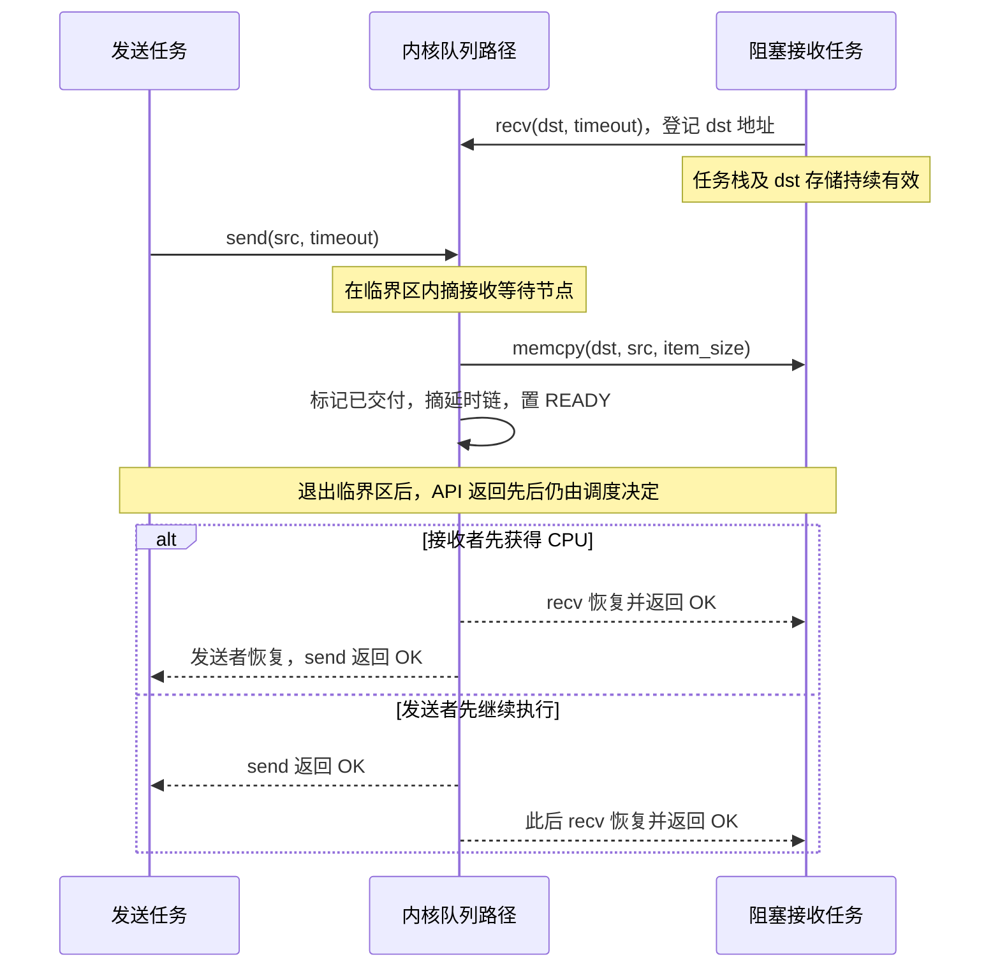

</details>

图中的两种返回先后均合法。若接收者优先级更高，它可能在发送者从 send 返回之前已经运行；若发送者继续执行，接收者之后才处理。消息何时完成复制由临界区保证，应用不得依靠这两次返回之间的固定顺序转移未约定的其他资源。

| 存储 | 最短有效期 | 不能由内核自动完成的事 |
|---|---|---|
| queue 对象及 storage | 覆盖全部使用者及尚在途调用 | 不能靠 deinit 成功证明全部裸指针已撤销 |
| 发送 item | 整个 send 返回前有效、内容稳定 | 阻塞时不会提前为发送者制作私有源副本 |
| 接收 item | 整个 recv 返回前有效且不被并发访问 | 不能检查目标数组真实容量或代管栈寿命 |
| 元素中的指针所指数据 | 由业务约定，通常到消费完成并归还 | 队列只复制指针值，不做引用计数、归还或失败释放 |

局部 item 在自身阻塞调用中可以保持有效，因为该任务的栈仍存在；风险在于函数已经返回、任务被删除或其他执行者提前覆盖同址缓冲。指针消息成功发送后何时允许生产者复用数据，必须通过消费确认或明确的池归还协议决定，不能只看 send 已经 OK。

关闭队列前，应停止所有新的任务/IRQ 发送，按业务协议排空或丢弃已接纳消息并归还其中资源，再解除等待和销毁对象。`queue_deinit` 唤醒发送和接收等待者并清 initialized，但保留 count、索引和 storage，也不会遍历指针消息逐条调用析构。

## 8.5 设计分析

队列将内容复制、容量背压、优先级候选和统一超时清理结合在一个对象内。适合短定长消息和描述符，不提供 Peek，也不依据消息内容自动排序。大对象按值发送会拉长临界区；改成指针降低复制成本之后，生命周期复杂度会转移到应用，而不会消失。

### 队列 API 使用清单

| API | 关键选择 | 返回值与输出处理 |
|---|---|---|
| `rtos_queue_init` | 明确元素字节数、条数和实际 storage | 非法参数为 PARAM；有存活等待者为 ALREADY；不清 payload |
| `rtos_queue_send` | 任务按背压选择有限等待，ISR使用NO_WAIT | OK表示接纳；满队不等为TIMEOUT；失败不释放指针消息所指数据 |
| `rtos_queue_recv` | 任务有限等待或永久服务，ISR仅NO_WAIT | 只有OK时输出是本次新消息；空队/超时为TIMEOUT |
| `rtos_queue_get_count/free` | 观察容量及趋势 | 无锁即时值，不验证初始化、不预留；两次查询不是原子联合快照 |
| `rtos_queue_deinit` | 中止仍登记的发送/接收等待 | 不清storage、不析构消息；先协调使用者与数据归还 |

### 基础用例：按值传递与合法 ISR 发送

下例 [ipc.c](ai/examples/ipc.c) 使用静态 4 元素 storage 和 uint32_t 元素，发送局部 sample 时 NO_WAIT，复制在函数返回前完成。初始化封装必须先成功；所有示例函数名均为应用示例接口。

<!-- example-function: ai_example_prepare_queue -->

```c
rtos_status_t ai_example_prepare_queue(void)
{
    return rtos_queue_init(&sample_queue, queue_storage,
        (uint32_t)sizeof(queue_storage[0]), 4U);
}
```

<!-- example-function: ai_example_queue_roundtrip -->

```c
rtos_status_t ai_example_queue_roundtrip(uint32_t sample, uint32_t *received)
{
    if (received == NULL) {
        return RTOS_ERR_NULL;
    }
    rtos_status_t status = rtos_queue_send(&sample_queue, &sample,
        RTOS_NO_WAIT, RTOS_FALSE);
    if (status != RTOS_OK) {
        return status;
    }
    uint32_t result = 0U;
    status = rtos_queue_recv(&sample_queue, &result, RTOS_NO_WAIT);
    if (status == RTOS_OK) {
        *received = result;
    }
    return status;
}
```

`queue_roundtrip` 只演示顺序调用 send/recv 和失败时不更新输出，不是并发 RPC。必须在队列原本为空且无其他生产/消费者的独占示例条件下，才可期待取回刚发送的 sample；真实共享队列中，别人可能先发送或取走消息，需要请求标识及独立响应协议。

<!-- example-function: ai_example_queue_send_from_irq -->

```c
rtos_status_t ai_example_queue_send_from_irq(uint32_t sample)
{
    return rtos_queue_send(&sample_queue, &sample, RTOS_NO_WAIT, RTOS_FALSE);
}
```

IRQ 封装只传播非阻塞发送状态。调用方须记录满队拒收或通知任务执行节流，不能在 ISR 中无限重试等待消费者。默认逻辑优先级 0–4 的 IRQ 不因为封装名含 irq 就被允许调用它。

### 业务用例：输入、有限等待背压与结果读取

下面的 [handbook.c](ai/examples/handbook.c) 将长期静态队列、共享结果及同步对象组合成一个应用层数据流程。它只允许启动前独占初始化一次，不支持运行中销毁或重新配置。任一步初始化失败即停止启动：调用者不得启用输入 IRQ、调用 rtos_start 或重试本例初始化；它没有回滚已建对象/任务的动态恢复协议。ready 标志只在启动前发布，此后不再修改，因此不用于演示运行中的无锁状态切换。

初始化成功后，任务生产者有限等待并处理失败；ISR 入口只做非阻塞投递；消费者收到消息后在 mutex 内写入一致结果；读取方依据返回值取得快照。这些函数不是内核新增功能，也不是把默认 main 改成了该业务。

<!-- example-function: ai_example_handbook_pipeline_init -->

```c
rtos_status_t ai_example_handbook_pipeline_init(void)
{
    if (handbook_has_init_attempted) {
        return RTOS_ERR_ALREADY;
    }
    /* Startup is one-shot. On failure do not enable sources/start the scheduler or retry init. */
    handbook_has_init_attempted = true;
    rtos_status_t status = rtos_queue_init(&handbook_queue, handbook_storage,
        (uint32_t)sizeof(handbook_storage[0]), HANDBOOK_QUEUE_CAPACITY);
    if (status != RTOS_OK) {
        return status;
    }
    status = rtos_mutex_init(&handbook_result_mutex);
    if (status != RTOS_OK) {
        return status;
    }
    status = rtos_event_init(&handbook_events);
    if (status != RTOS_OK) {
        return status;
    }
    status = rtos_task_create_static(&handbook_consumer, handbook_consumer_stack,
        HANDBOOK_STACK_WORDS, handbook_consumer_task, NULL, 10U, "book-consumer");
    if (status == RTOS_OK) {
        /* No concurrent caller exists yet. This flag stays immutable after scheduling starts. */
        handbook_is_ready = true;
    }
    return status;
}
```

<!-- example-function: ai_example_handbook_publish -->

```c
rtos_status_t ai_example_handbook_publish(uint32_t sequence, int32_t sample)
{
    if (!handbook_is_ready) {
        return RTOS_ERR_SCHED;
    }
    handbook_message_t message = {sequence, sample};
    /* The stack message stays alive until the potentially blocking send returns. */
    return rtos_queue_send(&handbook_queue, &message, 10U, RTOS_FALSE);
}
```

<!-- example-function: ai_example_handbook_publish_from_isr -->

```c
rtos_status_t ai_example_handbook_publish_from_isr(uint32_t sequence, int32_t sample)
{
    if (!handbook_is_ready) {
        return RTOS_ERR_SCHED;
    }
    handbook_message_t message = {sequence, sample};
    return rtos_queue_send(&handbook_queue, &message, RTOS_NO_WAIT, RTOS_FALSE);
}
```

<!-- example-function: handbook_consumer_task -->

```c
static void handbook_consumer_task(void *argument)
{
    (void)argument;
    for (;;) {
        handbook_message_t message;
        rtos_status_t status = rtos_queue_recv(&handbook_queue, &message, RTOS_WAIT_FOREVER);
        if (status != RTOS_OK) {
            handbook_mark_failure();
            rtos_task_delay(1U);
            continue;
        }
        status = handbook_store_result(&message);
        if (status != RTOS_OK) {
            /* The message has been consumed; this hint does not claim successful processing. */
            handbook_mark_failure();
            rtos_task_delay(1U);
            continue;
        }
        /* Repeated completions coalesce into a state bit; results are read under the mutex. */
        (void)rtos_event_set(&handbook_events, AI_EXAMPLE_HANDBOOK_RESULT_READY);
    }
}
```

<!-- example-function: ai_example_handbook_read_result -->

```c
rtos_status_t ai_example_handbook_read_result(ai_example_handbook_result_t *result)
{
    if (result == NULL) {
        return RTOS_ERR_NULL;
    }
    if (!handbook_is_ready) {
        return RTOS_ERR_SCHED;
    }
    rtos_status_t status = rtos_mutex_take(&handbook_result_mutex, 10U);
    if (status != RTOS_OK) {
        return status;
    }
    ai_example_handbook_result_t snapshot = handbook_result;
    status = rtos_mutex_give(&handbook_result_mutex);
    if (status != RTOS_OK) {
        return status;
    }
    if (snapshot.processed_count == 0U) {
        return RTOS_ERR_TIMEOUT;
    }
    *result = snapshot;
    return RTOS_OK;
}
```

该示例采用简单丢弃式背压：publish 失败由生产者跳过本次样本，不无限重试；ISR 封装将拒收状态返回调用方，由调用方落实记录或节流。消费者已从队列接纳消息后，若结果锁操作失败，仅置错误状态提示，不伪装为业务成功；处理计数在 UINT32_MAX 饱和。RESULT_READY 是会合并的状态位，不是逐条完成日志。

read_result 取得的是最新受保护结果快照，不保证与某次 publish 一一对应；尚未产生结果时本应用封装返回 TIMEOUT，失败时不改调用者输出。需要无损传输、每请求响应或重放时，必须增加确认、重试与持久存储等明确协议，不能直接把该教学示例当作这些保证的实现。

业务评价应分开统计尝试数、成功接纳数、拒收/超时和消费完成数。持续输入超过消费能力时，加深队列只能推迟满队，不能提高稳态处理能力；需要限速、合并可替代数据、丢弃策略或增加实际服务能力。

| 常见反例 | 后果 | 正确处理 |
|---|---|---|
| 用字节数作为capacity，或用元素数作为item_size | 复制范围、容量和索引与实际数组不符 | 以元素sizeof与实际条数初始化并检查返回 |
| get_free>0后假定send一定成功 | 别的生产者可能先占位 | 检查send结果并落实背压 |
| 指针消息失败后假定内核已归还缓冲 | 泄漏或所有权不明 | 失败由原拥有者回收；成功后按消费协议转移 |
| recv失败却继续使用旧输出变量 | 把旧数据重复当作新消息 | 仅OK分支消费输出，失败走恢复或继续等待 |
| 反复to_front插入所有“重要消息” | 原消息可能长期推迟 | 限制紧急流量，必要时分队列并定义服务配额 |

---

# 第九章 事件标志组

事件组解决“若干条件中任一个或全部成立时继续工作”的问题。例如配置就绪与标定完成要同时成立才能启动控制任务，任一故障位成立便应触发检查。它表示状态集合，不计数同一位发生了多少次，也不自动保存每次事件所携带的数据。

事件位与等待模式是两个参数：ANY/ALL 指定判定方式，CLEAR_ON_EXIT 位于 mode 的 bit24。该模式位不是 event->bits 中必须占用的一个内部业务位。头文件约定应用用低24位；当前uint32_t实现没有掩码或拒绝高8位，也没有可调事件位数宏，不能将这一实现遗漏宣传为已定义的32位扩展接口。

精确接口见 [rtos_event.h](../RTOS/Core/Inc/rtos_event.h) 和 [事件组契约](ai/contracts_ipc_memory.md#事件组)，实现见 [rtos_event.c](../RTOS/IPC/rtos_event.c)。

## 9.1 rtos_event_wait(bits, mode, timeout)

等待条件按当前事件集合与 wait_bits 计算：ANY 为至少一个交集位非零，ALL 为交集恰好覆盖整个 wait_bits。ALL 检查的是同一时刻保留的位集合，不会记住已经被其他等待者清掉的历史到达。

| 存储位置 | 等待时承载的内容 | 恢复前由谁写结果 |
|---|---|---|
| `event->bits` | 当前保留事件位 | set/clear 与成功消费路径 |
| `event->wait_head` | 按有效优先级排序的等待节点 | 等待登记、成功、超时和取消路径维护 |
| `wait_node.transfer_size` | 等待掩码 | 本次 wait 登记时写入 |
| `wait_node.wake_tick` | 等待模式 | 本次 wait 登记时写入，不是调度到期时刻 |
| `wait_node.transfer_buf` | 清位前成功快照或超时快照 | set 或内部 timeout 捕获钩子；不是可解引用的缓冲指针 |
| `tcb->wake_tick` | 真正的有限到期 tick | sched_block 与延时链使用 |

这些字段属于内核的受控复用，不是应用可自行扩展的协议。特别是事件等待参数不借用 task notify_value，避免通知到达时覆盖事件条件或结果。

```text
1. NULL、未初始化、wait_bits=0 → 返回0。
2. mode 除bit0和CLEAR_ON_EXIT外含其他位 → 返回0。
3. ISR只能NO_WAIT；要求阻塞则返回0；仍有系统调用优先级断言。
4. 进入临界区，复查initialized；失效则返回0。
5. 条件已满足：保存全部实际bits；若要求CLEAR则清整个wait_bits；返回快照。
6. 未满足且NO_WAIT：返回当前全部bits，不清位。
7. 需要阻塞但block_permitted不允许：返回0，不入链。
8. 初始化任务等待节点、模式和timeout钩子；按优先级入对象链。
9. sched_block另行登记有限时间，schedule选择候选；退出临界区后切出。
10. 恢复后从自己的wait_node读取快照，不再读取event对象。
```

成功时保存的是清位前的真实集合，不通过 OR wait_bits 虚构未置位条件。ANY+掩码0x3遇到真实集合0x1时，返回可以是0x1，不应把0x2也报为到达。

有限超时路径在对象链仍受保护时调用 `event_capture_timeout` 捕获 bits，再摘对象链。恢复时即使对象已 deinit/复用，仍只读 TCB 快照，避免重新解引用旧对象。捕获钩子是固定的内核动作，不能拿来运行用户业务回调。

## 9.2 rtos_event_set(bits)

```text
1. 检查指针与初始化，执行ISR优先级断言；进入临界区并复查初始化。
2. event->bits |= 本次置位掩码。
3. 按有序等待链依次检查每个节点；提前保存next，因为当前节点可能脱链。
4. 若满足该节点的ANY/ALL条件：
   保存此时全部bits为该等待者的成功快照；
   请求CLEAR则立即清除其整个wait_bits；
   摘节点，写OK及快照，撤销有限超时并使任务就绪。
5. 后续节点用已经可能被清除的当前bits重新判断。
6. 返回最终剩余event->bits，不是所有等待者都观察到的统一快照。
```

**逐等待者消费**是该实现最需要明确的语义。H、L 都等 bit0 且 H 更高，两者都请求CLEAR：一次set先满足H并清bit0，L继续等；H不清而L清时，两者可能都满足。不清位且满足同一状态的多个等待者可以都被唤醒，但不能把所有组合概括为广播同一冻结快照。

set 与 timeout 由临界区串行：set先满足则节点脱离两链并保留成功快照；timeout先捕获则节点已经离开事件链，随后set不能再改变该调用的返回快照。调用者拿到的是裁定时刻的状态，不是恢复运行这一时刻的最新状态。

`rtos_event_clear` 只执行清位并返回清除后的集合，不遍历或唤醒任务。clear 可以使某个尚未满足的ALL等待继续等，但不会追溯撤销已经保存给READY任务的成功快照。位清除策略必须由应用协调，否则一个消费者的清位会改变另一个消费者的条件。

## 9.3 返回快照与条件判断

event_wait 返回完整位集合，不是状态码，也不只返回本次匹配位。ANY 应判断 `(result & wait_bits) != 0`；ALL 应判断 `(result & wait_bits) == wait_bits`。一个与等待掩码无关的非零位，不能证明ANY或ALL成功。

| 返回路径 | 返回内容 | 清位行为 |
|---|---|---|
| 立即满足或被set满足 | 该次满足时的清位前完整快照 | 仅请求CLEAR时清整个wait_bits |
| NO_WAIT未满足 | 检查时的完整集合 | 不清位，即使模式包含CLEAR |
| 有限超时 | 到期捕获时的完整集合 | 不执行成功消费清位 |
| 参数、mode、上下文或阻塞条件拒绝 | 零 | 无成功条件消费 |
| deinit或挂起中止仍登记的等待 | 零 | 没有新增成功消费；deinit保留对象原bits |

零可表示合法无匹配、超时、取消、非法参数或对象失效，接口没有独立reason输出，不能一律翻译成超时。需要区分原因的业务，应将生命周期/停止状态放入另一个明确定义的协议；不要伪造不存在的 event 状态码。

init 首次可用未清零存储，有登记等待者时拒绝重建；无等待者时重新 init 会清掉全部事件位。deinit 使未完成等待脱链并返回零，保留 bits；get 不验证初始化，deinit 后仍可能读到旧集合，不能用于判断对象有效。已经由set完成且READY的等待不因随后挂起或deinit而自动改成零。

### 事件组 API 使用清单

| API | 目的 | 关键处理 |
|---|---|---|
| `rtos_event_init` | 创建空事件集合 | NULL为NULL错误；有等待者为ALREADY；成功后原位集合被清空 |
| `rtos_event_set` | 新增条件并检查等待者 | 返回消费后的最终集合；可能为零但已经唤醒任务 |
| `rtos_event_clear` | 主动撤销状态位 | 返回清除后集合，不负责唤醒或撤销已完成等待 |
| `rtos_event_wait` | ANY/ALL、可选成功清位与等待 | 根据原掩码和模式判断结果，不以非零代替匹配 |
| `rtos_event_get` | 观察当时位集合 | 不预留位，不验证初始化，不构成完成屏障 |
| `rtos_event_deinit` | 中止未完成等待并清初始化标志 | 不释放对象，不能证明所有使用者已退出 |

### 正确使用步骤与实际例子

[ipc.c](ai/examples/ipc.c) 的下面三个封装使用静态事件对象，掩码为0x3，等待模式为ALL+CLEAR，预算为10tick。初始化应在启用IRQ前成功完成；合法ISR置位；任务必须以返回值与0x3的交集是否完整来判定两个条件都成立。

<!-- example-function: ai_example_prepare_event -->

```c
rtos_status_t ai_example_prepare_event(void)
{
    return rtos_event_init(&sample_event);
}
```

<!-- example-function: ai_example_set_event_from_irq -->

```c
rtos_event_bits_t ai_example_set_event_from_irq(void)
{
    return rtos_event_set(&sample_event, 3U);
}
```

<!-- example-function: ai_example_wait_event -->

```c
rtos_event_bits_t ai_example_wait_event(void)
{
    return rtos_event_wait(&sample_event, 3U,
        RTOS_EVENT_WAIT_ALL | RTOS_EVENT_CLEAR_ON_EXIT, 10U);
}
```

示例ISR一次置0x3只演示接口。真实业务若由两条独立路径分别置bit0/bit1，应明确条件是可保留状态还是一次性发生；如果其他消费者会清位，ALL可能持续无法满足。若要求两个任务都看见每次到达，可用各自通知或显式带序号确认协议，而不能随意给所有等待者加CLEAR。

| 常见反例 | 后果 | 正确处理 |
|---|---|---|
| `result != 0`就开始ALL业务 | 无关位或部分位也可能非零 | 与原等待掩码进行ALL覆盖判断 |
| 把set返回0当作“没有唤醒” | 位可能已被成功等待者消费 | set返回的是最终剩余集合，不是唤醒数量 |
| 每次数据到达都set同一位，期望次数被保存 | 多次到达合并成一个状态 | 用计数或队列承载每次独立数据 |
| 所有订阅者都CLEAR并期望同次广播 | 先到候选清位影响后续候选 | 设计清位责任、订阅确认或独立通知 |
| deinit后get非零就继续使用对象 | getter可能返回旧bits且不查initialized | 以外部生命周期协议决定对象可用性 |

---

# 第十章 软件定时器

软件定时器解决“到某个内核时间后执行一小段任务级处理”的需求。delay挂起调用任务，
timer则把回调集中交给一个服务任务。它不等于硬件定时器：到期判断依赖内核tick，
实际执行还要等服务任务获得CPU。精确采样边沿、脉冲或严格时限不能仅靠缩小软件period实现。

本章核对[rtos_timer.c](../RTOS/Services/rtos_timer.c)和[rtos_timer.h](../RTOS/Core/Inc/rtos_timer.h)。
逐项签名见[定时器API契约](ai/contracts_services_usb.md#api-rtos_timer_create)。

## 10.1 架构: 服务任务串行处理控制与回调

### 10.1.1 为什么引入命令队列

普通任务或合法syscall域ISR可能同时请求启动、停止和修改周期。如果每个调用者都直接
遍历活跃链，链表更新与回调派发需要更多跨上下文协调。当前实现将请求复制为小命令，
让唯一服务任务处理；对外并发提交不等于多任务并发执行回调。

```text
任务 / 合法 ISR
    start / stop / change_period / delete
        ↓ { 命令类型, timer指针, 新周期, generation }
    16条命令队列
        ↓ 唤醒服务任务，或等到最近timer到期
    TIMER：处理命令 → 更新活跃链 → 在任务上下文派发回调
```

命令队列长度是实现常量`TIMER_CMD_QUEUE_LEN=16`。默认服务任务优先级30、栈256个
32位字，参数来自rtos_config。优先级数值越小越高，30是较低优先级，不能从配置注释
“建议较高”推断它可以抢占控制任务。持续就绪的高优先级任务会推迟所有回调。

`rtos_init()`仅在`RTOS_CONFIG_USE_TIMERS=1`时自动调用`rtos_timer_init()`；当前timer源
没有整体编译开关，宏0只是不自动初始化，不等于移除API。手动使用者应在初始化阶段显式
初始化子系统。重复成功init返回`RTOS_ERR_ALREADY`且保留现状；首次失败仍允许有效重试。

### 10.1.2 三种存储的不同所有权

| 存储 | 内容 | 归属及寿命 |
|---|---|---|
| `rtos_timer_t` | 状态、mode/period/expire、回调/参数/name、generation、next/prev | 调用方提供；内核借用地址，不负责free |
| 命令队列元素 | type、timer指针、new_period、generation | 命令按值复制；所指对象没有被复制 |
| 活跃链 | 按相对当前tick的到期先后排序的双向节点 | 服务任务临界区内维护；插入O(T)，已知节点摘除O(1) |
| 当前回调标记 | `s_callback_timer` | 防止已摘链但回调未结束的对象被create覆盖 |
| TIMER的TCB/栈及队列数组 | 模块内static对象 | 与子系统同寿命，不依赖通用heap |

`name`和`arg`保存指针，不能使用随后失效的局部字符串/结构。任务名称复制入TCB的
规则不能照搬到timer。应用不得读改next/prev、generation及状态标志来控制定时器。

### 10.1.3 API与“成功”的含义

| API | 输入/用途 | 成功含义 |
|---|---|---|
| `rtos_timer_init()` | Thread启动阶段建立服务 | 队列与服务任务初始化成功 |
| `rtos_timer_create()` | 对象、name、callback、arg、tick周期、模式 | 建立停止对象；不会自动start |
| `rtos_timer_start()` | 启动/重启 | 普通调用只是命令被接受，尚未保证执行 |
| `rtos_timer_stop()` | 停止未来派发 | 命令被接受，已进入回调不被撤销 |
| `rtos_timer_change_period()` | 更新tick周期 | 命令被接受；停止对象不因此启动 |
| `rtos_timer_delete()` | 逻辑删除 | 命令被接受，不是存储回收屏障 |

create/change_period只接受`1..0x7FFFFFFF` tick；0及更大值返回参数错误。这里没有
“0表示立即回调”“FOREVER表示不触发”的语义。外部任务投递最多等100 tick，ISR强制
NO_WAIT；因此控制API本身也可能因队列满而失败或等待，不适合放在外层临界区内。
100 tick是发送等待预算，不包含服务任务获得CPU或执行命令的延迟，返回值必须检查。

## 10.2 服务任务循环与回调重入

### 10.2.1 每轮只持有一个到期节点

```text
① 临界区：摘一个到期对象，保存previous_expire，登记当前回调对象
② 临界区外：callback(arg)
③ 临界区：判断是否续期，清回调标记；消费回调期间已到达的控制命令
④ 若刚有回调，重新检查到期链；否则重算最近到期剩余tick
⑤ queue_recv(剩余tick)，命令到达或超时后继续
```

不能把多个到期对象借next串为临时链后逐个回调，因为回调中的start/stop/delete本来
就会改这些next/prev。逐个摘取可避免遍历所用链接被回调污染。每次回调后也消费控制命令，
防止密集短周期回调把stop/delete持续饿死。

无活跃timer时服务任务永久等命令，有活跃timer则按最近到期时间等；它没有每tick扫描
全部timer，也没有为每个timer另建任务。链首到期检查O(1)，但完整服务成本还含有序插入、
用户回调及命令处理，不能把整个模块写成常数时间。

### 10.2.2 周期推进与错过相位

周期对象从`previous_expire + period`推进。period=10、上一到期为100时，回调在102结束
则下一次为110而不是112；若135才结束，则跳到140，不连续补发110/120/130。这样避免
回调耗时逐轮变成漂移和追赶风暴，但错过次数不会自动补齐，需要无损计数的业务应另设账本。

到期比较采用32位带符号差值和有限半范围，链排序以同一个当前tick作为比较基准；
正常tick跨零不导致系统结束。服务任务被饿死任意久、间隔超过算法半范围后，不能继续
假定仍可精确重建全部相位，这与正常回绕是两个问题。

### 10.2.3 回调内控制与阻塞的代价

只有“Thread且当前TCB就是TIMER”时，timer控制命令才在临界区就地执行，避免服务任务
向自己的满队列发送后等唯一消费者自己。ISR打断TIMER时仍走ISR队列路径，不仅凭current_tcb判断。

回调在临界区外，执行环境允许任务级阻塞调用，但会挂起整个服务任务，拖延其他回调和
外部命令。工程上让回调仅做有限短操作或尝试投递工作，长运算、打印、外设等待交给独立任务。
非阻塞投递也可能失败，必须定义丢弃/合并/错误统计策略；定时到达不等于业务已经完成。

## 10.3 timer_handle_cmd 的四种命令

| 命令 | 原状态 | 生效动作 | 重要后果 |
|---|---|---|---|
| START | 活跃或停止 | 若在链先摘；清停用标记；expire=处理时刻+period，再入链 | 重复start重计时；起点不是API入口时刻 |
| STOP | 活跃 | 摘链，置deactivated | 不会中断已经运行的回调 |
| STOP | 回调中已摘链 | 置deactivated，收尾不重插 | active=0时不能当作无事可做 |
| CHANGE_PERIOD | 活跃 | 摘链、改period、从当前tick重计时 | 改变当前相位 |
| CHANGE_PERIOD | 停止/已摘链 | 仅改period | 不隐式start，回调收尾另判续期条件 |
| DELETE | 任意有效状态 | 如在链则摘；清initialized、置deactivated | 逻辑失效不等于存储无人访问 |

命令在临界区串行生效；多个独立API调用不构成应用事务。有多个控制者时，应明确谁能
启动/停止/删除，不能靠“它们都用了临界区”推断一组操作不会被其他命令插入。

## 10.4 删除、代次与对象寿命


<details><summary>图形源码（mermaid）</summary>

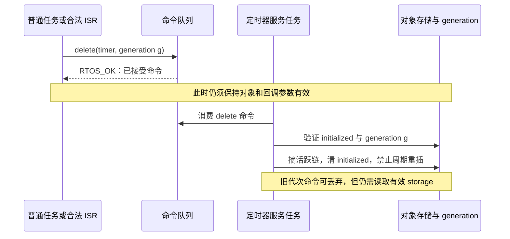

</details>

### 10.4.1 generation保护有效地址上的逻辑代次

每次create分配非零32位generation；服务执行命令前检查对象仍初始化且代次相同，
拒绝同一地址上旧DELETE误删新对象。代次本身有限回绕，并非永不重复的全局身份。
检查还必须解引用对象：已free或栈已返回时，读取generation本身就是风险，不能作为
内存回收、任意野指针或其他对象族的通用旧句柄保护。

### 10.4.2 没有完成确认就不能回收存储

外部delete返回OK时命令可能仍在队列中，回调也可能已进入或阻塞。回调内自删就地
清状态后，服务循环在回调返回时仍访问节点。当前没有delete-and-join接口，禁止在回调
里free自身timer，或在外部delete返回后立即释放timer/name/arg。

基础用法采用子系统同寿命的static对象。动态业务关停应先停止新的控制者和输入，
建立回调不再引用业务资源的应用确认协议；不能靠轮询内部标志或随意delay就宣称完成。

### 10.4.3 API样例：短回调与静态周期对象

[完整翻译单元](ai/examples/timer.c)的`sample_timer`和`callback_count`为文件static，
以下片段须连同文件级声明及`ai_examples.h`使用。回调只有TIMER一个写者；volatile不是
多写者同步。初始化顺序为timer子系统成功→prepare一次→检查结果→按需start，100为tick。

<!-- example-function: timer_callback -->

```c
static void timer_callback(void *argument)
{
    volatile uint32_t *count = (volatile uint32_t *)argument;
    if (count != NULL) {
        /* The service task is the sole writer; no blocking work is done here. */
        (*count)++;
    }
}
```

<!-- example-function: ai_example_prepare_timer -->

```c
rtos_status_t ai_example_prepare_timer(void)
{
    /* rtos_init auto-initializes timers only when USE_TIMERS is enabled.
     * Otherwise the caller must explicitly initialize the timer subsystem. */
    return rtos_timer_create(&sample_timer, "ai-timer", timer_callback,
        (void *)&callback_count, 100U, RTOS_TIMER_PERIODIC);
}
```

<!-- example-function: ai_example_start_timer -->

```c
rtos_status_t ai_example_start_timer(void)
{
    return rtos_timer_start(&sample_timer);
}
```

<!-- example-function: ai_example_stop_timer -->

```c
rtos_status_t ai_example_stop_timer(void)
{
    return rtos_timer_stop(&sample_timer);
}
```

<!-- example-function: ai_example_request_timer_delete -->

```c
rtos_status_t ai_example_request_timer_delete(void)
{
    /* Both callback argument and timer object remain alive after this returns. */
    return rtos_timer_delete(&sample_timer);
}
```

start/stop/delete返回状态必须处理。示例保留对象和参数，不演示异步删除后的存储释放。

## 10.5 设计分析

一个服务任务换取统一执行上下文和链表所有权，相位递推降低漂移，generation降低陈旧
命令风险；代价是串行回调、队列背压、借用存储和O(T)插入。适合后台节拍及超时工作，
不适合把长事务直接塞进回调或把命令接受当完成。验证应包括满队列、回调内重启/停用/自删、
服务被ISR打断、错过周期及同址重建，不能只观察每秒打印。

---

# 第十一章 内存管理

heap满足变长请求，固定pool满足固定尺寸借还，静态数组则直接由应用决定布局；它们
只管理存储，不管理跨任务交付和业务完成。动态task_create仍分配heap，static版本使用
调用方TCB/栈，USE_STATIC_ALLOCATION当前不切换这两条实际路径。

## 11.1 动态堆: first-fit + 前向合并 (32KB 静态缓冲)

### 11.1.1 布局与物理块扫描

默认堆数组32KiB、整体8字节对齐，不依赖标准库malloc。每块头8字节：magic和size，
size高位为空闲标志，其余为包含头的块总大小。下一块由本块地址+总大小定位。


<details><summary>图形源码（mermaid）</summary>

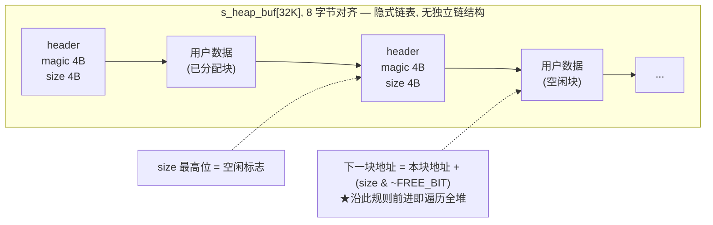

</details>

没有单独只收集空闲块的链，因此first-fit经过已分配和空闲块。复杂度O(K)的K是全部
物理块数，不能沿用旧头注释“O(空闲块数)”。只有一个空闲块时也可能先经过很多已分配块。

### 11.1.2 分配、切分和真实占用

1. 拒绝未初始化、size=0和对齐算术会溢出的过大输入。
2. 计算`need=max(16, align8(size)+8)`。
3. 临界区扫描magic/大小，选择首个足够大的空闲块。
4. 仅当剩余至少24字节时分裂新块，否则整块交付，尾部成为内部浪费。
5. 新块头从空闲payload账目扣8字节，再扣交付payload，记录成功次数。
6. 返回头后8字节对齐地址；没有合适块返回NULL，不等待其他任务free。

请求1字节最少占16字节块，请求33字节通常占48字节，整块不分裂时还可能更多。任务
TCB与栈是两个独立请求，要同时预算块头、对齐和连续块约束，不能只将stack_words×4
与总空闲量比较。

### 11.1.3 释放和合并只做有限防御

free(NULL)无操作；范围、头magic和FREE位检查通过后标空闲，最多与下一高地址空闲块
合并一次，回收该头8字节。没有后向寻找，也不循环吞并整个空闲段，释放顺序会影响块形状，
不能称作完整相邻合并或保证无碎片。

只允许free本分配器返回的原始首地址一次，禁止块内地址、pool块、标准malloc指针、
静态数组或已归还指针。free为void，拒绝非法输入不提供可诊断状态；magic等防御不证明
任意地址都安全，也不替应用检查越界写、访问寿命或所请求字节数。

### 11.1.4 公共API与使用例程

| API | 用途 | 边界 |
|---|---|---|
| `rtos_heap_init` | 启动初始化，重复已初始化返回OK | 不是运行时整理或重置 |
| `rtos_heap_alloc(size)` | 请求字节，返回指针/NULL | 无等待；建议低频任务路径 |
| `rtos_heap_free(ptr)` | 归还原指针，NULL可传 | 不清payload、不确认业务用户已结束 |
| `rtos_heap_get_free` | 总空闲payload | 不等于最大连续可分配空间 |
| `rtos_heap_get_max_alloc` | 当前最大单请求payload对齐上界 | 查询不保留后续分配资源 |
| `rtos_heap_get_alloc_count/free_count` | 累计成功次数 | uint32回绕；次数相等不证明所有权正确 |

alloc/free/max查询允许符合syscall优先级的IRQ进入，但扫描临界区会延迟可屏蔽中断，
优先用于任务。初始化不得与运行并发，多次统计读取也不构成原子快照。

[完整示例](ai/examples/memory.c)将分配、使用和释放放在同一调用中，只成功时写输出。
跨函数或跨任务转移时须先明确最终free者，不能入队指针后立即free。

<!-- example-function: ai_example_heap_use -->

```c
rtos_status_t ai_example_heap_use(uint32_t bytes, uint32_t *last_byte)
{
    if (last_byte == NULL) {
        return RTOS_ERR_NULL;
    }
    if (bytes == 0U) {
        return RTOS_ERR_PARAM;
    }
    uint8_t *buffer = (uint8_t *)rtos_heap_alloc(bytes);
    if (buffer == NULL) {
        return RTOS_ERR_NO_MEM;
    }
    memset(buffer, 0x5A, (size_t)bytes);
    uint32_t value = (uint32_t)buffer[bytes - 1U];
    rtos_heap_free(buffer);
    *last_byte = value;
    return RTOS_OK;
}
```

源码：[rtos_heap.c](../RTOS/Memory/rtos_heap.c)；[逐项契约](ai/contracts_ipc_memory.md#api-rtos_heap_alloc)。

## 11.2 固定块内存池: 分配 O(1)，释放 O(n)

### 11.2.1 空闲块复用指针与完整成本

调用方提供pool描述符和连续storage，块尺寸相同。空闲时头几个字节存next，借出后
整块交给应用，没有额外逐块header。alloc只取链首并减计数O(1)；free先有界扫描空闲链
拒绝重复归还，最坏O(block_count)，再入链。不能只数最后入链两次赋值而省略防御成本。

init按索引递增造块、每块挂链首，因此初始首分配为最后一块，地址不保证递增。应用
编号应独立维护，不能按借出次序推断块身份。

### 11.2.2 尺寸与容量责任

当前32位目标有效块长`max(align4(block_size), sizeof(void *))`；33字节变36，不自动
变64。base满足指针类型对齐，实际容量至少为有效块长×block_count。init检查NULL、零、
对齐、乘法和地址加法溢出，但接口不接收实际数组容量，不能验证指针背后真有足够空间。

| API | 返回 | 调用方保证 |
|---|---|---|
| `rtos_mempool_init` | OK/参数错误 | 初始化阶段、足够storage、描述符与base寿命 |
| `rtos_mempool_alloc` | 块首地址/NULL | pool已初始化；借出块由调用方独占或按业务协议共享 |
| `rtos_mempool_free` | OK、NULL/参数错误、ALREADY | 正确pool的精确块首；归还后停止访问 |
| `rtos_mempool_get_free` | free_count，NULL为0 | 瞬时查询，不预留块 |

free检查范围/边界、重复归还、链扫描上界及满计数异常；不检查是否还有业务引用，也
不清敏感数据。在用块未全部停用时禁止重新init，当前会直接重建空闲链，没有活跃借用守卫。

### 11.2.3 观察表对描述符寿命的影响

init会调用perf_register_pool，把descriptor指针借给观察表；没有unregister/deinit。
即便块全归还，局部pool对象返回后仍可能被get_memory访问。因此descriptor宜static，
storage至少保持到最后使用者结束。观察表默认8槽，满后静默不再登记，不阻止新pool的
alloc；资源能用和统计可见是两件事。

### 11.2.4 API样例：固定尺寸工作区

[完整文件](ai/examples/memory.c)使用static pool和8字节对齐的4×64字节storage。
prepare只初始化一次，use借一块、写入、归还并返回状态，不演示转交、引用计数或异步free。

<!-- example-function: ai_example_prepare_pool -->

```c
rtos_status_t ai_example_prepare_pool(void)
{
    /* The performance registry can retain &sample_pool for later observations. */
    return rtos_mempool_init(&sample_pool, pool_storage, 64U, 4U);
}
```

<!-- example-function: ai_example_pool_use -->

```c
rtos_status_t ai_example_pool_use(void)
{
    void *block = rtos_mempool_alloc(&sample_pool);
    if (block == NULL) {
        return RTOS_ERR_NO_MEM;
    }
    memset(block, 0x3C, 64U);
    return rtos_mempool_free(&sample_pool, block);
}
```

尺寸变化大、频率低且可容忍碎片时评估heap；固定尺寸和数量上界明确时评估pool；资源
完全静态时直接建数组。三者都不自动维护跨任务缓冲归属。源码见[rtos_mempool.c](../RTOS/Memory/rtos_mempool.c)。

---
# 第十二章 性能监视器

性能监视器回答“任务是否在运行、栈还有多少、窗口内有多少切换”等观察问题，不替
业务定义成功。CPU显示很低、系统一直打印、栈水位暂时充足，都不单独证明消息守恒、
IRQ有进展或未来路径不会溢出。必须先核对统计开关、时基和窗口，再解释数值。

本章依据[rtos_perf.c](../RTOS/Services/rtos_perf.c)、[rtos_perf.h](../RTOS/Core/Inc/rtos_perf.h)
及调度器的实际调用。精确字段和上下文见[性能契约](ai/contracts_services_usb.md#api-rtos_perf_get_system)。

## 12.1 配置与有效指标

### 12.1.1 总开关、热点统计和水印分别控制什么

| 配置 | 默认 | 实际作用 |
|---|---:|---|
| `RTOS_CONFIG_USE_PERF_MONITOR` | 1 | 是否保留perf实现、观察表和接口；关闭后查询为宏化桩 |
| `RTOS_CONFIG_PERF_HOTPATH_STATS` | 0 | 是否在请求/切换热路径调用周期和延迟记账钩子 |
| `RTOS_CONFIG_PERF_STACK_WATERMARK` | 1 | 创建时染A5、查询时扫描栈 |
| `RTOS_CONFIG_PERF_USE_DWT` | 1 | get_cycles采用DWT还是内核tick |

默认总监视器开、热点关。能读DWT、查询栈/内存池，不表示CPU与调度延迟已经采集。
get_system输出CPU=0、idle=10000是关闭记账的占位值，不是板卡100%空闲证明。
任务switch_count由调度器另外维护，不与perf全局切换总数混为一个计数器。

| 指标 | 热统计关闭 | 热统计开启后仍有的边界 |
|---|---|---|
| uptime、登记任务身份、栈、pool | 仍可查询 | 表容量、对象寿命和计数宽度有限 |
| CPU/idle比例 | 0/10000占位 | 已结算idle周期与墙上周期比，未单独扣除IRQ |
| run_cycles/run_time_us | 没有切换记账，通常为0 | uint32累加；当前运行尾段未在查询时补结算 |
| 全局切换数/频率/派发延迟 | 热钩子未累计 | 合并PendSV请求、窗口变更、回绕影响解释 |
| DWT短区间读数 | 可用 | 32位周期、频率及采样间隔约束 |

总开关0时，完整查询宏返回ERR_PARAM，不填写真实输出；快速查询返回0，内部钩子为空。
某些桩不求值实参，禁止依赖调用实参的副作用；关闭功能后仍检查返回码，不继续显示旧结构。

### 12.1.2 应用查询与内部维护入口

| API组 | 作用 | 使用规则 |
|---|---|---|
| get_system、reset | 管理系统测量窗口 | 一个明确观察者控制节奏，避免互相重置窗口 |
| get_task、get_all_tasks | 填调用方结构/数组 | 处理容量、有效TCB和存储寿命 |
| get_memory | 聚合已登记pool及历史命名任务字段 | 不是整个RAM或通用heap分析器 |
| get_cpu_usage、get_switch_rate | 读上次系统查询缓存 | 不主动更新，可能陈旧 |
| get_cycles、cycles_to_us | 原始时基及换算 | 核对DWT/tick实际单位和短区间前提 |
| init、on_scheduler_start、on_context_switch、on_pend_switch等 | 由内核初始化/记账调用 | 应用不可伪造钩子“修正”统计 |
| task_registry_count、task_at | 内部巡检 | 原始指针不带所有权或寿命锁 |

## 12.2 时基、单位与回绕约束

DWT初始化置DEMCR.TRCENA、清CYCCNT并置CYCCNTENA；目标仍须有相应硬件及可用的启动
环境，不能仅凭地址宏存在就认为计数正确。当前验证目标是F446 Cortex-M4F，其他目标另行适配。

```text
DWT模式：get_cycles → 32位CPU周期数
Tick回退：get_cycles → 内核tick_count，函数名不变但单位改变
短区间差值：uint32后读数 - 前读数
前提：真实间隔短于该32位时基完整周期，测量期间频率口径明确
```

168MHz下DWT约25.565秒一圈。跨零但不到一圈可用无符号减法处理，跨一圈或多圈则无法
只凭两个读数恢复圈数。每tick中断不等于每tick有真实上下文切换；持续运行任务可能违反
这一采样间隔，旧注释“系统不可能25秒无切换”不能作为可靠性前提。

DWT cycles_to_us先取`SystemCoreClock/1000000`整数MHz再除法；固定168MHz符合本工程
口径，非整数MHz、变频及跨频区间须另分析。tick回退用64位中间乘法换算，但精度仍为tick。

uptime_ticks为32位内核tick，uptime_ms用64位中间值换算后仍存uint32；默认1kHz约
49.710天回绕，调度器挂起也冻结普通tick处理。它们不是长期64位RTC。run_cycles和
run_time_us同样有限回绕；长期监控需在采样间隔受控时积累短差值，不能恢复已丢的完整圈。

## 12.3 切换记账与测量误差

### 12.3.1 记账在提交切换时结算

开启热统计后，挂PendSV记录请求周期，提交切换时取now，把距last_switch的delta记给prev，
更新全局切换计数与派发延迟。当前任务尚未切出的尾段不在get_task/get_system内补结算。

```text
请求PendSV：记录pend_cycle
 → 当前任务/嵌套IRQ/异常退出/请求合并
提交切换：now-last_switch记给prev；now-pend_cycle作为一条派发延迟
 → 恢复next现场
查询：使用已经累计的账目，不回溯所有IRQ与业务事件
```

区间中的ISR时间算入当时prev，prev为idle时也影响idle账目；所以不是任务纯C代码时间
或独立IRQ占用分析。多次请求可合并，时间戳可能被后请求更新，派发延迟不是从最早硬件
输入到任务首条业务指令的端到端响应时间。

### 12.3.2 平均值、最大值及观察开销

平均派发延迟用当前窗口sum/count，最大值取累计perf_latency_max；reset仅推进窗口，
不清累计最大值或任务总量。两个字段可能对应不同区间，平均降低而最大不变不必是错误。
有限观测最大值不是WCET证明，必须标明配置、负载、采样窗口及统计本身是否开启。

监视器查询有扫描、除法、拷贝和临界区，观察本身影响调度和中断响应。源码注释中的
“几条指令/几十纳秒”不作为跨编译器、跨配置承诺，实际成本需要当前构建测量。

## 12.4 查询窗口与调用顺序

get_system并非纯只读：填系统快照、更新快速缓存，然后推进全局窗口，还推进所有已登记
任务的perf_window_run_base。两个无协调观察者调用它会互相缩短区间。get_task/get_all_tasks
则读取任务在当前窗口已经结算的量，并不结束窗口。

希望看较长区间时可由一个监控任务按固定节奏先读所需任务，再get_system结束该轮；
这些调用仍非同一瞬间原子快照，不保证任务比例和精确等于系统CPU。先get_system再立即
读任务，任务查询看到的是重置后极短窗口，不是刚结束的旧窗口。

[下面例程](ai/examples/observation.c)先查system再查memory，只演示逐次错误检查，
明确不是每任务CPU同窗采样或全系统事务。

<!-- example-function: ai_example_observe -->

```c
rtos_status_t ai_example_observe(rtos_perf_system_t *system, rtos_perf_memory_t *memory)
{
    if ((system == NULL) || (memory == NULL)) {
        return RTOS_ERR_NULL;
    }
    rtos_status_t status = rtos_perf_get_system(system);
    if (status != RTOS_OK) {
        return status;
    }
    return rtos_perf_get_memory(memory);
}
```

get_all_tasks整个遍历持临界区，保护登记表重排及任务删除/回收，可能在此期间扫描所有
被输出任务的栈。成本随数量与栈长增长，不宜高频无节制全量查询。完整查询主要用syscall
优先级断言约束上下文，不普遍运行时拒绝所有ISR；应用观察放普通任务，不能因未返回ISR错误
就推断任意高IRQ都能使用。快速只读接口虽不修改窗口，但值会陈旧。

## 12.5 观察容量、内存与栈水位

### 12.5.1 观察容量不等于对象分配上限

任务表默认MAX_TASKS+2=18，pool表默认8；表满后任务仍可创建，只是查询不完整。
历史字段task_pool_capacity不是当前静态任务池实际容量。任务删除先扫描再末项补洞，
完整维护仍O(N)；pool注册也扫描去重，不因最后数组赋值一次就变成O(1)。

get_all_tasks最多写max_count条，actual_count是写入数，不是系统全部任务总数。
get_task(NULL)表示当前任务，显式非NULL指针没有普遍登记有效性验证，调用者防止查询前
TCB被删/复用，不能用它探测任意地址。

get_memory只聚合已登记pool的block_size、block_count和free_count，遗漏未登记pool、
通用heap和其他静态RAM；多池累计也有32位范围。descriptor被借用且无unregister，遵守第11章寿命。

### 12.5.2 栈水位反映已经写过的路径

创建时从低地址stack_base到初始top_of_stack之间填A5，查询从底向上找首个非A5，
以总字数减未改写前缀估算用量，包含初始化帧。未执行过的深调用链、未触发异常及恰好写回
A5的数据不能完全预测。关闭水印后按TCB保存的top_of_stack估计，不等于运行任务现场PSP。

任何模式都需预留硬件异常帧、软件保存、FPU及业务调用链。水位不是MPU隔离，也不能
替代边界检查。CPU占位零而业务不进展时，按[调试指南](ai/debugging.md)查屏蔽、等待及
数据不变量，不从一个负载值推断根因。

Idle中的栈巡检依赖idle实际获得CPU；持续就绪的高优先级任务可让巡检迟迟不运行。
开启perf时，按索引遍历受有限任务注册表覆盖，表满后未登记任务不会自动获得同样的观察
覆盖。关闭perf时退化扫描就绪和延时链，永久BLOCKED/SUSPENDED不一定覆盖；不能把两种
配置视为相同巡检范围。任务创建时初始化magic/染料，当前PendSV并没有逐次执行完整栈
溢出检测，不能把某次idle巡检未报错当作全任务全时刻保证。

---

# 第十三章 USB 子系统

本章描述现有CDC/MSC/HID设备集成及RTOS适配。USB是可选上层子系统，不是每个移植必须
带入的内核机制；核心、IPC和通用内存不依赖ST头。描述符、DWC2 FIFO、ST胶水、物理接口
具有目标相关性，必须与内核可移植性分别评估。

公共[rtos_usb.h](../RTOS/Core/Inc/rtos_usb.h)按所有条件分支去重包含38项可调用符号
（含超时内联），另有26项OSAL桥接。业务通常只需初始化和CDC/HID/MSC，不直接操作对象池、
TCB或DCD寄存器。逐项契约见[USB入口](ai/contracts_services_usb.md#api-rtos_usb_init)。

## 13.1 分层架构与一帧数据的旅程

<!-- diagram:inline -->

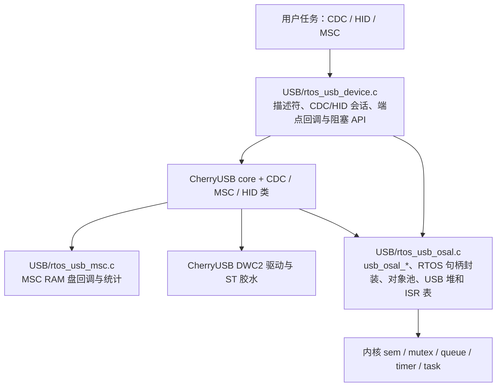

### 13.1.1 CDC接收的数据路径

```text
主机OUT → DWC2 FIFO/IRQ → USBD_IRQHandler → 协议栈端点完成分发
 → CDC OUT回调复制入软件环并更新head → give(rx_sem)
 → 若需要则挂PendSV → 读任务获得CPU → 复制到用户buffer → 返回实际字节数
```

ISR与任务共享的是缓冲和同步状态，IRQ中的复制、协议及控制请求仍占CPU。EP0线程
当前关闭，setup和类控制请求直接走ISR；MSC线程开启，SCSI读写在其任务里，端点硬件事件
和投递仍在ISR。不能把所有USB钩子当作任务函数，也不能笼统承诺固定微秒级IRQ耗时。

### 13.1.2 不同方向使用不同缓冲模型

| 路径 | 当前策略 | 应用后果 |
|---|---|---|
| CDC RX | 默认512字节环，保留1空位；head/tail为uint32原始计数，仅数组访问取模/掩码 | 实际最多511字节；read可拆包/拼包，不以调用次数表示消息 |
| CDC TX | 默认512字节内部区，mutex串行，多块发送 | 用户数据先复制，不是零拷贝 |
| HID RX | 64字节单报告槽 | 旧报告未读时保留旧槽、丢弃新报告；小目标buffer读取前缀后清槽、丢弃旧报告剩余部分 |
| HID TX | 每次最多64字节，独立缓冲/锁/信号 | len>64截断，不像CDC自动分块 |
| MSC | 512字节扇区，默认32KiB静态RAM盘 | 无掉电持久性；统计单位是扇区 |

CDC软件环满时只复制可容纳部分、累计私有rx_dropped并继续挂OUT读取，不是无损背压。
不能因为USB底层具备NAK就断言应用环不会丢字节。产品要用序号/确认/节流和容量预算，
信号量次数不能替代接纳字节账本。

### 13.1.3 完成确认、超时及会话变化

CDC/HID一次发送记录一个起始tick，锁竞争、旧传输及当前完成使用剩余预算，避免多阶段
各等一次完整timeout。超时返回后硬件可能仍用内部发送区，tx_busy使下一次先等待旧事务，
防止覆盖。用户payload已复制，调用返回后不再因该内部传输被借用。

完成回调用done序号推进等待；RESET/DISCONNECTED/CONFIGURED更新session_seq，发送者
拒绝跨会话继续累计。接收者被唤醒后重新查缓冲及connected，RESET清环；这些机制不提供
业务自动重放。发送短计数只统计已确认块，未确认块也可能到达主机，盲目重发整包会重复。
应由业务消息ID和确认协议处理，不能把一次短写当作恰好一次传递保证。

CDC bulk IN回调在非零长度恰为端点MPS整数倍时再发ZLP，待该零包完成才清busy、
递增done序号并give完成信号；不能把第一次数据IN完成等同于整个封装事务完成。HID中断
报告不走这套bulk ZLP收尾，直接更新自己的完成状态。

0或短计数可能来自参数、ISR、未配置、超时、会话改变、锁失败或驱动拒绝，返回值没有
唯一错误原因。不要仅凭0输出“线缆已断开”或“主机未打开端口”的确定诊断。

## 13.2 使用了 CherryUSB 的哪些部分

### 13.2.1 保留的源文件: 6 个 .c + 两组头文件

| CherryUSB相对路径 | 责任 | 当前OSAL消费 |
|---|---|---|
| core/usbd_core.c | 枚举、标准请求、EP0与端点分发 | EP0线程分支存在但关闭 |
| class/cdc/usbd_cdc_acm.c | CDC类控制请求及用户钩子 | 无 |
| class/msc/usbd_msc.c | BOT/SCSI和工作任务 | mq/thread |
| class/hid/usbd_hid.c | HID类请求/报告描述符 | 无 |
| port/dwc2/usb_dc_dwc2.c | 控制器、端点、FIFO与IRQ | 无 |
| port/dwc2/usb_glue_st.c | ST板级和DWC2参数胶水 | 无 |
| common/*.h、各类头、DWC2头 | 协议类型、描述符、OSAL/DCD声明、寄存器 | 不作为新C单元 |

这是实际保留源码集，不是完整CherryUSB所有能力。开一个宏不能自动补回已裁剪的host、
其他类和控制器驱动。

### 13.2.2 删除了什么, 为什么

其他OSAL/第三方RTOS副本、host/OTG核心、未用类/port、demo及测试工具不在当前构建。
裁剪防止递归收集时误编另一套OSAL并降低目录噪音，换平台需主动选择匹配版本驱动。
USB_HOST_MODE当前为0，部分host配置桥仍存在，不等于有可运行host核心或已经验证。
RTOS不要求应用使用任何USB协议栈。

### 13.2.3 三个类如何"同时"工作: 复合设备

一套配置描述符含CDC通信/数据、MSC和HID四接口，按接口/端点路由请求。各端点有独立
状态，却共享EP0、控制器、FIFO、总线及USB对象池；多类可被调度不表示彼此无竞争或带宽保证。

CDC/HID用户任务与MSC工作任务同由内核调度，各写锁仅保护自己的发送事务，不保护外部
业务buffer。多个CDC读者会分走字节而非广播；应用宜明确一个解析者或专门的数据分流协议。

## 13.3 本 RTOS 侧的自研文件

| 文件 | 责任边界 |
|---|---|
| [rtos_usb_osal.c](../RTOS/USB/rtos_usb_osal.c) | 对象池、rtos_usb包装、26OSAL、USB块池及ISR表 |
| [rtos_usb_device.c](../RTOS/USB/rtos_usb_device.c) | 描述符、初始化、CDC/HID会话/回调、F446 FIFO |
| [rtos_usb_msc.c](../RTOS/USB/rtos_usb_msc.c) | RAM盘、介质回调、扇区统计 |
| [rtos_usb.h](../RTOS/Core/Inc/rtos_usb.h) | 公共API、对象类型、尺寸默认及关闭分支 |
| [usb_config.h](../RTOS/Core/Inc/usb_config.h) | CherryUSB配置桥 |

### 13.3.1 池化资源的上界和寿命

默认sem/mutex/mq/thread/timer容量8/8/4/4/8，thread槽含TCB与512word栈。create扫描
空槽并预留，初始化失败撤销占用，不从通用heap自动扩容；增thread_count会为每个槽保留
完整栈，即使未使用。旧句柄仍是地址，没有通用代次验证，delete/复用前先停止旧使用者。

USB专用8KiB“堆”对半分64字节小块和512字节大块，默认64小块/8大块。请求0或>512
失败，小块耗尽不借大块。取头O(1)，free检查重复归还最坏O(块数)，不是标准malloc。
rtos_usb_init清池/ISR表，仅启动阶段一次，不是并发运行中的恢复reset。

自删线程槽等实际切出才回收；删其他线程用in_use中间态保护删除窗口，不替业务清资源。
USBtimer删除仅投递成功才还槽，重建避开仍活跃/回调对象，但仍依赖第10章借用寿命。

### 13.3.2 用户API的单位与上下文

| 需求 | 入口 | 返回/单位 |
|---|---|---|
| 初始化适配 | rtos_usb_init | RTOS状态，不代表物理枚举完成 |
| 建复合设备 | rtos_usb_cdc_init(busid, reg_base) | bus号/控制器基址，检查状态 |
| 查询配置状态 | rtos_usb_cdc_is_connected | CONFIGURED来源bool，不是CDC DTR/主机打开 |
| CDC read/write | rtos_usb_cdc_read/write | 长度字节、timeout毫秒、实际字节计数 |
| RX数量/丢弃 | available/flush_rx | 瞬时字节数；flush只清软件待收，不复位会话 |
| HID read/write | rtos_usb_hid_read/write | 单报告至多64字节，timeout毫秒 |
| MSC统计 | rtos_usb_msc_get_stats | 读/写扇区数顺序快照，不是完成屏障 |
| USB对象sem/mq | rtos_usb_sem_take、mq_send/recv等 | timeout仍是tick，不能套用CDC单位 |
| USBtimer/msleep | rtos_usb_timer_create、rtos_usb_msleep | 输入毫秒 |

CDC/HID写在运行时拒绝ISR并返回0；CDC/HID read的公共调用契约是Thread。当前read入口
主要有syscall域断言、底层等待和数据可用分支，没有统一运行时ISR拒绝；偶然NO_WAIT或
已有数据时能返回，不构成ISR受支持的接口承诺。available等只读查询另按各自契约使用。
create/delete由初始化或管理任务协调，部分
OSAL失败日志不保证通用ISR安全，不能把底层非阻塞自动提升为整个包装任意IRQ安全。

### 13.3.3 API样例：处理实际发送字节

先由目标工程完成时钟、GPIO、IRQ及初始化；[此示例](ai/examples/usb.c)只做一次CDC写，
不会替主机打开端口或完成协议。它限定长度到INT32_MAX，功能关闭时也明确返回0。

<!-- example-function: ai_example_cdc_write -->

```c
int32_t ai_example_cdc_write(uint8_t busid, const uint8_t *data, uint32_t bytes)
{
    if ((data == NULL) || (bytes == 0U) || (bytes > (uint32_t)INT32_MAX)) {
        return 0;
    }
#if RTOS_CONFIG_USE_USB && RTOS_CONFIG_USB_DEVICE_MODE
    /* Initialization, clocks, pins, IRQ priority and real host are prerequisites.
     * A short/zero result does not identify a unique failure cause. */
    return (int32_t)rtos_usb_cdc_write(busid, data, bytes, 20U);
#else
    (void)busid;
    return 0;
#endif
}
```

比较返回值与请求长度，将未完成情况交给业务超时/去重/恢复策略。CONFIGURED不证明
DTR已置位，ST-LINK日志正常也不证明目标OTG数据链已经传输成功。

## 13.4 OSAL 契约: 必须实现的 26 个函数

### 13.4.1 为什么要实现这一层

OSAL把句柄式create/delete、字节栈、毫秒超时和int状态映射到本RTOS的调用方对象、
word栈、tick超时与状态枚举。池化使上界易预算，代价是容量耗尽/复用和某些void接口丢状态。

| 边界 | 协议栈侧 | 本适配 |
|---|---|---|
| 栈 | 字节 | 向上换算word，0取默认，超池槽上限钳位 |
| 超时 | 毫秒/0/0xFFFFFFFF | 64位向上换算tick，有限值饱和0x7FFFFFFF |
| 句柄 | void* | 静态槽指针；禁止混族/失效后使用 |
| 返回 | 0成功、负值失败 | RTOS_OK→0、TIMEOUT→-USB_ERR_TIMEOUT、其他→-1 |
| 临界区flag | enter返回、leave接收 | enter返回0，原mask由RTOS嵌套协议保存，不在flag内 |

### 13.4.2 函数清单与实现要点

| 组/数量 | 完整入口，共同前缀usb_osal_ | 关键语义 |
|---|---|---|
| thread/3 | thread_create/delete/schedule_other | 字节转word、优先级越界钳最低；schedule_other会改基础优先级，不能视为透明让出 |
| sem/6 | sem_create/create_counting/delete/take/give/reset | timeout毫秒；reset只清计数，不取消或唤醒等待者 |
| mutex/4 | mutex_create/delete/take/give | take无timeout参数，永久等待；take/give拒绝ISR，create/delete并非相同拒绝逻辑 |
| mq/4 | mq_create/delete/send/recv | 复制uintptr_t；任务send永久等，ISRsend不等；recv毫秒 |
| timer/4 | timer_create/delete/start/stop | USB小块外壳+静态timer槽；void包装不能回报全部投递失败 |
| memory/2 | malloc/free | USB双档pool，不是通用heap |
| time/1 | msleep | 转tick后任务delay，不在ISR阻塞 |
| critical/2 | enter_critical_section/leave_critical_section | 配对、不可跨阻塞/任务切换 |

sem_create(initial)调用底层(initial,1)，但底层会把max至少抬到initial，所以initial>1
不能仍称严格二值；counting(0)也会被提高为max1。业务显式传合法范围，不依赖隐式纠正。

schedule_other读取的是当前有效priority，再用set_priority请求最低基础优先级、yield，
最后以保存的有效值设置基础优先级。持锁PI可能使请求“降低”后有效值仍不降低，最后也不
保证恢复进入前的base_priority。它是兼容既有OSAL的实现，不能作为保留基础优先级不变、
保证低优先级任务得到CPU的通用调度工具；当前保留设备栈也没有使用该入口。

OSAL timer外壳来自USB小块pool，内部timer槽常驻；checked-delete投递失败不释放外壳
或槽，投递成功也非回调结束屏障。重建遇仍活跃/回调槽会继续找别槽，generation拒旧命令，
但不保护用户arg寿命。mq元素只有机器字/地址，不复制payload，不自动管理所指对象。

### 13.4.3 单位换算的精确规则

```text
rtos_usb_timeout_ticks(ms):
    0xFFFFFFFF → RTOS_WAIT_FOREVER
    0          → RTOS_NO_WAIT
    其他        → ceil(ms*TICK_RATE_HZ/1000)，uint64中间值
                 超0x7FFFFFFF时饱和有限上限
```

100Hz下一毫秒仍换成一tick，即10ms量化步；向上换算不是高精度计时承诺。别在调用前
再手动转tick造成二次换算。rtos_usb_thread_create栈是word，usb_osal_thread_create
栈是字节，2048B=512word；超池上限被钳，不是非NULL就证明任意请求栈都满足。

### 13.4.4 诚实说明: 当前构建到底用了多少

当前第三方六个C中，MSC实际消费mq_create/delete/send/recv与thread_create/delete
六个OSAL函数；core同类调用在关闭的EP0线程分支；其他四C没有OSAL调用。它是代码在
当前配置下的调用关系，不是六个函数都做过真实主机验证的证据。

其余函数为契约完整性、其他配置和自研包装复用保留。gc-sections有助于丢弃未引用函数，
实际Flash/RAM仍取决于链接可达关系及静态池，不可从“第三方没调用”直接推断全部资源零成本。

## 13.5 硬件胶水层 (DWC2 + STM32)

### 13.5.1 usb_glue_st.c 提供的六件事

| 入口/职责 | 当前含义 | 集成核对 |
|---|---|---|
| usb_dc_low_level_init | 建bus/IRQ映射，借HAL_PCD_MspInit | 时钟/引脚/NVIC真实配置 |
| usb_dc_low_level_deinit | 板级反初始化 | 停止任务和IRQ访问，不提前回收存储 |
| OTG_FS/HS IRQ | 转USBD_IRQHandler对应bus | 启动向量匹配，避免SDK重复定义 |
| usbd_dwc2_delay_ms | 初始化忙等 | 尚无调度，实际时钟影响时长 |
| usbd_dwc2_get_system_clock | SystemCoreClock | 软件频率与硬件一致 |
| dwc2_get_user_params | 平台PHY/FIFO/参数 | F446选择不能自动推广新芯片 |

不同时运行HAL_PCD_Init/MX_USB_OTG_FS_PCD_Init和CherryUSB控制器驱动，二者操作相同
寄存器；这里只借MspInit完成板级准备。换SDK明确控制器与中断向量唯一所有者。

### 13.5.2 自定义 FIFO: 复合设备的入场券

当前F446配置选择EP0..EP5六端点号、320个32位字FIFO；同号IN/OUT是不同方向资源。
四个非控制IN方向分配各自TX FIFO，OUT共用RX。这是当前配置表，不是所有DWC2/STM32常量。

| FIFO | 32位字数 | 方向 |
|---|---:|---|
| RX | 176 | 所有OUT |
| TX[0] | 16 | EP0 |
| TX[1] | 64 | CDC bulk IN |
| TX[2] | 16 | 保留，EP2主要OUT |
| TX[3] | 16 | CDC通知IN |
| TX[4] | 16 | MSC bulk IN |
| TX[5] | 16 | HID IN |
| 总计 | 320 | 1280B |

实现为device的dwc2_get_user_fifo_config，由CUSTOM_FIFO宏选择；改芯片、速度、端点
或包长后重算，不能把本表照抄到其他控制器。

### 13.5.3 复合设备资源规划总表

| 接口 | 类 | 端点 | 描述符/传输 |
|---|---|---|---|
| 0+1 | CDC通信/数据 | IN0x81、OUT0x02、通知IN0x83 | bulk/bulk/interrupt；通知bInterval=2 |
| 2 | MSC | IN0x84、OUT0x05 | bulk；介质512字节扇区不等于端点MPS |
| 3 | HID | OUT0x01、IN0x85 | interrupt；64字节、全速bInterval=1 |

端点、接口顺序、描述符长度和FIFO必须一起改。关MSC/HID时描述符条件编译调整，最终
仍需真实主机枚举与收发验证，不以宏能编译替代设备已可用。

## 13.6 配置桥 usb_config.h 必须提供什么

| 类别 | 当前配置 | 边界 |
|---|---|---|
| 系统开关 | USE_USB、DEVICE_MODE、USE_MSC/HID | 选实现分支，不补回裁剪源码 |
| 日志 | CONFIG_USB_PRINTF、DBG_LEVEL | printf为可见宏，日志仍受ISR/串口实现约束 |
| 软件上界 | MAX_BUS1、EP0缓冲512、EP_NUM8 | 数组上限不等于F446有8硬件端点 |
| 对齐/cache | ALIGN_SIZE4、NOCACHE属性默认空 | 不自动建立M7非缓存区或cache维护 |
| MSC线程 | THREAD、栈512word×4、PRIO16 | 字节/word与ISR投递到任务一致 |
| MSC介质 | MAX_LUN1、MAX_BUFSIZE512、RAM盘32KiB | LUN、线程buffer与介质容量分开预算 |
| SCSI标识 | MANUFACTURER_STRING/PRODUCT_STRING/VERSION_STRING | 源码所需8/16/4字符字段，当前RTOS/RAM Disk/1.00 |
| DWC2 | CUSTOM_FIFO | 当前F446资源表 |

默认cache属性为空不能保证M7一致性。移植时按实际DCD读写方式核对cache line、可DMA
内存、clean/invalidate和链接区属性；这是目标USB适配，不应迫使纯内核和IPC依赖DMA。
当前ST glue的F446 PA11/PA12设备参数为`device_dma_enable=false`，不能仅凭内部缓冲
注释写有DMA就宣称本板正在进行DMA收发；FIFO驱动方式与缓冲寿命是需要分别核对的层次。
多数rtos_config宏不是ifndef，-D未必能覆盖，须查看实际预处理值，不能按配置注释推断效果。

## 13.7 移植到其他平台: 完整步骤

以下是已有分层可复用的责任清单，不声称仓库包含所有平台，也不把编译通过等同新目标实测。

### Step 0: 按 USB IP 选 DCD 端口

依目标SDK/手册确认USB IP、PHY、速度、端点/FIFO及可访问内存，选择匹配版本DCD。
仓库只留DWC2，其他IP需引入对应源码/头/配置，改MCU宏或目录名不是完整移植。
内核Port、USB IP和BSP是独立适配边界。

### Step 1: DCD 驱动 (仅全新 IP 需要)

[usb_dc.h](../RTOS/lib/third/CherryUSB/common/usb_dc.h)约定控制器init/deinit、地址/
唤醒/速度、端点open/close/stall及异步read/write；IRQ侧向协议栈上报reset、连接/断开、
setup及端点完成等事件。启动成功不代表传输完成，长度和完成次序须匹配栈契约。
新驱动应覆盖短包/ZLP/STALL/reset/断开/启动失败/超长输入，不能只读使能位证明功能。

### Step 2: 胶水层五件事 (照抄 usb_glue_st.c 模式)

实现时钟/GPIO/IRQ、分发、初始化延时、系统频率和控制器参数；复用模式不等于照抄
F446引脚、寄存器和FIFO。当前PA11/PA12、优先级6等均为本板配置，需核对实际时钟、
PHY供电、VBUS策略和向量所有者。

### Step 3: OSAL 26 函数 (带 RTOS 的平台)

同内核其他目标可复用对象/状态/超时翻译；换内核时逐项核对上下文、销毁等待者、
自删、timer异步delete、栈单位及优先级方向。API名相同不等于语义等价，不同时编译两套OSAL。

### Step 4: usb_config.h 按平台调整

按实际源码选device/host和类，设置总线、EP0、端点、对齐和MSC线程/块buffer。
高速描述符、MPS和bInterval解释随速度核对，开CONFIG_USB_HS不代表PHY、FIFO和主机
互操作已经完成。检查实际编译输入和有效宏，避免-D未覆盖原定义。

### Step 5: 用户层（参照 USB/rtos_usb_device.c 与 rtos_usb_msc.c）

先注册描述符和类接口/端点，再初始化控制器和事件回调；业务另外定义CDC分帧、HID报告、
MSC介质权限，不把一次USB包等同一条业务消息。

MSC三个回调为get_cap、sector_read、sector_write。当前检查扇区范围、有效buffer、
length为512倍数及终点，再memcpy并累计扇区；只读配置拒写。换SPI Flash/SD除替换memcpy，
还要处理介质忙/错误、块尺寸、持久性、掉电恢复及应用与主机并发一致性，不能只换读写函数
就宣称产品存储完成。容量输出指针有效由调用栈保证，回调不是任意参数探测API。

CDC line-coding/DTR、HID报告钩子当前可能沿EP0 ISR执行，长操作应通知任务，不在钩子
中阻塞驱动或无限日志。

### Step 6: 中断优先级 (带 RTOS 平台的硬约束)

完成回调使用内核同步，USB IRQ必须在syscall域。当前F446编码阈值0x50、四优先级位时
逻辑5..15，实际6；新目标重核PRIGROUP、实现位数和编码。0..4不得操作这些内核对象，
关闭断言也不使违规安全。临界区耗时取决于扫描/复制和负载，NVIC挂起不保证FIFO无限容量。

### 完整初始化时序 (供移植对照)

```text
板级时钟/内存/向量/引脚/IRQ准备
 → rtos_init（检查状态，未启动调度）
 → rtos_usb_init（一次性建池/登记表，检查状态）
 → rtos_usb_cdc_init(busid, 控制器基址)
      建CDC/HID同步对象 → 注册描述符/类/端点
      → usbd_initialize：先发USBD_EVENT_INIT，MSC类建立任务/队列
      → usb_dc_init → 板级low_level_init；物理连接仍取决真实主机
 → 建应用任务，共享对象先初始化
 → rtos_start，经端口启动时基和首任务
 → 主机配置及应用协议真实收发
```

每步检查状态。cdc_init重复已成功初始化返回ALREADY；对象分配失败逐级归还，协议栈初始化
失败还通过usbd_deinitialize清理已建类资源。这不是运行中并发重新init保证，当前没有通用
设备destroy/join来自动协调所有业务使用者。

当前MSC类INIT回调在mq/thread创建失败时记录日志，却不向usbd_initialize返回独立状态；
因此cdc_init成功也不能单独证明所有类工作资源均已建立。启动集成应预算对象池并核对类资源
失败日志及实际业务进展。这里指出源码错误传播的限制，没有在本轮修改协议栈或宣称已完成新复现。

## 13.8 已知陷阱与经验教训

| 症状 | 先核对 | 规则 |
|---|---|---|
| 初始化OK却无设备 | 实际OTG线、时钟/引脚、描述符和主机 | ST-LINK串口不是目标USB链路 |
| connected真却无CDC数据 | 配置、DTR、主机打开与协议 | configured不代表业务接收就绪 |
| 发送短/0 | 参数、上下文、总预算、busy及reset | 处理实际字节及未确认重复风险 |
| 收到拆包/拼包/丢字节 | 字节流、511字节环、消费者速度 | 分帧/流控，不按read次数计消息 |
| HID缺尾/丢报告 | 目标长度及单槽消费 | 足够buffer；旧槽未读时新报告丢弃，定义业务丢报告策略 |
| create NULL | 池容量、重复init、句柄泄漏 | 处理NULL，增容量同时预算栈/TCB |
| 高IRQ随机损坏 | 优先级编码/分组及API | syscall域，断言关闭非运行时保护 |
| 找另一RTOS头/重复符号 | 递归源码列表/多OSAL | 只编译一套适配 |
| M7搬运错 | 属性默认空、DMA地址、cache维护 | F446验证不等M7一致性验证 |
| MSC断电丢数据 | RAM盘或真实介质 | RAM盘不持久，介质恢复另设计 |

控制请求/异常长度/会话逻辑夹具仍保留，但旧批次原始结果按用户要求清理。逻辑注入、
寄存器观察或ST-LINK UART不能代替真实枚举、CDC/HID往返、MSC校验和反复拔插；
当前复测方法见[HIL入口](../hil/README.md)，产品集成须另行完成物理链路验证。

---

# 第十四章 复杂度与开销总表

公共API的一次调用不等于某个内部helper的一步。位图选优先级是常数时间，但完整路径还可能验证任务登记、
复制消息、扫描等待者、插入延时链、求解继承和请求调度。以下复杂度是源码结构分析，不是CPU周期或WCET。

本表按实际数据结构分析：N 为存活/构造中任务登记数，W 为相关对象等待者数，D 为延时任务数，M 为注册互斥锁数，K 为堆的全部物理块数，T 为活跃定时器数，B 为消息字节数。“屏蔽区”在 BASEPRI 模式下只屏蔽 syscall 域中断，高优先级非 RTOS 中断仍可运行；不能把所有临界区称为全关中断。

| 操作 | 复杂度 | syscall 域屏蔽区 | 主要触发条件 |
|------|--------|-----------|------|
| find_highest_priority | O(1)，RBIT + CLZ（整体含零输入判定） | — | 每次调度 |
| 就绪表 push/remove/rotate | O(1) | 含于调用者 | 高频 |
| enter/exit_critical | O(1)，保存原 mask、嵌套计数、PRIMASK 事务和进出屏障 | 持有时间取决于被保护操作 | 结构修改与一致快照；阻塞返回同步 |
| PendSV 切换核心 | O(1) 上下文保存/恢复；FPU、统计开关影响成本 | 提交 current/next 至安装 PSP 的窗口屏蔽 syscall ISR | 每次切换 |
| **延时链插入** | **O(1) 快路径**(表尾缓存) / O(D) 慢路径(乱序) | 含插入搜索 | delay 与有限对象超时 |
| **延时链摘除** | **O(1)**(双向 + 表尾缓存交接) | 含于调用者 | 提前唤醒/到期/中止 |
| sem take 快路径 | O(1) | 低 | 最高频 IPC |
| sem take 阻塞入链 | O(W) 尾插；另含延时链插入 | 含入链搜索 | 无可用计数且允许阻塞 |
| sem give 唤醒路径 | 单等待者 O(1)；多等待者定位/清位最坏 O(W) | 含扫描、摘链和调度决策 | 有等待者的释放 |
| mutex 无竞争/正常递归 take | O(1)；递归上界拒绝也为 O(1) | 含 owner/计数读改 | 空闲锁或同一任务重入 |
| mutex 阻塞登记 | 有序插入 O(W)及延时链插入，再执行全图继承求解 | 含入链、图求解与优先级重挂 | 锁被其他任务持有 |
| mutex 全图继承重算 | 最多 V 轮，数组查找 O(V)，求解保守 O(V²(M+ΣW))；另含变化节点对象重挂，V≤M+1、ΣW为注册锁等待者总数 | 含全图计算、发布与调度刷新；历史GCC11.3/O2曾观测128B局部帧，不是本轮重测或完整栈上界 | 阻塞 take、最终 give、deinit、等待者离开/调优先级 |
| mutex waiter_left | 对象地址匹配 O(M)，命中后执行全图重算 | 含于超时/中止路径 | 等待者因超时、挂起、删除离链 |
| mutex release_all | 注册表扫描及各命中锁的唤醒/移交；每次移交后重算全图 | 同左 | 删除持锁任务 |
| queue 空队直传 | O(B)，正常等待者链首选择 O(1) | 含复制和唤醒 | 已有接收等待者 |
| queue 阻塞入链 | O(W)，按有效优先级有序插入；另含延时链插入 | 含入链搜索 | 满队发送/空队接收 |
| event set | O(W)，逐个判条件、即时清位及唤醒 | 含全部等待者遍历 | 更新条件状态 |
| tick 处理 | O(到期数)+各节点对象清理成本；信号量清位可能 O(W) | 同左，互斥锁还需重算继承 | 每 tick |
| 堆 alloc / max_alloc / free | O(K) 扫描 / O(K) 扫描 / O(1) 标记及一次前向合并 | 与实际扫描物理块数相关 | 分配、预算查询、释放 |
| mempool alloc/free | alloc O(1)；free 最坏 O(块数)，拒绝重复释放 | free 含有界扫描 | 高(USB) |
| 定时器到期派发 | 链首检查 O(1)；重插 O(T)；回调及命令批次成本另计 | 仅摘链/控制/重插段，回调在外 | 到期和控制命令 |
| task_registered / 对象 init 存活等待检查 | O(N)，独立任务登记链扫描 | 含身份查找 | 任务修改、sem/queue/event 重初始化 |
| **rtos_task_set_priority** | 登记O(N)、直接有效值查询O(M)、对象重挂O(W)；总会进行注册锁/等待链反查，命中mutex等待者后再全图重算 | 含登记、继承及相关等待链扫描，即使非mutex等待者也不能省略反查成本 | 业务改基础优先级 |

> **复杂度与测量要分别解读**：位图选择、就绪表、单等待者唤醒等有 O(1) 快路径，但多等待者信号量、有序入链/重挂、对象重新初始化守卫、任务登记、堆扫描、内存池重复释放检查和定时器重插仍有线性成本。23 周期临界区、16 条 PendSV 等历史数据不描述当前加固后的完整路径；早期对照见 [底层优化报告](logs/2026-10-12.md#lowlevel)，此次临界区加固的实测见 [BASEPRI 修复报告](logs/2026-10-25.md#basepri)。关键中断/任务的最坏响应时间必须结合配置、消息大小、等待者数和外部 ISR 负载重新评估。

**容量与复杂度不能互相替代**：当前MAX_MUTEXES真正限制注册表容量；MAX_TASKS参与perf的task_pool_capacity兼容字段和观察容量计算，不限制任务create；MAX_SEMAPHORES/MAX_QUEUES/MAX_EVENT_GROUPS未在对应内核路径形成数量限制。规模有上界也不等于所有路径恒定时延，预算见第十六章。

---

## 14.1 从算法成本到响应时间预算

一次唤醒经过外设事件、ISR、对象交付、PendSV识别、现场提交和任务恢复。高任务优先级只决定
就绪后的CPU资格，不会缩短尚未执行的外设协议、长ISR、锁持有或大消息复制。

| 预算输入 | 工程师应明确的量 |
|---|---|
| 消息与负载 | item_size、队列容量、突发条数、生产/消费速率及允许丢弃策略 |
| 同步拓扑 | 每对象最大等待者、锁持有时长、锁依赖深度、超时/撤销频率 |
| 中断与屏蔽 | 优先级分组、逻辑/编码优先级、最长ISR、连续突发与嵌套 |
| 内核配置 | tick频率、同tick到期量、BASEPRI/PRIMASK、断言与统计配置 |
| 存储与观测 | 栈/异常帧、heap块布局、固定池容量、测量起止及仪器开销 |

平均周期、局部函数静态帧或一次最大观测值都不构成完整响应时间上界。比较时固定版本、配置、
编译器和规模，记录收益与退步；历史数字见[性能参考](rtos_performance_report.md)。

# 第十五章 已知限制与设计债务

本章只列当前使用者必须处理的边界。历史已修复BUG和试验过程集中在日日志，不用已修复条目
掩盖现存限制，也不把拟采用的数据结构写成已有功能。

| 主题 | 当前实际边界 | 应用责任与解读 |
|---|---|---|
| 单核与保护域 | 所有任务共享地址空间，无任务间MPU隔离；不是SMP内核 | 指针错误会影响整个系统，登记地址不是内存保护 |
| 有限等待 | 普通等待1..0x7fffffff tick，更大值按永久处理 | 超长业务等待须分段；约24.8天不是系统寿命 |
| 回绕 | tick使用有界差值；通知/ID/统计仍有独立32位域 | 不能按普通无符号绝对比较替代协议 |
| 调度挂起 | 冻结普通tick处理，拒绝新实际阻塞 | 不作长业务锁，不等于暂停SysTick硬件和外设 |
| 非抢占宏 | USE_PREEMPTION=0仍可能由tick切换 | 不是完整协作式调度模式 |
| 互斥继承 | 有界图传播与撤销，注册锁容量有限 | 不解除死锁，不修复被中断的资源内容 |
| 对象地址 | initialized与活跃等待检查不是通用带代次句柄 | 禁止在仍可能访问时释放/同址重用；不保证防ABA |
| 内存 | heap不完整后向合并；pool不接收base容量 | 预算最大连续块与对齐，禁止混用释放器 |
| 异步timer | DELETE成功是命令接受，名字/参数/存储仍被借用 | 完成协议或同寿命静态存储；不能立刻free |
| 观测 | perf注册满可能观察不全，默认热点统计关闭 | task列表不证明全部任务；占位0不是实测 |
| 空闲回收 | 动态自删延期回收需要idle获得CPU | 持续高优先级忙循环会推迟释放和巡检 |
| ISR违约 | 高优先级IRQ禁止操作内核，部分守卫只有断言 | 关断言不保证安全报错；NMI/HardFault不重入普通内核 |
| USB/移植 | 板上逻辑检查不是主机物理收发，M7缓存须额外适配 | 单独验证数据接口、枚举/传输与缓存契约 |
| 异常显示 | 基线故障报告保留旧栈用量显示算法 | 不以Used单值作精确结论，遵循[调试指南](ai/debugging.md) |

rtos_kernel.critical_nesting不是当前端口的实际嵌套计数，真实写入点在rtos_port_crit_nest。
NULL检查不证明地址可访问，初始化检查不证明没有并发释放，有限测试也不保证未知BUG为零。

## 15.1 如何评审后续改动

改变内部结构前，应明确受影响的全部路径。等待节点改动要覆盖成功、超时、中止、优先级变化和 deinit；调度改动要覆盖 current/next 暂时不同、候选失效和 ISR 交错；回收改动要覆盖 CPU 是否仍在保存旧任务、在途命令/回调和外部引用。局部代码看起来正确，不能替代这些组合条件的验证。

保留性能收益的同时维护可证明的边界：热路径成本、保护时间、存储寿命和观察覆盖分别记录。下一章把这些内部约束转成业务集成、资源预算和测试组织方法。

---

# 第十六章 工程集成、资源预算与验证

## 16.1 从业务协议选择同步原语

任务优先级、消息顺序和缓冲所有权是独立维度。还须区分通知的VALUE覆盖、BIT合并与计数，
以及queue每条消息交付。不要用suspend/resume模拟“先检查再休眠”的累积信号：resume可能早于
真正挂起发生；需要保存到达事实时应选notify、sem、queue或event。

选择原语时，先明确业务需要传递的是“资源数量”“互斥所有权”“消息内容”还是“条件状态”。任务优先级、消息顺序和缓冲区所有权是三个独立维度，不能用一个优先级字段替代完整业务协议。

| 业务需求 | 首选原语 | 当前实现的关键约束 |
|---|---|---|
| ISR 通知单个已知任务处理事件 | 任务通知 | 每个 TCB 只有一个通知槽；VALUE 覆盖、BIT 合并、INCREMENT 累加，均不是消息队列 |
| 表示若干同类可用资源或累计完成次数 | 计数信号量 | 无拥有者，不实施优先级继承；达到 `max_count` 后 `give` 返回溢出 |
| 保护跨多个语句的共享状态 | 互斥锁 | 任务拥有、支持递归；只允许拥有者 `give`；取锁和释放锁禁止 ISR |
| 传递定长、需要保存顺序的消息 | 消息队列 | 按值复制；消息字节数影响临界区耗时；发送者/接收者的阻塞缓冲必须保持有效 |
| 等待多个条件任一成立或全部成立 | 事件组 | 位状态会合并重复置位；消费式清位影响同次 `set` 的后续等待者 |
| 到期触发非硬实时后台工作 | 软件定时器 | 共享服务任务串行执行回调；控制命令接受成功不等于已经执行 |

源码入口：[IPC/rtos_sem.c](../RTOS/IPC/rtos_sem.c) 的 `rtos_sem_take/give`、[IPC/rtos_mutex.c](../RTOS/IPC/rtos_mutex.c) 的 `rtos_mutex_take/give`、[IPC/rtos_queue.c](../RTOS/IPC/rtos_queue.c) 的 `rtos_queue_send/recv`、[IPC/rtos_event.c](../RTOS/IPC/rtos_event.c) 的 `rtos_event_wait/set`，以及 [Core/Src/rtos_task.c](../RTOS/Core/Src/rtos_task.c) 的 `rtos_task_notify/notify_wait`。

## 16.2 上下文与返回语义矩阵

以下“合法 ISR”指中断在内核 syscall 保护域内，本工程 BASEPRI=0x50、4 位 NVIC 优先级时为数值 5–15。优先级 0–4 不得调用需内核临界区保护的 API，包括只读但需一致遍历的堆及完整统计查询。`RTOS_ASSERT_ISR_OK` 只有在断言开启时检查优先级，关闭断言不会扩大允许上下文。NMI/HardFault 不得调用临界区原语或操作内核对象的 API。

| API | 任务上下文 | 合法 ISR 的当前路径 | 返回值/边界 |
|---|---|---|---|
| `sem_take` | 可立即成功或阻塞 | 仅 `NO_WAIT`；其他 timeout 返回 `ERR_ISR` | 成功/超时/销毁/调度状态等明确错误码 |
| `sem_give` | 立即授予或增计数 | 可调用，入口有优先级断言 | 满计数且无等待者返回 `ERR_OVERFLOW` |
| `queue_send/recv` | 可立即完成或阻塞 | 仅 `NO_WAIT`；其他 timeout 返回 `ERR_ISR` | 空/满的立即失败同样返回 `ERR_TIMEOUT` |
| `event_set/clear` | set 可唤醒；clear 仅清位 | 可调用，入口有优先级断言 | 返回最终全部位值；无单独状态码 |
| `event_wait` | 可立即满足或阻塞 | 仅 `NO_WAIT`；其他 timeout 返回零 | 返回快照，须重新判断 ANY/ALL 条件 |
| `mutex_take/give` | 有拥有者语义，可递归 | 直接拒绝并返回 `ERR_ISR` | give 非拥有者返回 `ERR_PARAM` |
| `task_notify` | 更新目标槽，可唤醒 | 可调用，入口有优先级断言 | 检查目标存活登记，非法类型/句柄报错 |
| `task_notify_wait` | 当前任务消费/等待 | 即使 `NO_WAIT` 也返回 `ERR_ISR` | 成功消费整槽；超时不抹掉后来通知 |
| `timer_init` | 初始化一次，创建服务任务 | 返回 `ERR_ISR` | 已成功初始化再调用返回 `ERR_ALREADY` |
| `timer_create` | 建立调用方提供的对象 | 当前实现有优先级断言和临界区，可建立对象 | period 仅 `1..0x7FFFFFFF`；活跃/回调中的对象不可重建 |
| `timer_start/stop/change_period/delete` | 通常发送命令，队列空位等待预算为 100 tick | 只非阻塞投递命令，入口有优先级断言 | `OK` 通常仅为命令接受；不是完整调用墙钟耗时上界 |
| `mempool_alloc/free` | 非阻塞分配/释放 | 当前有优先级断言和临界区 | alloc 空池为 NULL；free 双重释放为 `ERR_ALREADY` |
| `heap_alloc/free/get_max_alloc` | 适合低频分配/释放及预算查询 | 当前有入口优先级断言和临界区 | 推荐任务上下文；高优先级 ISR 调用仍违约；alloc/max_alloc 可能线性扫描 |
| `perf` 完整查询/重置 | 按头文件在任务中执行 | 优先级断言捕获超界 ISR，不作为统一 ISR 拒绝接口 | 注册表遍历和栈水印扫描成本随规模增长 |
| USB 槽分配、共享 RX 操作及 IRQ 分发 | 按各接口上下文契约调用 | 在共享状态操作或协议栈回调前检查优先级 | 不保证物理总线传输已经验证；阻塞读写的任务约束另见 USB 章节 |

初始化与销毁不是一律禁止 ISR：sem、queue、event、mutex 的 `init/deinit` 当前均执行 `RTOS_ASSERT_ISR_OK` 后进入临界区；与 mutex `take/give` 的直接拒绝不同。生产集成宜由管理任务集中处理对象生命周期，避免 ISR 执行全任务登记扫描或唤醒整条等待链。mutex 的 take/give 还依赖有效的 `current_tcb`，应在调度器启动后的任务中使用，不能仅凭“Thread 模式”将启动前调用视为合法。

简单 `get_count/get_free/event_get` 读取的是瞬时值，不锁定未来资源，也不为对象寿命提供保护。perf 的完整查询可能扫描注册表和栈水印；只有 `rtos_perf_get_cpu_usage/get_switch_rate` 明确只读已有快照，且快照需要之前的系统查询刷新。不要把整个 perf 模块概括为同一种 ISR 开销。

ISR 的 API 选择应遵循“快速捕获必要状态—投递短描述符或通知—由任务处理长业务”的分工。API 名称没有 `FromISR` 后缀不表示所有超时值都可以使用，临界区存在也不表示任意 NVIC 优先级都安全。

源码 guard 复核位置：`rtos_sem.c` 的 take/give、`rtos_queue.c` 的 send/recv、`rtos_event.c` 的 wait/set/clear、`rtos_mutex.c` 的上下文检查、`Memory/rtos_mempool.c` 的 alloc/free 和 `rtos_timer.c` 的命令入口。本次补齐的 heap/perf/USB 入口见 [BASEPRI 修复报告](logs/2026-10-25.md#basepri)；内部钩子仍由调用方保证上下文，不能由这张矩阵推断所有函数都有同类断言。

## 16.3 对象与存储的寿命责任

区分仍在等待、授予/复制已经完成但尚未恢复CPU、以及API已经返回三个阶段。取消仍在等待的调用，
不等于撤销已经发生的消息复制或锁移交。READY后再挂起/deinit也不能自动回滚业务副作用。

| 存储 | 分配者 | 释放或复用的必要条件 |
|---|---|---|
| 静态任务的 TCB、栈 | 应用 | 任务退出且内核切换/清理已不再访问；自删调用不能自行证明这个时刻 |
| 动态任务的 TCB、栈 | RTOS 堆 | 删除其他任务由内核回收；自删由 idle 延迟回收；应用不得再使用旧句柄 |
| sem/mutex/event/queue 对象 | 应用或上层对象池 | 禁止与使用方并发复用；等待者必须经正确 deinit/中止协议脱链 |
| queue 环形 storage | 应用 | 整个队列可用期间有效，并实际提供不少于 `item_size * capacity` 字节 |
| 阻塞 queue 的源/目标 item 缓冲 | 调用方 | API 返回前持续有效；发送缓冲还必须维持内容不变 |
| timer 对象、回调 arg、name 指向存储 | 应用 | 控制命令和在途回调不再引用后才能销毁；timer 名称是指针保存，不会复制 |
| mempool 对象及块 storage | 应用 | 所有块使用结束；pool 被 perf 注册后没有 unregister API，描述符不能提前销毁 |

动态任务自删的延期回收见 `defer_free_tcb/process_pending_free`（[rtos_task.c](../RTOS/Core/Src/rtos_task.c)）。任务创建时复制名称，而定时器创建仅保存 `name` 指针（[rtos_timer.c](../RTOS/Services/rtos_timer.c) 的 `rtos_timer_create`），这两者的调用方寿命责任不同。

`is_initialized` 是对象状态标志，不是防止地址复用的完整句柄身份。当前存活任务登记可以拒绝未登记 TCB，以及发现仍挂在对象上的等待者；它不能让一个已释放指针永久安全。如果同一地址被新对象重新使用，旧句柄不能继续作为新对象的授权句柄。

sem take/give、queue send/recv、event wait/set/clear与mutex take/give在外部预检initialized，并在首次临界区内再次检查后才读改状态或登记等待。外部预检不能阻止合法ISR在进入临界区前deinit；内部再检拒绝存储仍有效但已失效的对象，状态型API返回ERR_PARAM，event返回0。历史回归用真实TIM7 IRQ覆盖该窗口，见[10月26日记录](logs/2026-10-26.md#adversarial)，本次未重跑。此检查不提供内存回收保护：仍可能访问时禁止释放或复用对象及缓冲。

sem、queue、event 的 `init` 允许首次传入未清零存储；有存活等待者时拒绝重置。空闲但仍有其他使用者的对象是否允许重置，必须由应用协调，不能将“当前没有等待者”解释为“所有使用者已经退出”。mutex 还通过注册表保护重复登记和存活拥有者。

源码依据：`rtos_internal_object_has_waiters`（`Core/Src/rtos_task.c`）与 `IPC/` 下的 `rtos_sem_init`、`rtos_queue_init`、`rtos_event_init`、`rtos_mutex_init`。

## 16.4 配置实效与资源预算

配置参与条件编译与结构布局，所有相关翻译单元必须一致。多数宏直接define，仅追加-D不一定覆盖；
应检查真实预处理输出，不能只看IDE选项或某一份头文件。以下省略RTOS_CONFIG_前缀。

| 宏 | 默认 | 实际作用/调整时的关键点 |
|---|---|---|
| TICK_RATE_HZ | 1000 | 端口时基与转换；20tick只在默认时钟下等于20ms |
| MAX_PRIORITIES | 32 | 就绪数组/32位位图，不是任务数量 |
| USE_TIME_SLICING | 1 | 同优先级tick轮转，不消除高优先级饥饿 |
| USE_PREEMPTION | 1 | 仅部分主动schedule分支受控，0不等于完整协作式语义 |
| MINIMAL_STACK_SIZE / IDLE_TASK_STACK_SIZE | 128字/128字 | 最小拒绝96字与业务安全栈预算不同 |
| USE_STATIC_ALLOCATION / MAX_TASKS | 1/16 | 不切换两条create路径；MAX_TASKS参与观察容量 |
| HEAP_SIZE | 32768字节 | 动态任务TCB/栈始终使用该堆，含块头与碎片 |
| MAX_MUTEXES | 8 | 实际注册容量、图数组和求解规模，满时init失败 |
| MAX_SEMAPHORES / MAX_QUEUES / MAX_EVENT_GROUPS | 各8 | 未形成对应模块的统一对象池限额 |
| USE_TIMERS | 1 | 控制rtos_init自动初始化，不自动移除timer实现 |
| TIMER_TASK_STACK_SIZE / TIMER_TASK_PRIORITY | 256字/30 | 回调共用一个服务任务，不是每timer独立栈 |
| ASSERT_ENABLED | 1 | 关闭断言不放宽ISR契约，也不普遍改为错误返回 |
| CHECK_FOR_STACK_OVERFLOW | 2 | 当前按非零启用，不是注释所称完整双算法 |
| USE_PERF_MONITOR / PERF_USE_DWT / PERF_HOTPATH_STATS | 1/1/0 | 功能/时基/热路径独立；占位0不等于实测无负载 |
| PERF_TASK_REGISTRY_SIZE / PERF_POOL_REGISTRY_SIZE | 18/8 | 观察容量，不是任务/池实际数量硬上限 |
| USE_USB / USB_DEVICE_MODE / USB_HOST_MODE | 1/1/0 | 当前设备集成；开HOST宏不自动得到可用主机栈 |
| USB_OSAL_*_COUNT | sem8/mutex8/mq4/thread4/timer8 | USB独立固定对象池，非应用IPC全局上限 |
| USB_THREAD_STACK_SIZE / USB_THREAD_PRIORITY | 512字/16 | 栈字节↔字及优先级约定须逐接口检查 |
| USE_BASEPRI / MAX_SYSCALL_INTERRUPT_PRIORITY | 1/0x50 | 门槛编码依赖F446优先级位数与分组 |
| STACK_ALIGNMENT | 8字节 | 调用方提供容量/对齐，端口向下对齐不会补足空间 |

下表进一步区分“真正硬容量”“调用者存储容量”和“观察容量”。

| 资源 | 当前预算依据 | 不应推断的能力 |
|---|---|---|
| 任务 TCB、栈 | 静态 create 使用调用方存储；动态 create 使用同一 32 KiB 堆 | `MAX_TASKS=16` 不是创建硬上限，也不是预建 TCB 池 |
| 就绪优先级 | 当前 `MAX_PRIORITIES=32`，位图选择范围为 0–31 | 增大任务数不增加优先级数量；超过 32 位需另设计位图 |
| 互斥锁 | 注册数组容量 `MAX_MUTEXES=8`，满时 init 返回 `ERR_NO_MEM` | sem/queue/event 不共享这张注册表 |
| sem/queue/event 对象数量 | 调用方实际分配多少对象与 storage | `MAX_SEMAPHORES/MAX_QUEUES/MAX_EVENT_GROUPS` 尚未成为内核创建限制 |
| timer 控制路径 | 静态服务 TCB、256 字栈、16 条命令存储 | 没有由 `MAX_TASKS` 限制的定时器个数池 |
| perf 任务观察 | 默认注册表 `MAX_TASKS+2=18`，满时新任务不再入观察表 | perf 返回的 task_count 不能证明系统全部任务都被列出 |
| perf pool 观察 | 默认 8 个描述符指针，初始化自动注册 | 池满时观察表静默不再登记，不限制池实际分配能力 |

`USE_STATIC_ALLOCATION`、`MAX_SEMAPHORES`、`MAX_QUEUES`、`MAX_EVENT_GROUPS` 当前只见配置定义或注释，不参与这些模块的选择/限额路径。修改它们不能视为功能已经裁剪或容量已经改变。`USE_TIMERS=0` 取消 `rtos_init` 中的自动初始化，不能直接等同于从构建中排除全部 timer 源码。

`USE_PREEMPTION=0` 目前只约束 `rtos_sched_schedule` 的主动请求路径；`rtos_sched_tick` 在最高就绪任务与 current 不同时仍请求 PendSV，时间片逻辑也另受 `USE_TIME_SLICING` 控制。因此这个开关不能被描述为完整协作式调度模式。配置矩阵编译通过不证明关掉该宏后已具有其他 RTOS 的非抢占语义。

栈预算统一用字数，Cortex-M4 目标一字为 4 字节。推荐同时列出 `stack_words` 与 `stack_bytes`；API 的 96 字最低检查只是初始化帧和基本 FPU 切换余量，不是应用调用链安全保证。水印反映已写入路径的历史使用量，必须结合深调用链、ISR 嵌套和异常帧预留空间。

动态分配请求的典型块消耗为 `max(16, align8(payload)+8)`；不足以形成有效剩余块时会整块分配。一个动态任务有 TCB 和栈两次独立请求，应同时预算对齐、两个块头及碎片。`heap_get_free` 是各空闲 payload 的总和，`heap_get_max_alloc` 是单个最大连续 payload 上界，两者不同；查询也不为紧随其后的分配保留内存。

固定池 storage 至少为 `max(align4(block_size), sizeof(void *)) * block_count`，并满足基址对齐。固定池分配 O(1)，释放为防重复释放扫描当前空闲链，最坏 O(block_count)；不应把两者统称为常数时间。块大小的舍入取决于选定档位，例如 USB 的 64/512 字节双档池；通用 `mempool_init(33)` 在此 32 位实现中向上对齐到 36 字节，不会自动变成 64 字节。pool 在 alloc/free 前必须已初始化；仍有在用块时不得重新 init，因为初始化会重建全部空闲链，没有存活分配的保护守卫。

堆为 first-fit 扫描所有物理块，n 应定义为总块数，包含已分配块，而不只是空闲块数。free 仅与下一高地址空闲块合并一次，既不后向合并，也不保证一次吞并所有连续空闲块。magic 和 FREE 位属于有限防御检查，不证明任意错误指针都安全。

源码依据：`Core/Src/rtos_task.c` 的 `rtos_task_create/static`、`Services/rtos_perf.c` 的 `rtos_perf_on_task_created`、`IPC/rtos_mutex.c` 的注册容量检查、`Memory/rtos_heap.c` 的扫描/分裂/合并，以及 `Memory/rtos_mempool.c` 的对齐与注册。

## 16.5 综合业务模型与有界关停

一个常见模型是：中断捕获输入，工作任务处理数据，控制任务按周期读取结果，维护任务统计进展。任务优先级确定 CPU 资格，queue 确定数据交付，event/notify 确定条件；三者共同构成业务协议，而不是由内核自动推断业务先后关系。


<details><summary>图形源码（mermaid）</summary>

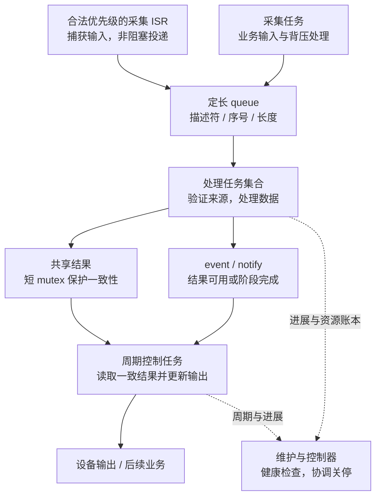

</details>

该图是业务集成模型，不是默认 `main.c` 的完整任务图。现有综合压力夹具采用四个任务来源、TIM6/TIM7 两个中断来源和四个 queue 消费者，同时覆盖共享 sem、mutex、ANY/ALL/timeout event 与控制/维护角色；真实外部传感器和 DMA 数据链路不在该夹具的证明范围内。实现见 [production_stress.c](../hil/fw/Src/production_stress.c) 和 [production_irq.c](../hil/fw/Src/production_irq.c)。

### 16.5.1 分步API组合：按值消息与最新结果

图是业务集成模型；production_stress夹具有多源/多消费者。本手册另提供较小的handbook例程，
只有一个周期生产者、一个消费者，默认timer/idle另计，不把两个模型算作同一个运行测试。
消息按值入queue，consumer接收后用mutex更新结果，再用event给出合并提示；没有DMA或共享缓冲。

<!-- example-function: ai_example_handbook_pipeline_init -->

```c
rtos_status_t ai_example_handbook_pipeline_init(void)
{
    if (handbook_has_init_attempted) {
        return RTOS_ERR_ALREADY;
    }
    /* Startup is one-shot. On failure do not enable sources/start the scheduler or retry init. */
    handbook_has_init_attempted = true;
    rtos_status_t status = rtos_queue_init(&handbook_queue, handbook_storage,
        (uint32_t)sizeof(handbook_storage[0]), HANDBOOK_QUEUE_CAPACITY);
    if (status != RTOS_OK) {
        return status;
    }
    status = rtos_mutex_init(&handbook_result_mutex);
    if (status != RTOS_OK) {
        return status;
    }
    status = rtos_event_init(&handbook_events);
    if (status != RTOS_OK) {
        return status;
    }
    status = rtos_task_create_static(&handbook_consumer, handbook_consumer_stack,
        HANDBOOK_STACK_WORDS, handbook_consumer_task, NULL, 10U, "book-consumer");
    if (status == RTOS_OK) {
        /* No concurrent caller exists yet. This flag stays immutable after scheduling starts. */
        handbook_is_ready = true;
    }
    return status;
}
```

<!-- example-function: ai_example_handbook_publish -->

```c
rtos_status_t ai_example_handbook_publish(uint32_t sequence, int32_t sample)
{
    if (!handbook_is_ready) {
        return RTOS_ERR_SCHED;
    }
    handbook_message_t message = {sequence, sample};
    /* The stack message stays alive until the potentially blocking send returns. */
    return rtos_queue_send(&handbook_queue, &message, 10U, RTOS_FALSE);
}
```

<!-- example-function: ai_example_handbook_publish_from_isr -->

```c
rtos_status_t ai_example_handbook_publish_from_isr(uint32_t sequence, int32_t sample)
{
    if (!handbook_is_ready) {
        return RTOS_ERR_SCHED;
    }
    handbook_message_t message = {sequence, sample};
    return rtos_queue_send(&handbook_queue, &message, RTOS_NO_WAIT, RTOS_FALSE);
}
```

<!-- example-function: ai_example_handbook_read_result -->

```c
rtos_status_t ai_example_handbook_read_result(ai_example_handbook_result_t *result)
{
    if (result == NULL) {
        return RTOS_ERR_NULL;
    }
    if (!handbook_is_ready) {
        return RTOS_ERR_SCHED;
    }
    rtos_status_t status = rtos_mutex_take(&handbook_result_mutex, 10U);
    if (status != RTOS_OK) {
        return status;
    }
    ai_example_handbook_result_t snapshot = handbook_result;
    status = rtos_mutex_give(&handbook_result_mutex);
    if (status != RTOS_OK) {
        return status;
    }
    if (snapshot.processed_count == 0U) {
        return RTOS_ERR_TIMEOUT;
    }
    *result = snapshot;
    return RTOS_OK;
}
```

<!-- example-function: ai_example_handbook_wait_hint -->

```c
rtos_event_bits_t ai_example_handbook_wait_hint(rtos_tick_t timeout)
{
    if (!handbook_is_ready) {
        return 0U;
    }
    return rtos_event_wait(&handbook_events, AI_EXAMPLE_HANDBOOK_RESULT_READY,
        RTOS_EVENT_WAIT_ANY | RTOS_EVENT_CLEAR_ON_EXIT, timeout);
}
```

生产者使用10tick等待预算，失败跳过本条并置错误hint；ISR从不等待，其调用者自行处理拒收。
等待预算不保证墙钟返回上界，任务还可能被更高优先级负载延后。
read_result仅给最后完成快照，不是每次请求的应答。多个完成会合并为一READY，多个读者也可能
看到同一结果；要求逐条处理结果时应使用另一个queue并定义确认账本。

wait_hint返回完整事件快照，必须判断RESULT_READY位；仅OPERATION_FAILED=2非零不代表新结果。
清位只消费READY，FAILED留作状态提示；mutex而非event保护结果字段一致性。
初始化只许在rtos_init后、start/IRQ发布前调用一次。失败采用fail-stop：禁止继续start、开启来源
或直接重试初始化，交给启动错误处理/复位。对象永久存储，无动态销毁或事务回滚承诺。

### 16.5.2 容量、背压与有界关闭

容量评估需要同时考虑输入突发、消费者被高优先级任务延迟的时间，以及持续服务能力。若长期输入量超过处理能力，增加 queue 容量只能延后满队时刻。应用应明确满队后的丢弃、重试或节流策略，并分别记录已接纳消息、拒收和超时；不能只统计 `send` 尝试次数。

有界关停建议采用下面的时序，每一步都需要应用级确认：

| 阶段 | 完成条件 | 保留的资源 |
|---|---|---|
| 1. 停止输入 | 外设/IRQ/DMA、生产者任务及产出消息的 timer 均不再发起交付；已在途操作已处理 | queue、信号量、任务句柄和数据池仍有效 |
| 2. 通知工作任务停止 | 每个角色知道不会再收到新工作 | 消费者仍可完成或归还已持有的数据 |
| 3. 排空或明确丢弃 | 消息、令牌和缓冲账本满足约定；每个角色已确认退出工作 | 对象保持有效，直到最后使用方结束 |
| 4. 停止其余 timer 与后台控制 | 非生产者控制命令和在途回调不再引用待回收存储 | 异步 delete 的成功返回不能单独充当确认 |
| 5. 解除等待并销毁 | 任务和对象按其生命周期协议退出，清除外部缓存的旧句柄 | 最后才释放 queue storage、回调参数和数据池 |

`deinit` 唤醒等待者或删除任务自动移交锁，不会自动完成外设停机、数据事务回滚或缓冲归还。强制删除必须与业务一致性恢复协议一起设计。对长期静态对象，优先让管理任务协调生命周期，减少跨 ISR 与任务并发重用地址的情况。

## 16.6 验证层次与故障定位入口

验证应围绕可失败的不变式组织，不以“所有测试都打印 PASS”代替覆盖说明。不同层次回答不同问题：

| 验证层次 | 主要问题 | 当前仓库入口 | 结论边界 |
|---|---|---|---|
| 源码/编译 | ABI 偏移、条件编译、头文件与配置是否成立 | [结构核对](../hil/refactor_20261027/verify_layout.py)、[完整编译矩阵](../hil/refactor_20261027/compile_checks.ps1) | token 等价与编译通过不能单独证明运行及最坏时延 |
| 功能/边界 | 参数、超时、销毁、等待链重挂是否符合契约 | [selftest.c](../Core/Src/selftest.c)、[boundary_test.c](../hil/fw/Src/boundary_test.c) | 构造 tick 验证不是连续运行几十天 |
| 竞态与上下文 | 启动窗口、候选失效、寄存器/FPU 和屏蔽值是否保持 | [audit_regressions.c](../hil/fw/Src/audit_regressions.c)、[lowlevel_checks.c](../hil/fw/Src/lowlevel_checks.c)、[lowlevel_fpu_probe.c](../hil/fw/Port/ARM/lowlevel_fpu_probe.c)、[basepri_regressions.c](../hil/fw/Src/basepri_regressions.c) | 只证明所执行的上下文与交错，仍需对新改动补触发条件 |
| 综合压力 | 混合 IPC、IRQ 嵌套、背压、数据守恒与关停 | [production_stress.c](../hil/fw/Src/production_stress.c)、[当前回归入口](../hil/refactor_20261027/run_regressions.ps1) | 合成业务不等于真实设备端到端链路；历史结果按日期区分 |
| 测试器对照 | 输入损坏是否被真实检测，结束判据是否可信 | 故意损坏单条消息的负向批次 | 预期失败单独分类，不计入正常 PASS |
| 优先级契约 | 高优先级 ISR 是否在共享状态访问前被预期断言捕获 | [basepri_guard.c](../hil/fw/Src/basepri_guard.c) | 每镜像一个终止用例；测试专用断言包装不返回被断言 API；不能当作断言关闭时的拒绝保证 |

测试先提出可被证伪的不变式，例如“没有giver的有限sem_take永不成功”，再构造实际交错。
长期打印日志、没有崩溃或一次PASS不能排除错误返回、屏蔽泄漏和数据损坏。
旧实板批次已清理，历史范围见[每日日志](README.md#daily-logs)；缺少原始preflight/ELF/manifest，
保留的冻结验收器不能重验整批。新采样需新的输入身份、构建/下载记录、原始输出和结束判据。
本次重写实际执行的编译/资料校验单列于[2026-10-29日志](logs/2026-10-29.md)。

排障时先记录实际状态，再追踪负责改变它的路径：

| 观测到的问题 | 优先检查的状态/路径 |
|---|---|
| 任务一直没有运行 | 有效 priority、state、所在就绪链、是否有持续就绪的更高优先级任务 |
| 阻塞任务提前或重复唤醒 | `blocked_on`、`list_head`、延时链接、结果写入方及清理是否完成 |
| sem give 变慢或位图异常 | FIFO 链实际节点、共享优先级位、动态改优先级与超时清位 |
| 取锁后优先级恢复不正确 | 注册锁的 owner、各有序等待链首、base/effective priority 与重挂 |
| queue 数据错误 | item_size、源/目标缓冲寿命、消息序号、`to_front`、满队策略 |
| timer 停止后仍有访问 | 命令是否只是入队、回调是否在途、generation、周期重插和存储寿命 |
| HardFault 或栈水位异常 | MSP/PSP、EXC_RETURN、基本/扩展帧偏移、具体业务调用链 |
| CPU/时延统计异常 | 热统计开关、DWT 采样跨度、观察表覆盖、查询窗口及中断归属 |

完整HIL脚本及复现条件见[hil/README.md](../hil/README.md)。工程保留权威测试源码、当前工具和最近一次AI示例编译证据；旧实板原始资料已清理，已提交的文字可从Git历史查阅，未入库的二进制不承诺可恢复。新增测试使用新批次与输出路径，重新构建的镜像不能冒充历史实测镜像。

<a id="167-演进方案与评审原则"></a>

## 16.7 实现与资料的一致性

本手册介绍现有实现及其限制。接口名称和原型以公共头为准，当前行为须逐项对照实现
与调用路径；源码中的既有缺陷不能自动成为设计规范。未实现的算法、接口与配置不列作
当前功能，不能由待设计名称推断已有相应支持。

涉及状态机、生命周期、中断和超时的修改，应先复现并核对保护协议，再做最小范围
调整和验证；源码指令数减少不能替代实测，也不能以删除保护换取微基准数字。

设计手册维护应与实现变更同行：更新受影响的不变式、API 契约、图源和复杂度；用新的源码身份执行相关验证；把结果、退步与缺失覆盖留在测试报告。历史优化数据继续保存在[历史性能报告](rtos_performance_report.md)、[第一阶段优化](logs/2026-10-12.md#optimization)和[底层优化](logs/2026-10-12.md#lowlevel)，无需在本手册重复多组版本数字。

## 16.8 重组后的源码集成与构建约束

本次重组依据共享状态和保护协议划分编译单元，未改变内核算法、TCB 布局、临界区或上下文栈协议。
`rtos_wait.c` 统一等待链机制，不把不同 IPC 对象的状态机合并；`rtos_kernel.c` 编排初始化，不拥有运行时调度链。
任务地址登记、通知和自删延期回收仍在 `rtos_task.c`；就绪和延时链接复用仍在 `rtos_sched.c`。
USB 两层 OSAL 合并，设备会话与 MSC 存储后端独立；两个相同的毫秒转换包装改用已有 inline。

集成边界如下，完整文件对应关系见[源码导览](../RTOS/README.md)：

| 边界 | 当前规则 | 常见迁移错误 |
|---|---|---|
| 公开接口 | 仍从 `RTOS/Core/Inc/` 包含原公共头，`rtos_mem.h` 名称保留 | 把实现改名误认为需要改应用 API 或复制声明 |
| 私有协作 | 内核及相关测试增加 `RTOS/Core/Private/` 搜索路径 | 从旧公开目录查找 `rtos_internal.h`；把私有协议当作兼容 API |
| 源码清单 | 加入 Core、IPC、Memory、Services、USB 和所选 Port 的当前单元，每个只链接一次 | 仍只收集 `Core/Src/`；同时链接旧 USB 文件和新模块 |
| 端口选择 | 当前源位于 `Port/GCC/ARM_CM4F_CM7F/port.c` | 目录名被误当作所有 M7 芯片、FPU 和缓存配置都已完成实板验证 |
| 对象等待 | 调用方持有内核临界区；helper 先登记阻塞并请求调度，解除保护后才切出 | helper 一返回就读取等待结果，跳过正确的临界区退出与切换时机 |
| 复杂度 | 仍按完整 API 路径核算；信号量 FIFO 位图链的定位/清位最坏 O(W) | 根据文件拆分或旧“分组扫描”注释误认为整个唤醒路径已变为 O(1) |

本手册7份C示例不加入日常57个单元。BSP还必须核查时钟、向量、FPU ABI、MSP预算和中断分组；
普通C的SVC/PendSV转跳包装须结合优化后反汇编审查，不能仅见源文件调用名就确认现场正确。

本工程 CubeIDE Debug/Release 均以整个 `RTOS/` 为源码入口；手工移植工程仍须更新自己的文件清单与头文件路径。
HIL 的 [build_layout.ps1](../hil/build_layout.ps1) 统一维护 **15 个规则目录、57 个编译单元（16 个自研 RTOS C 单元）**，
[build_fw.ps1](../hil/build_fw.ps1) 与 [restore_project.ps1](../hil/restore_project.ps1) 共用此清单和权威模板。
编译选项变化会使相应旧对象失效；恢复会还原日常规则、源码与链接清单，并移除 HIL 副本及变体 stamp。
新增或移动单元时须同时审查 IDE 输入、模板、对象清单及独立编译矩阵，不能只修改本机 Debug 生成文件。

结构比较覆盖 263 个函数定义、63 项状态/类型等声明及 16 个公共头；它为机械搬移提供证据，不能替代运行验证。
后续复测应创建新批次，记录编译器、配置、实际构建输入和结束条件；带日期验收器固定的是该批覆盖，不是自动检测所有缺陷的通用证明。

## 16.9 AI辅助开发资料与精确接口检索

正文区分三类代码：带example标记的“使用样例”来自真实完整编译单元，按函数/文件逐字核对；
机制摘要/伪代码允许省略检查与字段，不是ABI或可替换实现；端口汇编只解释本目标协议。
摘录的函数仍依赖所链接文件中的静态对象/常量/类型，不能把单个函数当成独立.c直接编译。

当前工程提供[AI项目入口](../AGENTS.md)、[逐项API契约](ai/README.md)、
[机器检索索引](ai/api_index.json)、[调试指南](ai/debugging.md)和
[独立可编译示例](ai/examples/README.md)。这些是开发资料与主机侧校验程序，不增加
调度、内存或运行时诊断机制，也不改变公共接口、BSP和既有应用。

契约覆盖16个自研公共头的函数声明、内联函数、函数式宏、公开变量及相关类型、配置
约束。公共目录里的内部/移植入口和弱钩子单独分类；CherryUSB桥接及驱动回调作为
补充列出。精确原型、参数单位、上下文、条件阻塞、错误与失败输出、对象/缓冲寿命
均链接实际声明及实现。调用者义务和实现确实执行的检查分别说明，尤其不能把
“禁止高优先级ISR调用”解释为关闭断言后仍一定安全拒绝。

头文件清单由[资料检查器](../hil/ai_docs/check_contracts.py)独立扫描后与人工核对的
契约比较；名称、原型、锚点及链接检查不能替代自然语言语义审查。独立示例编译用
实际ARM工具链，并验证生效宏和自研符号部分链接，不操作日常构建或板卡。
当前结果与限制见[每日记录](logs/2026-10-29.md)和[验证方法](../hil/ai_docs/README.md)。

资料描述当前源码，包括已核实的注释/实现偏差及使用限制。编译和部分链接不构成
真实运行、物理USB或时序保证；未执行的硬件检查仍须在对应任务中另行完成。

## 16.10 文档分层与结果清理

[文档导航](README.md)区分当前设计/API/调试手册、历史参考与`logs/YYYY-MM-DD.md`
每日日志。单次执行不再单独产生叙述报告；同一天内的修复、失败、验证和清理追加在一份日志。
架构原理和接口契约原位维护，未实现方案不列为现有功能。

权威测试源码在`hil/fw/`，构建模板在`hil/templates/`，复测入口见[HIL说明](../hil/README.md)。
生成的工程副本、对象、镜像和重复采样不是另一份源码。清理时先核对现行工具依赖，旧批次整组
退役并保留结论及证据缺失说明；不能只删除失败样本而保留PASS来扩大验证结论。
保留的两个历史分析器是当前脚本的固定摘要依赖，不是旧RTOS源码。

历史清理结论按日期记录，不在当前功能章节重复旧采样数字。

## 16.11 从启动到结果的完整使用样例

完整源[handbook.c](ai/examples/handbook.c)依赖[ai_examples.h](ai/examples/ai_examples.h)的声明/类型。
它是替代应用入口，不与日常main同时启动。调用前准备SDK时钟、异常路由和板级状态，成功不返回；
返回错误时进入应用启动失败处理，不再次rtos_init。本例不初始化USB或设置任何硬件IRQ。

两个应用任务的优先级为10/12，各有256字、8字节对齐静态栈，默认timer/idle另计。
周期20tick只有在默认1kHz下才对应20ms；相位控制不保证业务deadline。
sequence按模2^32递增且与接纳无关，跳号可来自明确丢弃；接入多个源需定义来源/序号命名空间。
本例只保存最后结果，不宣称无损、多源全消息审计或动态关闭正确性已运行证明。

<!-- example-file: handbook.c -->

```c
/**
 * @file handbook.c
 * @brief Persistent task/IRQ-to-queue pipeline and alternative startup for the design handbook.
 *
 * Objects are initialized once before scheduling/IRQ publication and never destroyed here.
 * This is an isolated application example, not an additional kernel service or daily firmware.
 */
#include "ai_examples.h"

#define HANDBOOK_QUEUE_CAPACITY (8U)
#define HANDBOOK_STACK_WORDS (256U)

typedef struct handbook_message {
    uint32_t sequence;
    int32_t sample;
} handbook_message_t;

static rtos_queue_t handbook_queue;
static handbook_message_t handbook_storage[HANDBOOK_QUEUE_CAPACITY];
static rtos_mutex_t handbook_result_mutex;
static rtos_event_t handbook_events;
static rtos_tcb_t handbook_consumer;
static rtos_tcb_t handbook_producer;
static _Alignas(8) rtos_stack_t handbook_consumer_stack[HANDBOOK_STACK_WORDS];
static _Alignas(8) rtos_stack_t handbook_producer_stack[HANDBOOK_STACK_WORDS];
static ai_example_handbook_result_t handbook_result;
static bool handbook_has_init_attempted;
static bool handbook_is_ready;

/** @brief Record a persistent state hint, not a counted error/message stream. */
static void handbook_mark_failure(void)
{
    /* event_set returns a snapshot, not an operation status. No consumer clears this hint. */
    (void)rtos_event_set(&handbook_events, AI_EXAMPLE_HANDBOOK_OPERATION_FAILED);
}

/** @brief Store one completed result under the mutex, preserving a consistent snapshot. */
static rtos_status_t handbook_store_result(const handbook_message_t *message)
{
    rtos_status_t status = rtos_mutex_take(&handbook_result_mutex, RTOS_WAIT_FOREVER);
    if (status != RTOS_OK) {
        return status;
    }
    handbook_result.sequence = message->sequence;
    handbook_result.sample = message->sample;
    if (handbook_result.processed_count < UINT32_MAX) {
        handbook_result.processed_count++;
    }
    return rtos_mutex_give(&handbook_result_mutex);
}

/** @brief Drain copied messages; all callback/storage lifetimes are permanent in this example. */
static void handbook_consumer_task(void *argument)
{
    (void)argument;
    for (;;) {
        handbook_message_t message;
        rtos_status_t status = rtos_queue_recv(&handbook_queue, &message, RTOS_WAIT_FOREVER);
        if (status != RTOS_OK) {
            handbook_mark_failure();
            rtos_task_delay(1U);
            continue;
        }
        status = handbook_store_result(&message);
        if (status != RTOS_OK) {
            /* The message has been consumed; this hint does not claim successful processing. */
            handbook_mark_failure();
            rtos_task_delay(1U);
            continue;
        }
        /* Repeated completions coalesce into a state bit; results are read under the mutex. */
        (void)rtos_event_set(&handbook_events, AI_EXAMPLE_HANDBOOK_RESULT_READY);
    }
}

rtos_status_t ai_example_handbook_pipeline_init(void)
{
    if (handbook_has_init_attempted) {
        return RTOS_ERR_ALREADY;
    }
    /* Startup is one-shot. On failure do not enable sources/start the scheduler or retry init. */
    handbook_has_init_attempted = true;
    rtos_status_t status = rtos_queue_init(&handbook_queue, handbook_storage,
        (uint32_t)sizeof(handbook_storage[0]), HANDBOOK_QUEUE_CAPACITY);
    if (status != RTOS_OK) {
        return status;
    }
    status = rtos_mutex_init(&handbook_result_mutex);
    if (status != RTOS_OK) {
        return status;
    }
    status = rtos_event_init(&handbook_events);
    if (status != RTOS_OK) {
        return status;
    }
    status = rtos_task_create_static(&handbook_consumer, handbook_consumer_stack,
        HANDBOOK_STACK_WORDS, handbook_consumer_task, NULL, 10U, "book-consumer");
    if (status == RTOS_OK) {
        /* No concurrent caller exists yet. This flag stays immutable after scheduling starts. */
        handbook_is_ready = true;
    }
    return status;
}

rtos_status_t ai_example_handbook_publish(uint32_t sequence, int32_t sample)
{
    if (!handbook_is_ready) {
        return RTOS_ERR_SCHED;
    }
    handbook_message_t message = {sequence, sample};
    /* The stack message stays alive until the potentially blocking send returns. */
    return rtos_queue_send(&handbook_queue, &message, 10U, RTOS_FALSE);
}

rtos_status_t ai_example_handbook_publish_from_isr(uint32_t sequence, int32_t sample)
{
    if (!handbook_is_ready) {
        return RTOS_ERR_SCHED;
    }
    handbook_message_t message = {sequence, sample};
    return rtos_queue_send(&handbook_queue, &message, RTOS_NO_WAIT, RTOS_FALSE);
}

rtos_status_t ai_example_handbook_read_result(ai_example_handbook_result_t *result)
{
    if (result == NULL) {
        return RTOS_ERR_NULL;
    }
    if (!handbook_is_ready) {
        return RTOS_ERR_SCHED;
    }
    rtos_status_t status = rtos_mutex_take(&handbook_result_mutex, 10U);
    if (status != RTOS_OK) {
        return status;
    }
    ai_example_handbook_result_t snapshot = handbook_result;
    status = rtos_mutex_give(&handbook_result_mutex);
    if (status != RTOS_OK) {
        return status;
    }
    if (snapshot.processed_count == 0U) {
        return RTOS_ERR_TIMEOUT;
    }
    *result = snapshot;
    return RTOS_OK;
}

rtos_event_bits_t ai_example_handbook_wait_hint(rtos_tick_t timeout)
{
    if (!handbook_is_ready) {
        return 0U;
    }
    return rtos_event_wait(&handbook_events, AI_EXAMPLE_HANDBOOK_RESULT_READY,
        RTOS_EVENT_WAIT_ANY | RTOS_EVENT_CLEAR_ON_EXIT, timeout);
}

void ai_example_handbook_periodic(void *argument)
{
    (void)argument;
    rtos_tick_t phase = rtos_sched_get_tick_count();
    uint32_t sequence = 0U;
    for (;;) {
        rtos_status_t status = ai_example_handbook_publish(sequence, 42);
        if (status != RTOS_OK) {
            /* Explicit lossy backpressure policy: skip this sample; no infinite retry. */
            handbook_mark_failure();
        }
        sequence++; /* Message identity is modulo 2^32, independent of acceptance. */
        rtos_task_delay_until(&phase, 20U);
    }
}

rtos_status_t ai_example_handbook_start(void)
{
    rtos_status_t status = rtos_init();
    if (status != RTOS_OK) {
        return status;
    }
    status = ai_example_handbook_pipeline_init();
    if (status != RTOS_OK) {
        return status;
    }
    status = rtos_task_create_static(&handbook_producer, handbook_producer_stack,
        HANDBOOK_STACK_WORDS, ai_example_handbook_periodic, NULL, 12U, "book-producer");
    if (status != RTOS_OK) {
        return status;
    }
    /* BSP clock/exception routing is the caller's responsibility; success never returns. */
    return rtos_start();
}

rtos_status_t ai_example_handbook_control_worker(rtos_tcb_t *worker, rtos_prio_t priority)
{
    if (RTOS_PORT_IN_ISR()) {
        return RTOS_ERR_ISR;
    }
    if (worker == NULL) {
        return RTOS_ERR_NULL;
    }
    if (priority >= RTOS_CONFIG_MAX_PRIORITIES || worker == rtos_task_get_current()) {
        return RTOS_ERR_PARAM;
    }
    rtos_status_t status = rtos_task_suspend(worker);
    if (status != RTOS_OK) {
        return status;
    }
    status = rtos_task_set_priority(worker, priority);
    rtos_status_t resume_status = rtos_task_resume(worker);
    if (resume_status != RTOS_OK) {
        return resume_status;
    }
    return status;
}
```

先看16.5分步调用，再在完整文件中追踪静态对象、消费者、周期生产者和启动路径。
复制单个函数时须同时提供它借用的对象/类型/宏；完整文件用于编译验证，正文摘录用于定位理解。
任务控制示例只适用于由单一controller管理的、已到业务安全点、无持锁/未完成等待的worker；
不是强制暂停任意任务而业务仍能自动一致的通用API。

## 16.12 工程师集成验收清单

| 集成前 | 首次运行 | 故障/关闭路径 |
|---|---|---|
| 栈单位/对齐/持久存储/宏一致 | 实际ELF与符号一致，各角色独立有进展 | 失败不消费旧输出，逐项处理返回 |
| IRQ分组、逻辑优先级、编码门槛正确 | 负载下检查栈、队列、锁持有预算 | 停输入→在途结束→排空→确认退出→最后释放 |
| 创建失败不发布句柄/开启来源 | 区分接纳、拒收、消费、业务完成 | timer命令接受和回调完成分开确认 |
| 明确满队/饱和/覆盖策略 | 配置/断言关闭按自身边界验证 | 新缺陷定向复现、修复、回归并保留负向对照 |

理解一次API调用，应能追到共享字段、等待归属、调度决策与CPU提交，也能写出对象存储可以复用的
业务条件。未执行的硬件、配置和交错继续明确标为未验证，不由文档篇幅推断可靠性保证。
