# 自研 RTOS 实现原理完整技术手册 (详尽版)

> **适用平台**：STM32F446RE（Cortex-M4F，ARMv7-M）+ GCC (arm-none-eabi)
> **文档基准**：本工程 RTOS/ 当前代码，包含 2026-10-12 源码审计修复。复现、修复和实板结果见 [本次审计报告](rtos_audit_20261012.md)。第十六章以及正文未标明本次日期的性能数字属于历史版本，不能作为当前固件性能结果。
> **文档目标**：逐函数、逐步骤讲清"调用 API 后内核内部发生了什么"——数据结构如何变化、上下文在哪里切换、任务在哪条指令上暂停又从哪里恢复——并分析每处设计的理念与代价
> **代码位置**：内核 `RTOS/Core/`、移植层 `RTOS/Port/GCC/ARM_CM7/port.c`
> **配套文档**：[2026-10-12 底层优化报告](rtos_lowlevel_optimization_20261012.md)（当前实现与实板对照）、[第一轮性能优化报告](rtos_optimization_20261012.md)（历史阶段）、[rtos_performance_report.md](rtos_performance_report.md)（历史微基准 + 系统级场景 + 与 FreeRTOS 的实测对比）、[rtos_testing_report.md](rtos_testing_report.md)（功能回归/边界测试/HIL 复现审计）、[hardfault_debug.md](hardfault_debug.md)（故障诊断）、[compilation_pipeline.md](compilation_pipeline.md)（编译原理）、[freertos_design.md](freertos_design.md)（FreeRTOS 设计分析与排障，与本文互为镜像参照）

---

## 目录

- [第一章 架构总览与设计哲学](#第一章-架构总览与设计哲学)
- [第二章 核心数据结构详解](#第二章-核心数据结构详解)
- [第三章 调度器: 从就绪表到上下文切换的完整链路](#第三章-调度器-从就绪表到上下文切换的完整链路)
- [第四章 移植层: PendSV, SVC 与临界区的指令级流程](#第四章-移植层-pendsv-svc-与临界区的指令级流程)
- [第五章 任务管理: 每个 API 的逐步执行流程](#第五章-任务管理-每个-api-的逐步执行流程)
- [第六章 信号量: take/give 的完整路径](#第六章-信号量-take/give-的完整路径)
- [第七章 互斥锁: 优先级继承的每一步](#第七章-互斥锁-优先级继承的每一步)
- [第八章 消息队列: 四条路径与零拷贝直传](#第八章-消息队列-四条路径与零拷贝直传)
- [第九章 事件标志组](#第九章-事件标志组)
- [第十章 软件定时器](#第十章-软件定时器)
- [第十一章 内存管理](#第十一章-内存管理)
- [第十二章 性能监视器](#第十二章-性能监视器)
- [第十三章 USB 子系统](#第十三章-usb-子系统)
- [第十四章 复杂度与开销总表](#第十四章-复杂度与开销总表)
- [第十五章 已知限制与设计债务](#第十五章-已知限制与设计债务)
- [第十六章 性能优化实录: 机制, 实测与权衡](#第十六章-性能优化实录-机制-实测与权衡)

---

# 第一章 架构总览与设计哲学

## 1.1 分层结构


<details><summary>图形源码（mermaid）</summary>

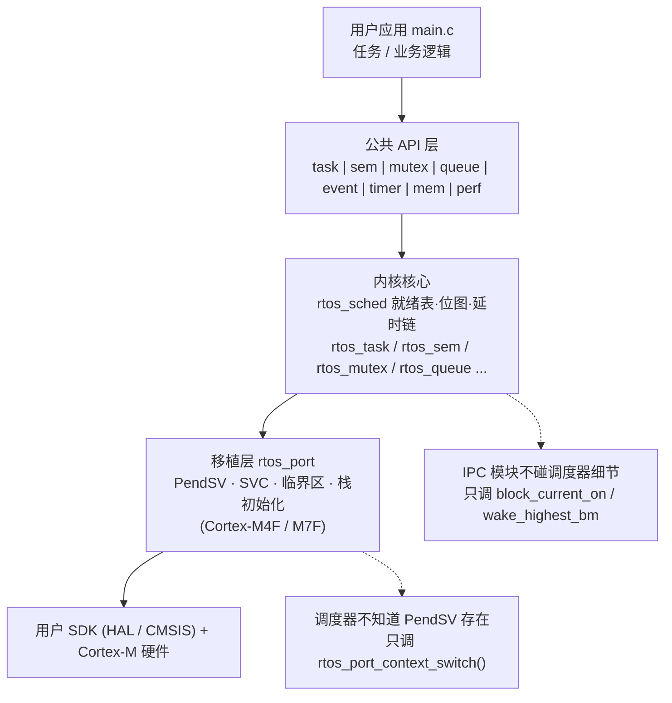

</details>

依赖方向严格单向：上层调用下层。IPC 模块（sem/mutex/queue/event）不知道调度器细节，它们只调用 `rtos_internal_block_current_on` 与 `rtos_internal_wake_highest_bm`（信号量；当前队列使用有序等待链）或 `rtos_internal_wake_highest`（事件组/互斥锁）等内部原语；调度器不知道 PendSV 的存在，它只调用 `rtos_port_context_switch()`"请求一次切换"。

> **文档版本说明**：本文档已按**优化后**的内核实现全面校订。
> 与早期版本相比，以下机制的描述已更新，阅读时请以本文为准：
> ① 等待链由"统一按优先级有序插入"改为**两套并存约定**（位图索引链 / 有序链）——唤醒侧从 O(n) 级联降为 O(1)、入链侧的 O(n) 被挪到低频的阻塞路径，见 1.3 不变式 III、2.3、6.5；
> ② 延时链由"单向 + 摘除 O(n)"改为**双向 + 表尾缓存**（插入 O(1) 快路径、摘除 O(1)），见 3.4；
> ③ PendSV 由"双层 C 调用 + `isb`"改为**汇编直存 + 单层 `bl`**，见 4.2；
> ④ 临界区由"out-of-line 函数 + exit 侧 `isb`"改为**头文件内联**，见 4.5；
> ⑤ 已知限制 L1/L2/L4 已修复，见第十五章；
> ⑥ 新增第十六章记录本轮性能优化的**机制与实测数据**。

## 1.2 五条贯穿全内核的设计原则

| 原则 | 体现 | 违反的代价（为什么必须坚持） |
|------|------|------|
| **1. 一切静态可预测** | 空闲任务/定时器任务/命令队列全静态；任务双路径（堆/静态） | 若 idle 任务依赖堆，堆耗尽时自删任务的 TCB 永远无法回收 → 死锁 |
| **2. 临界区极短** | 所有内核结构操作在 BASEPRI 临界区内，O(1) 或有界 O(n) | 临界区内执行回调 → SysTick 停走、PendSV 无法执行、中断延迟不可控 |
| **3. O(1) 热路径** | 选任务（`ctz` 位图）/就绪表/信号量唤醒（位图选最高优先级）/内存池 全部常数时间 | 调度热点出现 O(n) → 任务数增加时实时性衰退 |
| **4. 侵入式复用** | TCB 内嵌 wait_node 与链表指针，wait_node 字段多路复用 | 若用外部分配的节点，每次阻塞都要 malloc → 引入失败路径与碎片 |
| **5. 统一清理** | 任务离开等待状态的三条路径（唤醒/超时/中止）共用内核清理代码 | 任何一条路径漏删链表节点 → 悬空指针 → use-after-free |

## 1.3 任务状态机与迁移触发点


<details><summary>图形源码（mermaid）</summary>

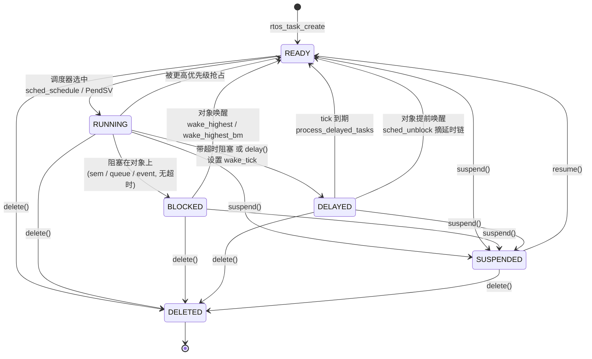

</details>

**三条硬性不变式**（贯穿全文，每处代码都依赖它们）：

1. **不变式 I**：RUNNING 状态的 TCB 必是其优先级就绪链表的 head（时间片轮转和调度决策都依赖）；
2. **不变式 II**：任一时刻，一个 TCB 至多属于一条调度链表（就绪链表或延时链表）+ 至多一条对象等待链表；
3. **不变式 III（两套并存约定）**：对象等待链表有两种维护纪律，**同一个对象内不可混用**——
   - **(A) 位图索引链**：信号量、队列（发送链与接收链）。链表是**尾插的 FIFO 链**，链首**不一定**是最高优先级；"最高优先级等待者"由配套的 `uint32_t` 优先级位图 + `__builtin_ctz` 在唤醒时选出（`rtos_internal_wake_highest_bm`）。**入链仍是 O(n)**（尾插要遍历到链尾），但**唤醒侧降为 O(1)**——关键在于入链发生在**阻塞侧（低频）**、唤醒发生在 **give 侧（高频）**，因此这是"把 O(n) 从热路径挪到冷路径"，而非消除 O(n)。
   - **(B) 有序链**：事件组、互斥锁。仍按任务优先级升序插入，**链首 = 最高优先级等待者**（`rtos_internal_wake_highest`）。插入 O(n)。
   - 两者的共同可观察语义**完全等价**：唤醒的必是最高优先级等待者，且同优先级内 FIFO（先阻塞者先得）。
   - 任务优先级变化时，由 `rtos_internal_requeue_wait_lists()`（5.8）**按链的类别分别处理**：位图链只同步位图并尾插回原位序，有序链才摘出重插。

> **为什么需要两套**：(A) 把"选最高优先级"的成本从**入链侧**（每次阻塞都付、且随等待者数线性增长）挪到**唤醒侧**（用两条指令的 `ctz` 换取）。信号量/队列是最热的两类 IPC，收益最大。事件组与互斥锁的等待链上还要承载"等待位掩码""插队意图"等附加语义，且其唤醒不是单纯的"取最高优先级"（互斥锁还要做所有权移交与优先级继承重算），故保留有序链以简化正确性论证。

---

# 第二章 核心数据结构详解

## 2.1 内核全局状态 rtos_kernel_t (rtos_sched.c 定义唯一实例)

```c
typedef struct rtos_kernel
{
    volatile rtos_sched_state_t sched_state;   /* NOT_STARTED/RUNNING/SUSPENDED/STOPPED */
    volatile rtos_tick_t        tick_count;    /* 全局时基, SysTick 每 ms +1 */
    volatile uint32_t           schedule_pending; /* (保留字段, 现代码未使用) */

    volatile uint32_t           ready_bitmap;  /* ★就绪位图 */
    rtos_tcb_t                 *ready_heads[ 32 ]; /* ★每优先级链表头 */
    rtos_tcb_t                 *delay_head;    /* 延时链(双向环外挂, wake_tick 升序) */

    rtos_tcb_t                 *current_tcb;   /* 正在运行 */
    rtos_tcb_t                 *next_tcb;      /* 调度决策结果, PendSV 消费 */
    rtos_tcb_t                 *idle_tcb;

    volatile uint32_t           switch_count;  /* 切换计数 */
    volatile uint32_t           critical_nesting; /* (保留字段; 实际计数在移植层
                                                   *  rtos_port_crit_nest, 见 4.5) */
    /* …统计与性能字段(第十二章, 受 RTOS_CONFIG_USE_PERF_MONITOR 条件编译)… */
} rtos_kernel_t;
```

> **易错点**：`critical_nesting` 是**历史遗留的保留字段**，内核实际使用的是移植层的全局
> `rtos_port_crit_nest`（`rtos_port.h` 内联函数直接读写它，避免跨 TU 函数调用）。
> 不要读 `rtos_kernel.critical_nesting` 来判断临界区状态 —— 它恒为 0。
> 查询入口是 `rtos_port_get_critical_nesting()`。

**`ready_bitmap` 与 `ready_heads[]` 的配合规则**（一切调度操作的基础）：

| 操作 | 链表动作 | 位图动作 |
|------|---------|---------|
| 任务入就绪表（优先级 p） | push_tail 到 ready_heads[p] 环 | `bitmap \|= 1<<p` |
| 该优先级最后一个任务离开 | ready_heads[p] = NULL | `bitmap &= ~(1<<p)` |
| 同优先级仍有其他任务 | 摘除 tcb，head 后移 | 位不变 |

## 2.2 TCB: 字段分组与三个易错点

```c
struct rtos_tcb
{
    rtos_stack_t      *top_of_stack;    /* 偏移0: PendSV 汇编直接 STR, 不算偏移 */
    rtos_stack_t      *stack_base;      /* 栈最低地址(向下生长的边界) */
    uint32_t           stack_size;      /* ★单位是字(4字节), 不是字节 */

    rtos_prio_t        priority;        /* 有效优先级(可能被继承临时提升) */
    rtos_prio_t        base_priority;   /* 用户设定的原始优先级 */
    rtos_task_state_t  state;
    rtos_bool_t        is_static;

    struct rtos_tcb   *next_ready, *prev_ready; /* 双向环(就绪) / next 单链(延时) */

    rtos_wait_node_t   wait_node;       /* 内嵌等待节点, 见 2.3 */
    rtos_tick_t        wake_tick;       /* 延时链排序键 */
    void              *blocked_on;      /* 所等对象; notify 等待时 =(void*)tcb 自指标记 */
    rtos_status_t      wait_result;     /* OK/TIMEOUT/DELETED, 醒来后由本任务读 */

    volatile uint32_t  notify_value;    /* 任务通知值 */
    volatile uint8_t   notify_state;    /* IDLE/PENDING/RECEIVED */

    char               name[ 16 ];
    uint32_t           task_id, switch_count;
    uint32_t           stack_magic;     /* 0xDEADBEEF, 溢出哨兵(只读 TCB 内这份) */
    /* …perf 字段… */
};
```

**易错点 1**：`next_ready` 是双面间谍——就绪态时是**双向环**指针（`next_ready`/`prev_ready` 构成环），延时态时转作延时链的**双向**指针（表尾 `next_ready == NULL`，且**表头的 `prev_ready` 被借用来缓存表尾**，见 3.4）。两种语义不重叠（状态互斥），但从延时链摘除任务后**必须手动清 `next_ready`/`prev_ready`**，防止残留指针被误当就绪环解引用。

**易错点 2**：`stack_size` 单位是字。所有边界计算都要 `× sizeof(rtos_stack_t)`。

**易错点 3**：`stack_magic` 的栈内副本（`*stack_buf` 处）会被性能监视器的水印填充（0xA5A5A5A5）覆盖——溢出检测**只能**读 TCB 内的这份。

## 2.3 等待节点: 三模块共用的字段多路复用表

```c
typedef struct rtos_wait_node
{
    rtos_tcb_t   *tcb;          /* 常规: 指向等待者 */
    rtos_tick_t   wake_tick;    /* 常规: 未用 | 事件组: 存等待模式 */
    rtos_bool_t   timed_out;    /* 超时唤醒标记 */
    void         *wait_obj;     /* 所等对象指针: mutex_waiter_left 匹配互斥锁用 */
    struct rtos_wait_node *next, *prev;   /* 对象等待链表(双向) */
    void         *transfer_buf; /* 队列: 零拷贝缓冲 | 事件组: set 回传的位值 */
    uint32_t      transfer_size;/* 队列: 消息字节数 | 事件组: 等待位掩码 */
    uint8_t       to_front;     /* [队列] 阻塞发送的插队意图(代办入队时按此选写入位置) */
    struct rtos_wait_node **list_head; /* ★所在链表头地址, 超时/中止清理的钥匙 */
    volatile uint32_t *queue_bitmap;   /* ★非 NULL = 本链为"位图索引链"(见下) */
    rtos_prio_t   queued_priority;     /* ★入链时的优先级(优先级变化后同步位图用) */
} rtos_wait_node_t;
```

| 字段 | 信号量 | 互斥锁 | 队列 | 事件组 |
|------|-------------|--------|------|--------|
| transfer_buf | 不用 | 不用 | 发送方=发送缓冲 / 接收方=接收缓冲 | set 写入"满足时的位值" |
| transfer_size | 不用 | 不用 | = item_size | = 等待位掩码 |
| wake_tick | 不用 | 不用 | 不用 | = 等待模式(ANY/ALL\|CLEAR) |
| to_front | 不用 | 不用 | 阻塞发送的插队意图 | 不用 |
| list_head | &sem->wait_head | &mutex->wait_head | &queue->send/recv_wait_head | &event->wait_head |
| **queue_bitmap** | **&sem->wait_bitmap** | NULL(有序链) | NULL(有序链) | NULL(有序链) |
| **queued_priority** | 入链时优先级 | 入链时优先级 | 入链时优先级 | 入链时优先级 |

**`list_head` 为什么存"链表头指针的地址"而不是链表头指针**：超时清理发生在 tick 中断里，此时内核并不知道任务等的是哪个对象（只有 TCB）。存下地址后，`rtos_internal_wait_remove(tcb->wait_node.list_head, &tcb->wait_node)` 即可精确把自己从对应链表摘除——一个字段同时回答了"在不在链表上"（NULL 判断）和"在哪条链表上"两个问题。notify 等待无链表，置 NULL 自动跳过清理。

**`queue_bitmap` / `queued_priority` 是"链纪律"的运行时标记**（这是理解唤醒路径的钥匙）：

| queue_bitmap | 含义 | 入链方式 | 唤醒方式 |
|---|---|---|---|
| **非 NULL** | 位图索引链 | `rtos_internal_wait_append`（尾插 → **O(n)**，同优先级 FIFO） | `rtos_internal_wake_highest_bm`（`ctz(bitmap)` 选优先级，再在该优先级分组内取链首）→ **O(1)**（单等待者）/ O(同优先级等待者数) |
| **NULL** | 按优先级有序链 | `rtos_internal_wait_insert_by_prio`（有序插入 → O(n)） | `rtos_internal_wake_highest`（取链首）→ **O(1)** |

> **两套约定的成本对比（注意：两者入链都是 O(n)，差别在唤醒侧）**：
> 有序链把成本花在**入链**（为唤醒时的 O(1) 取链首做排序准备）；
> 位图链把成本留在**入链**（尾插也要走一遍找尾），但唤醒时的"选最高优先级"从
> "链表已排好序"变成"`ctz` 现算"。**净收益来自调用频率的差异**：
> 阻塞入链只在真正拿不到资源时发生，而 give 在每次释放资源时都要发生。
> 实测退化量从 +18.4% 降到 +4.8%（见 16.2）。

`queued_priority` 记录**入链当时**的优先级：任务优先级被修改（用户 `set_priority` 或内核优先级继承提升/恢复）时，必须据此把旧位清掉、置新位，否则位图会残留一个"已无人等待"的优先级，导致后续唤醒空扫描甚至选错牺牲者。同步逻辑在 `rtos_internal_requeue_wait_lists()`（5.8）。

**`list_head` 为什么存"链表头指针的地址"而不是链表头指针**：超时清理发生在 tick 中断里，此时内核并不知道任务等的是哪个对象（只有 TCB）。存下地址后，`rtos_internal_wait_remove(tcb->wait_node.list_head, &tcb->wait_node)` 即可精确把自己从对应链表摘除——一个字段同时回答了"在不在链表上"（NULL 判断）和"在哪条链表上"两个问题。notify 等待无链表，置 NULL 自动跳过清理。

---

# 第三章 调度器: 从就绪表到上下文切换的完整链路

## 3.1 find_highest_priority: 两条指令选出下一个任务

```c
static inline rtos_prio_t find_highest_priority( uint32_t bitmap )
{
    if( bitmap == 0U ) return MAX_PRIORITIES;
    return (rtos_prio_t)__builtin_ctz( bitmap );
}
```

因为优先级 0（最高）对应位图最低位，"最高优先级就绪任务 = 最低置位 bit"。`__builtin_ctz` 在 Cortex-M 编译为 `RBIT + CLZ` 两条指令（2 周期）。**代码注释特意警告不要写成 `31-clz`**——那是取最高置位 bit，方向正好相反（bitmap=0x3 时 ctz=0 正确选优先级 0，31-clz=1 会错选优先级 1）。

## 3.2 ready_list 三操作: push_tail / remove / rotate

**push_tail（任务变为就绪）**：

```
空链:  tcb->next_ready = tcb->prev_ready = tcb; heads[p] = tcb;  (自环)
非空:  tail = head->prev_ready;
       tcb->next = head; tcb->prev = tail;
       tail->next = tcb; head->prev = tcb;      (插入 head 前 = 队尾)
       bitmap |= 1<<p;
```

**remove（任务失去就绪资格）**：

```
仅剩自己: heads[p] = NULL; bitmap &= ~(1<<p);
否则:     prev->next = next; next->prev = prev;
          若自己是 head: heads[p] = next_ready;   (维持不变式 I)
```

**rotate（时间片轮转）**：`heads[p] = heads[p]->next_ready` —— 只动头指针，O(1)。当前任务从"队头"变"队尾"，链上的下一个任务成为新队头（时间片轮到的下一个）。

## 3.3 rtos_sched_schedule(): 调度决策 (不执行切换)

```
前置: 调用方必须已进入临界区
1. sched_state != RUNNING → return
2. top = find_highest_priority(ready_bitmap)
3. top 无效 → return (idle 恒在, 理论不可达)
4. next = ready_heads[top]
5. next == current_tcb:
     next_tcb = NULL                    ← 取消早前已经失效的切换候选
     next 为 READY → state = RUNNING    ← 当前任务曾阻塞，但切出前又被唤醒
     return
6. next != current_tcb:
     抢占配置: next_tcb = next; switch_count++; 请求 PendSV
     非抢占配置: 仅 current 的 state != RUNNING 时执行上述提交
   rtos_port_context_switch()          ← 只"挂起" PendSV, 见 4.5
```

**关键理解：schedule() 返回后任务还在跑**。PendSV 优先级最低且被临界区屏蔽，此刻只是登记了"需要切换"。真正的切换发生在调用链层层退出、最外层临界区 `EXIT_CRITICAL` 恢复进入前的屏蔽状态并允许 PendSV 执行之后。

**本轮未保留的候选**：曾将提交/取消切换候选的逻辑抽为 `schedule_ready_task(next)`，让 `unblock` 在已知最高就绪优先级时直接复用 `ready_heads[p]`，减少一次状态检查与位图选择。候选保留了上述取消、READY→RUNNING、非抢占配置和 PendSV 请求语义，但常规微基准实测吞吐退步，因此已回退；当前 `unblock` 仍调用完整的 `rtos_sched_schedule()`。对照数据和最终保留范围见 [本轮性能优化报告](rtos_optimization_20261012.md)。


<details><summary>图形源码（mermaid）</summary>

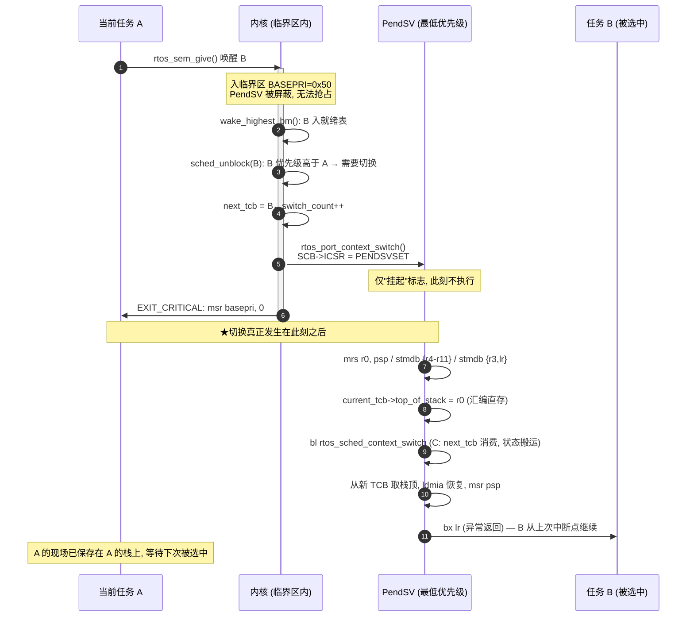

</details>

**这个"决策-执行分离"设计的三个好处**：
1. 临界区内可以多次调用 schedule()（如 tick 里唤醒多个任务），多次 pend 自然合并为一次切换；
2. 同一函数在任务上下文（yield）和 ISR 上下文（sem_give 唤醒）都能用——ISR 里挂 PendSV 是安全的标准手法；
3. schedule() 本身不碰栈、不碰 PSP，可以在任何嵌套深度的 C 调用链里安全执行。

**决策失效时必须重算**：合法 RTOS ISR（本配置优先级数值 ≥5）可在 PendSV 执行前唤醒刚阻塞的当前任务。若它重新成为最高就绪任务，`schedule` 清除过期 `next_tcb`，并恢复它的 RUNNING 状态。删除、挂起和优先级变化同样重算候选。优先级 0~4 的 ISR 不允许调用 RTOS API，不能用它们解释合法内核竞态。

## 3.4 rtos_sched_block(): 任务退出运行, 进入等待

任何阻塞 API（delay/sem_take/mutex_take/queue/event/notify_wait）最终都走到这里：

```
sched_block(tcb, ticks):
1. state == READY/RUNNING → ready_list_remove(tcb)     ← 先摘出就绪表
2. ticks == RTOS_WAIT_FOREVER:
      wake_tick = 0xFFFFFFFF (哨兵); state = BLOCKED
      (不入延时链 —— 永远不会因超时被 tick 唤醒, 只能被对象唤醒)
3. 否则:
      wake_tick = tick_count + ticks
      state = RTOS_TASK_DELAYED
      delay_list_insert(tcb)                            ← O(1) 快路径(表尾缓存, 见 3.4)
```

### 延时链表: 按"睡到几点"排序的**双向**链 (含表尾缓存)

延时链没有专门的结构体，全部家当是一根头指针加 TCB 里现成的两个字段：

```c
rtos_kernel.delay_head;   /* 唯一链表头 */
tcb->wake_tick;           /* 睡到第几个 tick 醒(绝对时刻) */
tcb->next_ready;          /* 延时链上的后继(此态下语义为 next) */
tcb->prev_ready;          /* 延时链上的前驱 —— 但要见下方的"表头借用"约定 */
```

**核心技巧：表头节点的 `prev_ready` 被借用来缓存表尾。**

这是本结构最不直观、也最关键的一处设计。链表是双向的（`next_ready` 指向更晚醒的、`prev_ready` 指向更早醒的，表尾 `next_ready == NULL`），但**表头节点的 `prev_ready` 不指向 NULL，而是指向表尾**：


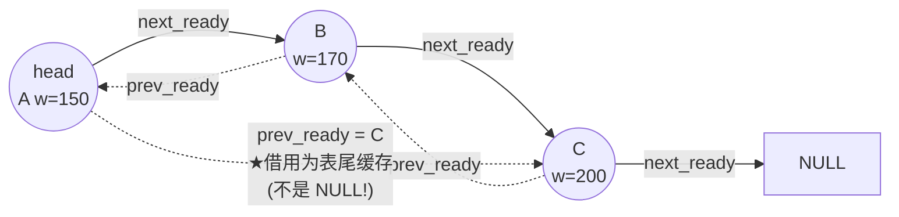

收益：**取表尾变成 O(1)**（无需遍历），而"新唤醒点是否晚于所有现有节点"这个判断只需比较一次即可完成——这就是插入快路径的基础。代价是**摘除表头时必须特殊处理**（表头的 `prev_ready` 不是真实前驱），见下面的 `delay_list_remove`。


<details><summary>图形源码（mermaid）</summary>

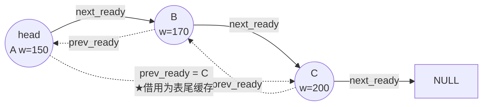

</details>


<details><summary>图形源码（mermaid）</summary>

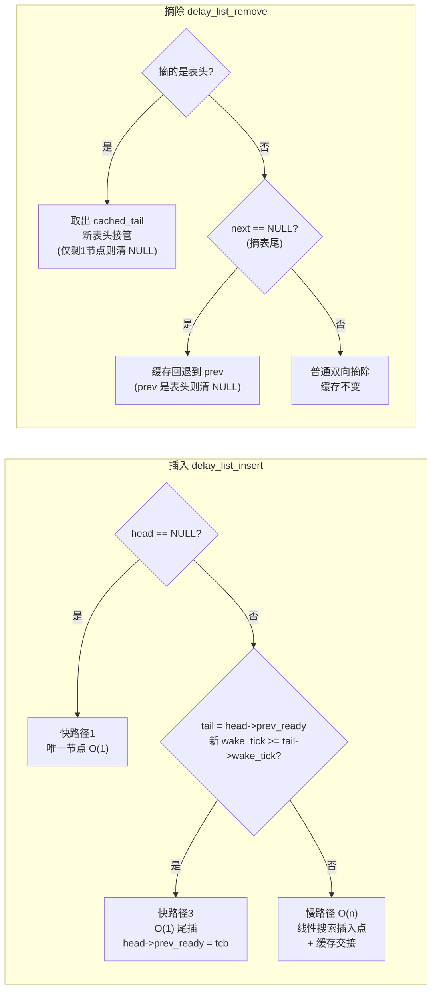

</details>

> 等价性论证：链长 ≥ 2 时 `表头.prev_ready == 表尾`，且 `表尾.prev_ready == 真实前驱`；
> 链长 == 1 时表头即表尾，缓存退化为 NULL。插入/摘除的每个分支都显式维护这条不变式。

**插入：三级快路径 + 一条慢路径**

```c
static void delay_list_insert(rtos_tcb_t *tcb)
{
    rtos_tcb_t *head = rtos_kernel.delay_head;

    /* 快路径 1: 空链 → O(1) */
    if (head == NULL) { tcb->next_ready = NULL; tcb->prev_ready = NULL;
                        rtos_kernel.delay_head = tcb; return; }

    rtos_tcb_t *tail = head->prev_ready;            /* 取表尾缓存 */

    /* 快路径 2: 单节点链 / 缓存异常修复 */
    if (head->next_ready == NULL)      { tail = head; }
    else if (tail == NULL) {                        /* 缓存异常: 重算并修复 */
        tail = head;
        while (tail->next_ready != NULL) { tail = tail->next_ready; }
        head->prev_ready = tail;
    }

    /* 快路径 3: 新唤醒点不早于表尾 → O(1) 尾插 */
    if (sched_tick_after(tcb->wake_tick, tail->wake_tick) >= 0) {
        tcb->next_ready = NULL; tcb->prev_ready = tail;
        tail->next_ready = tcb; head->prev_ready = tcb;   /* 缓存前移 */
        return;
    }

    /* 慢路径: 线性搜索插入点(仅当新节点早于当前表尾) */
    rtos_tcb_t *prev = NULL, *cur = head;
    while ((cur != NULL) && (sched_tick_after(cur->wake_tick, tcb->wake_tick) <= 0)) {
        prev = cur; cur = cur->next_ready;
    }
    tcb->next_ready = cur;
    if (prev == NULL) { tcb->prev_ready = tail;          /* 成为新表头, 接管缓存 */
                        head->prev_ready = tcb;
                        rtos_kernel.delay_head = tcb; }
    else { tcb->prev_ready = prev; prev->next_ready = tcb;
           if (cur != NULL) { cur->prev_ready = tcb; }
           else             { head->prev_ready = tcb; } } /* 新表尾, 更新缓存 */
}
```

**为什么这条快路径如此重要**：`delay_list_insert` 由 `rtos_sched_block()` 调用，而后者在 **SysTick 临界区内**也会被走到（任务 `delay`、带超时阻塞）。绝大多数延时/超时是"新增一个比现有全部节点都晚的唤醒点"——周期任务、一次性 `delay`、`sem_take(t, 100)` 都是这种形态，因此**快路径命中率极高**，慢路径（真正乱序插入，如高优先级任务插入短延时）才付 O(n)。快路径把常见情况的**关中断窗口**从 O(n) 压到 O(1)，这正是重负载下周期控制环偏差下降的机制来源。

插入实例（当前 tick = 100，表尾缓存已建立）：

```
任务A delay(50)        → wake=150: 链空, 快路径1           [A(150)]
任务B delay(10)        → wake=110: 110 < 表尾150 → 慢路径   [B(110), A(150)]
任务C sem_take(超时50) → wake=150: 150 >= 表尾150 → 快路径3 尾插
                                                          [B(110), A(150), C(150)]
任务D delay(100)       → wake=200: 200 >= 表尾150 → 快路径3 尾插(仅 1 次比较)
                                                          [B(110), A(150), C(150), D(200)]
```

**摘除：O(1)，但要处理"表头缓存"的三种交接**

```c
static void delay_list_remove(rtos_tcb_t *tcb)
{
    rtos_tcb_t *prev = tcb->prev_ready;      /* 注意: 若 tcb 是表头, 这是表尾缓存 */
    rtos_tcb_t *next = tcb->next_ready;
    rtos_bool_t is_head = (rtos_kernel.delay_head == tcb);

    if (is_head) {
        rtos_tcb_t *cached_tail = prev;      /* 先把缓存取出来 */
        rtos_kernel.delay_head = next;
        if (next != NULL) {
            if (next->next_ready == NULL) { next->prev_ready = NULL; }  /* 只剩1个: 无独立缓存 */
            else                          { next->prev_ready = cached_tail; } /* 新表头接管缓存 */
        }
    } else if (prev != NULL) {
        prev->next_ready = next;
        if (next != NULL) { next->prev_ready = prev; }
        else {                                /* 摘除表尾: 缓存要回退 */
            if (prev == rtos_kernel.delay_head) { prev->prev_ready = NULL; }
            else { rtos_kernel.delay_head->prev_ready = prev; }
        }
    } else { return; }                        /* 不在链上(防御) */
    tcb->next_ready = NULL; tcb->prev_ready = NULL;
}
```

**三个设计决定**：

**① 复用 `next_ready`/`prev_ready`，不新增 `next_delay` 字段**——省 8 字节/任务的 RAM。安全性由状态机保证：这两个指针的**就绪环**语义只在 READY/RUNNING 态（就绪链）使用；DELAYED 态下它们转作延时链的**双向**指针。任务同一时刻只处于一种状态，因此只可能挂在两条链之一，两种用法永不重叠。代价是读代码必须带着状态上下文（2.3 暗礁之一）。

**② 三条快路径 + 一条慢路径：用"比较一次"换掉"遍历一遍"**——升序排列的价值在于 tick 侧只需看链首一眼（`sched_tick_after(delay_head->wake_tick, now) > 0` 即收工），"找谁该醒"不是搜索而是摘链首。而**插入侧**通过表尾缓存把最常见的"追加到最晚"变成一次比较。FreeRTOS 同为有序链表，但其插入固定 O(n)；本内核在保持同等 tick 侧效率的前提下把常见插入降为 O(1)。

**③ 同一 `wake_tick` 的任务按 FIFO**——慢路径的循环条件用 `<= 0`（即"当前节点不晚于我"就继续走），使新节点插到所有同值节点**之后**；先睡的排前面、先被唤醒。

> **tick 回绕安全**（原限制 L1，已修复）：所有到期与排序比较统一走
> `sched_tick_after(a, b) = (int32_t)(a - b)`（模 2³² 减法取半平面），
> 约定单次延时/超时/周期 < 2³¹ tick。早期实现用无符号比较，
> 跨 49.7 天回绕点时延时会被排到链首并在下一 tick 立即"到期"。

注意实例里的任务 C：它不是单纯延时，而是**带超时的对象等待**——它会同时出现在延时链**和**信号量等待链上。这正是 3.5 / 3.7 的主角。

## 3.5 唤醒的两条路径: 对象侧与时间侧

"唤醒"在本内核里有且只有两个发起方，分别从不同的链上把任务摘下来，但**都必须把任务挂着的两条链都清干净**：


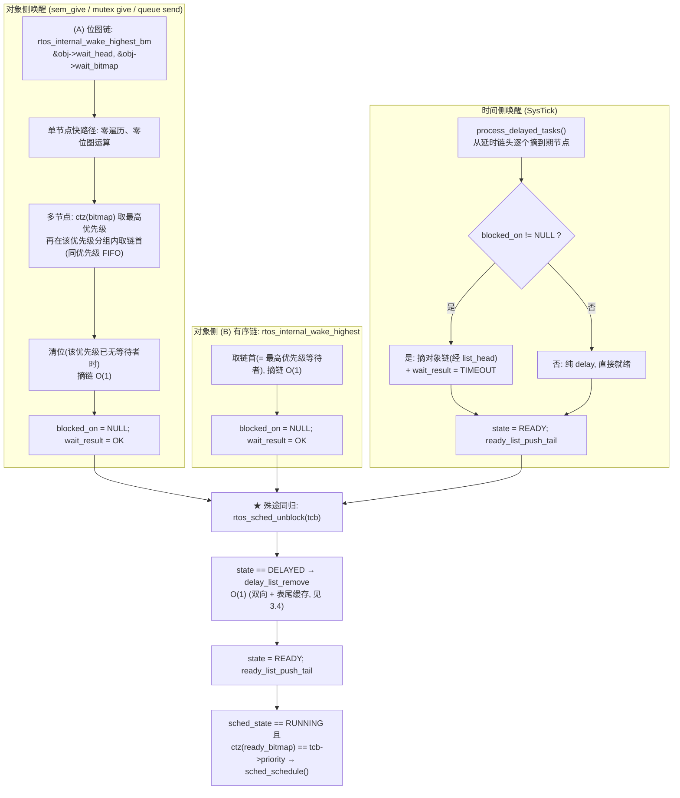

`rtos_sched_unblock()` 之所以先查延时链（`state == DELAYED → delay_list_remove`），是因为对象侧唤醒发生时，任务的超时时刻可能还没到——**提前醒来要把剩余的守夜义务注销**（从延时链摘掉，否则到点时 tick 还会再"唤醒"它一次，造成双重唤醒）。

入就绪队尾后，该任务的优先级位已置位，所以这里的 `ctz` 输入必非零。唤醒任务所在优先级是最高就绪优先级时，继续调用 `sched_schedule()` 完整选择该优先级的 **`ready_heads[p]`**；同级 FIFO 队列中它不一定就是刚被唤醒的任务。整个选择过程必须保持在同一临界区内，不能在读取候选前允许合法 RTOS ISR 改变调度状态或就绪位图。

**双链登记不变式（理解整个内核的钥匙）**——一个带超时阻塞在对象上的任务，同时挂在两条链上：

| 挂在哪条链 | 用什么字段串接 | 谁会来摘它 |
|---|---|---|
| 对象等待链（双向；纪律见 1.3 不变式 III） | wait_node.next / .prev | give 方的 `wake_highest` / `wake_highest_bm`；或超时路径经 list_head |
| 内核延时链（双向，按 wake_tick 升序 + 表尾缓存） | tcb->next_ready / tcb->prev_ready | 到期时的 process_delayed_tasks；或对象唤醒时的 delay_list_remove |

两条链各自回答一个独立的问题：对象链回答**"谁来唤醒我"**（give 顺着它找到该唤醒谁），延时链回答**"我最晚何时必须醒"**（tick 顺着它找谁该醒）。**先到的一方负责把两条链都摘干净，后到的一方自然扑空**——这就是"不会既算成功又算超时"的结构性保证。"摘两条链"是复合动作，其原子性由 BASEPRI 临界区背书（3.7 阶段四详述）。


<details><summary>图形源码（mermaid）</summary>

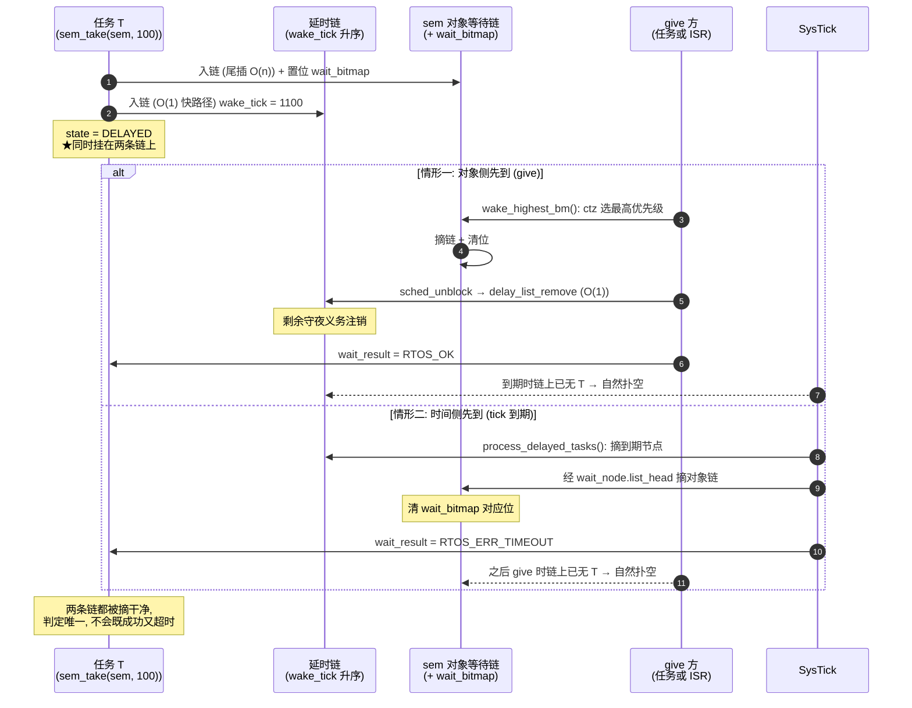

</details>

被唤醒任务进就绪**队尾**（同级 FIFO 公平）；只有优先级**严格高于**当前任务才触发立即切换——同级唤醒等时间片轮转，与 FreeRTOS 行为一致。

> **两条唤醒路径的等价性**（重要）：`wake_highest_bm` 与 `wake_highest` 的可观察语义完全相同
> ——都唤醒"最高优先级等待者，同优先级取最早入链者"。`_bm` 版本额外做了两件防御：
> ① 位图与链表理论上不会不一致（同一临界区维护），但若位图位残留导致在链上找不到该优先级的
> 节点，它退化为**全链扫描取最高优先级**，而**绝不退化为"取链首"**——后者会唤醒错误的任务
> 并破坏唤醒序语义；② 摘除后若该优先级已无其它等待者则清位，避免位图残留引发后续空扫描。

## 3.6 一个 tick 的完整旅程

以 1kHz SysTick 为例，从硬件到调度：

```
① SysTick 硬件计数到 0 → 拉起 SysTick 异常 (向量: SysTick_Handler)
② SysTick_Handler (stm32f4xx_it.c):
     rtos_port_sys_tick_handler():
       sched_state != RUNNING → 直接返回
       ENTER_CRITICAL                      ← BASEPRI=0x50, nesting=1
       rtos_sched_tick():
         (a) tick_count++
         (b) process_delayed_tasks():
              now = tick_count
              while delay_head && delay_head->wake_tick <= now:
                  tcb = delay_head; 摘链
                  if tcb->blocked_on != NULL:      ← 对象等待超时
                      wait_node.timed_out = TRUE
                      wait_result = RTOS_ERR_TIMEOUT
                      if list_head != NULL:
                          wait_remove(list_head, &wait_node)  ← 从对象等待链表摘除!
                          list_head = NULL
                      mutex_waiter_left(tcb)        ← 若等的是互斥锁, 重估 owner 优先级
                  state = READY; ready_list_push_tail(tcb)
         (c) 单次调度决策:
              top = ctz(ready_bitmap)
              next = ready_heads[top]; cur = current_tcb
              next != cur → next_tcb=next; pend PendSV        ← 抢占
              否则若时间片开启 && cur 是 RUNNING && 同级链>1:
                   rotate(top); next_tcb=新head; pend PendSV  ← 轮转
       EXIT_CRITICAL                      ← BASEPRI 清零
③ 此处可能立即进入 PendSV (若被 pend) → 切换到新任务
④ HAL_IncTick() (HAL 时基, 与 RTOS 独立)
```

**为什么超时摘除必须经 list_head**：任务阻塞在信号量上且带超时 → 它同时在 sem->wait_head（对象链）和 delay_head（延时链）两条链上（不变式 II 允许：一条调度链 + 一条等待链）。超时时若只从延时链摘、不从对象链摘，节点就留在 sem->wait_head 里成为悬空指针——之后任何 sem_give 的 wake_highest 都会解引用已就绪任务的节点，状态机立即错乱。这是侵入式链表方案必须付出的对价：**离开任何一条链都要显式摘除**。完整的逐步解剖见下一节。

## 3.7 超时如何定位任务: sem_take(sem, 100) 超时的完整解剖

这是全内核最精巧的一条路径。场景：任务 T（优先级 3）在 tick=1000 调用 `rtos_sem_take(sem, 100)`，此后无人 give。下面跟踪全过程每一步与每条数据结构的变迁。

### 阶段一: 入睡 (tick=1000, 任务上下文, 临界区内)

```
1. sem->count == 0 → 走慢路径
2. rtos_internal_block_current_on(sem, &sem->wait_head, 100):
     T->blocked_on = sem                        ← TCB 记下"我睡在 sem 上"
     T->wait_node.list_head = &sem->wait_head   ← ★自记"我的节点挂在哪条链上"
     按优先级插入 sem->wait_head                 （T 进入对象等待链）
3. rtos_sched_block(T, 100):
     T 从就绪表摘除
     T->wake_tick = 1000 + 100 = 1100           （T 进入延时链, 按 1100 有序插入）
     T->state = RTOS_TASK_DELAYED
     T->wait_result = RTOS_OK                   ← 预填的乐观结果
4. rtos_sched_schedule() → 选出别的任务, pend PendSV
5. EXIT_CRITICAL → PendSV 执行: T 的全部现场存进 T 自己的栈, CPU 换人
```

入睡完成时，T 的行踪登记在三处：**sem 的等待链**（等谁）、**内核延时链**（最晚何时醒）、**TCB 的 wait_result**（预填的判决占位）。此刻 T 同时挂在两条链上——这就是 3.5 的双链登记不变式。

### 阶段二: 守夜 (tick 1001~1099, 每 1ms, ISR 上下文)

每个 SysTick 的 tick 处理只做一次比较：`delay_head->wake_tick <= now ?`——未到期立即返回。**守夜成本与睡眠人数无关**，只与到期事件数相关。T 与其他睡眠者安静地排在延时链上，无人打扰。

### 阶段三: 判决 (tick=1100, SysTick ISR, 临界区内)

"如何找到超时任务"的答案：**不需要寻找——延时链的升序不变式保证所有到期任务必然集中在链首**，摘链首即可：

```
process_delayed_tasks():
  now = 1100
  while (delay_head != NULL && delay_head->wake_tick <= now):
      tcb = delay_head;  摘链                   ← 链首 = 全内核最早到期的睡眠者
      if (tcb->blocked_on != NULL):             ← 区分: 对象等待超时 / 纯 delay
          tcb->wait_node.timed_out  = TRUE
          tcb->wait_result = RTOS_ERR_TIMEOUT   ← ★趁 T 还睡着, 把判决写进它的 TCB
          if (tcb->wait_node.list_head != NULL):
              rtos_internal_wait_remove(list_head, &wait_node)
                                                 ← ★顺着入睡前自记的地址, O(1) 摘出对象等待链
              tcb->wait_node.list_head = NULL
          rtos_internal_mutex_waiter_left(tcb)  ← 若等的是互斥锁, 重估持有者优先级(7.4)
      tcb->state = RTOS_TASK_READY
      ready_list_push_tail(tcb)                 ← 进入就绪表, 排队等运行
```

两个关键机制：

**① 定位为什么是 O(1)**：tick ISR 手里只有 TCB，它不知道（也不需要知道）T 睡在信号量还是队列上。但 T 入睡前已把"我的节点挂在哪个链表头的**地址**"记进了 `wait_node.list_head`。摘除用 wait_node 的双向指针（prev/next）直接完成。一个字段同时回答"在不在链上"（NULL 判断）与"在哪条链上"（解引用即得）。notify_wait 不挂对象链、list_head 恒 NULL，自动跳过——**同一条超时路径通吃五种阻塞**（delay/sem/mutex/queue/event/notify）。

**② 判决的信箱模式**：`wait_result` 在 T 沉睡时被写入 TCB，T 醒来后自取。判决方（tick ISR）与受审方（任务 T）在时间上完全解耦——中间隔着"就绪→排队→PendSV 切换"的完整调度流程，却不需要任何额外的传递机制。

### 阶段四: 竞争裁定——先到者全摘, 后到者扑空

give 与超时都想摘同一个 T，竞态如何裁决？

- **give 先到**（某 tick < 1100）：wake_highest 把 T 从**对象链**摘掉 → sched_unblock 发现 `state == DELAYED` → delay_list_remove 把 T 从**延时链**也摘掉。1100ms 的 tick 到来时延时链上已无 T——超时路径碰不到它。T 醒来读到 wait_result=OK。
- **超时先到**（tick=1100）：T 从延时链摘除 + 经 list_head 从对象链摘除。此后任何 give 到达时，wake_highest 在对象链上扑空（T 的节点已不在），唤醒别的等待者或 count++。T 醒来读到 TIMEOUT。
- **"同时到达"不存在**：give（任务或 ISR 上下文）与 tick（ISR 上下文）对这两条链的全部修改都包裹在 BASEPRI 临界区内。"从两条链摘除"是复合动作，临界区使其**原子**——两个修改方被串行化，谁先进入临界区谁完成全部摘链，后进者看到的世界已经干净。

这就是双链登记的结构语义：**不存在"两边都摘到"（既成功又超时）或"两边都没摘到"（悬空节点）的中间态**。因此内核不需要任何"撤销超时"或"撤销唤醒"的补偿逻辑——正确性是结构性的，不是修补出来的。

### 阶段五: 醒来领判决

T 在就绪队尾排队 → 轮到 T → PendSV 恢复其上下文 → 从 `EXIT_CRITICAL` 那条指令之后继续执行（对 T 而言，仿佛 `rtos_internal_block_current_on` 刚刚返回）→ sem_take 的最后一行：

```c
return cur->wait_result;   /* cur 也随任务寄存器恢复；结果为 RTOS_ERR_TIMEOUT */
```

注意 T 的局部世界（栈帧、寄存器）在整个超时过程中原封不动——被改写的只有 TCB 里的全局字段。醒来后读 wait_result，即拿到判决。

### 附: 互斥锁超时的附加戏份

若 T 等的是 mutex，阶段三还多一步连锁反应：T 的等待曾让持锁者的优先级被提升（优先级继承），T 超时离开后这次提升失去依据。`rtos_internal_mutex_waiter_left(T)` 拿 `wait_node.wait_obj` 到全局锁注册表（s_mutex_registry）里匹配，确认"T 等的确实是一把活着的锁"后调 `mutex_recompute_inheritance` 重算持锁者有效优先级（综合其全部持有锁的有序等待链首与 `base_priority`，7.4、7.6 详述）。信号量/队列等对象的 wait_obj 在注册表里匹配不到，自动忽略——**同一个超时路径，只有锁需要善后**。

另一个相关边界：notify_wait 超时瞬间的通知去留——超时已置 TIMEOUT 但 T 尚未运行期间通知到达，notify_state 仍为 PENDING 被保留，下次 notify_wait 立即取走、不丢失（5.7 详述）。

## 3.8 时间片轮转的边界情形

轮转仅在 `next == cur`（无更高优先级就绪）且当前优先级链表多于一个任务时发生。刚被唤醒的同优先级任务在队尾，下一个 tick 轮到它——因此"同级任务被唤醒后最迟 1 个 tick 内获得执行"。

## 3.9 挂起调度器: 与阻塞 API 的互斥契约

`rtos_sched_suspend()` 只把 `sched_state` 置为非 RUNNING，而 `rtos_sched_tick()` 在非 RUNNING 态**直接返回**——tick 计数停走、到期处理停摆。因此"挂起"与"阻塞"互斥：挂起期间若让任务入睡，它既等不到对象侧唤醒（唤醒只会把它放回就绪表，而超时判定已停），也没有任何超时来源，**永久挂死**（真机实测：挂起后 `rtos_task_delay(60)` 永不返回）。

契约写在 `rtos_sched.h`：挂起期间**禁止任何会阻塞的 API**，一律立即返回，非阻塞路径不受影响——

| 类别 | API | 挂起期间行为 |
|---|---|---|
| 阻塞 | `rtos_task_delay` / `rtos_task_delay_until` | 不阻塞，立即返回（void 接口无法报错误码，与 ISR 上下文的处理一致） |
| 阻塞 | `rtos_task_notify_wait` / `rtos_sem_take` / `rtos_mutex_take` / `rtos_queue_send` / `rtos_queue_recv` | **`RTOS_ERR_SCHED`(-9)** |
| 阻塞 | `rtos_event_wait` | **0**（该接口返回位掩码，无法报错误码） |
| 非阻塞 | `RTOS_NO_WAIT`、计数充足、队列未满… | 不受影响 |

统一守卫 `rtos_internal_block_permitted()`（`rtos_internal.h`，`static inline`，只读 `sched_state`，不进临界区）必须在**修改任何状态之前**判定：否则会留下"已入链却无人唤醒"的半初始化 `wait_node`。`rtos_mutex_take` 的判定还必须早于 `mutex_try_inherit()`——否则会留下一次无人恢复的优先级提升（恢复动作在释放路径上，而释放者可能正是被挡住的调用者）。

> **与临界区的分工**（4.5）：临界区屏蔽中断、持有时长有明确上界；挂起影响的是调度与 tick，时长由调用者自律。需要"长时间不被打断"应选临界区，而不是挂起调度器。

---

# 第四章 移植层: PendSV, SVC 与临界区的指令级流程

## 4.1 两级现场保存的分工

进入异常时**硬件自动**保存 8 字基本帧（R0-R3/R12/LR/PC/xPSR）到当前栈；若该任务用过 FPU（CONTROL.FPCA=1），硬件**预留**扩展帧空间（S0-S15+FPSCR，共 17 字，配合 FPCCR.LSPEN 惰性填充）。**软件**（PendSV）只补存 callee-saved 部分：


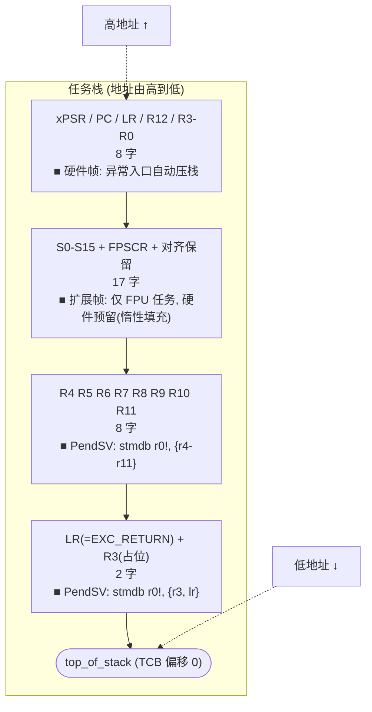

`STMDB {r3, lr}` 一石三鸟：保存 EXC_RETURN（每个任务帧类型可能不同，必须随栈保存）、凑 8 字节保持栈对齐、R3 在硬件帧里有副本可弃。

> **为什么 R3 只需要"有个值"**：它是被 `bl` 之后的 C 函数当作 caller-saved 寄存器随意改写的，
> 任务本身也不期望 R3 跨上下文切换保持（AAPCS 中 R3 是 caller-saved）。
> 因此这一格的真实载荷只有 EXC_RETURN，R3 是凑对齐的占位。函数返回路径同样先 `ldmia` 出这一对，
> 把 EXC_RETURN 装回 LR，R3 的旧值被丢弃。

## 4.2 PendSV 逐指令流程

当前移植层在 naked 汇编中保存旧任务现场，调用内部 `rtos_sched_commit_context_switch()`，再从 AAPCS 返回寄存器 R0 取得实际运行 TCB。公共 `void rtos_sched_context_switch(void)` 入口继续保留。返回 TCB 的方式省掉了 C 调用后重新取得内核地址和 current_tcb 的两条 LDR；实板对照与 ABI 检查见 [底层优化报告](rtos_lowlevel_optimization_20261012.md)。

下面为默认 BASEPRI 配置的当前指令流程，偏移由 `offsetof` 的命名常量传入汇编，不硬编码结构体布局：

```asm
rtos_port_pend_sv_handler:         ; naked，运行于 Handler 模式/MSP
  mrs   r0, psp                    ; 旧任务硬件帧地址
  tst   lr, #0x10                  ; 旧任务 EXC_RETURN 帧类型
  it    eq
  vstmdbeq r0!, {s16-s31}          ; 扩展帧补存 16 个高位浮点寄存器
  stmdb r0!, {r4-r11}
  stmdb r0!, {r3, lr}              ; R3 填充 + EXC_RETURN 保持任务栈 8 字节对齐
  mrs   r2, basepri                ; 保存原来的屏蔽值
  movs  r3, #MAX_SYSCALL_PRIORITY
  msr   basepri_max, r3            ; 不降低已有的更强屏蔽
  isb                             ; 同步中断屏蔽
  push  {r2, r3}                   ; 在 MSP 上保存原屏蔽值，保持 C 调用 8 字节对齐
  ldr   r1, =rtos_kernel
  ldr   r1, [r1, #OFF_CUR_TCB]
  str   r0, [r1, #OFF_TOP_STACK]   ; 保存旧任务栈顶
  bl    rtos_sched_commit_context_switch
                                   ; R0 = 实际运行 TCB；EXC_RETURN 已保存在任务栈
  ldr   r0, [r0, #OFF_TOP_STACK]   ; 直接读取返回 TCB 的栈顶
  ldmia r0!, {r3, lr}              ; 恢复新任务 EXC_RETURN
  ldmia r0!, {r4-r11}
  tst   lr, #0x10
  it    eq
  vldmiaeq r0!, {s16-s31}
  msr   psp, r0                    ; 安装新任务硬件帧地址
  pop   {r2, r3}
  msr   basepri, r2                ; 恢复调用者原来的屏蔽值
  bx    lr                         ; 异常返回，由硬件恢复基本/扩展帧
```

`RTOS_CONFIG_USE_BASEPRI=0` 时，相同窗口改用保存 PRIMASK、`cpsid i` 和还原 PRIMASK。旧任务上下文必须先完整保存，再提交任务身份；新 PSP 安装后才能解除屏蔽。此次优化没有缩短这个保护窗口，也没有删除其中的 ISB。历史图 [rtos_design_10.png](images/rtos_design_10.png) 仅展示保存/恢复主体，当前调用和中断保护以上述流程及 `port.c` 为准。

C 提交函数的主要逻辑如下（省略测试专用注入钩子）：

```c
rtos_tcb_t *rtos_sched_commit_context_switch(void)
{
    rtos_tcb_t *current_task = rtos_kernel.current_tcb;
    if (rtos_kernel.sched_state != RTOS_SCHED_RUNNING) {
        rtos_kernel.next_tcb = NULL;
        return current_task;
    }
    if (rtos_kernel.next_tcb != NULL) {
        rtos_tcb_t *prev = current_task;
        rtos_tcb_t *next = rtos_kernel.next_tcb;
        rtos_kernel.next_tcb = NULL;
        RTOS_ASSERT((next->state == RTOS_TASK_READY) || (next == prev));
        if ((prev != NULL) && (prev->state == RTOS_TASK_RUNNING)) {
            prev->state = RTOS_TASK_READY;
        }
        next->state = RTOS_TASK_RUNNING;
        next->switch_count++;
        rtos_kernel.current_tcb = next;
#if RTOS_CONFIG_PERF_HOTPATH_STATS
        rtos_perf_on_context_switch(prev, next);
#endif
        return next;
    }
    return current_task;
}
```

无候选或调度器暂停时返回原任务，供 PendSV 恢复刚保存的原现场；尚未安装当前任务时内部函数可返回 NULL，这不是已启动 PendSV 的合法运行情形。公共 void 包装函数只调用该内部入口，不改变外部接口。统计开启时，编译器将 next 保存在 callee-saved 寄存器中，调用统计钩子后再返回 R0；该分支已做独立反汇编核验和真实浮点任务混合测试。

PendSV 的优先级最低，合法 RTOS ISR 能在未屏蔽时抢占它，因此读取候选、提交 current/next、恢复上下文必须在同一保护窗口中。BASEPRI 模式下，优先级 0–4 的中断仍可运行，但必须遵守不调用 RTOS API 的契约。完整验证覆盖取消切换、暂停、无候选、自切换及公共入口；有限测试通过不等于任意负载或最坏时延保证。

## 4.3 任务栈初始化: 伪造一次中断

`rtos_port_init_stack(stack_top, size, entry, arg)` 从高向低依次压入（`*--sp` 序）：

```
xPSR  = 0x01000000      ← bit24(Thumb)=1, 否则首次异常返回即 INVSTATE
PC    = entry           ← 首次"恢复"后从这里执行
LR    = rtos_task_exit_handler  ← 任务函数 return 时自动跳这里 → 自删除
R12/R3/R2/R1 = 0x?0?0?0?0 图案
R0    = arg             ← AAPCS 第一个参数, 任务入口的原型是 void(*)(void*)
R11..R4 = 图案
EXC_RETURN = 0xFFFFFFFD ← 基本帧(新任务未用过 FPU)
R3(填充) = 0xDEDEDEDE   ← 对齐垫片, 值无所谓
返回 sp                 ← 写入 tcb->top_of_stack
```

**首次调度到新任务时**：PendSV 恢复流程把这份伪帧当作"上次被保存的现场"照常恢复，`bx lr` 异常返回后硬件弹出 R0=arg/PC=entry——任务就像"从一次中断中返回"般开始运行。**启动 = 恢复**，无需任何特殊入口汇编，这是 Cortex-M RTOS 的经典优雅解。

## 4.4 首任务启动: SVC 的必要性

线程模式下执行 `BX 0xFFFFFFFD` 是**普通跳转**（目标 0xFFFFFFFD 非法 → HardFault）；只有 Handler 模式下它才被解释为"异常返回"。因此首任务必须经 SVC 进入 Handler 模式后再返回：

```
rtos_sched_start():
  sched_state = RUNNING
  current_tcb = ready_heads[最高优先级]      ← 手动选出第一个任务
  perf 初始化窗口基准
  rtos_port_start_scheduler():
      FPU->FPCCR |= ASPEN|LSPEN             ← 使能惰性 FPU 保存
      SysTick->LOAD = SystemCoreClock/1000 - 1
      SysTick->CTRL = 使能+中断              ← tick 开始走
  rtos_port_start_first_task():
      msr basepri, 0x50                     ← ① 屏蔽 SysTick/PendSV(优先级5~15)
      cpsie i                               ← ② 开总中断
      dsb; isb
      svc 0                                 ← ③ SVC 优先级0, 不被①屏蔽, 立即响应
  (永不返回)

rtos_port_svc_handler:                      (naked, 运行于 Handler 模式/MSP)
  push {r1, lr}                             ← 保护 EXC_RETURN, 保持 MSP 8 对齐
  bl rtos_port_get_first_sp                 ← C: return current_tcb->top_of_stack
  pop {r1, lr}
  msr psp, r0                               ← PSP = 首任务栈
  isb
  ldmia r0!, {r3, lr}                       ← 恢复 R3 填充 + EXC_RETURN
  ldmia r0!, {r4-r11}
  tst lr, #0x10; it eq; vldmiaeq r0!, {s16-s31}
  msr psp, r0
  mov r1, #0; msr basepri, r1               ← ④ 清屏蔽, 首任务全中断运行
  bx lr                                     ← 异常返回 → 进入首任务
```

**①② 的顺序防的是什么竞态**：若先 `cpsie` 再屏蔽，`start_scheduler` 里已使能的 SysTick 可能在 PSP 初始化前到期 → PendSV 以 PSP=0 保存"上下文" → 写 0 地址 → HardFault。先 BASEPRI 后开中断，SVC（优先级 0）畅通无阻、SysTick/PendSV（0xFF）被挡住，窗口闭合。

## 4.5 临界区: 进出与屏障

2026-10-12 的实现先读取调用者屏蔽值，用 `BASEPRI_MAX` 加强屏蔽，最外层保存原值；嵌套归零时恢复原值，而非固定清零。因此已存在的更强 BASEPRI、PRIMASK 关中断状态不会被 RTOS 临界区削弱。以下代码对应当前 `rtos_port.h`；本节后面的周期数字记录旧版性能优化。

```c
/* 二者均为 rtos_port.h 中的 static inline；exit 侧无屏障 */
static inline void rtos_port_enter_critical(void)
{
    uint32_t previous_mask;
#if RTOS_CONFIG_USE_BASEPRI
    __asm volatile(" mrs %0, basepri      \n"
                   " msr basepri_max, %1 \n"
                   " isb                 \n" : "=&r"(previous_mask)
                   : "r"(RTOS_CONFIG_MAX_SYSCALL_INTERRUPT_PRIORITY)
                   : "memory");
#else
    __asm volatile(" mrs %0, primask \n"
                   " cpsid i        \n" : "=r"(previous_mask) :: "memory");
#endif
    uint32_t nesting = rtos_port_crit_nest;
    if (nesting == 0U) {
        rtos_port_saved_mask = previous_mask;
    }
    rtos_port_crit_nest = nesting + 1U;
}

static inline void rtos_port_exit_critical(void)
{
    uint32_t nesting = rtos_port_crit_nest - 1U;
    rtos_port_crit_nest = nesting;
    if (nesting == 0U) {
#if RTOS_CONFIG_USE_BASEPRI
        __asm volatile(" msr basepri, %0 \n" :: "r"(rtos_port_saved_mask) : "memory");
#else
        __asm volatile(" msr primask, %0 \n" :: "r"(rtos_port_saved_mask) : "memory");
#endif
    }
}
```

**本轮局部计数优化的约束**：每次 enter/exit 对 `volatile` 嵌套计数只读取一次，用局部 `nesting` 同时计算新值和判断最外层边界，再写回一次。enter 必须先完成屏蔽和进入屏障，随后才能读共享计数；合法 RTOS ISR 在这段读写期间被屏蔽，优先级 0~4 的 ISR 禁止调用内核，所以不会丢失另一个合法调用者的计数更新。嵌套进入仍执行屏蔽指令与原有屏障，最外层退出仍恢复保存的原始 mask。enter/exit 必须成对；此优化没有增加全局 RAM 或改变 API。

- **默认使用 BASEPRI，PRIMASK 为替代配置**：默认允许优先级 0~4 的硬实时中断（电机环等）抢占内核临界区；替代配置保存 PRIMASK、关全局中断，并在最外层退出时恢复原值；
- **为什么只有 ISB 没有 DSB**（2026-08 优化）：BASEPRI 是系统寄存器写入，DSB 等待内存完成纯属浪费；这是全内核最高频路径（每个 API 至少一对），每对省 ~10 周期；
- **为什么 enter 侧需要 ISB 而 exit 侧不需要**：进入临界区后**后续指令必须在屏蔽生效下执行**，故需一次上下文同步；退出时解除屏蔽，`msr` 对后续取指自然生效——已 pending 的中断晚几条指令被识别没有正确性影响（FreeRTOS `vPortExitCritical` 同判）。
  **实测收益**：临界区进出对由 55 周期降到 **23 周期**（FreeRTOS 为 47），反超 2.04×；
- **嵌套计数的副作用**：ISR 与任务共享同一计数——因此**优先级 0~4 的中断绝不允许调用任何 RTOS API**，否则进/出不对称会永久卡住 BASEPRI；
- **内联化的收益**：早期实现是 `port.c` 里的 out-of-line 函数 + TU 内 static 计数，每次 enter/exit 都要付函数调用序言/尾声；改为头文件 `static inline` + 全局 `rtos_port_crit_nest` 后，每对节省约 10 周期。计数改放移植层也顺带解决了"跨 TU 访问"的问题——内联函数必须能看到定义，而 `static` 变量做不到。
- **一次被实测否决的进一步优化**：曾尝试"嵌套时跳过冗余的 `msr` + `isb`"（用计数判断，仅在 0→1 时真正写 BASEPRI）。实测**净负收益**并已回退：`give_no_waiter` 91→99、`give_w01` 1246→1277 周期。原因是 `rtos_port_crit_nest` 为 `volatile`，判断+自增+分支引入的读-改-写访存开销超过了省下的写入；且信号量 give 路径本身并不嵌套，收益面根本不存在。该结论已写入源码注释，避免后续重复尝试。
- **`rtos_port_context_switch()`**（挂起 PendSV）：先记 perf 时间戳（仅当 `RTOS_CONFIG_PERF_HOTPATH_STATS` 打开，默认关），再 `SCB->ICSR = PENDSVSET`，后跟 `dsb + isb`（ICSR 是内存映射寄存器，此处的屏障保留是正确做法；该路径是"请求切换"而非"执行切换"，屏障成本可接受）。

---

# 第五章 任务管理: 每个 API 的逐步执行流程

## 5.1 rtos_task_create() (动态)的完整流程

```
1. 参数校验: tcb_out/entry 非空, priority < 32, stack_size >= 96字
2. tcb = rtos_heap_alloc(sizeof(rtos_tcb_t))       ← first-fit 扫描(11.1)
   失败 → ERR_NO_MEM
3. stack_buf = rtos_heap_alloc(stack_size * 4)
   失败 → free(tcb); ERR_NO_MEM                    ← 分配失败不留半成品
4. task_create_core(tcb, stack_buf, ...):
   a. memset(tcb, 0)                                ← 全零起步
   b. priority = base_priority = prio; state = INITIALIZING
      task_id = rtos_internal_alloc_task_id()       ← 全局递增
      name 复制(截断至15字符+NUL)
   c. top_of_stack = rtos_port_init_stack(...)      ← 4.3 的伪帧
   d. stack_magic = 0xDEADBEEF; *stack_buf = 0xDEADBEEF
   e. rtos_perf_on_task_created(tcb):
        perf 字段清零
        栈水印: [stack_base, top_of_stack) 全填 0xA5A5A5A5
                (会覆盖 d 写入的栈底魔数副本——无害, 检测只认 TCB 内那份)
        注册进 perf 任务表 (临界区内 add)
   f. ENTER_CRITICAL
      sched_add_ready(tcb) → ready_list_push_tail   ← 进入就绪表
      state = READY; *tcb_out = tcb                 ← 先发布，再允许抢占
      if 调度器RUNNING && prio < current->priority:
          sched_schedule()                          ← 高于当前 → 请求切换
      EXIT_CRITICAL
      → 此处 PendSV 可能立即切入新任务
5. return RTOS_OK
```

**当前创建顺序**：最小栈为 96 字。第一段临界区按地址预留 TCB，并标为 INITIALIZING；栈初始化和水印填充在临界区外进行，此时外部 resume/delete/set_priority/notify/suspend 均拒绝该 TCB。第二段临界区加入就绪表、置 READY，并在请求抢占之前执行 `*tcb_out = tcb`。创建函数返回前新任务可能已经运行；调用者的其他共享数据仍需自行同步。重复使用仍存活或正在构造的静态 TCB 返回 `RTOS_ERR_ALREADY`。

## 5.2 rtos_task_delete(): 两条路径, 一个陷阱

```
1. ISR 中调用 → ERR_ISR (删除需要触发调度, ISR 环境下不安全, 统一禁止)
2. tcb == NULL → tcb = current_tcb; self_delete = TRUE
3. ENTER_CRITICAL
4. 状态分派摘链:
   READY/RUNNING → rtos_sched_remove_ready
   DELAYED       → rtos_sched_remove_delayed
                   ★不能复用 unblock! unblock 会把任务放回就绪表并
                   可能在"其优先级更高"时请求切换 → next_tcb 指向即将
                   释放的 TCB → PendSV 切换到已释放内存 = use-after-free
   BLOCKED       → 不在任何调度链, 跳过
5. 若 blocked_on != NULL (阻塞在 IPC 对象上):
   list_head != NULL → wait_remove 从对象等待链摘除
   mutex_waiter_left(tcb)  ← 重估被等互斥锁 owner 的继承优先级
   blocked_on = NULL
6. state = DELETED
7. perf_on_task_deleted(tcb) ← 从性能注册表移除(swap-with-last)
8. mutex_release_all(tcb):                     ← 释放其持有的所有互斥锁
   遍历 s_mutex_registry, owner == tcb 的每把锁:
     restore_priority(owner)
     woken = wake_highest(&mutex->wait_head)   ← 移交给最高优先级等待者
     woken ? (owner=woken, recursion=1) : (owner=NULL)
   ★必须在释放 TCB 内存之前执行——否则 mutex->owner 指向已释放 TCB,
     其余等待者永久死锁
9. (可选) delete_hook
10. 内存处置:
    静态任务: 不释放(用户管理)
    动态+非自删: free(stack_base); free(tcb)    ← 不在运行位, 立即安全
    动态+自删:   defer_free_tcb(tcb)            ← 挂入待删链
11. 自删时: sched_schedule()                     ← 选出下一个任务, pend PendSV
    EXIT_CRITICAL
    → PendSV 切走, 本函数"永不返回到调用者"
    → 代码物理上会执行到 return RTOS_OK, 但该任务再也不会被调度
```

**defer_free + idle 清理的因果链**（为什么自删不能立即 free）：

```
delete(自身) 挂入 pending_free_list
  → schedule() pend PendSV
  → EXIT_CRITICAL
  → PendSV: mrs r0, psp / stmdb {r4-r11} / stmdb {r3, lr}
  → 汇编直存: current_tcb->top_of_stack = r0        ★写的就是这个 TCB!
  → 若已 free: 写入已释放内存, 破坏堆结构
  → idle 任务运行: process_pending_free() 逐个 free
    (此刻 PendSV 早已完成, TCB 不再被任何上下文引用)
```

**idle 的清理代码**（每轮循环开头检查）：

```c
if( s_pending_free_list != NULL ) {
    临界区摘下整条链并清空表头;      ← 批量摘除, 缩短临界区
    退出临界区后逐个 free;            ← free 是 O(n) 操作, 不能在临界区里做
}
```

## 5.3 rtos_task_suspend(): 从任何状态拉停一个任务

```
1. tcb==NULL(自挂起) 且在 ISR → ERR_ISR
2. ENTER_CRITICAL; self_suspend = (tcb == current)
3. READY/RUNNING → remove_ready
   DELAYED → rtos_sched_remove_delayed(tcb) 摘除(O(1), 双向 + 表尾缓存, 见 3.4)
             [fix S-7] 原实现手写复制了 delay_list_remove 的循环(与 rtos_sched.c
             重复且**漏清 prev_ready**), 现统一调用公共实现
4. 若 blocked_on != NULL (阻塞在对象上):
   wait_remove + mutex_waiter_left
   ★wait_result = RTOS_ERR_DELETED                ← 2026-08 修复
   blocked_on = NULL
   (修复前残留 RTOS_OK → resume 后 take 虚假成功 → 互斥锁被"偷")
5. state = SUSPENDED
6. self_suspend → sched_schedule() (临界区内, pend PendSV)
7. EXIT_CRITICAL
```

**语义要点**：挂起一个"阻塞中的任务"，其等待被**中止**而非"冻结"。恢复（`resume`）后，任务从阻塞点之后继续执行，`sem_take`/`mutex_take` 读到 `wait_result == RTOS_ERR_DELETED` 返回失败——调用方据此知道"这次没等到"，需重新发起操作。这与 FreeRTOS 的行为模型一致（FreeRTOS 里挂起的任务恢复后从 API 中间继续，队列类 API 靠重试循环消化，互斥/信号量返回失败）。

**挂起一个持锁任务**：锁不释放（只有 delete 释放）。等待者继续阻塞直到该任务恢复并 give——挂起持锁者 = 人为延长临界区，属于调用方的责任。

## 5.4 rtos_task_resume()

```
state != SUSPENDED → 直接返回 OK (幂等)
ENTER_CRITICAL
state = READY; add_ready
若 RUNNING 且优先级高于当前 → schedule()
EXIT_CRITICAL → 可能立即切换
```

## 5.5 rtos_task_yield(): 同级让出

```
ENTER_CRITICAL
若当前优先级链表多于一个任务:
    heads[p] = heads[p]->next        ← 自己到队尾
    next_tcb = 新 head; pend PendSV  ← 让给同级伙伴
EXIT_CRITICAL → 切换
```

注意 yield **不调用** sched_schedule()——它不跨优先级让出（低优先级任务不会因 yield 得到运行权），只做同级轮转。这与"yield=自愿降到同级队尾"的标准语义一致。

## 5.6 rtos_task_delay() 与 delay_until() 的算术

**delay(ticks)**：

```
ticks == 0 → 等价 yield (立即让出)
ISR 中 → 无操作返回
ENTER_CRITICAL
sched_block(cur, ticks)      ← 出就绪表, 入延时链(wake_tick = now+ticks)
sched_schedule()             ← 选下一个
EXIT_CRITICAL                ← PendSV 切出; n tick 后被 3.6 流程唤醒
```

**delay_until(last_wake_tick, period)**（周期任务的相位锁定算法）：

```
ENTER_CRITICAL
elapsed = now - *last_wake_tick             ← 无符号减法, 天然回绕安全
remain   = (period > elapsed) ? period - elapsed : 0
if remain == 0:                              ← 已经落后(执行超过了周期)
    missed = elapsed / period
    *last_wake_tick += (missed + 1) * period ← ★跳过所有错过的相位,
    remain = *last_wake_tick - now              直接对齐到未来最近相位
else:
    *last_wake_tick += period                 ← 正常推进一个相位
remain > 0 → block(cur, remain); schedule()
EXIT_CRITICAL
```

**为什么落后时要跳相位**：若不跳，`last_wake_tick` 停在过去，每次调用 `elapsed > period` → `remain=0` → 不阻塞立即返回 → 任务全速空转追赶相位，饿死所有低优先级任务。跳相位让周期任务"承认迟到、放弃追赶"，是周期调度的标准解法。

## 5.7 任务通知: notify 与 notify_wait

**rtos_task_notify(tcb, value, type)**（ISR 可调用）：

```
ENTER_CRITICAL
switch(type):
    VALUE      → notify_value = value       (覆盖)
    BIT        → notify_value |= value      (按位或)
    INCREMENT  → notify_value++
notify_state = PENDING
★唤醒判定(跨模块精确匹配):
if (state == BLOCKED || state == DELAYED) && blocked_on == (void*)tcb:
    ↑ 前者覆盖无限等待与带超时等待两种状态(旧版只查 BLOCKED,
      带超时的 notify_wait 永远收不到通知——已修复的跨模块 bug)
    blocked_on = NULL
    sched_unblock(tcb)                      ← 入就绪+可能抢占
EXIT_CRITICAL
```

`blocked_on == (void*)tcb` 这个"自指标记"是 notify 等待区别于对象等待的唯一签名——因为 notify 没有对象，任务把等待标记写在"等的是我自己"上。

**rtos_task_notify_wait(timeout, *recv)**（阻塞侧）：

```
ISR 中 → ERR_ISR
ENTER_CRITICAL
快路径: notify_state == PENDING?
    → *recv = notify_value; 清值清状态; EXIT; return OK
timeout == 0 → ERR_TIMEOUT
慢路径:
    blocked_on = (void*)cur          ← 自指标记
    wait_node.list_head = NULL       ← 无对象链表, 超时清理自动跳过
    wait_result = OK
    sched_block(cur, timeout); schedule()
EXIT_CRITICAL
--- 此处被切换出去; 被 notify 唤醒或超时后从这里恢复 ---
ENTER_CRITICAL
result = wait_result
*recv = notify_value
if result == RTOS_OK:                ← ★只有确实被通知唤醒才清除
    notify_value = 0; notify_state = IDLE
    (超时后瞬间到达的通知保留 PENDING, 下次 wait 立即返回——不丢失)
EXIT_CRITICAL
return result
```

## 5.8 rtos_task_set_priority() 与"等待链重挂"

修改任务优先级看似只是改一个字段，但它牵扯到**三处**由优先级派生出来的状态，漏掉任何一处都会造成静默错误。这是全内核最容易写错的一个 API。

```
rtos_task_set_priority(tcb, prio):
  ENTER_CRITICAL
  ① was_ready = (state == READY || state == RUNNING)
     if was_ready: ready_list_remove(tcb)        ← 它挂在 ready_heads[旧优先级] 上
  ② tcb->base_priority = prio
     tcb->priority = rtos_internal_mutex_compute_effective_priority(tcb)
         ↑ ★不能直接 priority = prio: 若该任务正持有互斥锁且有更高优先级等待者,
           必须维持优先级继承带来的提升, 否则等待者再也无法抢占持锁者
  ③ if was_ready: ready_list_add(tcb)            ← 挂到 ready_heads[新优先级]
  ④ rtos_internal_requeue_wait_lists(tcb)        ← 重挂"对象等待链"
  EXIT_CRITICAL
  (若该任务已就绪且新优先级高于当前任务, 还需触发一次调度)
```

**第 ④ 步是本节的核心**，也是两套链纪律（1.3 不变式 III）必须分别处理的唯一位置：

```c
void rtos_internal_requeue_wait_lists(rtos_tcb_t *tcb)
{
    /* 前置: 阻塞在对象上且确实在链上; 否则无事可做 */
    if (tcb->blocked_on == NULL || tcb->wait_node.list_head == NULL) {
        return;
    }

    rtos_wait_node_t **head = tcb->wait_node.list_head;
    rtos_prio_t new_prio = tcb->priority;
    rtos_prio_t old_prio = tcb->wait_node.queued_priority;

    if (new_prio == old_prio) return; /* 无效变化不改变 FIFO */
    rtos_internal_wait_remove(head, &tcb->wait_node);   /* 先摘出来 */

    if (tcb->wait_node.queue_bitmap != NULL) {
        /* ---- (A) 位图索引链: 旧位由同级等待者共享 ---- */
        bool still_waiting = false;
        for (rtos_wait_node_t *p = *head; p != NULL; p = p->next) {
            if (p->tcb->priority == old_prio) still_waiting = true;
        }
        if (!still_waiting && old_prio < RTOS_CONFIG_MAX_PRIORITIES) {
            *tcb->wait_node.queue_bitmap &= ~(1UL << old_prio);  /* 清旧位 */
        }
        *tcb->wait_node.queue_bitmap |= (1UL << new_prio);       /* 置新位 */
        tcb->wait_node.queued_priority = new_prio;
        rtos_internal_wait_append(head, &tcb->wait_node);  /* 新优先级组末尾 */
        return;
    }

    /* ---- (B) 有序链: 按新优先级重新插入 ---- */
    rtos_internal_wait_insert_by_prio(head, &tcb->wait_node);
    tcb->wait_node.queued_priority = new_prio;
}
```

**优先级与 FIFO**：位图负责选择最高优先级，链表负责同级 FIFO。实际有效优先级发生变化时，节点重新进入相应优先级组；有效优先级不变时必须保留原位置。本次实板复现并修复了相同优先级设置也重新入链、使先等待者被排到后面的错误。当前只有信号量采用位图等待链，队列、事件与互斥锁使用有序等待链。

**旧位不能无条件清除**：同优先级等待者共享同一个存在位。摘除节点后，必须确认链上没有其他同优先级等待者，才能清除旧位；该修复在本次审计前的源码中已存在，旧文档解释错误。

> 相关缺陷（均已修复，保留在此作为反面教材）：
> **PI-2** 优先级变化后不重挂等待链 → 对象释放时仍按旧优先级取牺牲者 → **唤醒顺序倒置**（低优先级先得资源）；
> **PI-1** 释放锁时无条件把持有者降回 `base_priority` → 若它仍持有别的锁且有人在等，继承被提前丢弃 → 持续到它释放第二把锁为止的**确定性优先级反转**。修复方式是改为重算"全部持有锁的综合有效优先级"（`rtos_internal_mutex_compute_effective_priority`）。

---

# 第六章 信号量: take/give 的完整路径

## 6.1 数据结构

```c
struct rtos_sem {
    uint8_t is_initialized;
    uint8_t in_use;                /* 对象池复用标志 */
    volatile uint32_t count;       /* 当前可用资源数 */
    uint32_t max_count;            /* 上限(max=1 即二值) */
    rtos_wait_node_t *wait_head;   /* 等待链: 尾插 FIFO(不再按优先级有序) */
    volatile uint32_t wait_bitmap; /* ★存在等待者的优先级位图(bit p = 优先级 p 有人等) */
};
```

**`wait_bitmap` 是本章的核心机制**，它与 `wait_head` 配对，把"选最高优先级等待者"的成本从**唤醒侧**消除（唤醒是高频路径），代价是入链侧仍需一次链表遍历：


<details><summary>图形源码（mermaid）</summary>

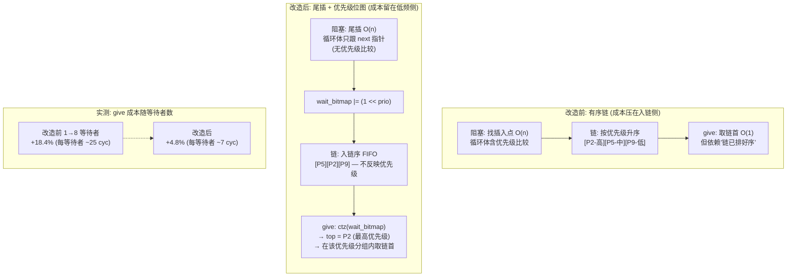

</details>

| | 入链（take 阻塞时，**低频**） | 唤醒（give 时，**高频**） |
|---|---|---|
| **改造前** | 沿等待链**找有序插入点**：O(n) | 取链首，O(1)（依赖"链已排好序") |
| **改造后** | 沿等待链**走到尾部**：O(n)（但只需比较尾指针，无优先级比较与重排） | `ctz(wait_bitmap)` 选最高优先级，再在该优先级分组内取链首 |

**关键澄清（避免误读为"入链变 O(1)"）**：尾插同样要遍历到链尾，因此**入链仍是 O(n)**。
本改造的收益不来自消除遍历，而来自**把成本留在低频侧并把高频侧的排序依赖去掉**：
give 每一次都要执行，而阻塞入链只在真正拿不到资源时才发生。
此外尾插的循环体比有序插入更轻（只跟 `next` 指针，不做优先级比较，也不必维护"插到第一个更低优先级者之前"的前驱关系）。

两者**可观察语义完全等价**：唤醒的必是最高优先级等待者，同优先级内 FIFO（尾插保证）。

`wait_bitmap` 与链表由**同一个临界区**维护，因此二者不会不一致；万一位图位残留导致在链上找不到该优先级的节点，`rtos_internal_wake_highest_bm` 会退化为**全链扫描取最高优先级**（绝不退化为"取链首"——那会唤醒错误的任务并破坏唤醒序语义）。

实测效果：give 成本随等待者数的退化从 **+18.4% 降到 +4.8%**（每等待者增量 ~25 → ~7 周期），详见第十六章。

## 6.2 rtos_sem_take(sem, timeout) 逐步流程

```
1. sem 非法/未初始化 → 错误码
2. ISR 判定: in_isr && timeout != NO_WAIT → ERR_ISR
   (ISR 里允许 try: count>0 就拿, 拿不到立即失败)
3. ENTER_CRITICAL
4. ── 快路径: count > 0 ──
   count--; EXIT_CRITICAL; return RTOS_OK
   (临界区内只有一条判断+一次自减, ~20 周期, 这是无竞争时的全部开销)
5. timeout == NO_WAIT → EXIT; return ERR_TIMEOUT
6. ── 慢路径: 阻塞 ──
   ★ 信号量**不走** rtos_internal_block_current_on, 而在本函数内手工初始化
     等待节点后自行入链 —— 因为它需要多设两个与"位图索引链"相关的字段。
     a. cur->blocked_on = sem
     b. wait_node 初始化: tcb=cur, wait_obj=sem, timed_out=FALSE,
        next/prev=NULL, list_head=&sem->wait_head,
        queue_bitmap    = &sem->wait_bitmap,  ← ★声明本链为"位图索引链"
        queued_priority = cur->priority        ← ★记下入链时的优先级
        (transfer_buf 不清零——队列路径要用它区分三态, sem 不用)
        wait_result = RTOS_OK
     c. rtos_internal_wait_append(&wait_head, node)  ← 尾插 O(n)(遍历到链尾; 同优先级 FIFO)
     d. sem->wait_bitmap |= (1UL << cur->priority)   ← 置位本优先级 (唤醒侧 O(1) 的来源)
     e. sched_block(cur, timeout)          ← 3.4: 出就绪/入延时链(插入走 O(1) 快路径)
     f. sched_schedule()                   ← 3.3: 决策+pend PendSV
7. EXIT_CRITICAL
   ★就是这一条指令之后: BASEPRI 归零 → pend 中的 PendSV 立即抢占 →
     本任务栈帧在 PendSV 里被保存, CPU 转去跑别的任务
8. --- 时间流逝: 或被 give 唤醒, 或超时 ---
   PendSV 恢复本任务现场, 从 msr basepri,0 的下一条指令继续
9. return cur->wait_result  ← 复用阻塞前的 cur，随 callee-saved 寄存器恢复
   (give 唤醒 → OK; 超时 → process_delayed_tasks 已把它置为 ERR_TIMEOUT)
```

> **`queued_priority` 为什么必须单独存**：`cur->priority` 之后可能被用户
> `set_priority` 或内核优先级继承改写。若优先级变化时只把新位写进 `wait_bitmap`，
> **旧位会永远残留** —— 位图再也回不到 0，后续每次 give 都要白扫一遍链。
> `queued_priority` 让"清旧位"有据可依（见 5.8 的 `rtos_internal_requeue_wait_lists`）。

**一次拷贝都没有**——信号量的传递语义是"计数与唤醒"，不带数据。带超时阻塞时任务同时挂上对象等待链与延时链的完整解剖（含超时如何定位任务、give 与超时的竞争裁定），见 **3.7**。

## 6.3 rtos_sem_give(sem) 逐步流程

```
1. 校验
2. ENTER_CRITICAL
3. woken = rtos_internal_wake_highest_bm(&sem->wait_head, &sem->wait_bitmap):
     ┌ 单节点快路径: 链上仅 1 个等待者 → 零遍历、零位图运算, 直接取它
     │   (典型嵌入式负载下"每对象 1~2 个等待者"是最常见情形)
     ├ 多节点: top = __builtin_ctz(wait_bitmap)     ← 2 条指令选出最高优先级
     │         从链首找第一个 priority == top 的节点
     │           ↑ 扫描长度 = 同优先级等待者数, 与总等待者数无关
     │         若找不到(位图位残留) → 退化为全链扫描取最高优先级
     ├ rtos_internal_wait_remove(head, victim)      ← 双向链 O(1) 摘除
     ├ 若该优先级已无其它等待者 → bitmap &= ~(1<<prio)  ← 清位, 防残留
     ├ victim->tcb->blocked_on = NULL
     ├ victim->tcb->wait_result = RTOS_OK     ← 告诉它: 你成功了
     ├ victim->list_head = NULL               ← 标记已离开链表
     └ sched_unblock(victim->tcb):            ← 3.5
        DELAYED → 从延时链摘除(O(1), 提前醒, 剩余超时作废)
        READY + push_tail
        若优先级高于当前 → sched_schedule() → pend PendSV
4. woken != NULL:
   ★count 不变! 这次 give 的"资源"不变成计数, 而是直接被 woken 消费
   EXIT; return OK
5. woken == NULL (无等待者):
   count >= max_count → ERR_OVERFLOW      ← 二值信号量重复 give 的典型报错
   count++
   EXIT; return OK
```

**"唤醒即传递"的不变量**：`等待者非空 ⟺ count == 0`。因为 give 优先喂等待者、take 优先吃计数，两者永不同时非空——设计上杜绝了"唤醒了任务又加了计数"的双重记账 bug。`wake_highest_bm` 摘对象链 + `sched_unblock` 摘延时链的"两条链都清干净"语义，见 3.5 的双链登记不变式。

> **`wake_highest_bm` 与 `wake_highest` 的分工**：信号量与队列用前者（位图链），
> 事件组与互斥锁用后者（有序链）。两者可观察语义相同（最高优先级 + 同优先级 FIFO），
> 差别只在"最高优先级"是**算出来的**（`ctz`）还是**排出来的**（有序插入）。
> 这是 1.3 不变式 III 两套约定在代码上的落点。

**中断里 give 的效果**：ISR 中执行到 unblock 的 schedule() → pend PendSV（PendSV 优先级低于 ISR，不抢占）→ ISR 退出 → PendSV 执行 → 被唤醒任务立即运行。从硬件事件到任务响应的全部延迟 = ISR 剩余执行时间，这就是"ISR 只做 give、处理放任务"模式高效的原理。

## 6.4 sem_deinit

```
ENTER_CRITICAL
wake_all(&wait_head, RTOS_ERR_DELETED):
    逐个摘节点: blocked_on=NULL, wait_result=DELETED, unblock
    (所有等待者以失败告终, 调用方需自己处理对象存储生命周期)
is_initialized = 0
EXIT
```

## 6.5 设计分析

**优点**：快路径极短；唤醒即传递无双记账；优先级序唤醒；ISR 友好；二值/计数统一。
**缺点**：无优先级继承（文档明示用 mutex）；对象销毁后等待者醒来返回 DELETED，但若用户已释放对象存储则结构本身悬空——对象生命周期契约由用户承担；无 Peek。

---

# 第七章 互斥锁: 优先级继承的每一步

## 7.1 数据结构与注册表

```c
struct rtos_mutex {
    rtos_tcb_t      *owner;               /* 当前持有者(NULL=自由) */
    uint32_t         recursion_count;
    rtos_prio_t      owner_orig_priority; /* (预留字段, 当前未参与逻辑) */
    rtos_wait_node_t *wait_head;
};
static rtos_mutex_t *s_mutex_registry[ 8 ];  /* 全局注册表: 任务删除清理的索引 */
```

**为什么需要注册表**：任务持有哪些锁，TCB 里没有记录（FreeRTOS 维护持有链表，本内核为省内存不维护）。任务被删除时，只能反向遍历"所有活着的锁"找 `owner == 被删任务` 的——注册表就是"所有活着的锁"的清单。代价：O(M) 扫描、容量上限、init 注册/deinit 注销的配对责任。

## 7.2 rtos_mutex_take(mutex, timeout) 逐步流程

```
1. 校验; ISR → ERR_ISR (中断没有"拥有者"语义, 从 API 层堵死)
2. ENTER_CRITICAL; cur = current_tcb
3. ── 情形A: 锁自由 ──
   owner = cur; owner_orig_priority = cur->priority; recursion_count = 1
   EXIT; return OK
4. ── 情形B: 递归重入 ──
   owner == cur → recursion_count++; EXIT; return OK
5. timeout == NO_WAIT → ERR_TIMEOUT
6. ── 情形C: 他人持有 → 阻塞 + 优先级继承 ──
   mutex_try_inherit(mutex, cur->priority):
     if owner->priority > cur->priority:          ← owner 数值更大=更低优先级
         was_ready = owner 在就绪表?
         was_ready → ready_list_remove(owner)    ← 必须先摘出
         owner->priority = cur->priority          ← 提升到等待者级别
         was_ready → ready_list_push_tail(owner)  ← 挂进更高优先级的链表+置位图
     ★若 owner 正阻塞在别处(如等另一把锁), 只改 priority 字段即可——
       它不在就绪表, 醒来后自然以新优先级参与调度
   block_current_on(mutex, &mutex->wait_head, timeout)
   → 与 6.2 的 6-8 步完全相同: 挂链/出就绪/决策/EXIT/切出
7. --- 唤醒后 ---
   return cur->wait_result
   (OK 的场合: 所有权已在 give 里预移交, 此刻已持有锁——见下)
```

**优先级继承解决的问题**（优先级反转）：

```
无继承:  H(高) 等锁 → L(低) 持锁 → M(中) 抢占 L → H 被 M 间接阻塞(时间不可控)
有继承:  H 等锁 → L 被提升到 H 级 → M 无法抢占 L → L 尽快放锁 → H 立即运行
```

## 7.3 rtos_mutex_give(mutex) 逐步流程 (顺序是正确性核心)

```
1. 校验; ISR → ERR_ISR
2. ENTER_CRITICAL; cur = current_tcb
3. owner != cur → ERR_PARAM               ← 只有持有者能释放
4. recursion_count--; > 0 → 仍持有, EXIT; return OK
5. ── 真正释放 ──
   ★第一步: 先摘掉本锁所有权，再重算 old_owner 的优先级
   mutex->owner = NULL
   mutex_restore_priority(cur):
     effective = compute_effective_priority(cur)  ← 全部仍持有锁的等待链首与 base 取最小值
     priority 未变 → 无事
     否则: 摘出就绪表 → priority = effective → 放回对应优先级链
   ★第二步: 再唤醒最高优先级等待者
   woken = wake_highest(&wait_head)        ← 同 6.2 的唤醒五连(unblock 可能触发 schedule)
   ★第三步: 所有权预移交
   woken != NULL:
       owner = woken; recursion_count = 1
       → 被唤醒任务运行时【已经持有锁】, 它的 take 直接返回 OK,
         不存在 "owner=NULL 窗口被第三方 take 窃取" 的竞争
   woken == NULL:
       owner = NULL; 锁自由
6. EXIT_CRITICAL; return OK
```

**为什么必须"先恢复、再唤醒"**：调度决策需要看到 old_owner 释放本锁后的有效优先级。若仍把本锁算作它持有，继承重算会保留来自本锁等待者的提升；若先唤醒再重算，unblock 选择候选时也仍看到旧优先级。先摘本锁所有权、综合其余持有锁恢复优先级，再唤醒，才能让本次决策基于正确的就绪关系，同时保留其他锁要求的继承提升。

**为什么所有权预移交是安全的**：临界区保证从"移交"到"woken 实际运行"之间无人能插入（任何第三方 take 都进不了临界区）。woken 恢复执行后读 wait_result==OK 直接返回——它的 take 函数里根本没有再碰 owner 字段的代码路径，锁就是它的。

## 7.4 等待者中途退出的善后: mutex_waiter_left

三个场景会让等待者"不经过 give"离开等待链表：

| 场景 | 触发点 | 善后 |
|------|--------|------|
| 超时 | process_delayed_tasks | wait_remove + `mutex_waiter_left(tcb)` |
| 挂起 | task_suspend 第 4 步 | 同上 |
| 删除 | task_delete 第 5 步 | 同上 |

```
mutex_waiter_left(waiter):
  obj = waiter->wait_node.wait_obj
  扫描 s_mutex_registry: 注册表里 == obj ?
    是 → mutex_recompute_inheritance(mutex):
           遍历注册表中 owner 仍持有的全部锁，每把只取有序等待链首
           owner->priority = min(base_priority, 各非空等待链首的有效优先级)
           在就绪表则摘出重挂
    否 → 非 mutex 对象(sem/queue/event 的 wait_obj), 自动忽略
```

**用指针身份匹配的隐患**：理论上若一个已销毁信号量的地址恰好被新互斥锁复用且已注册，匹配会误命中。工程上"等待中的对象仍被复用"意味着用户已 use-after-free，防御成本远大于收益——设计上接受此边界。

## 7.5 任务删除时的锁大扫除: mutex_release_all

```
task_delete 第 8 步调用(此时任务状态已 DELETED, 不在就绪表):
遍历 s_mutex_registry:
  mutex->owner == 被删任务:
      restore_priority(owner)            ← 恢复(但任务已不在就绪表, 只改字段)
      woken = wake_highest(...)
      woken ? 移交所有权 : owner = NULL
```

若不做这一步：被删任务持有的锁永远无人能 give（owner 指向已释放 TCB），所有等待者永久死锁——这是 RTOS 删除任务最经典的坑，本内核在注册表的支持下 O(M×W) 一次扫清。

## 7.6 rtos_task_set_priority 与继承的交互

```
set_priority(tcb, prio):
  was_ready → 摘出就绪表
  base_priority = prio
  ★priority = mutex_compute_effective_priority(tcb)
      ← 不能直接 priority = prio! 若任务持锁且有更高优先级等待者,
        直接覆盖会丢弃继承提升, 等待者永远抢不到持锁者
      遍历注册表: owner==tcb 的每把锁只取非空 wait_head, 与 base 取最小值
  was_ready → 放回
  requeue_wait_lists(tcb) ← 若正在等待，按新有效优先级重排对象等待链
  mutex_waiter_requeued(tcb) ← 若正等 mutex，重算该锁持有者的继承
  schedule() ← 升降都可能引发切换
```

**本轮只查看等待链首的依据**：互斥锁等待链始终按任务的有效 `priority` 排序，数值最小者在链首；初次阻塞按优先级插入，等待任务优先级变化时先重挂等待链，再通知其所等待互斥锁的持有者重算继承。超时、挂起、删除和成功唤醒只摘节点，保持剩余节点的顺序。这些操作及继承重算都在内核临界区中完成，因此每把锁的链首已经代表该锁全部等待者的最高有效优先级。

`compute_effective_priority` 仍从 `base_priority` 出发，检查注册表中该任务持有的**每一把锁**，保留多锁继承和逐把释放后的正确恢复。若注册表有 M 把锁，重算为 O(M)，不再逐一遍历各锁等待者；并未增加元数据 RAM 或改变 API，也没有增加跨多把锁的传递式优先级继承能力。

## 7.7 设计分析


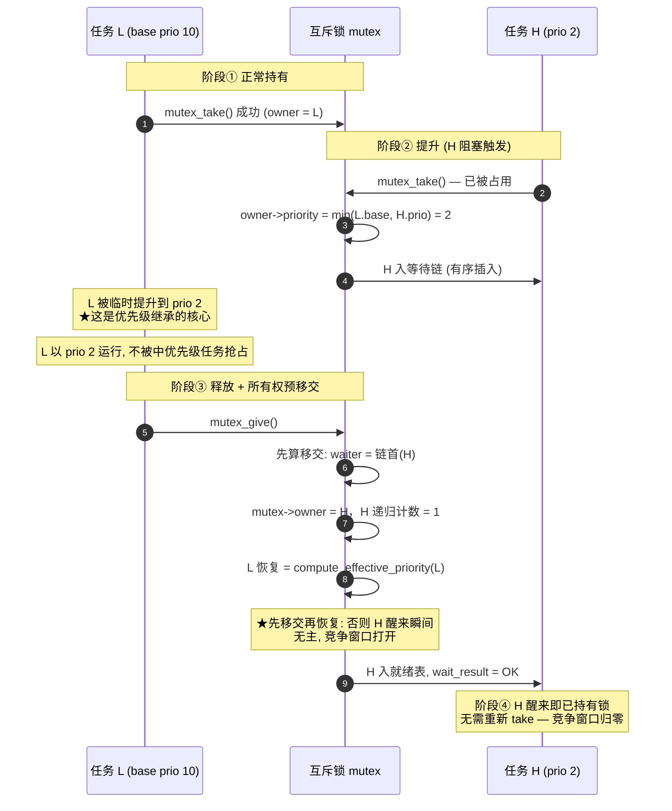

**优点**：单锁场景继承协议完整（提升/维持/恢复/移交四阶段无死角）；递归；所有权预移交消灭竞争窗口；三路径善后统一。

**缺点/已知限制**：

1. ~~多锁 give 丢弃其他锁的继承~~ → ✅ **已修复**（PI-1）：释放时不再无条件降回 `base_priority`，
   而是调用 `rtos_internal_mutex_compute_effective_priority(owner)` **重算"全部持有锁的综合有效优先级"**。
   原缺陷场景：A 持 L1、L2，H1 等 L1、H2 等 L2；give L1 后若直接恢复 base，
   A 仍持 L2 却丢掉 H2 带来的提升 → 持续到 A 释放 L2 为止的**确定性优先级反转**。
   代价是释放路径需 O(M) 扫描注册表（M ≤ 8），且**不在无争用快路径上**（仅争用释放时触发）。
2. 链式继承不传递（A 等 B 的锁、B 等 C 的锁，C 不会被提升）——FreeRTOS 亦然（L10）；
3. 注册表 O(M) 扫描、容量 8 静默上限（超出后该锁静默失去继承能力——已在 7.1 用
   `rtos_internal_mutex_registry_count()` 暴露为可观测指标，供回归用例守卫）；
4. waiter_left 指针匹配而非类型标签（1 字节即可 O(1)）。

---

# 第八章 消息队列: 四条路径与零拷贝直传

## 8.1 数据结构与环形缓冲

```c
struct rtos_queue {
    uint8_t  *storage;               /* 用户提供, item_size*capacity 字节 */
    uint32_t  item_size, capacity;
    volatile uint32_t count;         /* 当前消息数(判空/判满的唯一依据) */
    uint32_t  head, tail;            /* 读/写游标, 环形回绕 */
    rtos_wait_node_t *send_wait_head; /* 队满时的发送者(优先级序) */
    rtos_wait_node_t *recv_wait_head; /* 队空时的接收者(优先级序) */
};
```

不变量：`recv_wait_head 非空 ⟹ count == 0`（接收者只在空时阻塞）；`send_wait_head 非空 ⟹ count == capacity`。

## 8.2 rtos_queue_send() 的四条路径

```
入口: 校验; ISR 判定(必须 NO_WAIT); ENTER_CRITICAL

── 路径1: 零拷贝直传(接收者正在等) ──
recv_wait_head != NULL:
    node = 链首(最高优先级接收者)
    wait_remove
    recv_buf = node->transfer_buf     ← 接收者阻塞前存的缓冲指针
    node->transfer_buf = NULL         ← 三态标记: "已直传"
    memcpy(recv_buf, item, item_size) ← ★全流程唯一一次拷贝
    node->tcb->blocked_on = NULL; wait_result = OK
    sched_unblock(接收者)
    EXIT; return OK
    ★消息不经过环形缓冲! to_front 在空队列无意义, 统一走直传
      (空队列必有等着的接收者——上面的不变量)

── 路径2: 直接入队(有空间) ──
count < capacity:
    to_front==FALSE: memcpy(storage + tail*item_size, item); tail 环形+1
    to_front==TRUE : new_head = (head==0) ? capacity-1 : head-1
                     memcpy(storage + new_head*item_size, item); head = new_head
    count++
    EXIT; return OK

── 路径3: 满且不等待 ──
timeout == NO_WAIT → EXIT; return ERR_TIMEOUT

── 路径4: 满 → 阻塞发送者 ──
transfer_buf  = (void*)item      ← 记录发送缓冲(零拷贝的另一半)
transfer_size = item_size
block_current_on(queue, &send_wait_head, timeout)
EXIT_CRITICAL → PendSV 切出
--- 唤醒后 ---
wait_result != OK      → return (超时/被中止)
transfer_buf == NULL   → return OK   ← 接收者"代办入队"了(见 8.3), 消息已在队里
否则 → 重试循环:
    ENTER_CRITICAL
    有空间 → 入队(同路径2,含to_front分支); EXIT; return OK
    又满了 → 重设 transfer_buf; 再 block_current_on; EXIT; 再切出 …
```

**重试而非报错的理由**：被唤醒到实际运行之间，槽位可能被更高优先级任务偷走。这不是调用方的错误，报 ERR_TIMEOUT 会误导（它没超时）；重新阻塞保持"要么成功要么真超时"的语义。已知妥协（L5）：重试沿用原始 timeout，多次被偷则总时长超预期。

## 8.3 rtos_queue_recv() 与"代办入队"

```
入口: 校验; ISR 判定; ENTER_CRITICAL

── 路径1: 有消息 ──
count > 0:
    memcpy(item, storage + head*item_size); head+1; count--
    ★腾出的空位立刻补给阻塞的发送者(代办入队):
    send_wait_head != NULL:
        node = 链首
        wait_remove
        memcpy(storage + tail*item_size, node->transfer_buf)  ← 从发送者缓冲拷入
        tail+1; count++          ← 空位被重新填上(净效果: 发送者消息入队)
        node->transfer_buf = NULL ← 三态标记: "已代办"
        node->tcb->blocked_on=NULL; wait_result=OK
        sched_unblock(发送者)
    EXIT; return OK

── 路径2: 空且不等待 → ERR_TIMEOUT ──

── 路径3: 空 → 阻塞接收者 ──
transfer_buf = item               ← 记录接收缓冲, 供发送者直传
block_current_on(queue, &recv_wait_head, timeout)
EXIT → 切出
--- 唤醒后 ---
result != OK → return
transfer_buf == NULL → return OK  ← 发送者已直传进 item
否则 → 重试循环(同 8.2 路径4 的对称结构)
```

**零拷贝全景**：发送者到达时若接收者已等 → 1 次拷贝（发送缓冲→接收缓冲）；接收者到达时若发送者已等（满队）→ 2 次拷贝（发送缓冲→环 buf→…不对，代办是 1 次拷贝进环，接收者拿的 head 消息是别人的）→ 实际为"发送缓冲→环"+接收者路径正常 1 次。最热的"消费者等待生产者"模式收益最大。

**代办入队的已知缺陷（L2）**：`to_front=TRUE` 的阻塞发送者被代办时固定写入 tail——紧急插队语义丢失，消息排到队尾。修复需在 wait_node 记录 to_front 标志（如 transfer_size 最高位）。

## 8.4 设计分析

**优点**：零拷贝直传；优先级唤醒；ISR 可发；to_front 紧急通道；重试语义诚实。
**缺点**：定长按值拷贝（大消息应传指针+内存池）；L2/L5；无 Peek。

---

# 第九章 事件标志组

## 9.1 rtos_event_wait(bits, mode, timeout)

```
mode = ANY(0)/ALL(1) | 可或上 CLEAR_ON_EXIT(1<<24)
校验: bits 非零; mode 无非法位; ISR 需 NO_WAIT
ENTER_CRITICAL

── 快路径: 条件已满足 ──
event_check(bits&wait_bits 按 ANY/ALL):
    result = 当前 bits                ← 返回"清除前的真实值"
            (旧版曾回填 |wait_bits, ANY 模式会把没置位的位也报成1——已修)
    CLEAR_ON_EXIT → bits &= ~wait_bits
    EXIT; return result

NO_WAIT → 返回当前位(未满足)

── 慢路径: 阻塞 ──
blocked_on = event
wait_node:
    transfer_size = wait_bits   ← 借用字段存参数
    transfer_buf  = NULL        ← event_set 将写入结果
    wake_tick     = mode        ← 借用字段存模式
    list_head     = &event->wait_head
block_current_on 风格: insert_by_prio + sched_block + schedule
EXIT → 切出
--- 唤醒后 ---
result = (bits)transfer_buf               ← event_set 回传的"满足时位值"
if wait_result != OK:                      ← 超时
    临界区重读 event->bits 返回(可能已被别的任务置位, 语义可接受)
return result
```

## 9.2 rtos_event_set(bits)

```
ENTER_CRITICAL
bits |= 新位
遍历 wait_head(先存 next 再处理——当前节点会被移除):
    wait_bits = node->transfer_size; mode = node->wake_tick
    if event_check(当前 bits, wait_bits, mode):
        result_bits = bits                   ← 清除前的快照
        CLEAR_ON_EXIT → bits &= ~wait_bits   ← 可能影响后续等待者的判定
        wait_remove; blocked_on=NULL; wait_result=OK; list_head=NULL
        transfer_buf = (void*)result_bits    ← 回传给等待者
        sched_unblock(该等待者)               ← 可能触发抢占
EXIT; return 当前 bits
```

**多等待者 + CLEAR 的语义**：第一个满足者消费掉位后，后面的等待者可能因此不再满足——"事件被最先到达的等待者消费"，与 FreeRTOS 一致。

**设计分析**：优点是一对多/多对一解耦同步、ISR 可 set。缺点：set 是 O(等待者) 遍历无提前终止；参数借存 wake_tick/transfer_size 提高了阅读门槛（历史上曾因借存 notify_value 与任务通知互相覆盖出过 bug，现方案各字段独占）。

---

# 第十章 软件定时器

## 10.1 架构: 命令队列串行化一切

```
任意任务/ISR:
  rtos_timer_start/stop/change_period/delete
      → timer_send_cmd: 打包 {type, timer*, new_period, generation}
      → rtos_queue_send(命令队列, NO_WAIT in ISR / 100 tick in task)
                                  │
                                  ▼
定时器服务任务(优先级30, 静态栈256字, 创建于 rtos_init):
  for(;;) { 三阶段循环 + queue_recv(超时=距下次到期) }
                                  │
                                  ▼
活跃链表 s_active_head: 双向链, 按 expire_tick 升序
```

**为什么经队列而不直接操作链表**：ISR 里直接改链表需要临界区，且与任务上下文的修改互相纠缠；投队列把所有修改**串行化**到服务任务——ISR 安全、天然无竞态、命令保序。代价：start 生效延迟 ≤ 服务任务被调度的延迟（通常 <1 tick）。

## 10.2 服务任务循环与回调重入

每轮只摘下一个已到期定时器。旧实现把所有到期对象用 `next` 串成临时链；回调中的 `start/stop/delete` 会复用这些链接，使其他回调遗漏，或把尚未到期的对象带进回调遍历。

```
loop:
  [临界区] 摘下一个到期对象，保存 previous_expire，登记 s_callback_timer
  [临界区外] 执行它的回调
  [临界区] 若仍有效且未自行重启/停止/删除：
              PERIODIC：从 previous_expire + period 推进到下一未来时刻
              ONE_SHOT：保持不活跃
            清 s_callback_timer，消费回调期间排入的控制命令
            按当前 tick 重新计算下一等待时间
  若本轮执行了回调：立即重新检查到期链
  否则 queue_recv(剩余等待时间)，收到命令后继续处理
```

周期定时器维持原绝对相位；回调超过一个周期时跳过已经错过的相位，避免永久漂移和补偿回调风暴。回调自行 `start` 已重新挂入活跃链，服务任务不会再插一次。

只有服务任务本身在任务上下文调用控制 API 时，命令才直接执行。即使 ISR 打断的是服务任务，ISR 也只入命令队列。每条命令带创建代号 `generation`，旧对象的命令不会误作用到同地址新创建的对象。该机制不允许提前释放存储：异步 delete 后，结构必须保持有效，直到命令已消费且正在执行的回调返回。

回调在临界区外，可以调用阻塞 API；长回调仍会拖延其他回调，这是单一服务任务的执行模型。服务任务不能在自己的控制命令队列上阻塞等待空位。
## 10.3 timer_handle_cmd 的四种命令

```
START:  is_active → 先 remove(支持重复 start 重置计时)
        expire = now + period; insert
STOP:   is_active → remove
CHANGE_PERIOD:
        active → remove; period 新值; expire = now+新值; insert
        idle  → 只改 period (不自动启动, 与 FreeRTOS xTimerChangePeriod 略异)
DELETE: is_active → remove; is_initialized = 0
        ★delete 是异步的——函数返回时定时器可能还在链上, 命令处理完才真删;
          用户若随后立刻复用/释放 timer 结构, 需自行保证时序
```

## 10.4 设计分析

**优点**：回调可阻塞（任务上下文）；命令串行化无竞态；全静态；到期检查 O(到期数)。
**缺点**：回调串行排队（长回调拖延后续所有定时器；回调后已重新计算等待时间）；命令队列 16 深度；异步 delete 的生命周期契约；expire_tick 回绕（并入 L1）。

---

# 第十一章 内存管理

## 11.1 动态堆: first-fit + 前向合并 (32KB 静态缓冲)

**块布局与隐式链表**：


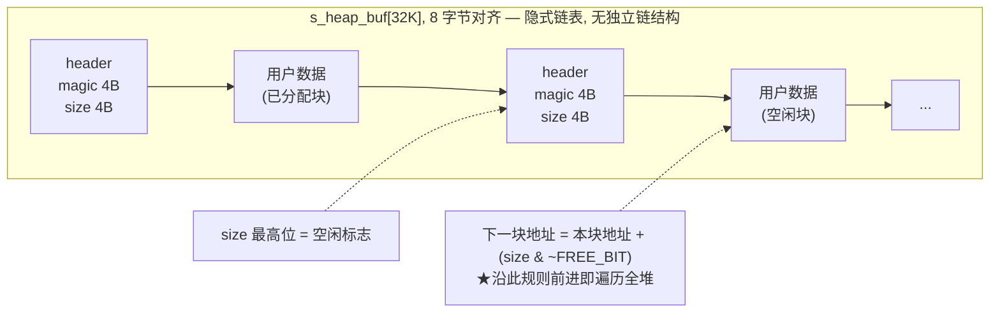

**rtos_heap_alloc(size) 逐步**：

```
need = align8(size) + 8(header); 不足 MIN_BLOCK(16) 按此
ENTER_CRITICAL
hdr = 堆首
while hdr 在堆内:
    magic != MAGIC → 堆已损坏, break            ← 越界写的哨兵检测
    空闲 && 块 >= need:
        block_split(hdr, need):
            剩余 >= need + 16 + 8 → 在 need 处造新空闲块(写magic/size/FREE)
                                    hdr->size = need
            否则整块分配(尾部碎片 <= 24B, 避免生成不可用小块)
        标记已分配; 统计 s_heap_free -= 分出的大小-8
        EXIT; return hdr+8                       ← 跳过 header
    hdr += 块大小                                  ← 沿隐式链走
EXIT; return NULL
```

**rtos_heap_free(ptr) 逐步**：

```
范围检查(必须在堆内) → magic 检查(防双重释放/野指针) → FREE 位检查(防重复释放)
块大小记录; 标记 FREE
block_merge_next: 下一块也空闲 → size += 下一块大小; 下一块 magic=0(防复用)
   (只向高地址合并——向低地址需知道前一块, 隐式链做不到, L7)
```

**任务删除的释放顺序技巧**：`rtos_task_create` 先分配 TCB 后分配栈（TCB 地址 ≤ 栈地址，若相邻），`process_pending_free` **先 free 栈(高地址) 后 free TCB(低地址)**——TCB 释放时执行前向合并恰好吞并刚释放的栈，两块并一块。交错分配时此技巧失效，碎片留给 L7 的 footer 方案。

**设计分析**：first-fit 简单、扫描快；隐式链零元数据开销（对比 TLSF/边界标记）；magic+FREE 双校验防御性好。代价：alloc O(n) 全堆扫描；无后向合并的长期碎片；32KB 固定。**适用边界**：低频、尺寸稳定的分配（任务创建/删除）。高频变长请用 11.2 的池或引入 TLSF。

## 11.2 固定块内存池: 分配 O(1)，释放 O(n)

```
init:  块大小 align4、至少 4B(存 next 指针)
       从最后一块往前串单链 → free_list = 第 N-1 块(第0块在链尾)
alloc: ENTER; node = free_list; free_list = node->next; free_count--; EXIT
free:  范围和块边界检查; 扫描空闲链拒绝重复释放;
       node->next = free_list; free_list = node; free_count++
```

空闲块自身的空间被复用来存链指针——零元数据。内部碎片 = 块大小对齐的舍入（请求 33B 占 64B 块）。适合 USB URB/网络缓冲这类"少数固定尺寸、高频生灭"的对象。

---

# 第十二章 性能监视器

## 12.1 时基: DWT_CYCCNT

```
perf_init: DEMCR |= TRCENA; CYCCNT = 0; DWT_CTRL |= CYCCNTENA
32位自由计数, 168MHz 下 25.5s 回绕
所有差值一律 (now - prev) 无符号减法 → 单次回绕天然免疫
(两次采样间隔必然 < 25s: 系统不可能 25s 无上下文切换)
```

## 12.2 任务运行记账: 在 `rtos_sched_commit_context_switch` 里顺路完成

**重要前提**：该记账钩子受 **`RTOS_CONFIG_PERF_HOTPATH_STATS` 编译期开关**控制，
**默认关闭**(=0)，此时切换路径上的钩子**完全消失、零开销**——这是与 FreeRTOS
(`configGENERATE_RUN_TIME_STATS=0`) 做公平性能对比的前提。下表的开销仅在开关打开时存在。

```
sched_commit_context_switch → perf_on_context_switch(prev, next):   /* #if 开关内 */
    now  = CYCCNT
    delta = now - last_switch_cycle;  last_switch_cycle = now
    prev->perf_run_cycles += delta          ← 该任务本次跑了多久
    total_cycles += delta; prev==idle → idle_cycles += delta
    latency = now - perf_pend_cycle         ← pend→切换 的派发延迟
    更新 max/sum/count
    约 15~25 周期, 仅在开关打开时计入
```

CPU% = 1 - idle/total（墙上时间分母）；窗口查询时同步推进全任务基准，保证 Σ任务% ≈ 系统%。全部条件编译（`USE_PERF_MONITOR=0` → 零代码零 RAM；`PERF_HOTPATH_STATS=0` → 保留查询能力但切换路径零开销）。

> `rtos_perf_on_context_switch()` 的调用点就在 `rtos_sched_commit_context_switch` 内部（4.2 代码中的
> `#if RTOS_CONFIG_PERF_HOTPATH_STATS` 块），不再经过任何中间 C 辅助函数。

## 12.3 栈高水位

创建时填 0xA5A5A5A5 → 查询时从栈底向上扫首个非填充字 → 历史最深水位。注意与溢出魔数的覆盖关系（2.2 易错点 3）。

---

# 第十三章 USB 子系统

> 本章描述 USB 子系统的完整实现：如何把第三方协议栈 **CherryUSB** 以最小代价移植到本内核之上，做成 **CDC 虚拟串口 + MSC 大容量存储 + HID** 三合一复合设备；以及把这套方案搬到其他平台时，哪些东西必须重写、哪些可以直接复用。

**定位**：纯适配层，不侵入内核。向下把本内核的 sem/mutex/queue/timer/task 五原语包装成 CherryUSB 期望的 `usb_osal_*` 句柄式接口；向上把 CherryUSB 的异步端点回调翻译成 `rtos_usb_cdc_read/write` 这类阻塞式串口感 API。

## 13.1 分层架构与一帧数据的旅程

```
+----------------------------------------------------------+
| 用户应用        main.c: task_usb_cdc / task_usb_msc /    |
|                task_usb_hid                              |
+----------------------------------------------------------+
| 用户友好封装    rtos_usb.c: 描述符表、端点回调、          |
|                CDC/HID 阻塞式 API、MSC RAM 盘读写        |
+----------------------------------------------------------+
| CherryUSB 设备栈  usbd_core.c (枚举状态机/标准请求)       |
|                + class: usbd_cdc_acm / usbd_msc /        |
|                  usbd_hid (类协议)                       |
+----------------------------------------------------------+
| DCD 驱动       usb_dc_dwc2.c (DWC2 寄存器级驱动)         |
| 胶水层         usb_glue_st.c (时钟/GPIO/NVIC/IRQ 入口)   |
+----------------------------------------------------------+
| OSAL 适配      rtos_usb_osal.c: usb_osal_* 26 个函数     |
+----------------------------------------------------------+
| USB 引擎      rtos_usb.c: 静态对象池/双档堆/ISR 注册表   |
+----------------------------------------------------------+
| 内核          rtos_sem / mutex / queue / timer / task    |
|               (第五~第十章所述的五原语)                   |
+----------------------------------------------------------+
```

以"CDC 收到主机发来的一行数据"为例，一帧数据的完整旅程：

1. 主机发出 OUT token，DWC2 硬件收包入 RX FIFO，置中断挂起；
2. `OTG_FS_IRQHandler`（usb_glue_st.c 提供）→ `USBD_IRQHandler(0)`（usb_dc_dwc2.c 的总入口）；
3. DWC2 驱动读 GRXSTSP 弹出 FIFO 数据，按端点号调用 `usbd_event_ep_out_complete_handler`（usbd_core.c）；
4. usbd_core 查端点注册表，转到我们注册的 `rtos_usb_cdc_bulk_out` 回调（rtos_usb.c，仍在 ISR 上下文）；
5. 回调把数据 memcpy 进 RX 环形缓冲（临界区保护 head/tail），`rtos_sem_give(rx_sem)`；
6. 给信号量触发调度决策，ISR 退出后 PendSV 切换到阻塞在 `rtos_usb_cdc_read` 的任务；
7. 任务从环形缓冲拷出数据返回给用户。

**并发模型**：ISR 只做"收发完成 → 搬数据 → 给信号量"三件事（微秒级）；协议解析与存储读写全部在任务侧。MSC 更进一步——端点回调只往消息队列投 `MSC_DATA_IN/OUT` 事件，SCSI 译码和扇区读写由独立的 `usbd_msc` 线程串行处理，天然保序且不占用 ISR 时间。

## 13.2 使用了 CherryUSB 的哪些部分

### 13.2.1 保留的源文件: 6 个 .c + 两组头文件

| 文件 | 层 | 功能 | OSAL 依赖 |
|---|---|---|---|
| `core/usbd_core.c` | 协议栈核心 | 设备枚举状态机；标准请求（SET_ADDRESS / GET_DESCRIPTOR / SET_CONFIGURATION）；接口与端点注册表；EP0 数据阶段与 ZLP；类请求按接口号分发到各 class 的 handler | 仅 `CONFIG_USBDEV_EP0_THREAD` 开启时用 mq+thread（本工程关闭 → EP0 在 ISR 内直接处理，零 OSAL 依赖） |
| `class/cdc/usbd_cdc_acm.c` | 类 | CDC ACM：通信接口类请求（SET_LINE_CODING 等，5 个 `__WEAK` 钩子留给用户）；IAD 双接口初始化 | 零 |
| `class/msc/usbd_msc.c` | 类 | BOT 传输协议；SCSI 命令译码（INQUIRY / READ(10) / WRITE(10) / REQUEST_SENSE…）；CBW/CSW 状态机 | mq+thread（本工程开启 `CONFIG_USBDEV_MSC_THREAD`） |
| `class/hid/usbd_hid.c` | 类 | HID 类请求（GET/SET_REPORT / IDLE / PROTOCOL，6 个 `__WEAK` 钩子）；报告描述符挂接 | 零 |
| `port/dwc2/usb_dc_dwc2.c` | DCD | DWC2 IP 寄存器驱动：端点使能、FIFO 编程、中断处理、软断开（DCTL.SDIS）；把硬件事件翻译成 `usbd_event_*` 回调 | 零 |
| `port/dwc2/usb_glue_st.c` | 胶水 | ST 平台胶水层（详见 13.5.1） | 零 |
| `common/*.h` | 头 | `usb_def.h`（描述符初始化宏模板）、`usb_osal.h`（OSAL 契约）、`usb_dc.h`（DCD API）、`usb_log.h`、`usb_errno.h`、`usb_dcache.h` 等 | — |
| `class/*/usb_*.h` | 头 | 各类协议常量与描述符宏（`CDC_ACM_DESCRIPTOR_INIT` / `MSC_DESCRIPTOR_INIT` / `HID_CUSTOM_INOUT_DESCRIPTOR_INIT`） | — |
| `port/dwc2/usb_dwc2_reg.h, usb_dwc2_param.h` | 头 | DWC2 寄存器定义、硬件参数探测（`dwc2_get_hwparams`）、用户参数结构 | — |

**一个值得注意的事实**：CDC、HID 两个类与 DWC2 驱动对 OSAL 的依赖是**零**——设备模式的类是纯回调驱动的。整个构建里真正调用 `usb_osal_*` 的只有 usbd_msc.c（mq+thread）。OSAL 的其余部分是为配置可扩展性而完整实现的契约（见 13.4.4）。

### 13.2.2 删除了什么, 为什么

上游 CherryUSB 是完整仓库（设备+主机+全部类+全部芯片端口+多 OS 的 OSAL+文档测试工具）。本工程只保留上表 6 个 .c，物理删除了：

| 删除项 | 原因 |
|---|---|
| `osal/`（FreeRTOS/RT-Thread/Zephyr/LiteOS/ThreadX/NuttX/IDF 七套官方 OSAL） | 我们用 `rtos_usb_osal.c` 替代。**必须删除而非仅不编译**——此前工程把整个 CherryUSB 目录加入编译路径，`osal/usb_osal_freertos.c` 等混入构建导致 `FreeRTOS.h not found`，这正是移植初期报错的根源 |
| `third_party/`（FreeRTOS 10.4 源码、nimble 等） | 同上，纯祸源 |
| `core/usbh_core.c, usbotg_core.c` | 主机/OTG 栈（`RTOS_CONFIG_USB_HOST_MODE=0`），且 usb_glue_st.c 中对 `usbh_core.h` 的引用已加宏守护 |
| 其余 30 余个 class（audio/video/dfu/hub/serial/wireless…） | 用不到，减目录噪音 |
| 其余 33 个 port（ch32/chipidea/musb/rp2040/ehci/…） | 非 DWC2 平台 |
| `demo/ docs/ tests/ tools/ platform/` | 示例与文档，不参与编译 |

### 13.2.3 三个类如何"同时"工作: 复合设备

USB 物理上只有一对差分线，"同时"是分时复用的宏观效果：

- **枚举期**，主机从配置描述符读到 4 个接口（CDC 通信 0 / CDC 数据 1 / MSC 2 / HID 3），**各自绑定独立驱动**（Windows：`usbser.sys` / `disk.sys` / `hidclass.sys`）。后续每个请求携带接口号/端点号，路由互不交叉。
- **数据期**，每端点一条独立管道；interrupt 端点（HID、CDC 通知）按 `bInterval` 保留带宽，bulk 端点（CDC、MSC 数据）公平瓜分剩余带宽——串口狂传时 U 盘变慢是性能竞争，不是错误。
- **设备端**，一条 ISR 串行分发（天然无并发）；三个用户任务 + 一个 CherryUSB 内部 `usbd_msc` 线程由调度器并发调度。
- **背压**，设备未挂接收请求时硬件自动回 NAK，主机重试——流量控制无需软件参与。

竞争点与消解手段：

| 竞争场景 | 消解方式 |
|---|---|
| ISR 与任务共享数据（RX 环形缓冲 head/tail、`hid_rx_len`） | 单生产者单消费者 + `RTOS_PORT_ENTER_CRITICAL()` |
| ISR 通知任务 | 信号量（ISR `give` / 任务 `take`） |
| 多任务并发 `rtos_usb_cdc_write` | `tx_mutex` 互斥锁串行化 |
| OSAL 对象池/USB 堆并发分配 | 分配扫描+标记全程临界区 |
| MSC 的 SCSI 命令序 | 消息队列投递给单一线程串行执行，天然保序 |
| 三类功能之间 | 架构性隔离：独立端点、独立 DMA 缓冲、独立同步对象，无共享数据 |

## 13.3 本 RTOS 侧的自研文件

| 文件 | 职责 |
|---|---|
| `Core/Inc/rtos_usb.h` | 对外 API（CDC/HID/MSC + ISR 注册）；`RTOS_CONFIG_USE_USB=0` 时全部宏化为空桩，零开销裁剪 |
| `Core/Src/rtos_usb.c` | USB 引擎：静态对象池、双档堆、ISR 注册表；复合设备描述符与初始化序列；CDC/HID 阻塞式 API；MSC RAM 盘回调；DWC2 自定义 FIFO 划分 |
| `Core/Src/rtos_usb_osal.c` | `usb_osal_*` 26 函数：CherryUSB 契约 → 本内核五原语 |
| `Core/Inc/usb_config.h` | CherryUSB 编译期配置入口 + OSAL 桥接（`#include "rtos_usb.h"`），CherryUSB 源文件经 `#include "usb_config.h"` 读取 |

五个关键设计：

1. **静态对象池**：sem(8)/mutex(8)/mq(4)/thread(4, 内嵌 2KB 栈)/timer(8) 各一数组，create 扫描 `in_use` 取槽、delete 还槽——弥合"本内核静态对象"与"USB 栈 create 返回句柄"的范式差；池满返回 NULL 不崩溃。
2. **双档固定块堆**（8KB 对半）：≤64B 小块池 + ≤512B 大块池，全部 O(1)——匹配 USB 对象"小而多"的分配画像；>512B 请求失败（当前仅 device 模式，规避了 host class 的大结构）。
3. **CDC ACM 封装**：RX 环形缓冲用"原始计数器"模式（head/tail 恒增、访问时掩码/取模——回绕免疫、count=减法）；TX 用完成信号量 + `tx_busy` 在途标记（超时返回后 DMA 未完成时不覆盖缓冲，下次调用先等在途传输）；`ep_in_buf` 为 DMA 安全的独立缓冲（D-cache 一致性 + 超时后用户缓冲复用两大问题一并解决）。
4. **ZLP 处理**：IN 回调中 nbytes 为 MPS 整数倍时补零包（主机据此识别传输结束）；`tx_busy` 门防陈旧回调污染信号量。
5. **硬约束**：USB ISR 优先级必须在 syscall 域（本工程 5~15，实配 6）——ISR 内调用 sem_give 会改内核结构，必须能被 BASEPRI 临界区屏蔽。

## 13.4 OSAL 契约: 必须实现的 26 个函数

### 13.4.1 为什么要实现这一层

CherryUSB 面向"动态内核"（FreeRTOS 式）设计，与本内核存在四个范式差异，OSAL 就是翻译层：

| 差异 | CherryUSB 期望 | 本内核现实 | 翻译 |
|---|---|---|---|
| 对象生命周期 | `create` 返回句柄、`delete` 销毁 | 用户传入静态对象指针 | 静态对象池取槽/还槽 |
| 超时单位 | 毫秒；`USB_OSAL_WAITING_FOREVER`(0xFFFFFFFF) | Tick；`RTOS_WAIT_FOREVER` | `usb_osal_ms_to_ticks()` |
| 栈单位 | 字节 | 字（4 字节） | `stack_size / sizeof(rtos_stack_t)` |
| 返回值 | int：0 成功、`-USB_ERR_TIMEOUT` 超时 | `rtos_status_t` | `rtos_status_to_osal()` 映射 |

优先级语义两边一致（小值=高优先级）直接透传，仅做越界钳位。

### 13.4.2 函数清单与实现要点

**线程组（3 个）**

| 函数 | 当前构建的调用者 | 实现要点 |
|---|---|---|
| `usb_osal_thread_create(name, stack_size, prio, entry, args)` | usbd_msc.c（MSC 线程） | 字节→字换算；prio≥MAX_PRIORITIES 时钳位到 MAX-1；从线程池取槽（TCB+内嵌栈）；`rtos_task_create_static` 创建，自动接入 perf 与栈高水位 |
| `usb_osal_thread_delete(thread)` | 同上 | `rtos_task_delete` + 还槽 |
| `usb_osal_thread_schedule_other()` | （契约，暂无调用者） | 降到最低优先级 → yield → 恢复 |

**信号量组（6 个）**

| 函数 | 要点 |
|---|---|
| `usb_osal_sem_create(initial)` | 二值语义：max=1, init=initial（与 FreeRTOS `xSemaphoreCreateCounting(1, init)` 对齐） |
| `usb_osal_sem_create_counting(max)` | max=max, init=0 |
| `usb_osal_sem_take(sem, timeout_ms)` | ms→tick；**ISR 中禁止阻塞** |
| `usb_osal_sem_give(sem)` | ISR 与任务均安全（内核 give 本身 ISR-safe） |
| `usb_osal_sem_reset(sem)` | 临界区内清 count（本内核 sem 无 reset API，手动清零；等待者不丢失） |

**互斥锁组（4 个）**：`create/delete/take/give`。`take` 无 timeout 参数 → 永久等待；带优先级继承；**不可在 ISR 调用**（本内核互斥锁限制）。

**消息队列组（4 个）**：`mq_create(max_msgs)`（深度受内嵌 storage 限制）、`delete`、`send`（**ISR 中强制 NO_WAIT、任务中 WAIT_FOREVER**——与 FreeRTOS OSAL 行为一致）、`recv`（支持超时）。

**定时器组（4 个）**：`timer_create(name, ms, handler, arg, is_period)` 等。特殊处理：CherryUSB 的 `usb_osal_timer_create` 返回**堆分配**的 `struct usb_osal_timer *`，其 `->timer` 字段存内部句柄——实现上从 USB 堆分配外壳结构、从对象池分配内部定时器，start/stop/delete 经 `->timer` 间接访问。

**内存组（2 个）**：`malloc/free` → 双档块池（13.3 第 2 点）。

**时间组（1 个）**：`msleep` → `rtos_task_delay`，禁止 ISR 调用。

**临界区组（2 个）**：`enter` 返回 flag、`leave(flag)` 恢复。本内核临界区（BASEPRI+嵌套计数）自带上下文自适应与嵌套能力，flag 无用武之地——`enter` 返回 0、`leave` 忽略参数直接调 `EXIT_CRITICAL`。

### 13.4.3 单位换算的精确规则

```
ms → tick:  FOREVER 透传（防乘法溢出）
            0 → NO_WAIT
            其余 (ms × TICK_RATE_HZ) / 1000，结果为 0 则抬到 1（至少等 1 tick）
返回值映射:  RTOS_OK → 0
            RTOS_ERR_TIMEOUT → -USB_ERR_TIMEOUT
            其他负值 → -1
```

### 13.4.4 诚实说明: 当前构建到底用了多少

对本工程保留的 6 个 .c 全量 grep `usb_osal_` 的结论：

- `usbd_msc.c`：mq 4 函数 + thread 2 函数（`CONFIG_USBDEV_MSC_THREAD` 开启）
- `usbd_core.c`：mq+thread 调用全部位于 `#ifdef CONFIG_USBDEV_EP0_THREAD` 内，**本工程关闭该选项** → EP0 setup 在 ISR 内直接处理
- 其余四个文件：零调用

即：**当前链接真正消费的 OSAL 服务只有 6 个函数**。其余 20 个仍然实现，理由有三：①契约完整性——一旦开启 EP0 线程、增加类（audio 用 sem、RNDIS 用 sem+mq）或 host 模式立即需要；②工程开了 `--gc-sections`，未被引用的实现自动裁掉，无 Flash 代价；③我们自己的 CDC/HID 封装走 `rtos_usb_*` 内部接口，与 `usb_osal_*` 同池同源，全实现等于一份代码两处受益。

## 13.5 硬件胶水层 (DWC2 + STM32)

### 13.5.1 usb_glue_st.c 提供的六件事

| 提供项 | 说明 |
|---|---|
| `usb_dc_low_level_init(busid)` | DWC2 驱动初始化时回调。建立 busid→IRQ 映射，然后调用 `HAL_PCD_MspInit`——**借 CubeMX 生成的时钟/GPIO/NVIC 代码**：CLK48=PLLQ 48MHz、PA11/PA12 AF10、OTG_FS 外设时钟、NVIC 优先级 6（syscall 域） |
| `usb_dc_low_level_deinit(busid)` | 反向清理 |
| `OTG_FS_IRQHandler / OTG_HS_IRQHandler` | 中断入口，查表调 `USBD_IRQHandler(busid)`——用户 IRQ 文件里**不需要写任何 USB 代码** |
| `usbd_dwc2_delay_ms(ms)` | 忙等延时。用在初始化阶段（调度器未启动时），不能依赖 rtos_task_delay |
| `usbd_dwc2_get_system_clock()` | 返回 `SystemCoreClock`，驱动据此计算寄存器超时 |
| `dwc2_get_user_params(reg_base, params)` | 按宏探测 `stm32fXxx_hal.h` 选家族参数（FIFO 尺寸/PHY 类型/GCCFG 位）；F446 等新料号附加 `b_session_valid_override=true`（无 VBUS 检测也枚举） |

**关键纪律**：不要调用 `MX_USB_OTG_FS_PCD_Init()`。HAL PCD 与 CherryUSB DWC2 驱动操作同一组寄存器，两者并存会互相破坏；只借 MspInit 做引脚/时钟级初始化。

### 13.5.2 自定义 FIFO: 复合设备的入场券

F446 OTG_FS 只有 **6 个端点（EP0~EP5）、320 字（1280B）FIFO**。CherryUSB 默认 ST 参数只给 EP0~EP3 分配 TX FIFO，而三合一复合设备需要 **4 个非控制 IN 端点**（CDC 批量 IN、CDC 通知 IN、MSC 批量 IN、HID 中断 IN）。

解法是两点：

1. **利用"同端点号 IN/OUT 是两个独立端点"**：HID OUT 借 EP1-OUT（与 CDC 的 EP1-IN 同号不同向），HID IN 借 EP5-IN（与 MSC 的 EP5-OUT 同号不同向）；
2. **启用 `CONFIG_USB_DWC2_CUSTOM_FIFO`**，在 rtos_usb.c 实现 `dwc2_get_user_fifo_config()` 重新划分：

| FIFO | 字数 | 服务对象 |
|---|---|---|
| RX（共享） | 176 | 所有 OUT 端点（最小要求 47 字） |
| TX[0] | 16 | EP0 控制 |
| TX[1] | 64 | EP1 IN：CDC 批量（全速 MPS=64B，余量充足） |
| TX[2] | 16 | 保留（EP2 仅用作 OUT） |
| TX[3] | 16 | EP3 IN：CDC 通知 |
| TX[4] | 16 | EP4 IN：MSC 批量（MPS=64B 恰好） |
| TX[5] | 16 | EP5 IN：HID 中断 |
| **合计** | **320** | 与 GHWCFG3 报告的 DFIFO 深度一致 |

### 13.5.3 复合设备资源规划总表

| 接口号 | 类 | 端点 | 类型 | 轮询间隔 |
|---|---|---|---|---|
| 0 + 1（IAD） | CDC ACM | IN 0x81 / OUT 0x02 / IN 0x83(通知) | bulk / bulk / interrupt | — / — / 2ms |
| 2 | MSC | IN 0x84 / OUT 0x05 | bulk | — |
| 3 | HID | OUT 0x01 / IN 0x85 | interrupt | 1ms |

## 13.6 配置桥 usb_config.h 必须提供什么

CherryUSB 每个源文件开头 `#include "usb_config.h"`，从这里读取全部 `CONFIG_USB*` 宏。本工程的提供清单：

| 类别 | 宏 | 值 | 说明 |
|---|---|---|---|
| 桥接 | `#include "rtos_usb.h"` | — | 使 OSAL 类型与本内核衔接 |
| 日志 | `CONFIG_USB_PRINTF` | `printf` | **必须是宏**。usb_log.h 不包含 usb_config.h，假设包含者已定义 |
| 日志 | `CONFIG_USB_DBG_LEVEL` | `USB_DBG_INFO` | 0~3，ERR/WRN/INFO/LOG |
| 通用 | `CONFIG_USB_ALIGN_SIZE` | 4 | DMA 对齐 |
| 设备栈 | `CONFIG_USBDEV_MAX_BUS` | 1 | 单 USB IP |
| 设备栈 | `CONFIG_USBDEV_REQUEST_BUFFER_LEN` | 512 | EP0 控制请求缓冲 |
| 设备栈 | `CONFIG_USBDEV_EP_NUM` | 8 | 端点数上限 |
| MSC | `CONFIG_USBDEV_MSC_MAX_LUN / MAX_BUFSIZE` | 1 / 512 | 逻辑单元数 / 块缓冲 |
| MSC | `CONFIG_USBDEV_MSC_THREAD` | 定义 | 线程模式（与 POLLING 二选一） |
| MSC | `CONFIG_USBDEV_MSC_STACKSIZE / PRIO` | 2048B / 16 | 线程参数 |
| MSC | `CONFIG_USBDEV_MSC_MANUFACTURER / PRODUCT / VERSION_STRING` | "RTOS" / "RAM Disk" / "1.00" | SCSI INQUIRY 字段，**各 ≤8/16/4 字符，缺失即编译错**（实际踩过的坑） |
| DWC2 | `CONFIG_USB_DWC2_CUSTOM_FIFO` | 定义 | 启用 13.5.2 的自定义划分 |

## 13.7 移植到其他平台: 完整步骤

### Step 0: 按 USB IP 选 DCD 端口

| USB IP | 典型芯片 | CherryUSB 端口 |
|---|---|---|
| Synopsys DWC2 | STM32F2/F4/F7/L4/H7、GD32、沁恒 CH32 部分 | `port/dwc2` |
| ST FS 设备 IP | STM32F0/F1/F3 | `port/fsdev` |
| ChipIdea CI | NXP Kinetis、MM32 | `port/chipidea`（注意：上游其余 port 已按本工程需要裁剪，需从上游仓库补回） |
| RP2040 / CH58x / BL618 / Nuvoton / HPM / AIC / MUSB | 各家 | 对应 `port/<name>` |
| 全新 IP | — | `port/template/usb_dc.c` 骨架 |

**平台无关、直接复用的部分**：`core/usbd_core.c` + 全部 `class/` + `common/` + 本工程 4 个自研文件中的 `rtos_usb.c/h`、`usb_config.h`（改参数即可）。

### Step 1: DCD 驱动 (仅全新 IP 需要)

实现 `usb_dc.h` 声明的完整契约——**13 个主动函数**：

```
usb_dc_init / usb_dc_deinit                  初始化/反初始化控制器
usbd_set_address / usbd_set_remote_wakeup / usbd_get_port_speed
usbd_ep_open / usbd_ep_close                 端点配置
usbd_ep_set_stall / clear_stall / is_stalled 端点 stall 控制
usbd_ep_start_write / usbd_ep_start_read     异步收发（完成后必须回调，类似 UART+DMA）
```

**9 个事件上报函数**（硬件中断里调用，通知协议栈）：

```
usbd_event_reset / connect / disconnect / resume / suspend / sof_handler
usbd_event_ep0_setup_complete_handler        EP0 收到 setup 包
usbd_event_ep_in / ep_out_complete_handler   端点传输完成（回调用户注册的 ep_cb）
USBD_IRQHandler(busid)                       DCD 总中断入口（用户 IRQ 调它）
```

### Step 2: 胶水层五件事 (照抄 usb_glue_st.c 模式)

① 时钟+GPIO+NVIC（`usb_dc_low_level_init`，可借厂商 HAL 的 MspInit）；② USB IRQ 入口 → `USBD_IRQHandler(busid)`；③ 忙等 `delay_ms`；④ 返回系统时钟；⑤ `dwc2_get_user_params` 家族参数（FIFO/PHY/GCCFG，照寄存器手册填）。

### Step 3: OSAL 26 函数 (带 RTOS 的平台)

照 `rtos_usb_osal.c` 模式实现 13.4.2 的全部函数即可——它是"静态对象内核"对接"句柄式协议栈"的通用模板，与具体 USB 硬件无关。若目标平台无 RTOS，CherryUSB 上游另有 standalone（轮询）OSAL，可从上游仓库取 `osal/usb_osal_none.c` 参考。

### Step 4: usb_config.h 按平台调整

`CONFIG_USBDEV_EP_NUM` 改为实际端点数；FIFO 划分按 `GHWCFG3.DFIFO_DEPTH` 等寄存器实测值重算（13.5.2 的表是 F446 的 320 字特例）；高速 IP 加 `CONFIG_USB_HS`（MPS 自动切 512）。

### Step 5: 用户层 (照 rtos_usb.c 模式)

- 描述符表 + 初始化序列（照 `rtos_usb_cdc_init`）：`usbd_desc_register` → `usbd_add_interface`（CDC×2 / MSC / HID，各类 `init_intf`）→ `usbd_add_endpoint` → `usbd_initialize(busid, reg_base, event_handler)`；
- **必须实现** MSC 三回调（非 weak，链接期强制）：`usbd_msc_get_cap` / `usbd_msc_sector_read` / `usbd_msc_sector_write`——把三个函数里的 memcpy 换成真实介质（SPI Flash / SD 卡）读写，U 盘即告完成；
- 可选覆盖 CDC 的 `__WEAK` 钩子（`usbd_cdc_acm_set_line_coding` 拿到主机设定的波特率、`set_dtr` 感知串口打开）；HID 的 `get_report` 等 6 个钩子按需覆盖。

### Step 6: 中断优先级 (带 RTOS 平台的硬约束)

USB ISR 内部调用 sem_give 等内核 API，会修改就绪表/等待链表。**USB IRQ 优先级数值必须 ≥ 内核的 MAX_SYSCALL_INTERRUPT_PRIORITY**（本工程 5，实配 6），使 BASEPRI 临界区能屏蔽它——否则任务正在操作调度器时被 USB 打断，数据结构损坏、随机 HardFault。临界区极短（微秒级），USB 中断只会 pending 不会丢。

### 完整初始化时序 (供移植对照)

```
rtos_init()                          内核起来（SysTick/PendSV）
rtos_usb_init()                      清零对象池/ISR 表, 初始化双档堆
rtos_usb_cdc_init(0, USB_OTG_FS)     一步完成:
  ├─ 创建同步对象(rx/tx/hid 信号量, tx 互斥锁)
  ├─ usbd_desc_register              挂描述符
  ├─ usbd_add_interface ×2           CDC IAD 双接口
  ├─ usbd_add_endpoint ×2            CDC bulk IN/OUT
  ├─ usbd_add_interface(msc)         MSC(端点类内管理)
  ├─ usbd_add_interface(hid) + ×2    HID + 中断端点
  ├─ usbd_initialize                 → usb_dc_init(DWC2 寄存器)
  │    └─ usb_dc_low_level_init      → HAL_PCD_MspInit(48MHz/GPIO/NVIC=6)
  │    └─ DCTL 清 SDIS               软连接, 主机开始枚举
  └─ MSC notify_handler              创建 usbd_msc 线程(经 OSAL)
rtos_start()                          调度器接管, 枚举在 ISR+任务中自动完成
```

## 13.8 已知陷阱与经验教训

| 症状 | 根因 | 规则 |
|---|---|---|
| `undefined reference to CONFIG_USB_PRINTF` | usb_log.h 假设包含者已定义该宏；自研文件用 `USB_LOG_*` 却没含 usb_config.h，宏被当函数调用 | 任何使用 USB_LOG 的自研文件，`usb_config.h` 必须先于 `usb_log.h` 包含 |
| MSC 编译报 `MANUFACTURER_STRING undeclared` | 文档标"可选"实为必填 | usb_config.h 补齐三个 INQUIRY 字符串宏 |
| `FreeRTOS.h not found` | 上游 osal/third_party 混入编译 | 物理裁剪，只保留 6 个 .c；不靠"不勾选" |
| USB 枚举失败/寄存器互踩 | HAL_PCD_Init 与 DWC2 驱动抢寄存器 | 不调 MX_USB_OTG_FS_PCD_Init，只借 MspInit |
| DWC2 断言 `fifo config is overflow` | 复合设备 IN 端点多于默认 TX FIFO | CONFIG_USB_DWC2_CUSTOM_FIFO 重新划分（13.5.2） |
| 随机 HardFault/调度器损坏 | USB IRQ 优先级 0~4，临界区屏蔽不了 | IRQ 优先级 ≥5（syscall 域） |
| 链接 RAM 溢出 | RAM 盘 32K + 线程池内嵌栈 | 调小 MSC_RAM_DISK_SIZE / OSAL_THREAD_COUNT |
| 运行期 create 返回 NULL | 对象池耗尽 | 加大 rtos_config.h 对应池容量 |

---

# 第十四章 复杂度与开销总表

| 操作 | 复杂度 | 关中断时间 | 热度 |
|------|--------|-----------|------|
| find_highest_priority | O(1) 2周期 | — | 每次调度 |
| 就绪表 push/remove/rotate | O(1) | 含于调用者 | 高频 |
| enter/exit_critical | **23 周期/对**(实测, 含内联+isb) | — | 每 API ≥1 对 |
| PendSV 切换核心 | **16 条指令**(汇编) + C 决策 25 周期 | 不占关中断 | 每次切换 |
| **延时链插入** | **O(1) 快路径**(表尾缓存) / O(n) 慢路径(乱序) | 低频路径 | 低 |
| **延时链摘除** | **O(1)**(双向 + 表尾缓存交接) | 低频路径 | 低 |
| sem take 快路径 | O(1) | 低 | 最高频 IPC |
| sem take 阻塞入链 | O(n) 尾插遍历(低频侧) | 含阻塞 | 低 |
| sem give 唤醒路径 | **O(1) 单等待者快路径** / O(同优先级等待者数) 多位图 | O(1)+决策 | 最高频 IPC |
| mutex take 继承 | O(1)(就绪表重挂) + O(M) 有效优先级重算 | 同 take | 中 |
| mutex waiter_left | O(M) M=注册锁数 | 每次超时/中止 | 低频 |
| queue 空队直传 | O(1)+1次memcpy | 含唤醒 | 高 |
| queue 阻塞入链 | O(n) 尾插遍历(低频侧) | 含阻塞 | 低 |
| tick 处理 | O(到期数)+O(1) | 同左 | 每 ms |
| 堆 alloc / free | O(n) 全堆扫描 / O(1)+前向合并 | O(n) | 低频 |
| mempool alloc/free | O(1) | 极短 | 高(USB) |
| 定时器到期派发 | O(到期数) | 仅收集/重插段 | 低 |
| **rtos_task_set_priority** | O(1) 位图链 / O(n) 有序链 | 含重挂 | 低频 |

> **复杂度总结的要点**：改造后内核中残留的 O(n) 数据结构操作是
> ① 信号量/队列的**阻塞入链**（尾插遍历，在低频侧；唤醒侧已 O(1)）、
> ② 延时链的乱序插入慢路径（命中率低）、
> ③ 有序链（事件组/互斥锁）的插入与重挂、
> ④ 堆分配的全堆扫描、⑤ 互斥锁有效优先级的跨锁扫描。
> 其中①②③在常见负载下均可行走更快路径；④⑤不在无争用快路径上（11.1、7.x）。
> **最高频 IPC 的唤醒侧已与等待者数解耦**，这是本轮优化的核心成果。

---

# 第十五章 已知限制与设计债务

| 编号 | 问题 | 触发条件 | 影响 | 状态 |
|------|------|----------|------|----------|
| ~~**L1**~~ | ~~tick 回绕(49.7天@1kHz): 延时链/定时器链无符号比较~~ | — | — | ✅ **已修复**：统一改用 `sched_tick_after(a,b) = (int32_t)(a-b)` 有符号差值半平面比较（3.4）。原症状：跨回绕的延时被排到链首并在下一 tick 立即"到期" |
| ~~**L2**~~ | ~~队列代办入队丢 to_front~~ | — | — | ✅ **已修复**(BUG-6)：`wait_node.to_front` 记录阻塞发送者的插队意图，代办入队时据此选写入位置 |
| ~~**L3**~~ | 调度决策失效与 PendSV ISR 竞态 | 合法 ISR 唤醒刚阻塞任务 | 过期候选/丢失新决策 | 已修复并实板复现：失效候选取消、RUNNING 恢复、PendSV 屏蔽保护；见 2026-10-12 审计报告 |
| ~~**L4**~~ | ~~多锁 give 丢继承~~ | — | — | ✅ **已修复**(PI-1)：释放时改为重算"全部持有锁的综合有效优先级"，而非无条件降回 base_priority |
| **L5** | 历史队列重试超时说法 | 正常直接传递路径 | 当前等待者由对端完成消息复制后返回，不重新争抢槽位 | 本次未在合法 API 路径复现；不能据此宣称仍存在。USB 多阶段等待另已修为统一预算 |
| ~~**L6**~~ | 回调前计算剩余等待时间 | 长回调 | 多睡一段旧剩余时间 | 当前代码回调后重新计算，本次真实板用例通过；长回调串行排队仍是设计限制 |
| **L7** | 堆无后向合并 | 交错分配释放 | 长期碎片 | ⚠️ 仍存在。修复方向：块尾 footer 存 prev_size，O(1) 双向合并 |
| ~~**L8**~~ | notify_wait 超时后 blocked_on 残留 | 超时唤醒 | 状态不洁 | 当前超时与恢复路径已清理；见现有 FIX 自测 |
| L9 | 优先级≤32/任务名16B/对象池8 | — | 配置硬上限 | 取舍非缺陷 |
| L10 | 链式继承不传递 | A→B→C 三层锁 | 深嵌套反转残留 | 业界通病 |
| **L11** | 位图链的**入链侧仍是 O(n)**（尾插遍历到链尾） | 大量任务同时阻塞在同一信号量/队列 | 阻塞侧关中断窗口随等待者数线性增长 | 设计取舍：本轮只把成本从高频的唤醒侧挪到低频的阻塞侧，**未消除**。若要彻底消除，可给每个等待对象加表尾指针（+4B/对象），把尾插降为 O(1) |
| **L12** | 有序链插入 O(n) | 大量任务阻塞在同一事件组/互斥锁 | 关中断窗口随等待者数线性增长 | 设计取舍：仅高位图链（sem/queue）做了唤醒侧 O(1) 化；若事件组成为热点，可套用同一套位图机制 |
| **L13** | `rtos_kernel.critical_nesting` 为死字段 | — | 误读该字段会得到恒 0 | 卫生问题：计数实际在 `rtos_port_crit_nest`；建议后续删除该字段 |
| ~~**L14**~~ | ~~`rtos_task_suspend` 手写复制延时链摘除循环~~ | — | — | ✅ **已修复**(S-7)：原实现复制了 `delay_list_remove` 的循环且**漏清 `prev_ready`**（残留指针可被误当就绪环解引用）；现统一调用 `rtos_sched_remove_delayed()` |
| ~~**L15**~~ | 历史第二轮审计条目 | 队列重初始化/传递长度/周期相位 | 越界复制或永久漂移 | 本次修复队列存活等待者保护、传递长度校验、绝对周期相位；EXC_RETURN 注释已校正。伪造 NULL TCB 节点不是合法 API 输入，未把该加固项计作已复现缺陷 |

> **本轮修复的三项(L1/L2/L4)都是从"核对代码与文档一致性"中确认的**，
> 说明第十五章这类清单必须随代码演进同步维护，否则会退化为误导性文档。

---

## 结语: 五个最值得借鉴的设计决策

1. **等待节点统一化**（2.3）——IPC 模块不碰超时，三条离开路径的清理单点收口，杜绝悬空节点；
2. **决策/执行分离**（3.3）——一个 schedule() 通吃任务与 ISR 两种上下文，必须同时保护候选失效与 PendSV 决策窗口；
3. **临界区三阶段纪律**（10.2）——收集/执行/重插，用户回调永不开着重断中断跑；
4. **所有权预移交**（7.3）——互斥锁唤醒即持有，竞争窗口归零；
5. **自删任务延迟回收**（5.2）——用 idle 的时序而非引用计数解决 use-after-free。

以及三处最需警惕的暗礁：wait_node 字段多路复用的上下文依赖（2.3）、决策-执行窗口（L3）、延时链"表头借用 prev_ready 缓存表尾"的不变式（3.4）。

---

# 第十六章 性能优化实录: 机制, 实测与权衡

> 本章记录本轮针对"自研 RTOS 相对 FreeRTOS V10.3.1 的实测性能差距"所做的优化。
> 完整数据见 `rtos_performance_report.md`（微基准 + 场景已合并为一份）。此处只讲**改了哪个机制、为什么有效、代价是什么**。

## 16.1 优化清单与实测收益

测试条件：NUCLEO-F446RE @168MHz, `-O2`, DWT CYCCNT 计时, 两内核逐项镜像的 `benchmark.c`。

| 编号 | 改动 | 涉及的机制 | 实测收益 |
|---|---|---|---|
| **G1** | `sched_unblock` 用 `ctz(ready_bitmap)` 判抢占，取代"与当前任务优先级比较" | 3.3 调度决策 | 省一次冗余位图选择；收益在噪声内，方向正确，保留 |
| **G2** | 信号量/队列等待链：有序插入 → **尾插 + 优先级位图** | 6.1 / 1.3 不变式 III | 把 O(n) 从**高频唤醒侧**挪到**低频阻塞侧**；give 随等待者数的退化 **+18.4% → +4.8%**；每等待者增量 ~25 → ~7 周期 |
| **G3** | 延时链插入加**表尾缓存快路径** | 3.4 | 常见入睡路径 O(n) → O(1)；S4 唤醒偏差 max 30 → 22 周期 |
| **P-1** | 临界区改头文件 `static inline` + exit 去 `isb` | 4.5 | 临界区进出对 **55 → 23 周期**(FreeRTOS 47) |
| **P-2** | PendSV 扁平化：双层 C 调用 → 汇编直存 + 单层 `bl` | 4.2 | 省一层调用序言/尾声与间接寻址 |
| **P-3** | 切换路径 perf 钩子改编译期开关(默认关) | 12 | 切换路径统计开销归零，与 FreeRTOS 口径对齐 |
| **S-10** | 去掉 PendSV 中两条冗余 `isb` | 4.2 | 每次 give **−23 周期**(三个等待者数量下完全一致)；汇编 18 → **16 条** |

**综合结果(8 项微基准)**：自研在临界区(2.04×)、信号量乒乓(2.93×)、sem 唤醒(1.71×)、
队列唤醒(1.49×)、ISR 唤醒(1.47×)五项领先；yield 切换(1.35×)与任务创建(1.21×)两项落后；
`delay(1)` 周期两者**完全相同**(均 168000 周期 = 1.000 ms)。详见对比报告。

## 16.2 G2 详解: 为什么"位图 + 尾插"能同时拿到 O(1) 与优先级语义

这是本轮最有价值的改动，因为早期文档曾把它当作一个**必须二选一的权衡**：

> *"自研的等待链表按优先级排序插入 (O(n)) vs FreeRTOS 尾插 (O(1)) 是一个『实时性保证换吞吐』
> 的选择：自研在任意时刻唤醒的必是最高优先级等待者，FreeRTOS 依赖『高优先级必然先阻塞』
> 的调度序不变式。"* —— 早期报告

**该权衡实际上可以两全**。关键在于认识到：**"谁该被唤醒"与"链表物理顺序"是两件独立的事**。位图记录了"哪些优先级有人在等"，`ctz` 用两条指令给出其中最高的那个，然后只需在该优先级分组内取链首（同优先级 FIFO 由尾插保证）。

```
旧: 唤醒 = 取链首        (O(1)，但要求入链时把链表按优先级排好 → 入链 O(n) 且循环体更重)
新: 唤醒 = ctz(位图) → 该优先级分组内的链首   (唤醒侧 O(1) / O(同优先级等待者数))
    入链 = 尾插 + 置位                        (仍是 O(n)，但循环体更轻、且发生在低频侧)
```

**收益的真正来源是频率差，而不是复杂度降级**——这一点必须说清楚，否则容易误以为入链变成了 O(1)：

| | 触发频率 | 改造前成本 | 改造后成本 |
|---|---|---|---|
| **入链**（阻塞） | 仅当拿不到资源时 | O(n)：遍历 + 优先级比较 + 找插入点 | O(n)：遍历到链尾（循环体更轻） |
| **唤醒**（give） | **每次释放资源** | O(1)：取链首，但**依赖链已排好序** | O(1)：`ctz` 现算，**不再依赖链序** |

把"优先级顺序"从**链表的物理顺序**中解耦出来，是这次改造的本质：
一旦链序不再承载优先级语义，唤醒侧就不必为"维持有序"付出任何代价，
而入链侧也只需保证 FIFO。实测退化量从 +18.4% 降到 +4.8% 正是这一点的体现。

代价与副作用（必须如实记录）：
1. 每个等待对象多 4 字节（`wait_bitmap`），每个等待节点多 8 字节（`queue_bitmap` 指针 + `queued_priority`）；
2. **优先级变化时必须同步位图**，多出一条容易写错的路径（5.8 的 `requeue_wait_lists`），且该路径的重新入链同样是 O(n)——这是本改动引入的**主要复杂度成本**；
3. 唤醒时多一次"在分组内找链首"的短扫描（长度 = 同优先级等待者数，通常为 1）；
4. 事件组与互斥锁**未**套用该机制（保留有序链），故两套链纪律必须并存维护——这是 L11 的来源；
5. **入链侧的 O(n) 并未消除**：若某应用有大量任务同时阻塞在同一信号量上，阻塞侧仍会退化（只是这条路走得少）。

## 16.3 S-10 详解: `isb` 的真实代价与删除的依据

早期实现（含 FreeRTOS 之外的多数参考实现）在 PendSV 里保留了两条 `isb`。本轮删除它们，
依据是逐条审视"这条屏障到底在防什么"：

| 位置 | 原写法 | 删除依据 |
|---|---|---|
| `mrs r0, psp` 之后 | 有 `isb` | PSP 属通用寄存器组、**无写缓冲**，读后即可用；后续 `stmdb`/`vstmdb` 不依赖取指流状态 → 无语义需要同步 |
| `msr psp, r0` 之后 | 有 `isb` | 紧跟的 `bx lr` **本身就是上下文同步点**（异常返回语义）；FreeRTOS V10.3.1 的 ARM_CM4F/CM7 端口同样不在此处加 `isb` |

**实测代价：每次 give −23 周期**（`give_w01` 1166→1143、`w04` 1197→1174、`w08` 1221→1198，
三个等待者数量下完全一致），汇编 18 条 → 16 条。这是**纯删除冗余指令的确定性收益，无语义变化**。

> **方法论提示**：`isb` 在 Cortex-M4 上冲刷流水线，单条成本显著高于普通指令。
> 本项目两次最大幅度的单点收益(P-1 与 S-10)都来自删除屏障指令，而不是重写算法。
> 遇到"性能不如参考实现"时，**先把屏障指令逐条问一遍"它在防什么"**，往往比优化数据结构更划算。

## 16.4 被实测否决的优化 (避免后人重复尝试)

| 方案 | 预期 | 实测 | 结论 |
|---|---|---|---|
| **嵌套临界区跳过冗余 `msr`+`isb`** | 省 2 次写入/屏障 | `give_no_waiter` 91→**99**，`give_w01` 1246→**1277** | **净负收益，已回退**。计数为 volatile，"判断+自增+分支"的读-改-写开销超过省下的写入；且 sem 的 give 路径**本身不嵌套**，收益面不存在 |
| 合并 PendSV 两次 `ldr r1,=rtos_kernel` | 省 1 条字面量加载 | — | **不划算**：第二次加载在 `bl` 之后，此时 R4-R11 已是新任务上下文（恢复序列正要覆盖它们），无可用暂存寄存器；省 1 条需付 push/pop，净值 ≤0 |
| 合并保存侧两条 `stmdb` | 省 1 条指令 | — | **风险大于收益**：`{r3,lr}` 承担 EXC_RETURN 暂存与对齐，该布局与 `init_stack`/SVC 恢复序三处强耦合 |
| `str ICSR` 后的 `dsb`+`isb` 降为 `dmb` | 省约 10 周期 | 未验证 | **暂不动**：语义依赖对中断系统的可见性，未取得确定性等价论证 |
| 延时链摘除改双向 O(1) | — | 已实现(3.4) | ✅ 已落地，并顺带得到插入快路径 |

## 16.5 方法论教训 (比优化本身更值得记住)

1. **"测量口径"错误会伪装成"性能问题"**。本项目三次作废结论都源于口径：
   ① S3 的 `control_deviation_cyc` 是累积基准漂移，不是抖动；
   ② S2 的 `give_w*` 是含被换出等待的墙钟时间，不能当 IPC 执行成本；
   ③ 首轮 yield 归因(182 周期拆成四项)在对应机制被优化后，差距只从 182 缩到 49 ——
   说明**逐项估算不能替代逐项实测**。
2. **代码布局会污染微基准**：在 `benchmark.c` 中追加约 500 字节归因代码（被测逻辑一字未改），
   BM2 就从 1092 漂到 1017(−6.9%)。跨版本比较必须保证 `.text` 布局一致，
   否则 ±7% 以内的差异可能纯由布局造成。
3. **"看起来合理"的优化必须实测**：嵌套临界区跳过冗余写入在纸面上无懈可击，
   实测却是净负。**没有测量的优化等于猜测。**
4. **带功能税对比会得出错误结论**：首轮自研 perf 常开而 FreeRTOS 关闭，
   IPC 优势因此被低估。本轮把自研切换路径钩子**编译期关闭**后才做了公平对比。

## 16.6 成本总账 (优化后)

| 维度 | 变化 |
|---|---|
| RAM | 每等待对象 +4B(`wait_bitmap`)；每等待节点 +8B(`queue_bitmap` 指针 + `queued_priority`)；信号量结构由 16B → 24B |
| 代码复杂度 | 等待链由"一套有序语义"变为"两套并存语义" + `requeue_wait_lists` 的多路分支；新增 L11 设计债务 |
| 正确性风险面 | 新增"位图与链表一致性""优先级变化后清旧位"两个必须维护的不变式，均已由回归用例覆盖（`test_sem_priority_wake`、`FIXP2 waitlist_requeued`） |
| 功能回归 | `pass=391 fail=0 info=11 total=402`（全绿） |

---

*基准代码：本工程 `RTOS/` 目录 | 内核 ~3300 行 C + ~120 行汇编 | Flash ~14KB / 静态 RAM ~70KB（不含 USB 子系统与 RAM 盘）*
