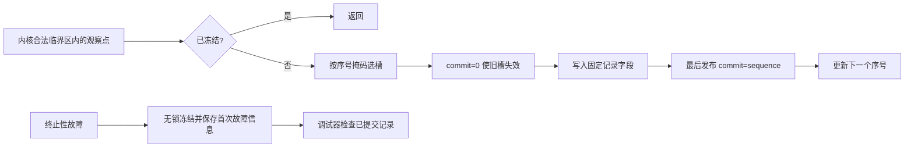
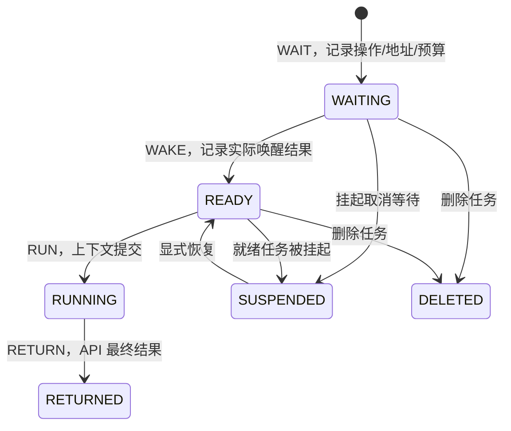

# 有界故障记录与等待原因解释

本模块帮助工程师回答三个不同的问题：任务在等什么；什么事件使它离开等待；
实际 API 最后返回了什么。它只观察内核，不改变调度、资源分配、超时或对象的生命周期。
公共接口在 `RTOS/Core/Inc/rtos_diag.h`，实现为 `RTOS/Services/rtos_diag.c`。

## 配置与成本边界

```c
/* 全部翻译单元必须使用同一份配置。 */
#define RTOS_CONFIG_USE_DIAGNOSTICS (1)
#define RTOS_CONFIG_DIAGNOSTIC_CAPACITY (64U)
```

默认 `RTOS_CONFIG_USE_DIAGNOSTICS=0`。Debug 阶段可按需开启；Release 保持关闭。
不根据 `DEBUG` 宏自动开启，因为 CubeIDE 的某些发布配置也保留该宏。
容量允许 8..1024 的 2 次幂，配置非法时编译失败。开启和关闭均需完整重编译。

| 路径 | 算法成本 | 不执行的工作 |
|---|---|---|
| 编译关闭的内核观察点 | 预处理移除，参数不求值 | 不加锁、不保存诊断状态 |
| 单条事件写入 | O(1)，固定字段写入和提交 | 无堆、无复制业务载荷、无串口、无图遍历 |
| 冻结 / 重置 | O(1) | 不批量清空记录缓冲 |
| 读取一条记录 | O(1)，短临界区复制 | 不解引用历史对象或历史 TCB |
| 冻结信息 / 等待解释 | O(R)，R 为记录容量 | 不在一个长临界区中扫描整个缓冲 |

在 Cortex-M4 的 32 位布局中，记录为 36 字节，提交标志为 4 字节，每槽共 40 字节。
默认 64 槽的记录区为 2560 字节，另有少量模块状态；不增加 TCB 字段或修改 PendSV 栈帧。
开启后，每次调度及阻塞/唤醒都会增加记录工作，不能称为零开销。
实际业务基准和资源差值以本轮验证报告为准。

完整默认模块预算为 **2604 字节**（2560 字节记录区 + 44 字节状态）。
本工程日常固件开启后的 `data+bss` 为 128676 字节，关闭时为 126080 字节；
链接时未使用的查询状态可继续裁剪，所以整机差值为 2596 字节。
容量 1024 是模块允许的配置，不代表完整 F446 日常应用有足够 RAM 同时启用它。

O2 下高频阻塞交换的实测耗时增加 46.14%–70.87%；O3 增加 52.61%–71.16%。
这是包括任务切换、记录和观察锁的完整交换成本，不能当作单条记录或整机 WCET。
当前版本适合 Debug 定位问题；发布时应编译关闭。冻结一个仍然编译开启的记录器，
仍保留观察调用成本，不能等同于编译关闭。全部样本见[本轮验证报告](rtos_diagnostics_validation_20261027.md)。

模块关闭时，公共 API 返回 `RTOS_ERR_DISABLED`，不写输出参数。只要应用不主动调用
这些关闭后的存根，链接器即可删除全部诊断函数；内核自身没有诊断调用和记录缓冲。
原有断言使用 `__LINE__`，插入观察点会改变断言行号常量，因此启用断言的固件二进制
不应仅凭全文件字节不同就判断有额外运行开销。

## 记录与提交协议



正常写者由现有内核临界区或 PendSV 的内核中断屏蔽串行化。每槽使用一个原生 32 位
提交字，编译器屏障保证先使旧记录失效、后写字段、最后发布。仅当提交字与记录序号相等，
该槽才可读取。它面向单核内存中的同步异常/中断观察，不是多核或设备总线共享协议。

环满后覆盖最旧事件。冻结信息提供首末序号、有效条数和丢失历史数量 `overwritten`；
故障打断写入时另置 `RTOS_DIAG_FLAG_PARTIAL_WRITE`，解释器保守返回证据不足。
即使故障发生在发布元数据前，也依据各槽提交字重建范围，不依赖一个可能更新到一半的
全局头尾计数。

可见时间窗口约为 `R / 每秒事件数`；例如 64 槽、每秒 10000 条事件仅保留约 6.4 ms。
长时间等待的起点可能已经丢失，解释器会明确返回 UNKNOWN。本轮没有为每个 TCB 另存
永久等待状态，因此不能保证对任意久以前开始的等待给出完整解释。可按 RAM 预算增大
容量，并在问题发生点及时冻结，不能靠覆盖后的地址猜测旧等待。

序号采用不回绕的 32 位计数，到 `UINT32_MAX` 后自动冻结并拒绝重新启用。它限制的是
一次启动中的调试记录数量，不影响 RTOS 继续调度。假设每秒 10000 条事件，约 4.97 天
后会耗尽；实际时长取决于事件率。重置清空的是逻辑历史，不重用序号。
快照会话号同样不回绕，耗尽时拒绝新的 reset，保留现有会话。
内核任务 ID 即将复用时诊断模块永久停止记录，防止不同任务
被错误拼接。重新上电/启动可开始新的记录域。

## 等待模型与解释语义



`RUN` 表示上下文已由调度器提交，不是测得了任务第一条指令开始执行的时间。
未真正切出就被唤醒的当前任务，也会记录恢复运行；不能只观察 PendSV。
记录基准为内核 tick，不能从同一 tick 内的事件算出周期级延迟；事件顺序看序号。
尚未到达 WAKE/RETURN 阶段时，对应 result 字段的零初值不表示已经成功；应先检查 phase/cause。

| 操作 | WAIT 附带的信息 | 唤醒原因解释 |
|---|---|---|
| 信号量 | 对象地址、此次阻塞的 timeout | 令牌唤醒、超时或对象销毁 |
| 队列发送/接收 | 方向、对象地址、此次阻塞预算 | 直传/代办完成、超时或对象销毁 |
| 互斥锁 | 对象地址、入等待时观察到的 owner task ID | 资源唤醒、超时或对象销毁；不是实时 owner 查询 |
| 事件组 | 目标位 mask、ANY/ALL/CLEAR 模式 | 以内部结果判断成功/超时；返回非零 bits 不代表成功 |
| 任务通知 | 接收任务地址及预算 | 通知满足、超时或任务控制操作 |
| 延时 | 此段延时及起始 tick | 延时到期，不归为 IPC 超时 |
| 借用通道 | acquire/receive、地址、剩余预算 | OK 仅为重新检查资源的通知；不代表已经取得块 |

解释结构同时保留 `wake_result`、`return_result` 和 `cause`。
例如通道线程被资源通知唤醒后，因高优先级业务占用 CPU，真正恢复时总预算已耗尽：
`cause=RETRY_NOTIFICATION`、`wake_result=RTOS_OK`、`return_result=RTOS_ERR_TIMEOUT`
是合法结果，不应归为数据丢失或错误唤醒。

挂起正在等待的任务会取消其等待；`TASK_SUSPENDED` 与对象销毁的 `OBJECT_DELETED`
分别记录，即使现有内核 API 都使用 `RTOS_ERR_DELETED` 返回，也不会将二者解释成同一原因。
删除任务不会伪造一个实际上没有发生的 API 返回事件。

一次 `WAIT` 的序号就是该次等待 episode。重试重新入链会开始新 episode，解释器只解释
最近可见的一次阻塞，不把队列重试预算改造成通道的总预算。普通无等待 API 调用
不会结束一个历史等待 episode，中断的即时调用也不会假冒被打断任务的返回。

## 冻结、读取与证据不足

```c
rtos_diag_info_t info;
rtos_diag_explanation_t explanation;

if (rtos_diag_freeze(RTOS_DIAG_TRIGGER_USER) == RTOS_OK &&
    rtos_diag_get_info(&info) == RTOS_OK) {
    /* task_id 来自一个已知任务；冻结后分析不再产生新记录。 */
    if (rtos_diag_explain(info.session, target_task_id, &explanation) == RTOS_OK &&
        (explanation.flags & RTOS_DIAG_FLAG_INCOMPLETE) == 0U) {
        /* 按 operation、phase、cause 和两个 result 展示给工程师。 */
    }
}
```

`get_info`、`read`、`explain` 只允许线程调用，未冻结时返回 `RTOS_ERR_BUSY`。
`read(session, sequence, &record)` 复制单条已提交记录。旧会话、已经覆盖或未提交的序号
返回 `RTOS_ERR_STALE`，出错不改输出。冻结是幂等的，首次触发原因保留。
`reset` 开始新会话，立即使旧会话和此前所有逻辑记录失效；它不是内存擦除接口。

查询使用调用任务自己的栈。最终严格编译显示，已知 `explain → get_info → copy`
调用链在 O0/O2 下分别约 376/304 字节，尚不包含业务函数、格式化输出和异常现场。
建议独立诊断维护任务从 256 字（1 KiB）起配，并结合实际水印验证；内核允许的最小栈
不能当作任意诊断任务的安全配置。

如果 WAIT 起点已被覆盖、重置发生在任务阻塞期间、提交不完整或转换证据不完整，
返回 `phase=UNKNOWN` 和 `RTOS_DIAG_FLAG_INCOMPLETE`，不猜测任务在等什么。
调用方必须先检查标志。未知 task ID 同样不能仅凭历史地址推导等待原因。

所有快照中的地址只是数值标签，解释器从不解引用。相同地址重建的对象可以出现在
不同 episode 中，但本模块不提供通用对象代次句柄、内存隔离或旧裸指针撤销能力。
它也不从一个等待链直接断言死锁：队列/信号量可能有外部生产者，互斥锁的入等待 owner
也可能已经改变。

## 异常与中断契约

`mark` 和普通 `freeze` 可在线程或合法 syscall IRQ 中调用。中断优先级检查在关闭
断言后仍有效；优先级高于 syscall 阈值的 IRQ、NMI 和 HardFault 不能使用正常 API。

现有 CPU 故障报告入口在保留 CFSR 后调用 `rtos_diag_fault_freeze`。该特殊入口不进入
内核临界区、不访问 TCB/对象、不分配或输出，保留首次故障附加信息并冻结历史。
故障报告仍使用原有 `g_fault` 保存寄存器/PC/帧信息；本模块不复制这套故障引擎。
默认附加故障 PC 为 0，实际 PC 应读取 `g_fault.frame.pc` 并检查 `frame_valid`。

此入口仅供最终停机的故障处理器使用，不能返回被打断的记录写者；NMI 不得调用它。
冻结后的 SRAM 历史通过调试器检查 `diag_slots` 等符号。本轮不提供掉电持久化、自动 Flash
写入、跨复位恢复或保证可用的故障串口。若 SRAM 或 MSP 自身已破坏，软件诊断不能保证完整。

## 验证入口

`hil/diagnostics_20261027/` 保存本功能独立的宿主边界测试、严格编译、串口判据和上板证据。
`diagnostic_checks` 使用真实任务、tick、PendSV 和 IRQ 测等待；`diagnostic_ring` 负责最小
容量的覆盖与旧历史；`diagnostic_bench` 对相同业务工作量比较 ON/OFF；`diagnostic_fault`
故意执行 UDF，验证原故障报告与 SRAM 记录冻结。正常测试与预期致命故障使用不同判据。

测试可以提高具体路径和边界的覆盖率，不能证明所有环境、所有应用误用和未来修改都没有缺陷。
