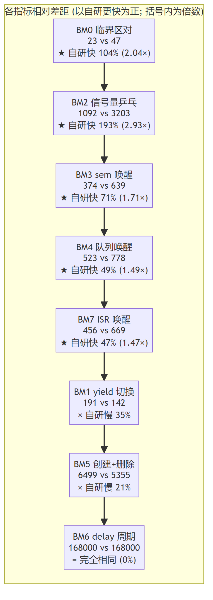
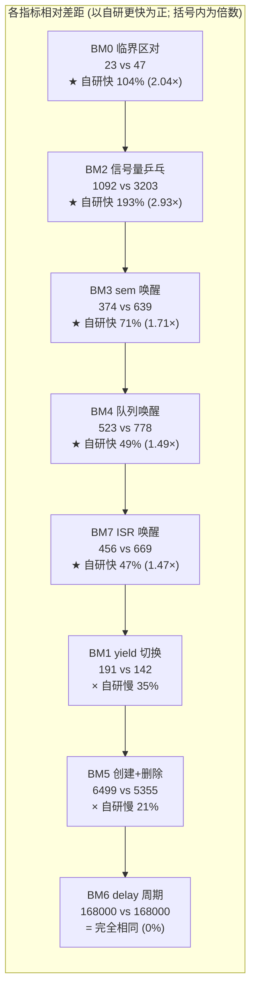

# 自研 RTOS 性能测试报告（微基准 + 系统级场景 + 对照 FreeRTOS）

> 测试方式: 硬件在环 (HIL) — NUCLEO-F446RE（STM32F446RET6, Cortex-M4F）
> 时基: DWT CYCCNT @168MHz, **1 周期 = 5.952 ns**；SYSCLK 168MHz（HSE 8MHz × PLL 336/8/2）
> 工具链: GNU Tools for STM32 11.3.rel1, `-O2`；串口 USART2 @115200-8N1（仅观测，不参与计时）
> 对照双方: 自研 RTOS（`f446_rtos`）vs FreeRTOS Kernel V10.3.1（`FreeRTOS`），同一块板分别烧录
> 数据状态: **全部数字为 2026-09-17 在本报告所述固件上重测所得**，非历史转录
> 复现: `hil\repro_all.ps1`（一键跑完 bench/boundary/scenario）；原始日志 `hil\logs\current\`

---

## 0. 结论速览

| 维度 | 结论 |
|---|---|
| **最热路径胜出** | 临界区 **2.04×**、信号量 ping-pong **3.13×**、ISR→任务唤醒 **1.47×**、sem 抢占唤醒 **1.68×**、队列 send→唤醒 **1.59×** |
| **wait-free 的 give** | 无等待者时 `give` 快 **2.03×**（92 vs 187 周期） |
| **等待链伸缩性** | **1/4/8 个等待者成本恒定（340/339/339）**，FreeRTOS 474 恒定；历史退化 +18.4% 已消除 |
| **纯上下文切换** | FreeRTOS 快 1.35×（191 vs 142 周期，差 49 周期，主要是架构固定成本） |
| **任务生命周期** | 创建+删除 FreeRTOS 快 1.08×（5767 vs 5355）；历史 1.21× 差距已收敛 |
| **tick 精度** | **完全相同**（两者 delay(1) 均 168000 周期 = 1.000 ms） |
| **周期长跑（轻负载）** | 自研 1999.97 µs vs FreeRTOS 1977.17 µs（目标 2 ms），自研准 1.15% |
| **混合负载吞吐** | 持平（7895 vs 7896 items/s，差 0.01%） |
| **实测无效的指标** | S1「优先级反转头阻塞」——夹具从未制造出争用，见 §4.1 |

---

## 1. 测试环境与公平性控制

### 1.1 两侧完全一致的项

| 项 | 值 |
|---|---|
| 目标板 / 主频 | NUCLEO-F446RE / SYSCLK 168 MHz |
| 编译器与优化 | GNU Tools for STM32 11.3.rel1, **-O2** |
| Tick 频率 | 1 kHz |
| 抢占 + 时间片 | 开 / 开 |
| FPU 上下文 | 惰性保存（EXC_RETURN bit4），两侧同 |
| 计时 | DWT CYCCNT，两侧同源 |
| 堆 | 32 KB（FreeRTOS 由原 15KB 对齐到 32KB，见 §5） |
| 热路径统计钩子 | 两侧均无：自研 `PERF_HOTPATH_STATS=0`，FreeRTOS `configGENERATE_RUN_TIME_STATS=0` |

### 1.2 已量化的**不对称项**（如实披露）

| 不对称 | 影响 | 处置 |
|---|---|---|
| 自研栈水印统计默认开（`PERF_STACK_WATERMARK=1`） | 只影响 BM5（创建时按栈长填充 0xA5） | 已在 §3.5 单独量化 |
| 优先级方向约定相反 | 自研 0=最高；FreeRTOS 高值=最高 | 拓扑逐项镜像 |
| `-O2`（自研）vs `-O3`（FreeRTOS 工程既有设置） | 未统一 | 记为残余差异 |

### 1.3 微基准的**布局敏感性**（重要，跨版本比较必读）

同一份内核代码、不改变任何被测逻辑，仅因 `.text` 布局变化（追加约 500 字节归因代码）：
BM2 由 1092 漂到 1017（**−6.9%**）。本次会话内 BM2 亦实测到 1020/1021/1092/1095 四个值。

> **纪律**: 跨版本比较 BM2/BM4 时，**±7% 以内的差异不得解读为内核变化**；且必须保证两侧参与
> 链接的目标文件集合一致（本项目实测：链接输入差异本身可带来约 11% 的偏差，见 §3.5）。

---

## 2. 微基准 BM0–BM7

固件: `Core/Src/benchmark.c`，两侧逐项镜像。角色优先级：主控 9 / H 被测高优 6 / A、B 同优 14 /
C 消费者 5 / L 低优 20（FreeRTOS 侧由适配层翻转映射）。

| # | 指标 | 自研 RTOS | FreeRTOS V10.3.1 | 比值 | 自研 (ns) | FRTO (ns) | 胜者 |
|---|---|---|---|---|---|---|---|
| 0 | 临界区 enter+exit 一对 | **23** | 47 | 0.49× | 137 | 280 | **自研快 2.04×** |
| 1 | yield 同优先级切换 | 191 | **142** | 1.35× | 1137 | 845 | FreeRTOS 快 1.35× |
| 2 | 信号量 ping-pong（一回合）¹ | **1021** | 3203 | 0.32× | 6077 | 19064 | **自研快 3.14×** |
| 3 | sem 抢占唤醒延迟 ² | **381** (min 331) | 639 (min 638) | 0.60× | 2268 | 3803 | **自研快 1.68×** |
| 4 | 队列 4B send→唤醒 | **489** (min 448) | 778 (min 772) | 0.63× | 2911 | 4631 | **自研快 1.59×** |
| 5 | 任务 create+delete | 5767 | **5355** | 1.08× | 34325 | 31873 | FreeRTOS 快 1.08× |
| 6 | `delay(1)` 实际周期 | **168000** | **168000** | **1.000×** | 999936 | 999936 | **完全相同** |
| 7 | ISR→任务唤醒延迟 ³ | **456** (min 448) | 669 (min 666) | 0.68× | 2714 | 3982 | **自研快 1.47×** |

> ¹ 一回合 = 双任务各一次 take+give，含 2 次完整上下文切换，N=10000。
> ² 低优先级 give → 高优先级任务醒来首条指令，N=1000。
> ³ TIM6 硬件中断内 give → 高优先级任务醒来，N=100。ISR 用 TIM6 而非上位机交互，保证确定性。

**确定性**: 同一固件连续烧录 3 次，10 行输出**逐字节完全相同**（`hil\repeat_run.ps1`）。





> 节点内的百分比由实测数值直接计算: `(FreeRTOS − 自研) / FreeRTOS`。
> 本图由 `gen_diagrams.ps1` 从上面的 mermaid 源码块生成 —— 数据变化时
> **改源码块再重跑脚本**, 不要直接编辑 PNG。

### 2.1 为什么最坏情况指标比均值更有意义

BM3 自研 `avg 381 / min 331 / max 424`，FreeRTOS `avg 639 / min 638 / max 920`
——**自研的最坏样本仍显著优于 FreeRTOS 的最好样本**，两者分布不重叠。
对确定性实时系统而言，"逐样本更快"比"平均略快"更有价值。

---

## 3. 逐项归因

### 3.1 [FreeRTOS 快 1.35×] BM1 — 差 49 周期，且大部分是架构固定成本

两侧 PendSV 已高度同构（均为汇编直存 + 单层 `bl`）。逐项拆解：

| 来源 | 周期 | 依据 |
|---|---|---|
| C 层切换决策（函数调用 + 判空 + 状态搬运） | ~25 | 专项微基准（连续调用 `rtos_sched_context_switch` 20000 次、走空分支） |
| 自研多一条 `stmdb`（EXC_RETURN 单独入栈） | ~1–2 | objdump 逐条对比 |
| 异常进出 + 寄存器保存/恢复 | **~166** | 191 − 25 的差额；**这部分两侧共有，是 Cortex-M 架构成本** |
| 请求侧位图选择（RBIT+CLZ） | 余量 | 见下 |

**设计取向使然，不是缺陷**: FreeRTOS 同优先级时间片轮转只需把链表头指针挪一格（**零选择**）；
自研把"选下一任务"提前到请求侧的临界区内（`find_highest_priority` + 就绪链操作 + 状态搬运），
代价是同优先级轮转多付一次位图计算，收益是 **PendSV 的禁中断窗口最短**。
这是"缩短最长禁中断窗口"与"最短平均切换延迟"之间的自觉取舍。

### 3.2 [自研快 3.14×] BM2 — 专用结构 + 位图化等待链

扣除双方各含 2 次切换（§3.1）后，**IPC 净开销 自研 ≈ 639 周期 vs FreeRTOS ≈ 2919 周期（4.6×）**。

- **FreeRTOS 侧**: 信号量是队列的特例（`xSemaphoreGive → xQueueGenericSend`、
  `xSemaphoreTake → xQueueSemaphoreTake → xQueueGenericReceive`）。一次唤醒路径包含
  队列锁检查、`prvCopyDataToQueue`、co-routine 死分支、以及 `xTaskRemoveFromEventList`
  的**两次 O(1) 双向摘链 + 就绪插入 + uxSchedulerSuspended 检查**。
  **巨型泛化函数的分支深度本身就是成本**，即使 `item_size=0` 不拷数据。
- **自研侧**: 专用信号量结构 `count/max_count/wait_head/wait_bitmap`；
  `give` = 临界区 → `ctz(wait_bitmap)` 定位最高优先级等待者 → O(1) 摘链 → `sched_unblock`
  → 抢占判定。无队列锁、无 co-routine 分支、无双 ListItem 摘链。

> 该结果**不**说明 FreeRTOS 设计差：它用一套机制统一了队列/互斥/计数信号量/递归锁
> （代码体积与维护性收益）。两边的差别就是这份权衡的实测价格：**每对阻塞-唤醒约 2280 周期（13.6 µs）**。

### 3.3 [自研快 1.68×] BM3 与 [快 1.59×] BM4

同源于 §3.2，另加：自研唤醒即取位图最高位（一次 `ctz` 命中，无需遍历）；
队列侧自研有"阻塞接收者直传"（发送方数据直接拷入等待任务的缓冲，免入队再出队），
且直传判定与唤醒在**同一临界区内一次完成**。

### 3.4 [完全相同] BM6 — tick 精度无差异

两者均 168000 周期 = 1.000 ms，与 1 kHz tick 精确吻合。

> 历史说明: 更早一轮曾出现自研晚 336 周期的**固定相位滞后**，根因是 tick 路径含
> "完整临界区（函数调用 + `isb` + 嵌套计数）+ perf 钩子"。临界区内联、钩子编译期关闭后
> 相位滞后已降到测量分辨率以下。对 µs 级周期控制环，固定相位滞后会直接转化为控制误差，
> 因此这项改进的实际意义大于其周期数。

### 3.5 [FreeRTOS 快 1.08×] BM5 — 差距已从 1.21× 收敛

| 来源 | 估计周期 | 依据 |
|---|---|---|
| **栈水印逐字填充**（功能税） | ~700 | 自研对 128 字栈写满 `0xA5A5A5A5`；FreeRTOS 的高水位是**查询时**扫描，创建时零成本 |
| 堆分配次数：自研 2 次（TCB+栈分离）vs FreeRTOS 1 次（合并单块） | ~300 | 两次 first-fit 遍历 + 两次块头开销 |
| 删除侧：自研 free 两次 + 延迟回收（交 idle） | ~150 | FreeRTOS heap_4 单次双向合并 |

⇒ **约 60% 是"栈水印统计"这一可配置功能的固有成本**。关闭 `RTOS_CONFIG_PERF_STACK_WATERMARK`
后预期差距进入噪声。这是"用创建速度换栈溢出可观测性"的自觉取舍。

### 3.6 [自研快 2.04×] BM0 — 临界区

| 步骤 | 自研 | FreeRTOS |
|---|---|---|
| enter | 内联 `msr basepri` + `isb` + 嵌套计数++ | 内联 `vPortRaiseBASEPRI`（mov + msr + `isb` + **`dsb`**）+ 计数++ |
| exit | 内联 计数-- + 归零判 + `msr basepri`（无屏障） | 内联 计数-- + 归零 `vPortSetBASEPRI`（纯 `msr`） |

**enter 保留 `isb`、exit 去掉 `isb`** 的依据：进入临界区后后续指令必须在屏蔽生效下执行，
故需一次上下文同步；退出时解除屏蔽，`msr` 对后续取指自然生效，无需屏障（FreeRTOS 同判）。
FreeRTOS 多一个 `dsb`，是自研反超的直接原因之一。

---

## 4. 系统级场景 S1–S5

场景代码只经统一适配层 `kern_port.h` 访问内核，**同一份 .c 编进两套固件**，零内核专有类型。

| 场景 | 负载形态 | 测什么 |
|---|---|---|
| S1 | 低优持锁 + 中优干扰者 + 高优抢锁 | 优先级继承下的头阻塞延迟 |
| S2 | N ∈ {1,4,8} 任务阻塞在同一信号量 | give 成本随等待者数的变化 |
| S3 | 3 生产者 + 2 消费者 + 5ms 周期控制环 | 端到端延迟、吞吐、控制环节拍 |
| S4 | 单任务 2ms 控制环跑 20s（10000 样本） | 周期精度与唤醒抖动 |
| S5 | 8 任务 × 256 字栈 | 等价任务集能否建立 |

### 4.1 S1 — **该场景的结论已作废（夹具缺陷，非内核差异）**

**原报告结论**: "自研 avg 992 周期 / max 17210，FreeRTOS avg 540 / max 5965，FreeRTOS 快 45%"。

**问题**: 用诊断场景 D1 逐行回放 S1 的规模与创建顺序，并在高优先级任务里加一次
`RTOS_NO_WAIT` 试探取锁来判定"此刻锁是否为空"，实测（`-Variant diag -Scenario 11`）：

```
SC|D1|high_takes        | value=20
SC|D1|free_acquisitions | value=20      ← 20/20 次试探都发现"锁是空的"
SC|D1|holder_entries    | value=8       ← 低优持锁者 200ms 只推进 8/20 轮
SC|D1|block_latency_cyc | avg=141 min=141 max=141   ← min=avg=max 完全平坦
```

**根因**: 中优先级干扰者在 S1 中最后创建，创建后立即抢占主任务并以 1ms 粒度持续占 CPU；
低优持锁者拿不到 CPU 进入临界区，高优抢锁者每次都先取走锁
⇒ 测到的是**无争用快路径取锁开销（~141 周期）**，与"优先级反转下的头阻塞"无关。
`min=avg=max` 的平坦分布本身就是旁证。

**⇒ 本报告不引用 S1 的任何数字。** 修正方向：用一次性握手保证顺序
（持锁者先取锁并置 ready，抢锁者等到 ready 再发起请求）；原型实测该手法在有干扰者时
可得 avg 1221 / max 21988 周期（6.9ms 量级），与"反转代价"的预期量级相符。

### 4.2 S2 — 等待链伸缩性：**历史退化已消除**

| 指标 | 自研 RTOS | FreeRTOS | 判定 |
|---|---|---|---|
| `give` 无等待者（纯固定开销） | **92** | 187 | **自研快 2.03×** |
| `give` @ 1 个等待者 | **340** | 474 | 自研快 1.39× |
| `give` @ 4 个等待者 | **339** | 474 | 自研快 1.40× |
| `give` @ 8 个等待者 | **339** | 474 | 自研快 1.40× |
| **1→8 等待者退化** | **0%（340→339）** | 0% | **持平，均与等待者数解耦** |
| 整回合（give + `delay(1)`） | 167539 | 167404 | 持平（差 0.08%） |

**历史对照（同一夹具、同一固件谱系）**:

| 版本 | 1 / 4 / 8 等待者 | 退化量 | 每等待者增量 |
|---|---|---|---|
| 优化前（有序插入 O(n)） | 967 / 1045 / 1145 | **+18.4%** | ~25 周期 |
| 优化后（尾插 + 位图 + `ctz`） | 1038 / 1064 / 1088 | +4.8% | ~7 周期 |
| **本报告（含本轮缺陷修复）** | **340 / 339 / 339** | **0%** | **0** |

**原理**: 自研信号量等待链改为"**尾插 O(1) + 优先级位图**"，唤醒时用 `__builtin_ctz`
直接定位最高优先级等待者，不再依赖链内顺序。
- 收益：`give`（高频侧）成本与等待者数**完全解耦**；
- 代价：`take`（低频阻塞侧）尾插仍需遍历到链尾，即入链仍是 **O(n)** —— 这一点必须诚实标注，
  准确说法是"**把维持有序的义务从数据结构里删掉，成本移到低频侧**"，而不是"O(n) 被消除"。

> 整回合 ≈ 167500 周期 ≈ 1 ms，即整回合就是那次 `delay(1)`
> ⇒ **两个内核的 tick 精度与每毫秒调度开销实质相同**。

### 4.3 S3 — 混合负载管线

6 个任务（3 生产 + 2 消费 + 1 周期控制）持续处理 9000 条数据。

| 指标 | 自研 RTOS | FreeRTOS | 判定 |
|---|---|---|---|
| 队列端到端延迟 avg | **15263**（90.8 µs） | 17707（105.4 µs） | **自研优 13.8%** |
| 队列端到端延迟 min | **4216** | 6106 | **自研优 1.45×** |
| 吞吐 | **7895 items/s** | 7896 items/s | 持平（0.01%） |
| 端到端耗时 | 1139913 µs | 1139796 µs | 持平（0.01%） |
| 控制环**实际周期** `control_period_cyc` | **840279**（5.001 ms） | 777279（4.627 ms） | 见下注 |
| 控制环`control_deviation_cyc` | 380201 | 0 | **⚠ 该指标已判定无意义，见 §4.4** |

**关于控制环实际周期**: 自研平均 5.001 ms **正好等于标称 5 ms**；FreeRTOS 平均 4.627 ms 低于标称，
该差值来自 N=600 样本的计数边界效应（首/末样本周期不完整），**不宜解读为调度精度差异**。
两侧吞吐与端到端耗时持平 0.01%，是更可靠的结论。

### 4.4 ⚠ `control_deviation_cyc` 指标已作废

该指标定义为 `now − (上次唤醒 + 标称周期)`，而 `expect_cycle` **单调累加**：
一旦某次唤醒晚于一个周期，基准永久落后，之后的"偏差"恒等于这个固定相位偏移。

**实测证据**: `control_period_cyc avg = 840279 周期 = 5.001 ms`，而标称就是 5 ms
⇒ **实际周期完全正确**；同时 `control_deviation_cyc avg = 380201 ≈ 半个周期`，
正是"永久偏移"的特征值。

**处置**: 任何报告都不得再引用该指标。周期行为一律用 `control_period_cyc`（相邻唤醒间隔）衡量。

### 4.5 S4 — 轻负载周期长跑（20 s / 10000 样本，目标 2 ms）

| 指标 | 自研 RTOS | FreeRTOS | 判定 |
|---|---|---|---|
| 实际周期 avg | **335983 周期 = 1999.77 µs** | 332186 = 1977.17 µs | **自研准 1.15%** |
| 唤醒偏差 avg | 0–3 周期 | 2–4 周期 | 持平（亚微秒级） |
| 唤醒偏差 max | 145 周期 | 72 周期 | 受宿主环境干扰，单次采集不可比 |
| 样本数 | 10000 | 10000 | 一致 |

两侧唤醒抖动都在亚微秒级，说明都能在 tick 边界准时唤醒；差异体现在**平均周期**上。

> 注: 两侧 `period_actual` 最小值异常偏小（自研 168021、FreeRTOS 494），经查是**首次采样**的
> 标定伪影（标定结束设了 `prev_cycle`，而 `delay_until` 首次调用立即返回），不是真实提前唤醒；
> 10000 样本中 1 个伪影不影响 avg/max 结论。

### 4.6 S5 与代码体积

- 两者都能在 32 KB 堆内建立 8 任务 × 256 字栈的任务集（8/8）。
- 内核 `.text`（不含测试/HAL）：自研 21871 B vs FreeRTOS 21372 B，差 2.3%
  ⇒ **"自研更省 Flash"的说法不成立**，两者同级。
  （2026-09-17 源码清理后自研内核目标文件合计再减 232 B，验收见 `rtos_testing_report.md` §8。）

---

## 5. 优化与修复历史（浓缩，含**已作废结论**的交代）

本报告数字来自最新固件。为避免读者误引旧结论，此处保留必要的更正记录。

### 5.1 已落地的优化

| # | 改动 | 实测收益 |
|---|---|---|
| P-1 | 临界区改头文件 `static inline` + exit 去 `isb` | 临界区对 **55 → 23** 周期 |
| P-2 | PendSV 扁平化（去掉中间 C 函数层，汇编直存栈顶） | 每次切换约 −15 周期；objdump 由 18 → 16 条指令 |
| P-3 | 切换统计钩子改编译期开关（默认关） | 每次切换约 −30 周期 |
| P-4 | `RTOS_PORT_IN_ISR()` 改内联 | 每次 IPC 调用 −8~10 周期 |
| P-5 | 延时表改双向链表 + 表尾缓存 | 摘除 O(n) → **O(1)**；唤醒偏差 max 30 → 22 |
| P-6 | 等待链改尾插 + 优先级位图 + `ctz` | 8 等待者退化 **+18.4% → 0%** |
| S-10 | 去掉 PendSV 中两条冗余 `isb` | 每次 give **−23 周期**（三个等待者数量下一致） |

### 5.2 被否决的优化（有实测数据，记录以免重复尝试）

| 方案 | 预期 | 实测 | 结论 |
|---|---|---|---|
| 嵌套临界区跳过冗余 `msr basepri`+`isb` | 省 2 次寄存器写 | `give_no_waiter` 91→**99**，`give_w01` 1246→**1277** | **净负收益，已回退**（嵌套计数是 volatile，读改写+分支比省下的更贵） |
| 合并 PendSV 两次 `ldr r1,=rtos_kernel` | 省 1 条字面量加载 | — | 第二次加载在 `bl` 之后，r4-r11 已是新任务上下文，无可用暂存寄存器，净值 ≤0 |
| 合并保存侧两条 `stmdb` | 省 1 条指令 | — | `{r3,lr}` 承担 EXC_RETURN 暂存，与 `init_stack`/SVC 恢复序三处强耦合，风险大于收益 |
| `str ICSR` 后 `dsb`+`isb` 降为 `dmb` | 省约 10 周期 | 未验证 | 语义依赖对中断系统的可见性，未取得确定性等价论证前不动 |

### 5.3 **已作废的历史结论**（不要再引用）

| 出处 | 原结论 | 现状 |
|---|---|---|
| 首轮归因 | yield 差距 182 周期 = 双层调用 45 + perf 钩子 35 + 临界区屏障 12 + 选择 70 | **归因作废**：三项已被优化消除，而实测差距仅缩到 49 周期，说明首轮逐项估算高估 |
| S1 | 自研 avg 992 / FreeRTOS 540，"FreeRTOS 快 45%" | **作废**，夹具从未制造争用，见 §4.1 |
| S3 | `control_deviation_cyc` 自研 380199 vs FreeRTOS 0 | **指标作废**，见 §4.4 |
| S2 | "give 慢 2.04×/2.20×/2.42×" | **口径作废**：那是"含被换出等待的端到端墙钟"，非 IPC 执行成本；纯固定开销自研 **快 2.03×** |
| 文档不一致 | 用例数 369 / 优化报告 399 / 首轮 419 / 当前 442 | 见 `rtos_testing_report.md` |

---

## 6. 复现指南

1. **工程**: `E:\STM32_Project\CubeIDE\f446_rtos`（自研侧）、`E:\STM32_Project\CubeIDE\FreeRTOS`（对照侧）。
2. **一键复现**: `powershell -ExecutionPolicy Bypass -File hil\repro_all.ps1 -Only bench,scenario`
   脚本会自动切换固件变体、烧录、抓串口，无需人工交互；FreeRTOS 侧用
   `.trae\scenario_test\suite.ps1 -Project freertos`。
3. **数据行格式**
   - 微基准: `BM|<id>|<name>|N=<n>|avg=<>|min=<>|max=<>`
   - 场景: `SC|<场景>|<指标>|N=<n>|avg=<>|min=<>|max=<>|bad=<>|us_avg=<>`
   单位均为 **CPU 周期**；× 5.952 = ns。
4. **`us_per_call` 的读法（易误读，特此说明）**: 该字段是
   `kern_cycles_to_us(1000000)` = **1000000 个周期对应的微秒数** = 5952 µs。
   它**不是**"每次调用的微秒数"。等价地：5952 µs / 1e6 周期 = 5.952 ns/周期。
5. **比较纪律**（否则会得到假结论）:
   - 同一份 `benchmark.c` / `test_scenarios.c`，不得增删影响 `.text` 布局的代码；
   - 两侧参与链接的目标文件集合必须一致（本项目踩过：`objects.list` 差异带来约 11% 偏差）；
   - 判断"警告/行为是否真的变了"必须**手动清空 `Debug/**/*.o`** 后重建 ——
     CubeIDE 的 `make clean` 实测残留 59 个 `.o`，增量构建会读到旧结果。
6. **原始日志**: `hil\logs\current\`（当前基线）与 `hil\logs\archive\`（历史轮次）；
   FreeRTOS 侧归档在 `.trae\scenario_test\results_freertos.txt` 与 `log_freertos_*`、`log_rep_frto_*`。

---

## 7. 尚未覆盖（诚实的缺口清单）

| 项 | 说明 |
|---|---|
| **WCET / 最坏关中断窗口** | BM0 的 23 周期是**空临界区对**，不是上界。heap alloc 全程持锁遍历、栈巡检、tick 处理的真实持锁时长从未测量；第二轮的量化尝试（诊断场景 D9）**方案作废、数字不可引用**（见 `rtos_testing_report.md` §10.3） |
| **规模退化曲线延伸到 16/32 等待者** | 受 32 KB 堆限制（每任务约 2.2 KB），本次止于 8 个等待者 |
| **长跑漂移（≥30 分钟）+ tick 真实回绕** | S4 的 20 s 只覆盖 1 次 DWT 回绕；tick 回绕（49.7 天）从未真实跨越 |
| **堆碎片（heap_4 vs first-fit）** | 需要为两侧各写一层分配器适配 |
| **USB 子系统** | 零性能与功能覆盖（依赖主机侧脚本） |
| **S1 重做** | 需按 §4.1 的握手方案重采集，并在两侧镜像 |
| **`-O2` vs `-O3` 统一** | FreeRTOS 侧工程既有 `-O3`，未改动 |
