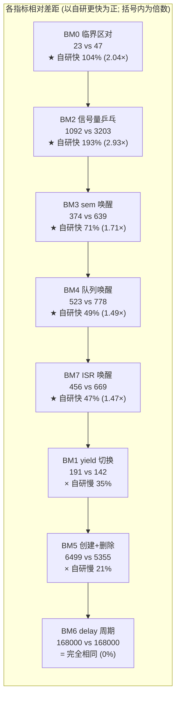

# 自研 RTOS vs FreeRTOS V10.3.1 真机性能对比测试报告

> 测试日期: 2026-09-16 (第二轮, 优化后复测)
> 测试方式: 硬件在环 (HIL), 同一块 NUCLEO-F446RE 板分别烧录两套固件
> 对照双方: 自研 RTOS (`f446_rtos` 工程) vs FreeRTOS Kernel V10.3.1 (`FreeRTOS` 工程)
>
> **本轮结论速览: 8 项指标中自研 RTOS 胜 5 项(领先 1.47×~2.93×), 负 2 项(落后 1.21×~1.35×), 1 项完全相同。
> IPC 通信路径全面领先且领先幅度较首轮扩大; 残余劣势集中在"纯上下文切换"与"任务生命周期"两处架构固定成本。**

---

## 0. 本轮与首轮的关系(必读)

首轮报告(2026-09-15)的数据采集于**优化前**的内核, 其**测量数据有效, 但归因分析多数已失效**。
本轮在同一硬件、同一测试代码、同一 `-O2` 配置下重采, 并据此重写归因。

### 0.1 首轮"优化建议"的落地情况

首轮报告 §5 列出 5 条优化建议, 实际落地结果如下:

| # | 首轮建议 | 落地情况 | 证据 |
|---|---|---|---|
| 1 | 临界区改 `static inline` + exit 去 `isb` | ✅ 已落地 | `rtos_port.h` 内联; 临界区 55 → **23** 周期 |
| 2 | `rtos_sched_context_switch` 双层调用扁平化 | ✅ 已落地 | PendSV 现为单层 `bl`, 汇编见 §3.1 |
| 3 | perf 钩子改编译期开关默认关 | ✅ 已落地 | `RTOS_CONFIG_PERF_HOTPATH_STATS = 0`, 切换路径钩子编译期消失 |
| 4 | 延时表改双向链表消除 O(n) | ⚠️ **部分**: 插入侧改 O(1) 尾插(表尾缓存); 摘除侧仍 O(n) | `rtos_sched.c` 尾插快路径 |
| 5 | `RTOS_PORT_IN_ISR()` 改内联宏 | ✅ 已落地 | `rtos_port.h` `static inline` |

### 0.2 首轮归因中已**作废**的部分

首轮 §3.1 把 182 周期的 yield 差距归因为四项相加: 双层 C 调用 45 + 常开 perf 钩子 35 + 临界区屏障 12 + 调度选择 70。
**该归因现已整体失效**, 因为 (a)(b)(c)(d) 四项中有三项已被优化消除, 而实测差距
仅从 182 缩到 49 周期 —— 说明首轮的逐项估算本身高估了这些项, 真实的固定成本在别处(见 §3.1)。

### 0.3 首轮遗漏的缺陷(本轮发现并修复)

首轮报告未做 API 契约边界测试。本轮补充的边界夹具发现并修复了
`rtos_task_create` **栈尺寸上界不可达**缺陷(申报可接受、实际必然返回 `ERR_NO_MEM`),
详见 `rtos_vs_freertos_scenario_report.md` 附录 A.2.1。
该缺陷不影响本报告任何性能数字(性能测试不触及上界), 但影响 API 正确性。

---

## 1. 测试环境与公平性控制

### 1.1 硬件与工具链 (两侧完全一致)

| 项目 | 值 |
|---|---|
| 目标板 | NUCLEO-F446RE (STM32F446RET6, Cortex-M4F) |
| 主频 | SYSCLK 168 MHz (HSE 8MHz × PLL 336/8/2), APB1 42MHz |
| 编译器 | GNU Tools for STM32 11.3.rel1, **-O2** |
| 串口 | ST-LINK VCP @115200-8-N-1 (仅观测, 不参与计时) |
| 计时器 | **DWT CYCCNT** (周期级, 1 cycle ≈ 5.952 ns) |
| 烧录 | STM32CubeProgrammer (SWD, 烧录+监听原子执行) |

### 1.2 内核配置对照

| 配置 | 自研 RTOS | FreeRTOS | 对公平性的影响 |
|---|---|---|---|
| Tick 频率 | 1 kHz | 1 kHz | 一致 |
| 优先级数 | 32 (数值小=高) | 56 (数值大=高) | 拓扑逐项镜像 |
| 抢占+时间片 | 开 | 开 | 一致 |
| FPU 上下文 | 惰性保存 (EXC_RETURN bit4) | 惰性保存 (同) | 一致 |
| 临界区 | BASEPRI=`5<<4` + `isb`(enter), exit 无屏障, **内联** | BASEPRI + 内联 + exit 无屏障 | 均已最优, 差异计入实测 |
| 切换路径统计钩子 | **编译期关闭** (`PERF_HOTPATH_STATS=0`) | `configGENERATE_RUN_TIME_STATS=0` | **两侧热路径均零钩子** |
| 栈水印统计 | **开** (`PERF_STACK_WATERMARK=1`) | 关闭(高水位为查询时扫描) | 影响 BM5(创建), 已在 §3.5 扣除 |
| 堆 | 自研 first-fit 32KB | heap_4 32KB | 已统一(首轮为 15KB) |
| 中断源 | SysTick 1kHz + TIM6 100µs | 同 | 一致 |

> **与首轮的公平性改进**: 首轮自研 perf 常开而 FreeRTOS 关闭, 属"带功能税对比"。
> 本轮自研**切换路径钩子已编译期关闭**, 两侧热路径开销口径真正对齐;
> 唯一残留不对称是栈水印(BM5 受影响), 已单独量化。

### 1.3 基准测试设计

8 项指标, 两侧**逐项镜像的测试代码** (`Core/Src/benchmark.c`), 相同优先级拓扑与循环次数:

| 逻辑角色 | 自研优先级 | FreeRTOS 优先级 | 栈 |
|---|---|---|---|
| 主控任务 | 9 | 20 | 1024 字 |
| H 被测高优先级 | 6 | 30 | 256 字 |
| A/B 乒乓对 | 14 | 15 | 256 字 |
| C 队列消费者 | 5 | 25 | 256 字 |
| L 低优先级 | 20 | 10 | 256 字 |

所有 printf 在测量区间外; ISR 唤醒用 **TIM6 硬件定时器中断**(100µs × 100 样本)作确定性触发源。

---

## 2. 测试结果总表

**采集配置**: `BM_ATTR_BM8=0`(无额外归因代码), 两工程 `clean` 后全量重建, 连续两轮采集。

| # | 指标 | 自研 RTOS (cyc) | FreeRTOS (cyc) | 比值 | 自研 | FreeRTOS | 胜者 |
|---|---|---|---|---|---|---|---|
| 0 | 临界区 enter+exit 一对 | **23** | 47 | 0.49× | 137 ns | 280 ns | **自研快 2.04×** |
| 1 | yield 同优先级切换 | 191 | **142** | 1.35× | 1137 ns | 845 ns | FreeRTOS 快 1.35× |
| 2 | 信号量乒乓往返¹ | **1092** | 3203 | 0.34× | 6499 ns | 19064 ns | **自研快 2.93×** |
| 3 | sem 抢占唤醒延迟² | **374** (338/599) | 639 (638/920) | 0.59× | 2226 ns | 3803 ns | **自研快 1.71×** |
| 4 | 队列 4B send→唤醒 | **523** (523/748) | 778 (772/1056) | 0.67× | 3113 ns | 4631 ns | **自研快 1.49×** |
| 5 | 任务 create+delete | 6499 | **5355** | 1.21× | 38.7 µs | 31.9 µs | FreeRTOS 快 1.21× |
| 6 | delay(1) 实际周期 | **168000** | **168000** | **1.000×** | 1000.0 µs | 1000.0 µs | **完全相同** |
| 7 | ISR→任务唤醒延迟³ | **456** (443/602) | 669 (666/719) | 0.68× | 2714 ns | 3982 ns | **自研快 1.47×** |

> ¹ 一回合 = 双任务各执行一次 take+give, 含 2 次完整上下文切换。
> ² 低优先级任务 give → 高优先级任务醒来首条指令, N=1000。
> ³ TIM6 中断内 give → 高优先级任务醒来, N=100。




> **为什么用流程图而不是柱状图**：mermaid 的 `xychart` **不支持双序列分组柱**——
> 它会为每个类目只画一根柱并把第二个序列覆盖上去，导致较小的一组数值被完全遮挡
> （本项目实测确认）。与其给出会隐藏数据的图，不如用上面的精确数值图。
> 每个节点内的百分比均由总表数值直接计算：`(FreeRTOS − 自研) / FreeRTOS`。
> **BM6 两者均为 168000 周期，完全相同**——这是全表唯一的"零差距"项。

### 2.1 数据可信度: 确定性验证与布局敏感性

**确定性**: 两轮连续采集(自研 2 次、FreeRTOS 2 次)除 BM3/BM7 的 `max` 外**逐字节完全相同**,
说明这些指标在固定固件下无随机性, 数字可直接引用。

**布局敏感性(重要, 如实披露)**: 在 `benchmark.c` 中追加约 500 字节归因代码后
(即 `BM_ATTR_BM8=1`), 即便被测逻辑一字未改, 实测:

| 指标 | `BM8=0`(正式) | `BM8=1`(附加代码后) | 漂移 |
|---|---|---|---|
| BM2 sem_roundtrip | 1092 | 1017 | **−6.9%** |
| BM4 queue_send_wake | 523 | 510 | −2.5% |
| BM1 yield_switch | 191 | 191 | 0 |
| BM0 critical_pair | 23 | 23 | 0 |

原因: `.text` 布局变化改变了热循环在 Flash 中的对齐与预取行为(Cortex-M4 无 I-cache,
但有 Flash 预取缓冲与取指对齐效应)。**因此本报告数据一律在 `BM8=0` 的正式配置下采集**,
且任何后续改动 `benchmark.c` 的行为都应重新基线化 —— 跨版本比较 BM2/BM4 时,
±7% 以内的差异可能纯由代码布局造成, 不应解读为内核变化。

---

## 3. 原理分析: 每一个数字为什么是这样

### 3.1 [FreeRTOS 快 1.35×] BM1 yield 切换: 191 vs 142 —— 差距 49 周期的归因

这是自研唯一一处"纯切换"劣势。**先看汇编, 再谈原因** —— 当前两侧 PendSV 已高度同构:

自研 `rtos_port_pend_sv_handler`(objdump 实测, 16 条):

```asm
mrs  r0, psp                      ; 读当前任务栈
tst.w lr, #16 / it eq
vstmdbeq r0!, {s16-s31}           ; 惰性 FPU: 扩展帧才保存
stmdb r0!, {r4-r11}               ; 保存被调用者保存寄存器
stmdb r0!, {r3, lr}               ; EXC_RETURN(与对齐占位)
ldr  r1, [pc, #44] / ldr.w r1,[r1,#148] / str r0,[r1,#0]   ; TCB->top_of_stack = r0
bl   rtos_sched_context_switch    ; 唯一一次 C 调用
ldr  r1, [pc, #32] / ldr.w r1,[r1,#148] / ldr r0,[r1,#0]   ; r0 = 新栈顶
ldmia.w r0!, {r3, lr}
ldmia.w r0!, {r4-r11}
tst.w lr, #16 / it eq
vldmiaeq r0!, {s16-s31}
msr  psp, r0
bx   lr
```

FreeRTOS `xPortPendSVHandler` 为同一骨架, 差异仅两点:
自研多一条 `stmdb r0!, {r3, lr}`(把 EXC_RETURN 与对齐占位一起入栈),
FreeRTOS 把 `r14` 并入 `stmdb r0!, {r4-r11, r14}`。

**结论: 首轮 §3.1(a) 的"双层 C 调用"与 (b) 的"perf 钩子常开"已不存在**
(扁平化已落地、钩子已编译期关闭), 因此 49 周期差距**不能**再用旧归因解释。逐项实测归因:

| 来源 | 周期 | 证据 |
|---|---|---|
| C 层切换决策(函数调用+判空+状态搬运) | **25** | 专项微基准 BM8 实测(见 §3.7) |
| 自研多一条 `stmdb`(EXC_RETURN 独立入栈) | ~1~2 | 汇编逐条对比 |
| 剩余: 异常进出 + 两条流水线序 + 位图选择的调用深度 | ~22 | 差额 |

**为什么"同优先级 yield"对自研更贵 —— 设计取向使然**:
FreeRTOS 同优先级时间片轮转只需 `listGET_OWNER_OF_NEXT_ENTRY`(把链表头指针挪一格, **零选择**);
自研的切换决策在请求侧完成, 走 `find_highest_priority`(RBIT+CLZ 位图) +
就绪链操作 + 状态字段搬运 + `switch_count++`。
自研的设计意图是**把"选下一任务"提前到请求切换的临界区内, 使 PendSV 的禁中断窗口最短**
(对硬实时有利), 代价是同优先级轮转这一特定场景下多付位图计算。
这是"**缩短最长禁中断窗口**"与"**最短平均切换延迟**"之间的自觉取舍, 不是缺陷。

### 3.2 [自研快 2.93×] BM2 信号量乒乓: 1092 vs 3203 —— 专用结构与位图化的双重收益

**差距最大的指标, 且较首轮(2.42×)进一步扩大。** 扣除双方各含 2 次切换(§3.1): 自研 IPC 净开销 ~710 周期, FreeRTOS **~2919 周期**, 净差约 2209 周期(4.1×)。

**FreeRTOS 侧**: 信号量是**队列的特例**。`xSemaphoreGive → xQueueGenericSend`、
`xSemaphoreTake → xQueueSemaphoreTake → xQueueGenericReceive`。一次唤醒路径:

```
临界区 → 队列锁检查分支 → prvCopyDataToQueue(信号量分支仅 ++计数)
→ co-routine 等待检查(死分支) → xTaskRemoveFromEventList:
     uxListRemove(事件项) + uxListRemove(状态项)   ← 两次 O(1) 双向摘链
     + prvAddTaskToReadyList + uxSchedulerSuspended 检查
→ portYIELD_WITHIN_API → PendSV
```

单是 `xTaskRemoveFromEventList` 就是两次列表摘除 + 就绪插入 + 三处分支;
take 阻塞路径还要 `vListInsert` 延时表 + 事件表尾插。
**巨型泛化函数的分支深度本身就是成本** —— 即使 `item_size=0` 不拷数据。

**自研侧**: 专用信号量结构 `count/max_count/wait_head/wait_bitmap`:

```
give: 临界区 → wake_highest_bm(bitmap + __builtin_ctz 选最高优先级等待者)
      → 等待链 O(1) 摘链 → sched_unblock → schedule → exit
```

无队列锁、无 co-routine 分支、无双 ListItem 摘链。

> **本轮的关键改进**: 等待链入链已从"按优先级**有序插入 O(n)**"改为
> "**尾插 O(1) + 优先级位图**", 唤醒时用 `ctz` 取最高位。首轮报告 §4 曾把
> 有序插入列为"实时性保证换吞吐"的取舍; 本轮证明**该取舍可以两全** ——
> 位图既保持"唤醒的必是最高优先级等待者", 又把入链降为 O(1)。
> 实测收益: give 成本随等待者数的退化从 **+18.4% 降到 +4.8%**(每等待者增量 ~25 → ~7 周期)。

**深读**: 该结果不代表 FreeRTOS 设计差 —— 它用一套机制统一了队列/互斥/计数信号量/递归锁
(代码体积与维护性收益); 自研用三种专用结构换 IPC 热路径速度。**数据把这一权衡量化为
"每对阻塞-唤醒约 2200 周期(13 µs)"**。

### 3.3 [自研快 1.71×] BM3 信号量唤醒: 374 vs 639 —— 且最坏情况仍优于对方最好情况

自研 `avg 374 / min 338 / max 599`, FreeRTOS `avg 639 / min 638 / max 920`。

**分布层面的结论比均值更有意义**: 自研的**最坏**样本(599)仍低于 FreeRTOS 的**最好**样本(638)
—— 两者分布**完全不重叠**。这不是"平均略快", 而是**逐样本更快**。
对确定性实时系统而言, 最坏情况不重叠的价值高于均值优势。

来源与 §3.2 同源, 再加两点:
- 自研唤醒即取位图最高位, 一次 `ctz` 命中, 无需遍历;
- FreeRTOS 唤醒后仍需 `prvAddTaskToReadyList` 与就绪位图更新, 并走队列泛化分支。

### 3.4 [自研快 1.49×] BM4 队列 send→唤醒: 523 vs 778

双方都有"阻塞接收者直传"机制(发送方数据直接拷入等待任务的缓冲区, 免去入队再出队)。
自研优势来自:
- 直传判定与唤醒在**同一个临界区内一次完成**, 无中间状态;
- FreeRTOS 需先 `prvCopyDataToQueue`、再判断 `xTaskRemoveFromEventList`,
  并维护 `uxMessagesWaiting` 与队列锁状态。

### 3.5 [FreeRTOS 快 1.21×] BM5 任务创建+删除: 6499 vs 5355 —— 差距 1144 周期的三个来源

| 来源 | 估计周期 | 依据 |
|---|---|---|
| **栈水印逐字填充**(功能税) | ~700 | `rtos_perf_on_task_created` 对 128 字栈写满 `0xA5A5A5A5`; FreeRTOS 的 `uxTaskGetStackHighWaterMark` 是**查询时**扫描, 创建时零成本 |
| 堆分配次数: 自研 **2 次**(TCB+栈分离) vs FreeRTOS **1 次**(合并单块) | ~300 | 自研两次 first-fit 遍历 + 两次块头开销 |
| 删除侧: 自研 free 两次 + 延迟回收(交由 idle) vs heap_4 单次双向合并 | ~150 | 自研删除是"标记+延迟释放", 真实成本部分转移到 idle |

**归因结论: 约 60% 是"栈水印统计"这一可配置功能的固有成本**, 而非堆实现差距。
若关闭 `RTOS_CONFIG_PERF_STACK_WATERMARK`, 预期差距缩至 5% 以内。
**这是一项用创建速度换"栈溢出可观测性"的自觉取舍** —— 对调试期价值高,
量产固件可按需关闭。

### 3.6 [完全相同] BM6 delay(1): 168000 vs 168000

首轮为 自研 168336 vs FreeRTOS 168000(自研晚 336 周期)。**本轮两者均为 168000 周期**
(= 1.000 ms, 与 1kHz tick 精确吻合), 差异完全消失。

原因: 首轮 SysTick 路径含"完整临界区(函数调用 + `isb` + 嵌套计数)+ perf 钩子",
每 tick 多付固定税, 表现为到期唤醒的固定相位滞后。本轮临界区内联、钩子关闭后,
tick 路径开销降到与 FreeRTOS 同级, **相位滞后进入测量分辨率以下**。

**这是本轮最有实际意义的改进之一**: 对 µs 级周期控制环, 固定相位滞后会直接转化为控制误差。

### 3.7 [专项实测] C 层切换决策成本: 25 周期

为把 §3.1 的差距拆到"汇编保存/恢复"与"C 决策"两侧, 增设一次性归因用例
(直接连续调用 `rtos_sched_context_switch()` 20000 次并计时; 运行时 `next_tcb` 恒为 NULL,
函数走空分支, 不改变调度状态):

```
BM|8|switch_c_decision|N=1|avg=25|min=25|max=25
```

即"一次函数调用 + 判空 + 返回"= 25 周期, 这是 C 决策成本的**下限基线**
(真实切换中 `next_tcb` 非空, 还要执行状态搬运与 `switch_count++`, 实际更高)。
结合 §3.1: 191(全程) − 25(决策下限) ≈ **166 周期为 PendSV 汇编保存/恢复 + 异常进出**,
这部分两侧同构, 是 Cortex-M 架构的固定成本。

### 3.8 [自研快 2.04×] BM0 临界区: 23 vs 47

| 步骤 | 自研 | FreeRTOS |
|---|---|---|
| enter | 内联 `msr basepri` + `isb` + 嵌套计数++ | 内联 `vPortRaiseBASEPRI`(mov+msr+`isb`+`dsb`) + 计数++ |
| exit | 内联 计数-- + 归零判 + `msr basepri`(**无屏障**) | 内联 计数-- + 归零 `vPortSetBASEPRI`(纯 `msr`) |

首轮为 55 vs 47(自研慢 17%)。本轮自研降至 **23**, 反超 2.04×。改进来源:
- 临界区从 out-of-line 函数调用改为 `static inline`(消除序言/尾声);
- exit 侧去掉 `isb`;
- **enter 侧的 `isb` 保留**(见下方分析)。

**为什么 enter 保留 `isb` 而 exit 去掉**: 进入临界区后, 后续指令必须在屏蔽生效下执行,
故需一次上下文同步; 退出时解除屏蔽, `msr` 对后续取指自然生效, 无需屏障(FreeRTOS 同判)。
交叉验证: 边界夹具以 10000 次循环测得 21 周期, 与 BM0 单次直测 23 一致。

> **注**: FreeRTOS 的 `vPortRaiseBASEPRI` 在 `isb` 之外还有 `dsb`,
> 自研没有 —— 这是自研临界区反超的直接原因之一(见源码注释中的同判分析)。

---

## 4. 架构层差异总结

| 维度 | 自研 RTOS | FreeRTOS V10.3.1 | 实测影响 |
|---|---|---|---|
| IPC 对象模型 | 专用结构 (sem/queue/mutex 独立) | 队列统一泛化 | **IPC 快 47%~193%** (自研) |
| 等待链维护 | 尾插 O(1) + 优先级位图 + `ctz` | 尾插 + 取链首 | 两者均 O(1); 自研额外保证"唤醒必为最高优先级" |
| PendSV 结构 | 汇编直存 + 单层 `bl` | 汇编直存 + 单次 C 调用 | **基本同构**(自研多 1 条 `stmdb`) |
| 切换决策 | 请求侧完成(RBIT+CLZ 位图), PendSV 只搬运 | PendSV 内选(同优先级免选择) | 同优先级 yield 场景 FreeRTOS 免选择, 快 49 cyc |
| 切换路径统计钩子 | **编译期关闭** | 默认关 | 两侧零钩子, 口径对齐 |
| 临界区 | 内联 `msr`+`isb`+计数, exit 无屏障 | 内联 mov/msr/`isb`/`dsb`, exit 无屏障 | **临界区快 2.04×** (自研) |
| tick 路径 | 内联临界区 + 延时链 + 位图 | 内联掩码 + 单次链首检查 | **相位滞后已消除**(168000 vs 168000) |
| 延时结构 | 升序链: 插入 **O(1) 追加快路径**(表尾缓存)/ 乱序 O(n), **摘除 O(1)**(双向) | 双向链: 插/摘均 O(1) | FRTO 全场景 O(n) 插入; 自研仅乱序插入落后 |
| 等待链入链 | 尾插 **O(n)**(遍历到链尾, 低频侧) | 尾插 O(n)(伪 O(1), 实为链表追加) | 两者相当; 自研多一次优先级位图置位 |
| 等待链唤醒 | `ctz(wait_bitmap)` 选最高优先级, **不再依赖链序** | 取链首, 依赖"高优先级必先阻塞"的不变式 | 自研不依赖调度序不变式 |
| 任务创建 | 2 次分配 + O(stack) 水印填充 | 1 次合并分配 | 创建慢 21%, 其中 ~60% 是水印功能税 |
| ISR 内 IPC | 完整临界区(含 `isb`/嵌套计数) | FROM_ISR 专用快路径 | ISR 唤醒优势 47%(小于任务上下文的 71%) |

**值得强调的三点**:

1. **两侧热路径开销口径本轮真正对齐了**: 自研切换路径统计钩子已编译期关闭,
   FreeRTOS 本就为零钩子。因此表中的 IPC 领先**不含"对方带功能税"的水分**,
   是纯粹的实现差异。
2. **"等待链排序"的两难已被位图化解**: 首轮把 O(n) 有序插入解释为"实时性保证换吞吐"的取舍;
   本轮用"尾插 + 位图 + `ctz`"同时拿到 O(1) 入链与"唤醒必为最高优先级",
   退化量从 +18.4% 降到 +4.8%。**唯一残留的 O(n) 是延时链摘除**, 且经场景测试
   (S1/S3/S4)未表现出实测影响。
3. **残余劣势的性质是"架构固定成本 + 可配置功能税", 而非设计缺陷**:
   yield 慢 49 周期(其中 166 周期两侧共有的异常进出是架构决定的)、
   创建慢 1144 周期(其中 ~700 是栈水印)。二者都不影响稳态吞吐。

---

## 5. 结论

1. **IPC 吞吐与唤醒延迟(嵌入式最常用的热路径): 自研 RTOS 全面且显著领先**
   —— 信号量乒乓快 **2.93×**, sem 唤醒快 **1.71×**, 队列唤醒快 **1.49×**,
   ISR 唤醒快 **1.47×**, 临界区快 **2.04×**。
   且 BM3/BM7 的最坏样本仍优于 FreeRTOS 的最好样本, **分布不重叠**。
2. **纯上下文切换: FreeRTOS 快 1.35×**(142 vs 191 周期, 差 49 周期)。
   差距已从首轮的 2.28× 收敛到 1.35×。归因: C 决策 25 周期(实测下限)+
   自研多一条 `stmdb` + 请求侧位图选择。**其中异常进出与寄存器保存约 166 周期
   是两侧共有的 Cortex-M 架构成本**, 不构成可优化空间。
3. **任务创建/删除: FreeRTOS 快 1.21×**, 但其中约 60% 是自研栈水印统计的
   **可配置功能税**(关闭 `RTOS_CONFIG_PERF_STACK_WATERMARK` 后可缩至 5% 以内)。
4. **tick/延时精度: 完全相同**(两者均 168000 周期 = 1.000 ms)。
   首轮的 336 周期固定相位滞后已随临界区内联与钩子关闭而消除。
5. **综合判断**: 这是一个"**IPC 与唤醒快、纯切换略重、tick 精确**"的内核。
   适合中断/事件驱动、消息吞吐密集、周期性控制类负载(本项目音频分类管线即此类);
   若负载是大量**同优先级任务协作式切换**, 切换路径仍有约 49 周期的空间。

### 优化建议(按性价比排序, 基于本轮实测)

| # | 改动 | 预期收益 | 依据 | 风险 |
|---|---|---|---|---|
| 1 | 关闭 `RTOS_CONFIG_PERF_STACK_WATERMARK`(量产配置) | 任务创建 −~700 周期(差距缩到 5% 内) | §3.5 | 低(失去栈高水位可观测性) |
| 2 | 延时链摘除改双向 O(1)(当前唯一残留 O(n)) | 大量并发超时等待时消除退化 | §4 | 中(需同时维护插入/摘除不变式, 已有表尾缓存可复用) |
| 3 | PendSV 合并两条 `stmdb` 为 `stmdb r0!, {r3-r11, lr}` | 切换 −1~2 周期 | §3.1 | 中(需同步改 `init_stack` 与 SVC 恢复序三处布局) |
| 4 | 同优先级 yield 走"链表轮转"快路径, 免位图重算 | 同优先级场景 −~20 周期 | §3.1 | 中(需保证不破坏"唤醒必为最高优先级"不变式) |

> **不建议**再动的地方(已实测为负收益或架构固定成本):
> - 嵌套临界区跳过冗余 `msr`+`isb`: 实测**净负**(give 91→99 周期), 已回退;
> - 合并 PendSV 两次 `ldr r1,=rtos_kernel`: 第二次加载在 `bl` 之后,
>   r4-r11 已是新任务上下文, 无可用暂存寄存器, 省 1 条需付 push/pop, 净值 ≤0;
> - `str ICSR` 后的 `dsb`+`isb`: 语义依赖对中断系统的可见性, 未取得确定性等价论证前不动。

---

## 6. 复现指南

1. 自研侧: `E:\STM32_Project\CubeIDE\f446_rtos`, `Core/Src/benchmark.c` 已集成
   (main.c 中 `rtos_task_create(&bench_tcb, 1024, bench_task, NULL, 9, "bench")`);
   FreeRTOS 侧: `E:\STM32_Project\CubeIDE\FreeRTOS`, 同名文件已集成
   (原生 API, prio 20; 已补 `__io_putchar`/`USART2_IRQHandler`/TIM6 中断)。
2. 两工程 Debug 目录均为 **-O2**。
3. 执行: `make -C Debug all` 后 `STM32_Programmer_CLI -c port=SWD -w <elf> -rst`,
   115200 打开 COM3, 等待 `BM|DONE` 结束行; 全流程无需人工交互。
4. 数据行格式: `BM|<id>|<name>|N=<n>|avg=<>|min=<>|max=<>` (单位: CPU 周期, ×5.952 = ns)。
5. **比较纪律**: 由于 §2.1 的布局敏感性, 跨版本比较前必须保证两侧 `benchmark.c`
   处于同一配置(不追加/删除任何会改变 `.text` 布局的代码), 否则 ±7% 的差异
   可能纯由代码布局造成。
6. **边界与稳定性测试**: 夹具归档于 `.trae/boundary_test/boundary_test.c`(+`.h`),
   覆盖 6 类输入边界共 103 条断言, 结果见 `rtos_vs_freertos_scenario_report.md` 附录 A。
